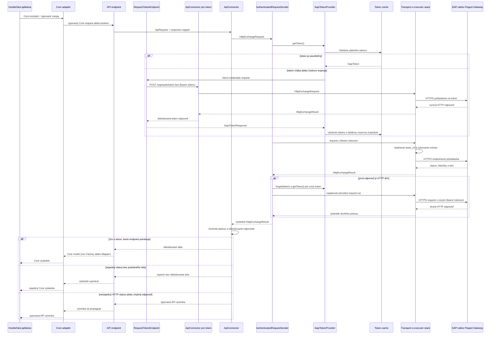

# Prehľad API

Toto je prehľad endpointov zabudovaných v balíku podľa DataHosting [SAPI-SK OpenAPI](https://test-sapisk.datahosting.sk/swagger-ui/index.html?urls.primaryName=SAPI-SK+API#/), [Peppol Gateway v1 OpenAPI](https://test-sapisk.datahosting.sk/swagger-ui/index.html?urls.primaryName=Peppol+Gateway+API+v1) a [Integrator API OpenAPI](https://test-sapisk.datahosting.sk/v3/api-docs/integrator-api). Tento balík cieli na DataHosting API; verejný, poskytovateľsky nezávislý SAPI-SK kontrakt nie je jeho implementačným cieľom. Integrator API používa samostatný klient a integrátorský token.

`docs/eFaktura/api/openapi.json` je lokálny kombinovaný snapshot všetkých troch skupín. V snapshot-e sú SAPI cesty pod `/sapi` a Gateway aj Integrator API cesty pod `/v1`; transport pripája každú cestu ku nakonfigurovanému `base_url`. SAPI a Gateway používajú SAPI Bearer token, kým Integrator API používa `X-Integrator-Token`.

Obsah stránky

- [Tok jedného API volania](#tok-jedného-api-volania)
- [SAPI-SK](#sapi-sk)
- [Peppol Gateway](#peppol-gateway)
- [Integrator API](#integrator-api)
- [Telo požiadaviek a mapovanie odpovedí](#telo-požiadaviek-a-mapovanie-odpovedí)
- [Retry a backpressure](#retry-a-backpressure)
- [Core adaptéry](#core-adaptéry)

Hodnotu `base_url` profilu klienta nastavte na serverovú adresu `servers` z OpenAPI, napríklad `https://test-sapisk.datahosting.sk`. Implementácia odstráni koncové lomky, ale zachová cestovú časť URL a pripojí ju pred cestu každého endpointu. Pri štandardnom nasadení preto použite serverový koreň bez `/sapi`: SAPI endpointy už obsahujú celú cestu `/sapi/...` a Gateway endpointy `/v1/...`. Ak API stojí za reverznou proxy so spoločným prefixom, ten možno uviesť v `base_url` (napríklad `https://api.example.sk/proxy`); výsledné cesty budú `/proxy/sapi/...` a `/proxy/v1/...`. Prefix `/sapi` alebo `/v1` nepoužívajte ako spoločný, pretože by sa pripojil aj k druhej skupine endpointov.

Testovacie OpenAPI uvádzajú server `https://test-sapisk.datahosting.sk`. Nastavte `base_url` na server príslušného prostredia.

## Tok jedného API volania

Nasledujúci diagram zobrazuje tok SAPI a Peppol Gateway volaní od Core kontraktu po typovaný výsledok. Gateway používa token získaný zo SAPI. Integrator API má samostatný klient a transport s hlavičkou `X-Integrator-Token`; jeho endpointy a mapovanie sú uvedené v samostatnej časti nižšie.

Ak endpoint potrebuje telo odpovede, `ApiConnector` dekóduje JSON alebo bezpečne parsuje XML a odovzdá údaje statickej factory (mapperu) endpointu, ktorá z nich vytvorí Core model. Operácia `send()` kontroluje iba HTTP úspech a telo nedekóduje. Neúspešný HTTP status skončí ako `ProviderErrorResponseException`; chybný formát alebo štruktúra úspešnej odpovede ako `InvalidProviderResponseException`. Endpoint vracia Core model (alebo `bool`/`void`) a adaptér ho odovzdá hostiteľovi. Samotné vrstvy, retry a správanie pri `401` rozoberá [HTTP transport a autentifikácia](Transport-and-Authentication.md); mapovanie konkrétnych endpointov pokračuje v tabuľkách tejto stránky.

## SAPI-SK

| Metóda | Cesta | Endpoint trieda | Použitie |
| --- | --- | --- | --- |
| POST | `/sapi/auth/token` | `RequestTokenEndpoint` | OAuth client credentials. |
| GET | `/sapi/auth/token/status` | `GetTokenStatusEndpoint` | Kontrola tokenu / spojenia. |
| POST | `/sapi/document/send` | `SendDocumentEndpoint` | Odoslanie UBL dokumentu. |
| GET | `/sapi/document/receive` | `ListReceivedDocumentsEndpoint` | Stránka doručenej pošty. |
| GET | `/sapi/document/receive/{documentId}` | `GetReceivedDocumentEndpoint` | Stiahnutie prijatého XML. |
| POST | `/sapi/document/receive/{documentId}/acknowledge` | `AcknowledgeReceivedDocumentEndpoint` | Technické potvrdenie príjmu. |

`SapiTokenProvider` získava a cacheuje access token cez DataHosting `/sapi/auth/token`. Po expirácii alebo zneplatnení cache získa nový token cez client credentials. `forget(SapiToken)` maže iba lokálny zamietnutý token (čerstvý token iného workera nechá); DataHosting kontrakt použitý týmto balíkom neobsahuje vzdialené operácie na obnovu ani zrušenie tokenu.

Pri čítaní odpovedí sa neznáme neprázdne statusy, webhook udalosti, režimy Integrator API a hodnoty `payloadFormat` zachovajú v modeloch. Statusové value objecty ponúkajú `isKnown()`; `WebhookEventType` používa `isSupported()`. Hostiteľ má podľa výsledku rozhodnúť, ako novú hodnotu spracovať. Pri odoslaní SAPI iba známy status `ACCEPTED` vyžaduje `receivedAt`. Hodnota OAuth `token_type` sa porovnáva bez ohľadu na veľkosť písmen a normalizuje sa na `Bearer`.

### Požiadavky, odpovede a HTTP statusy SAPI

Všetky SAPI operácie okrem `POST /sapi/auth/token` vyžadujú Bearer token. Odoslanie, príjem a acknowledge vyžadujú aj participant hlavičku podľa tabuľky; token status ju nevyžaduje. Hviezdička označuje povinné pole podľa OpenAPI. Všetky deklarované chybové statusy vracajú `SapiErrorResponseEnvelope` s povinným poľom `error`; jeho `SapiError` vyžaduje `category`, `code`, `message`, `retryable` a `correlation_id`, kým `details` sú voliteľné. OpenAPI používa pri odpovediach podľa operácie `*/*` alebo `application/json`.

| Operácia | Požiadavka | Úspešná odpoveď | HTTP statusy (úspech; chyby) |
| --- | --- | --- | --- |
| OAuth token `POST /sapi/auth/token` | Bez Bearer tokenu. Povinné JSON `SapiTokenRequest`: `client_id*`, `client_secret*`, `grant_type*=client_credentials`; voliteľné `scope`. | `200 (*/*) SapiTokenResponse`: povinné `access_token*`, `token_type*=Bearer`, `expires_in*`; voliteľné `scope`. | `200 (*/*)`; chyby `400, 500 (application/json)`, `401, 403, 423 (*/*)`. `423` znamená dočasne uzamknutý účet. |
| Stav tokenu `GET /sapi/auth/token/status` | Bearer token; bez participant hlavičky, query a request body. | `200 (*/*) SapiTokenStatusResponse`; všetky polia sú voliteľné: `valid`, `token_type=access`, `client_id`, `issued_at`, `expires_at`, `expires_in_seconds`, `should_refresh`, `refresh_recommended_at`. | `200 (*/*)`; chyby `401 (*/*), 500 (application/json)`. |
| Odoslanie `POST /sapi/document/send` | Bearer token, povinné hlavičky `Idempotency-Key` (UUID) a `X-Peppol-Participant-Id`. Povinné JSON `SapiSendDocumentRequest`: `metadata*`, `payload*` (max. 10 MB), `payloadFormat*=XML`; metadáta vyžadujú `documentId`, `documentTypeId`, `processId`, `senderParticipantId`, `receiverParticipantId`, `creationDateTime`. `payloadEncoding` je voliteľné a predvolene UTF-8; voliteľný SHA-256 `checksum` musí byť 64 malých hexadecimálnych znakov. | `202 (*/*) SapiSendDocumentResponse`: povinné `providerDocumentId*`, `status*` (`ACCEPTED` alebo `REJECTED`) a `timestamp*`. OpenAPI opisuje `receivedAt` ako prítomné pri `ACCEPTED`, ale nezaraďuje ho medzi formálne povinné polia schémy. | `202 (*/*)`; chyby `400, 401, 403, 409, 422, 502 (*/*), 500, 503 (application/json)`. `409` je konflikt opakovane použitého idempotency key s iným payloadom; `422` znamená odmietnutie dokumentu Peppol Access Pointom. |
| Zoznam prijatých dokladov `GET /sapi/document/receive` | Bearer token a povinný `X-Peppol-Participant-Id`; voliteľné query `pageToken`, `limit` (1–100, predvolene 20) a `status` (`RECEIVED` alebo `ACKNOWLEDGED`). | `200 (*/*) SapiReceivedDocumentListResponse`: povinné `documents*`; voliteľný `nextPageToken` je reťazec a pri poslednej stránke chýba. | `200 (*/*)`; chyby `400, 500 (application/json), 401, 403 (*/*)`. |
| Detail prijatého dokladu `GET /sapi/document/receive/{documentId}` | Bearer token, path parameter `documentId` a povinný `X-Peppol-Participant-Id`; bez request body. | `200 (*/*) SapiReceivedDocumentDetailResponse`: povinné `metadata*` (`DocumentMetadata`), `payload*` (UTF-8 XML) a `payloadFormat*` (reťazec bez enum obmedzenia). | `200 (*/*)`; chyby `400, 500, 502 (application/json), 401, 403, 404 (*/*)`. |
| Technické potvrdenie `POST /sapi/document/receive/{documentId}/acknowledge` | Bearer token, path parameter `documentId` a povinný `X-Peppol-Participant-Id`; bez request body. | `200 (*/*) SapiAcknowledgeResponse`: povinné `documentId*`, `status*` (`RECEIVED` alebo `ACKNOWLEDGED`) a `acknowledgedDateTime*`. | `200 (*/*)`; chyby `400, 500 (application/json), 401, 403, 404 (*/*)`. Operácia je idempotentná. |

Živé OpenAPI uvádza HTTP 429 ako všeobecné mapovanie na kategóriu `TEMPORARY`, no neuvádza ho v odpovediach žiadnej jednotlivej SAPI operácie. Podrobnosti o mapovaní úspešných odpovedí na Core modely sú v nasledujúcej tabuľke.

## Peppol Gateway

| Metóda | Cesta | Endpoint trieda | Použitie |
| --- | --- | --- | --- |
| POST | `/v1/discovery/receives` | `CheckReceivingCapabilityEndpoint` | Zisťuje podporu príjemcu pre proces a typ dokladu. |
| POST | `/v1/validate-document` | `ValidateDocumentEndpoint` | Vzdialená validácia payloadu. |
| POST | `/v1/send-documents` | `SendDocumentsEndpoint` | Dávkové odoslanie dokumentov cez Peppol Gateway s `Idempotency-Key`. |
| GET | `/v1/participants/{participantId}` | `GetParticipantProfileEndpoint` | Profil účastníka. |
| GET | `/v1/sent-documents/{identifier}` | `GetSentDocumentEndpoint` | Stav odoslaného dokumentu. |
| GET | `/v1/sent-documents/{identifier}/message-level-statuses` | `ListMessageLevelStatusesEndpoint` | Zoznam MLS potvrdení. |
| GET | `/v1/sent-documents/{identifier}/message-level-statuses/{statusIdentifier}/content` | `GetMessageLevelStatusContentEndpoint` | Obsah konkrétnej MLS správy. |
| POST | `/v1/webhooks` | `RegisterWebhookEndpoint` | Registrácia webhooku. |
| GET | `/v1/webhooks` | `ListWebhooksEndpoint` | Stránkovaný zoznam webhookov. |
| GET | `/v1/webhooks/{webhookId}` | `GetWebhookEndpoint` | Detail webhooku cez `WebhookRegistryInterface::get()`. |
| PATCH | `/v1/webhooks/{webhookId}` | `UpdateWebhookEndpoint` | Aktualizácia webhooku cez typovaný `WebhookUpdate`; vynechané polia sa nemenia a explicitné hodnoty `null` sa zachovajú v tele požiadavky. |
| DELETE | `/v1/webhooks/{webhookId}` | `DeleteWebhookEndpoint` | Odstránenie webhooku. |

Gateway tabuľka uvádza endpointy implementované vo vrstve Infrastructure a sprístupnené cez Core kontrakty. Integrator API má samostatný klient s vlastným tokenom a neprechádza cez SAPI OAuth autentifikáciu. Aktuálne publikované skupiny neobsahujú `/v1/admin` cesty.

### Požiadavky, odpovede a HTTP statusy Peppol Gateway

Všetky Gateway operácie vyžadujú Bearer token získaný cez SAPI. Hviezdička pri poli označuje povinnosť podľa OpenAPI; neoznačené polia schéma nevyžaduje a typ `string|null` povoľuje `null`. Hlavička `X-Peppol-Participant-Id` je povinná pri participant-scoped operáciách okrem discovery (participant je v tele) a profilu (participant je v ceste). Pri odpovediach v zátvorke je uvedený schema a povinné polia.

| Operácia | Požiadavka | Úspešná odpoveď | HTTP statusy (úspech; chyby) |
| --- | --- | --- | --- |
| Discovery `POST /v1/discovery/receives` | Povinné JSON `DiscoveryReceivesRequest`: `participantId*`, `documentTypeId*`, voliteľné `processId` (`string|null`). | `200 (*/*) DiscoveryReceivesResponse`: povinné `participantId*`, `receives*`; voliteľné `endpoint`, `capability`. | `200`; chyby `400, 401, 500, 502`. |
| Vzdialená validácia `POST /v1/validate-document` | Povinná hlavička participant-a; JSON `SapiSendDocumentRequest` s `metadata*`, `payload*` (max. 10 MB) a `payloadFormat*=XML`. Metadáta vyžadujú `documentId`, `documentTypeId`, `processId`, `senderParticipantId`, `receiverParticipantId`, `creationDateTime`; `payloadEncoding` je voliteľné (predvolené UTF-8) a `checksum` je voliteľný SHA-256 v lowercase hex. | `200 (*/*) ValidateDocumentResponse`; pole `valid` nie je v OpenAPI povinné. | `200`; chyby `400, 401, 403, 500, 502, 503`. Pri `400`, `401`, `403`, `502`, `503` OpenAPI uvádza media type `*/*`; pri `500` `application/json`. |
| Profil participanta `GET /v1/participants/{participantId}` | Povinný path parameter `participantId`; participant hlavička sa neposiela. | `200 (*/*) ParticipantResponse`: povinné `participantId*`, `reachable*`, `capabilities*`; voliteľné nullable `name`. | `200`; chyby `400, 401, 500, 502`. |
| Stav dokumentu `GET /v1/sent-documents/{identifier}` | Povinné `X-Peppol-Participant-Id` a path parameter `identifier`. | `200 (*/*) SentDocumentResponse`; OpenAPI neoznačuje žiadne jeho polia za povinné. `status` povoľuje `RECEIVED_BY_GATEWAY`, `VALIDATING`, `VALIDATION_FAILED`, `QUEUED`, `SENDING_TO_ACCESS_POINT`, `SENT_TO_ACCESS_POINT`, `DELIVERY_FAILED`. | `200`; chyby `400, 401, 403, 404, 500`. |
| Zoznam MLS `GET /v1/sent-documents/{identifier}/message-level-statuses` | Povinné `X-Peppol-Participant-Id` a path parameter `identifier`. | `200 (*/*) MessageLevelStatusListResponse`; `items` nie je v OpenAPI označené za povinné. | `200`; chyby `400, 401, 403, 404, 500`. |
| Obsah MLS `GET /v1/sent-documents/{identifier}/message-level-statuses/{statusIdentifier}/content` | Povinné `X-Peppol-Participant-Id` a path parametre `identifier`, `statusIdentifier`. | `200 application/xml`, telo je XML bez JSON response schema. | `200`; chyby `400, 401, 403, 404, 500, 502`. |
| Zoznam webhookov `GET /v1/webhooks` | Povinná participant hlavička; voliteľné query `pageToken` a celočíselné `limit`. | `200 (*/*) WebhookList`: povinné `webhooks*`; voliteľné nullable `nextPageToken`. Endpoint vracia Core `WebhookRegistryPage` cez `WebhookRegistryPageFactory`. | `200`; chyby `400, 401, 403, 500`. |
| Registrácia webhooku `POST /v1/webhooks` | Povinná participant hlavička; povinné JSON `WebhookCreateRequest` s `url*`, `events*`; nullable `description` je voliteľné. | `201 (*/*) WebhookCreateResponse`: povinné `id*`, `url*`, `events*`, `status*`, `createdAt*`, `updatedAt*`, jednorazové `signingSecret*`; nullable `description` je voliteľné. Endpoint vracia Core `WebhookRegistrationResponse` cez `WebhookRegistrationResponseFactory`. | `201`; chyby `400, 401, 403, 422, 500, 502, 503, 504`. |
| Detail webhooku `GET /v1/webhooks/{webhookId}` | Povinná participant hlavička a path parameter `webhookId`. | `200 (*/*) Webhook`: povinné `id*`, `url*`, `events*`, `status*`, `createdAt*`, `updatedAt*`; nullable `description` je voliteľné. Endpoint vracia Core `Webhook` cez `WebhookFactory`. | `200`; chyby `400, 401, 403, 404, 500`. |
| Úprava webhooku `PATCH /v1/webhooks/{webhookId}` | Povinná participant hlavička a path parameter `webhookId`; povinné JSON telo `WebhookUpdateRequest`. `url`, `events`, `status`, `description` sú voliteľné a nullable; OpenAPI odporúča uviesť aspoň jedno pole, ale žiadne pole nie je v schéme `required`. | `200 (*/*) Webhook` s rovnakými povinnými poľami ako pri detaile. Endpoint vracia Core `Webhook` cez `WebhookFactory`. | `200`; chyby `400, 401, 403, 404, 422, 500, 502, 503, 504`. |
| Odstránenie webhooku `DELETE /v1/webhooks/{webhookId}` | Povinná participant hlavička a path parameter `webhookId`; bez request body. | `204 No Content`, bez tela. | `204`; chyby `400, 401, 403, 404, 500`. |
| Dávkové odoslanie `POST /v1/send-documents` | Povinné hlavičky `X-Peppol-Participant-Id` a `Idempotency-Key` (UUID); povinné JSON `SendDocumentsRequest` s `documents`. Každá položka vyžaduje `type` (`UBL_XML` alebo `SBDH_XML`) a XML `payload` (max. 10 MB); `receiverParticipantId` je povinné pre `UBL_XML` a voliteľné pre `SBDH_XML`. Najviac 100 dokumentov na dávku; konektor pred odoslaním vynucuje konfigurovateľný limit serializovaného tela, predvolene 100 MiB. | OpenAPI `SendDocumentsResponse` obsahuje povinné `count*` a `identifiers*`; endpoint mapuje telo cez `SendDocumentsResultFactory` a vracia Core `SendDocumentsResult` priamo. | `200`; chyby `400, 401, 403, 409, 413, 500`. |

OpenAPI pri uvedených chybových statusoch deklaruje `SapiErrorResponseEnvelope`. Ne-2xx odpoveď vyvolá `ProviderErrorResponseException`; neplatná alebo neúplná 2xx odpoveď vyvolá `InvalidProviderResponseException`. Odpoveď `DELETE` 204 nemá telo. Špecifikácia momentálne neuvádza HTTP 429 pre žiadnu Gateway operáciu. Pri registrácii webhooku provider odošle podpísanú udalosť `webhook.test` a registráciu vytvorí iba po HTTP 2xx; pri zmene URL cez PATCH vykoná rovnaký test.

Živá schéma `DiscoveryReceivesResponse.capability` súčasne deklaruje `type: null` a odkaz na `ParticipantCapability`; lokálny snapshot túto nekonzistentnosť normalizuje na alternatívu objektu alebo `null`. Vzdialená validácia má podľa schémy voliteľné pole `valid`, no `PeppolGatewayDocumentValidationCheck` ho vyžaduje a pri jeho neprítomnosti vyhodí `InvalidProviderResponseException`.

## Integrator API

`IntegratorAccountClientFactory` vytvára samostatný `IntegratorAccountClientInterface` klient z `IntegratorAccountConfiguration`. Bežné operácie používajú `X-Integrator-Token`; odoslanie PDS subjects používa podpis `X-PDS-Secret` namiesto API tokenu. OAuth poverenia spravovaných klientov sa používajú pri ich neskorších SAPI/Gateway volaniach.

| Metóda | Cesta | Endpoint trieda | Použitie |
| --- | --- | --- | --- |
| GET | `/v1/integrators/{integratorId}/clients` | `ListClientsEndpoint` | Cursor stránkovaný zoznam klientov s voliteľným status filtrom. |
| POST | `/v1/integrators/{integratorId}/clients` | `CreateClientEndpoint` | Vytvorenie OAuth klienta s `Idempotency-Key`. |
| GET | `/v1/integrators/{integratorId}/clients/{clientId}` | `GetClientEndpoint` | Detail OAuth klienta. |
| DELETE | `/v1/integrators/{integratorId}/clients/{clientId}` | `DeleteClientEndpoint` | Zmazanie klienta; `204 No Content`. |
| PUT | `/v1/integrators/{integratorId}/clients/{clientId}/participants` | `ReplaceClientParticipantAccessEndpoint` | Kompletná náhrada oprávnení `can_send` a `can_receive`. |
| PUT | `/v1/integrators/{integratorId}/clients/{clientId}/secret` | `RotateClientSecretEndpoint` | Rotácia OAuth secretu bez automatického retry. |
| GET | `/v1/integrators/{integratorId}/participants` | `ListParticipantsEndpoint` | Cursor stránkovaný zoznam participantov. |
| GET | `/v1/integrators/{integratorId}/document-summary` | `GetDocumentSummaryEndpoint` | Mesačný prehľad počtov podľa `yyyyMM`. |
| POST | `/v1/integrators/{integratorId}/participants/{participantId}/activations` | `RequestParticipantActivationEndpoint` | Aktivácia zmluvy s `Idempotency-Key`. |
| POST | `/v1/integrators/{integratorId}/pds/subjects` | `SubmitPdsSubjectsEndpoint` | Odoslanie typovaného PDS batchu podpísaného HMAC-SHA512 hlavičkou `X-PDS-Secret`. |

Odpovede sa mapujú na typované Core modely v `Core\IntegratorApi`; neúspešné statusy končia ako `ProviderErrorResponseException`. Všetky úspešné polia sú podľa OpenAPI voliteľné a mapper zachováva chýbajúce hodnoty ako `null` (zoznamy stránok sa pri vynechanom poli vrátia ako prázdne). Pri PDS požiadavke sa JSON telo vytvorí z `PdsSubjectBatch` a podpis sa vypočíta nad presnými bajtmi odosielaného tela. PDS endpoint používa samostatný `ApiConnector` a `PdsAuthenticatedRequestSender` nad spoločným transportom. Sender vyžaduje jeden neprázdny podpis `X-PDS-Secret` a odstraňuje hlavičky `Authorization` a `X-Integrator-Token`.

Použitie, konfigurácia a retry hranice sú v [návode Integrator API](Integrator-API).

Integrátor ID a OAuth client ID v Integrator API sú hodnotové typy `IntegratorId` a `OAuthClientId`. Participant ID používa zdieľaný typ `Domain\EFaktura\Participant`, rovnako ako SAPI a Gateway. Stav OAuth klienta a režim kontraktu vracajú typy `IntegratorClientStatus` a `ParticipantContractMode`; neznáme neprázdne hodnoty z odpovede sa zachovajú a hostiteľ ich klasifikuje cez `isKnown()`. Vstupné DTO naďalej prijímajú príslušné typy a konfiguráciu overujú podľa podporovaných hodnôt.

## Telo požiadaviek a mapovanie odpovedí

Endpointové triedy používajú názov `<Akcia><Zdroj>Endpoint`, napríklad `SendDocumentEndpoint` alebo `ListWebhooksEndpoint`. Keď operácia potrebuje viac vstupných hodnôt, endpoint prijíma typovaný Core request, napríklad `SendDocumentRequest`; pri jednoduchších operáciách prijíma priamo typovaný kontext alebo identifikátor. Endpoint zostaví `ApiRequest` a výsledok vráti ako Core model (alebo `bool`/`void`), ktorý vytvorí statická `<Resource>Factory` alebo `<Resource>Mapper` v `Api/Response/`; samostatné response DTO ostáva iba pre OAuth `SapiTokenResponse`. Provider polia a ich serializácia zostávajú na hranici Infrastructure.

Peppol `documentTypeId` a `processId` v Core a Domain modeloch reprezentujú hodnotové objekty `PeppolDocumentTypeIdentifier` a `PeppolProcessIdentifier`. Provider JSON telá zachovávajú reťazcový tvar OpenAPI; request mappery a response factory hodnoty prevádzajú medzi týmito hranicami.

| Operácia | Vstup na drôte | Odpoveď a mapovanie |
| --- | --- | --- |
| OAuth token | `POST /sapi/auth/token`: `client_id`, `client_secret`, `grant_type=client_credentials`, voliteľne `scope`. | `RequestTokenEndpoint` vracia `SapiTokenResponse` s `OAuthAccessToken`, `OAuthAuthorizationScheme`, `OAuthTokenLifetime` a voliteľným `OAuthScope`. `SapiTokenProvider::getToken()` vracia `SapiToken`; `accessToken()->reveal()` sprístupní token pre autentifikáciu a `expiresAt()` vracia lokálny čas expirácie skrátený o bezpečnostnú rezervu; scope, deklarovaná životnosť a typ tokenu (vždy `Bearer`) sa v `SapiToken` neuchovávajú. |
| Stav tokenu | `GET /sapi/auth/token/status`: Bearer token získaný cez SAPI. | Endpoint mapuje odpoveď `SapiTokenStatusResponse` cez `TokenStatusFactory` priamo na Core `TokenStatus` (schéma a model majú tie isté polia, preto sa nevedie samostatný response objekt) a `SapiTokenHealthProvider::getTokenStatus()` ho vráti; model má polia platnosti a klienta (`OAuthClientId`), skupinu `TokenLifetime` (`issuedAt`, `expiresAt`, `expiresInSeconds`) a `TokenRefreshRecommendation` (`shouldRefresh`, `refreshRecommendedAt`). Ploché gettre zostávajú dostupné. |
| Odoslanie | `POST /sapi/document/send` (úspech `202`): hlavičky `Idempotency-Key` (UUID), `X-Peppol-Participant-Id`; telo má `metadata` (`documentId`, `documentTypeId`, `processId`, `senderParticipantId`, `receiverParticipantId`, `creationDateTime`), `payload`, `payloadFormat: XML`, voliteľné `payloadEncoding` (predvolene UTF-8) a voliteľný `checksum` SHA-256 v lowercase hex nad presnými bajtmi payloadu. | Core gateway prijíma `SendDocumentRequest`, ktorý nesie participant, `OutboundDocumentPayload` a `IdempotencyKey` a overí zhodu participant identity s odosielateľom payloadu. `SendDocumentEndpoint` mapuje request na telo a hlavičky; `UblDraftSubmissionInterface` naďalej prijíma draftové vstupy a služba zostaví tento request pre gateway. Odpoveď vyžaduje `providerDocumentId`, `status` a `timestamp`; OpenAPI opisuje `receivedAt` ako prítomné pri stave `ACCEPTED`, no schéma ho neoznačuje za povinné. Pri ukladaní kľúča použite `value()` a pri načítaní `IdempotencyKey::fromString()`. |

| Zoznam prijatých dokladov | `GET /sapi/document/receive`: participant hlavička a query `pageToken`, `limit` (1–100, predvolene 20 podľa OpenAPI), `status` (`RECEIVED` alebo `ACKNOWLEDGED`). | `getInboxPage()` prijíma `ListReceivedDocumentsRequest` s participantom, voliteľným `PageToken`, `PageSize` a filtrom `ProviderDocumentStatus`; endpoint mapuje tieto hodnoty na query a hlavičku. Pri ukladaní tokenu použite `value()`. |
| Detail prijatého dokladu | `GET /sapi/document/receive/{documentId}`: participant hlavička a URL-kódované ID. | `SapiReceivedDocumentProvider` odovzdá `ReceivedDocumentReference` endpointu; ten prevedie ID cez `value()` do cesty. `ReceivedDocumentPayloadFactory` (schéma `SapiReceivedDocumentDetailResponse`) vyžaduje `metadata`, `payload` a `payloadFormat`; provider ich vracia cez `ReceivedDocumentPayload::metadata()`, `xml()` a `payloadFormat()`. Hostiteľ môže XML samostatne odovzdať čítačke cez `$ublReader->read($payload->xml())`; potvrdenie sa volá samostatne. Metadáta zahŕňajú aj `creationDateTime` a typovaný `ProviderDocumentId`. |
| Technické potvrdenie príjmu | `POST /sapi/document/receive/{documentId}/acknowledge`: participant hlavička a ID v ceste. | `SapiReceivedDocumentProvider` odovzdá `ReceivedDocumentReference` endpointu; `ReceivedDocumentAcknowledgementFactory` (schéma `SapiAcknowledgeResponse`) overí `documentId`, `status` a `acknowledgedDateTime`, ktoré provider vracia v `ReceivedDocumentAcknowledgement` s typovaným ID. |
| Discovery | `POST /v1/discovery/receives`: `participantId`, `documentTypeId`, voliteľný `processId`. | `CheckReceivingCapabilityResponseFactory` vytvorí Core `CheckReceivingCapabilityResponse` s typovaným `Participant`; adapter overí, že odpoveď patrí hľadanému participantovi. |
| Vzdialená validácia | `POST /v1/validate-document`: participant hlavička odosielateľa a rovnaký tvar tela ako odosielanie. | `ValidateDocumentRequest` nesie participant a payload a kontroluje ich zhodu; `ValidateDocumentEndpoint` mapuje požiadavku na hlavičku a telo. OpenAPI povoľuje odpoveď bez poľa `valid`; `PeppolGatewayDocumentValidationCheck` ho však vyžaduje. Chýbajúce pole vyvolá `InvalidProviderResponseException`, hodnota `false` `DocumentRejectedByProviderException` a neúspešný HTTP status `ProviderErrorResponseException`. |
| Profil a tracking | `GET /v1/participants/{participantId}`, `/v1/sent-documents/{identifier}` a vnorené cesty MLS. Participant a identifikátory v ceste sú typované a URL-kódované na hranici endpointu. | Core `SentDocumentReference` nesie `ProviderDocumentId`; endpointy ho prevádzajú cez `value()` do cesty pre stav aj zoznam MLS. Obsah MLS prijíma `MessageLevelStatusIdentifier`, ktorý sa na reťazec cesty prevedie až v endpoint-e. `SentDocumentStatus.identifier()` vracia `ProviderDocumentId`, `documentId()` nullable `SubmittedDocumentId` a `status()` `ProviderDocumentStatus`; rovnaký typ stavu vracia aj výsledok odoslania a potvrdenia príjmu. `ProviderMessageLevelStatus.identifier()` je nullable `MessageLevelStatusIdentifier`, `responseCode()` je nullable `MessageLevelStatusCode` a `messageId` je `ProviderMessageId`. Response factory mapujú textové hodnoty na doménové typy. Výsledky zachovávajú polia definované v OpenAPI vrátane `provider`, `error`, `messageId` a `documentTypeId`. |
| Webhook registry | `GET /v1/webhooks/{webhookId}` načíta webhook podľa `WebhookIdentifier`; `POST` používa `url`, `events`, voliteľný `description`; `PATCH` používa voliteľné `url`, `events`, `status`, `description`; list používa `pageToken` a `limit`. | `PeppolGatewayWebhookRegistry` mapuje načítanie, registráciu, zoznam, úpravu a odstránenie na Core modely. `listPage()` prijíma `ListWebhooksRequest` s voliteľnými `PageToken` a `PageSize`; token stránky získate cez `value()`. Registrácia vracia aj `url` a `description`; `signingSecret()` vracia `WebhookSigningSecret`, reťazec získate cez `reveal()`. |

`UblDraftSubmission` prijíma `Timestamp` v `preparePayload()` a `send()`. UBL dátumy sú typu `LocalDate` a časové pečiatky typu `Timestamp`; JSON/XML hranice ich serializujú do formátov požadovaných provider API a UBL.

`CreateWebhookRequest` prijíma `WebhookUrl`, ktorý vytvoríte cez `WebhookUrl::fromString()`, a pole `WebhookEventType` objektov. Factory vyžaduje absolútnu HTTPS callback URL bez vloženého používateľského mena alebo hesla a request odmietne nepodporované typy udalostí; prázdny zoznam je povolený. Aj `WebhookUpdate::withEvents()` prijíma typované hodnoty a modely webhookov ich vracajú cez `events()`. ID webhooku reprezentuje `WebhookIdentifier`, vytvorený cez `WebhookIdentifier::fromString()`. Stav webhooku je hodnotový objekt `WebhookStatus`; vytvára sa cez `WebhookStatus::fromString('ACTIVE')` alebo `WebhookStatus::fromString('DISABLED')` a na reťazec API sa prevedie cez `value()`. `WebhookEventPayload::eventId()` a `eventType()` vracajú `WebhookEventId` a `WebhookEventType`; ich text získate cez `value()`. Neznámy neprázdny typ udalosti v prichádzajúcej obálke sa zachová a `isSupported()` umožňuje overiť, či ho knižnica pozná.

`ApiRequest` URL-kóduje path parametre a serializuje query. `withHeader()` prijíma validovaný `HttpHeaderName`; pri dynamickom názve ho vytvorte cez `HttpHeaderName::fromString()`. Core requesty obsahujú typované vstupy operácie a nepoznajú názvy provider polí ani ich serializáciu. Endpoint mapuje hodnoty do HTTP hlavičiek, query a tela; `DocumentSubmissionRequestMapper` zostáva spoločným mapperom pre SAPI odoslanie a Gateway validáciu. `ApiConnector` kontroluje HTTP status a dekóduje odpoveď, ktorú factory endpointu prevedie na Core model. Neúspešné HTTP odpovede zostávajú `ProviderErrorResponseException`; chybná úspešná odpoveď je `InvalidProviderResponseException`.

`SendDocumentsRequestMapper` mapuje `SendDocumentsRequest` na JSON telo dávky; `DocumentSubmissionRequestMapper` zostáva mapperom pre SAPI odoslanie a vzdialenú Gateway validáciu.

## Retry a backpressure

`DefaultHttpRequestExecutorFactory` skladá cURL, retry, circuit breaker a backpressure. `RetryPolicy::default()` povoľuje tri pokusy celkovo; exponenciálne oneskorenie začína na 500 ms a má strop 30 sekúnd. `ApiRequest` povoľuje retry pre GET predvolene; ostatné metódy sa opakujú iba vtedy, keď ich endpoint výslovne označí ako bezpečné. Bezpečné požiadavky opakujú chyby spojenia a odpovede 5xx/429; provider odpovede sa opakujú len vtedy, keď rozpoznaná chybová obálka obsahuje `retryable: true`. Integrator klient vytvára a aktivuje OAuth klientov s idempotency key a retry-safe označuje aj úplnú náhradu participant prístupov cez PUT. Rotáciu secretu a odstránenie klienta automaticky neopakuje.

Pri samostatnom skladaní sa vlastná politika nastaví cez `HttpRequestExecutorOptions::defaults()->withRetryPolicy(...)` a odovzdá do `DefaultHttpRequestExecutorFactory::create()`. Zámok sa nastavuje cez `withExecutionLock()`; predvolený `FileHttpRequestExecutionLock` používa aktuálny pracovný adresár ako koreň aplikácie. Pri načítaní runtime konfigurácie použite `createFromRuntimeConfiguration()`. Laravel bridge nastavuje retry cez `runtime.retry`; premenné prostredia pre tieto hodnoty sú uvedené v Laravel konfigurácii.

Predvolená politika čaká synchronne najviac jednu sekundu na jeden retry po provider odpovedi. Pri dlhšom platnom `Retry-After` vráti executor odpoveď bez ďalšieho čakania. Metóda `retryAt()` na provider výnimke sprístupní hodnotový objekt `RetryDeadline`; na plánovanie v hostiteľskej aplikácii použite jeho `unixTimestamp()`.

Ak retry vrstva vráti konečnú HTTP 429 odpoveď, tá zostáva `ProviderErrorResponseException` a backpressure uloží cooldown z `Retry-After`, prípadne jednu sekundu, ak hlavička chýba alebo je neplatná. Ďalšie volania v rovnakom transportnom scope sa pred uplynutím cooldownu neodošlú. SAPI/Gateway scope sa viaže na origin, OAuth klienta a scope a nemení sa pri obnove Bearer tokenu; Integrator scope používa origin a hash ID integratora a nemení sa pri rotácii tokenu. Počas cooldownu volania vyvolajú `RequestDeferredException` s hodnotou `RetryDeadline` v `retryAt()`. Táto výnimka znamená, že daná požiadavka neodišla do siete.

Samostatná skladba používa in-memory stav pre backpressure a circuit breaker. Laravel bridge ich zdieľa cez Laravel Cache a pre zápisy používa cache locky, ak ich Laravel a store podporujú; inak koordinuje lock operácie lokálnymi súborovými zámkami. Tie fungujú len medzi procesmi na tom istom hostiteľovi. Circuit breaker otvorí obvod po piatich neúspešných požiadavkách (chyba spojenia alebo odpoveď 5xx) v priebehu 60 sekúnd na 30 sekúnd a po prestávke povolí jeden skúšobný request. HTTP 429 nie je zlyhanie circuit breakera.

Keď je execution lock zapnutý, `BackpressureHttpRequestExecutor` ho drží počas kontroly cooldownu a vykonania jedného pokusu; pred čakaním retry vrstvy ho uvoľní. Cooldown po 429 zapisuje `RateLimitRecordingHttpRequestExecutor` pod retry vrstvou. Samostatná Core skladba predvolene používa `FileHttpRequestExecutionLock`, ktorý je oddelený podľa kanonickej cesty aplikácie a OS používateľa a koordinuje iba procesy na rovnakom hostiteľovi; aktuálny pracovný adresár je predvolený koreň aplikácie. Laravel bridge používa `Cache::lock()` zo zvoleného cache store, ak je lock API dostupné; pri Laravel 5.6 alebo cache store bez tohto API použije lokálny súborový lock. Zdieľaný store s podporou atómových zámkov môže koordinovať celý request aj medzi hostmi. Pri `laravel.request_execution.execution_lock.driver=file` sa použije súborový lock s koreňom `basePath()`, ktorý sa medzi hostmi nezdieľa.

## Core adaptéry

| Port alebo služba | Predvolená implementácia alebo dostupná varianta |
| --- | --- |
| `SapiClientRegistryInterface` | `SapiClientRegistry` |
| `SapiClientFactoryInterface` | `SapiClientFactory` |
| `SapiClientInterface` | `SapiClient` |
| `IntegratorAccountClientFactoryInterface` | `IntegratorAccountClientFactory` |
| `IntegratorAccountClientInterface` | `IntegratorAccountClient` |
| `CodeListRegistryInterface` | `CodeListRegistry` |
| `DocumentSubmissionGatewayInterface` | `SapiDocumentSubmissionGateway` |
| `PeppolGatewayDocumentSubmissionInterface` | `PeppolGatewayDocumentSubmission` |
| `UblDraftSubmissionInterface` | `UblDraftSubmission` |
| `ReceivedDocumentProviderInterface` | `SapiReceivedDocumentProvider` |
| `DocumentTrackingProviderInterface` | `PeppolGatewayDocumentTrackingProvider` |
| `DocumentDiscoveryProviderInterface` | `PeppolGatewayDiscoveryProvider` |
| `ProviderDocumentValidationCheckInterface` | `PeppolGatewayDocumentValidationCheck` |
| `RecipientCapabilityCheckInterface` | `RecipientCapabilityCheck` |
| `ParticipantProfileProviderInterface` | `PeppolGatewayParticipantProfileProvider` |
| `TokenHealthProviderInterface` | `SapiTokenHealthProvider` |
| `WebhookRegistryInterface` | `PeppolGatewayWebhookRegistry` |
| `UblXmlDocumentLoaderInterface` | `UblXmlDocumentLoader` |
| `UblDocumentReaderInterface` / `UblDocumentWriterInterface` | `UblDocumentReader` / `UblDocumentWriter` |
| `PeppolBillingDraftRulesInterface` | `PeppolBillingDraftRules` |
| `UblSchemaValidationInterface` | `UblSchemaValidator` |
| `PeppolSchematronValidationInterface` | `PeppolSchematronValidator` (vracia `PeppolSchematronValidationResult`) |
| `PeppolBillingRulesInterface` | `PeppolBillingHeaderRules` |
| `SchematronRunnerInterface` | `SaxonSchematronRunner` |
| `LocalUblValidationInterface` | `LocalUblValidator` |
| `UblValidationStageInterface` | Predvolené: `UblSchemaValidationStage`, `PeppolBillingHeaderValidationStage`, `PeppolSchematronValidationStage`; vlastná pipeline môže použiť aj `CenSchematronValidationStage` alebo `PeppolSlovakBillingValidationStage`. |
| `UblValidationIssueInterface` / `UblValidationRuleVersionProviderInterface` | Typované validačné nálezy a verzie pravidiel poskytované príslušnými validátormi. `UblValidationFinding::guidance()` môže vrátiť odkaz na pravidlo a odporúčanú opravu. |
| `UblValidationProvenanceProviderInterface` | Voliteľné rozšírenie pre krok, ktorý poskytuje odtlačky validačných artefaktov a runtime verzie. |
| Lokálna validačná pipeline | `UblValidationPipeline`, `UblValidationStepResult`, `UblValidationStepMetadata`, `UblValidationSummary`; metadáta obsahujú odtlačky artefaktov a runtime verzie, pri infraštruktúrnom zlyhaní pipeline uchová čiastočné výsledky a pokračuje ďalšími krokmi. |

Core kontrakty sú stabilné integračné body pre aplikačnú vrstvu. Endpoint triedy patria do Infrastructure vrstvy a hostiteľ môže namiesto nich testovať alebo nahradiť implementáciu portu.

`CodeListRegistryInterface` je dostupný aj mimo Laravelu cez `new CodeListRegistry()`. Laravel service provider ho viaže automaticky. Zoznamy a ich stabilné identifikátory sú opísané v [UBL dokumentácii](UBL-Documents#číselné-hodnoty-a-kódy).

`UblDocumentReaderInterface::read($xml)` aj `readDocument($document)` načítajú všetky riadky faktúry alebo dobropisu do `UblDocumentContent::lines()`.

Súvisiace návody

- [Tok dát a triedy](Data-Flow-and-Classes)
- [API špecifikácie a pokrytie](Source-Alignment)
- [HTTP transport a autentifikácia](Transport-and-Authentication)

