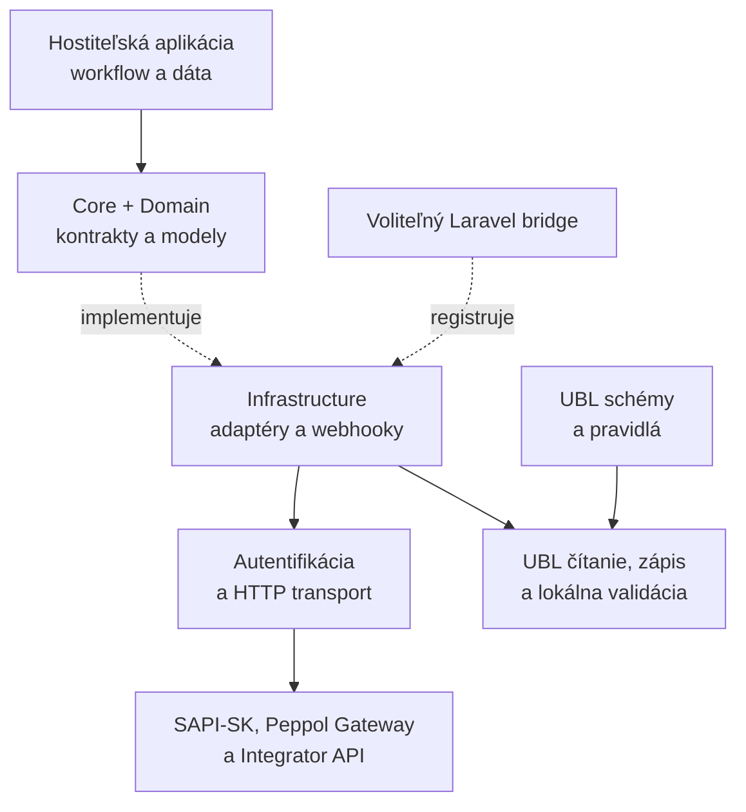
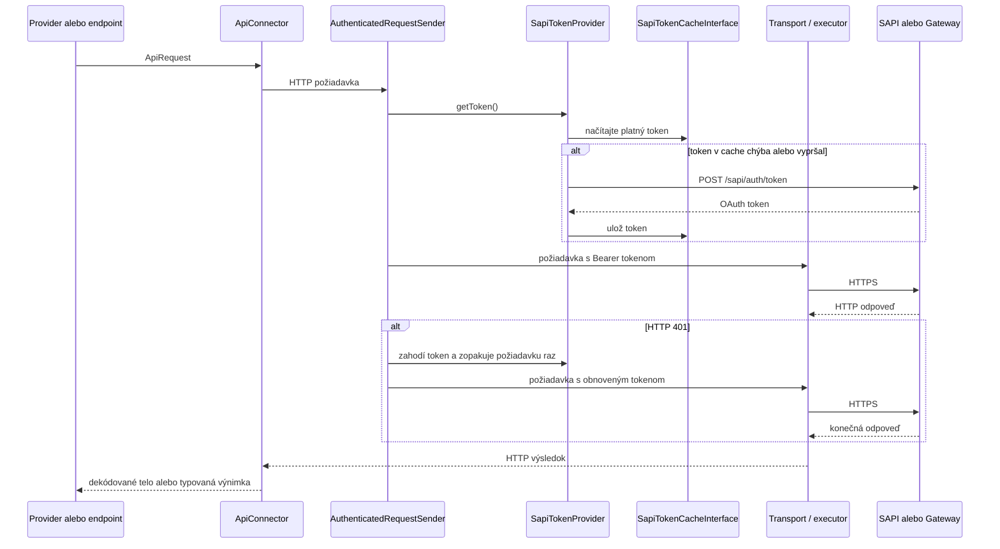
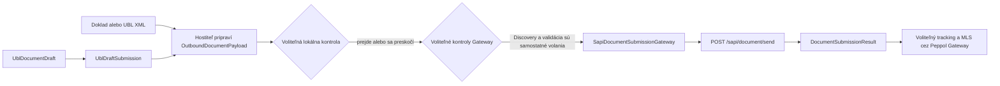
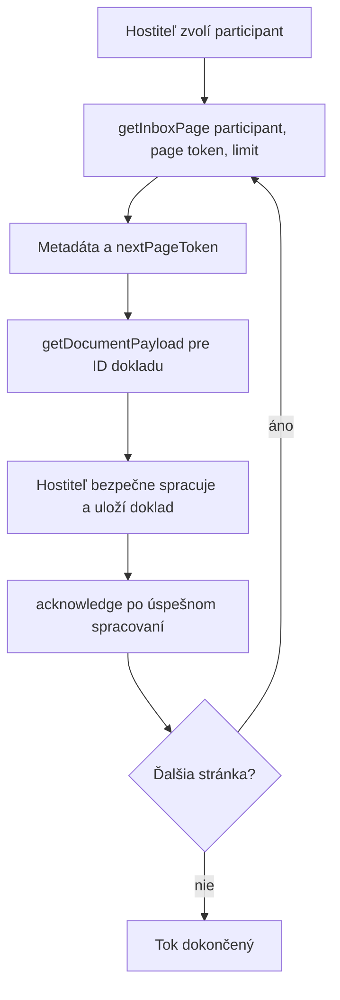
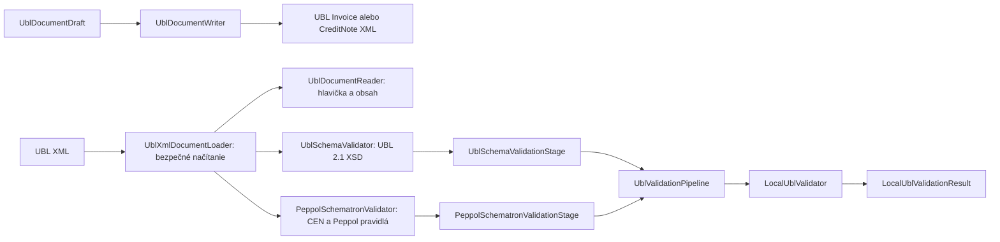
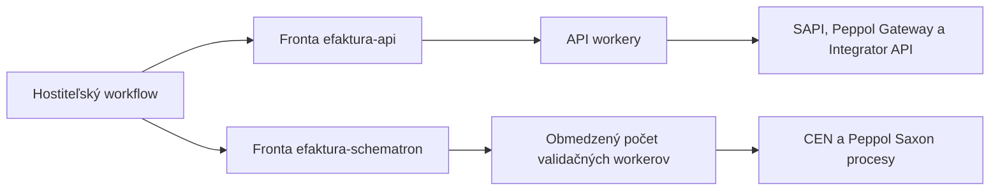

# Architektúra a hlavné toky

Konektor je PHP knižnica, ktorá spája hostiteľskú aplikáciu s rozhraniami SAPI-SK, Peppol Gateway a vybranými operáciami Integrator API. Poskytuje typované kontrakty, doménové hodnoty, adaptéry API a samostatné UBL nástroje. Neobsahuje účtovný workflow, databázu dokladov, plánovač synchronizácie ani HTTP server pre prijímanie webhookov.

<details>
<summary>Obsah stránky</summary>

- [Vrstvy](#vrstvy)
- [Vzdialená požiadavka, OAuth a transport](#vzdialená-požiadavka-oauth-a-transport)
- [Integrator API klient](#integrator-api-klient)
- [Odoslanie dokladu](#odoslanie-dokladu)
- [Príjem dokumentov](#príjem-dokumentov)
- [Discovery, stav a webhooky](#discovery-stav-a-webhooky)
- [Lokálna práca s UBL](#lokálna-práca-s-ubl)
- [Kapacitné odporúčania a oddelené fronty](#kapacitné-odporúčania-a-oddelené-fronty)
- [Hranice zodpovednosti](#hranice-zodpovednosti)
- [Testovanie](#testovanie)
  - [Integračná skúška hostiteľskej aplikácie](#integračná-skúška-hostiteľskej-aplikácie)

</details>

## Vrstvy



| Vrstva | Úloha |
| --- | --- |
| `src/Core/` | Verejné kontrakty, konfigurácia, request/response modely, výsledky a typované výnimky. Obsahuje tiež UBL kontrakty a spoločné XML typy. |
| `src/Domain/` | Hodnotové objekty a pravidlá pre participantov, stavy dokladov, webhooky a UBL. Nevykonáva HTTP ani prístup k frameworku. |
| `src/Infrastructure/` | Konkrétne SAPI/Gateway/Integrator endpointy a adaptéry, oddelené autentifikácie, transport, mapovanie odpovedí a lokálne validátory. |
| `integrations/laravel/` | Voliteľný Laravel service provider, token cache, zámok obnovy tokenu a cache-backed stav transportu. |
| `config/` | Predvolená konfigurácia Laravel bridge. |
| `resources/validation/` | Verziované UBL XSD, CEN/Peppol Schematron, Saxon a licenčné oznámenia. |

Jadro v `Core` a `Domain` nevyžaduje Laravel. Hostiteľ môže cez Core kontrakty použiť predvolené Infrastructure adaptéry alebo ich nahradiť vlastnými. Pri použití bez Laravelu hostiteľ zostaví závislosti sám; Laravel bridge slúži ako composition root a zaregistruje predvolené služby.

Pre frameworkovo nezávislé použitie použite `ConnectorFactory`; Laravel aplikácie s pomenovanými profilmi používajú `SapiClientRegistry`.

### Samostatné zostavenie klientov

Pre bežné frameworkovo nezávislé použitie poskytuje balík stabilný `ConnectorFactory`. Vytvorí predvolený cURL executor, SAPI klient alebo samostatne autentifikovaný Integrator klient bez Laravel kontajnera:

```php
use DreaM1\EfakturaConnector\ConnectorFactory;
use DreaM1\EfakturaConnector\Core\Configuration\IntegratorAccountConfiguration;
use DreaM1\EfakturaConnector\Core\Configuration\SapiClientConfiguration;

$connector = new ConnectorFactory();

$sapiClient = $connector->createSapiClient(
    'billing',
    new SapiClientConfiguration(
        'https://provider.example',
        getenv('EFAKTURA_CLIENT_ID'),
        getenv('EFAKTURA_CLIENT_SECRET'),
        'document:send'
    )
);

$integratorClient = $connector->createIntegratorAccountClient(
    IntegratorAccountConfiguration::fromArray([
        'base_url'      => 'https://provider.example',
        'integrator_id' => getenv('EFAKTURA_INTEGRATOR_ID'),
        'token'         => getenv('EFAKTURA_INTEGRATOR_API_TOKEN'),
    ])
);
```

Predvolená SAPI token cache drží hodnoty iba počas života procesu. Pri opakovanom vytváraní klientov alebo pri viacerých workeroch odovzdajte konštruktoru vlastnú implementáciu `SapiTokenCacheInterface`, ktorá bearer token bezpečne uloží a obmedzí jeho platnosť podľa `SapiToken::expiresAt()`. `ConnectorFactory` vytvára izolovaný HTTP stack pre každého vytvoreného klienta; aplikácia má vytvorený klient uchovať a opakovane používať. Runtime limity možno odovzdať ako `ConnectorRuntimeConfigurationInterface`.

Voliteľné závislosti sa pridávajú nemennými metódami `with*()`; každá vráti kópiu factory a pôvodná inštancia sa nemení:

```php
use DreaM1\EfakturaConnector\Infrastructure\EFaktura\Api\Transport\Execution\HttpRequestExecutorOptions;

$connector = (new ConnectorFactory($runtimeConfiguration, $tokenCache))
    ->withExecutorOptions(HttpRequestExecutorOptions::defaults()->withLogger($logger))
    ->withTokenRefreshLock($refreshLock)
    ->withMetrics($metrics);
```

| Metóda | Účinok |
| --- | --- |
| `withExecutorOptions()` | HTTP stack každého klienta sa zostaví z týchto `HttpRequestExecutorOptions`. Retry, cooldown a predvolené cURL limity sa naďalej berú z runtime konfigurácie. Inštancie v options, napríklad circuit breaker alebo backpressure store, budú zdieľať všetci neskôr vytvorení klienti; nechajte ich nenastavené, ak má mať každý klient vlastný stav. |
| `withTokenRefreshLock()` | `SapiTokenRefreshLockInterface` koordinuje obnovu SAPI tokenu medzi workermi. |
| `withMetrics()` | `ConnectorMetricsInterface` dostáva HTTP aj token-cache metriky. Metriky nastavené priamo v executor options majú pre HTTP požiadavky prednosť. |
| `withClock()` | `ClockInterface` pre expiráciu tokenu, retry oneskorenia a cooldowny, najmä na deterministické testy. Hodiny nastavené v executor options majú pre HTTP stack prednosť. |

## Vzdialená požiadavka, OAuth a transport

Každý endpoint zostaví `ApiRequest` s cestou, hlavičkami, query, telom a pravidlom opakovania. `ApiConnector` odovzdá požiadavku autentifikovanému senderu a po odpovedi kontroluje HTTP status a dekóduje JSON alebo XML. Endpoint či provider potom mapuje odpoveď na typovaný model konektora.



Token sa získava zo štandardného SAPI a používa sa ako Bearer token aj pri volaniach Peppol Gateway. Cache implementuje `SapiTokenCacheInterface`. Laravel bridge dodáva šifrovanú cache nad Laravel Cache; pri samostatnom použití ju zabezpečuje hostiteľ. Ak hostiteľ poskytne `SapiTokenRefreshLockInterface`, `SapiTokenProvider` koordinuje súbežnú obnovu a po získaní zámku znovu načíta cache. Laravel bridge koordinuje refresh cez cache lock, ak je dostupný, inak lokálnym súborovým zámkom.

Predvolenú HTTP skladbu vytvára `DefaultHttpRequestExecutorFactory`: cURL vykonávač, voliteľné logovanie, retry podľa `RetryPolicy`, circuit breaker a backpressure. Samostatná skladba ukladá stav breakeru a cooldown v procese; Laravel bridge ukladá stav v Laravel Cache a používa cache alebo lokálne súborové zámky podľa dostupnosti. `ApiRequest` štandardne povoľuje retry iba pre GET; endpoint môže výslovne označiť bezpečnú zápisovú požiadavku ľubovoľnou HTTP metódou. Odoslanie dokumentu sa automaticky neopakuje pri neistom výsledku. Hostiteľ dodáva stabilný idempotency key a rieši následné overenie stavu.

## Integrator API klient

`SapiClient` lenivo vytvára a typovo ukladá adaptéry služieb. Tým sa zachováva identita služby počas života klienta; draft submission a recipient capability check zdieľajú svoje závislé služby.

`IntegratorAccountClientFactory` zostaví jeden `ProviderTransport` a dva konektory: tokenový a PDS podpisový. Bežné operácie prechádzajú cez `IntegratorTokenRequestSender`, ktorý nastaví `X-Integrator-Token`; PDS endpoint používa `PdsAuthenticatedRequestSender` nad tým istým transportom. Sender vyžaduje práve jeden neprázdny podpis `X-PDS-Secret` a odstráni hlavičky `Authorization` a `X-Integrator-Token`. Konektory dostane `IntegratorAccountClient`, ktorý z nich vytvorí štyri typované skupiny operácií (klienti, účastníci, súhrny dokladov a PDS) a deleguje do nich volania; verejné Core rozhranie zostáva `IntegratorAccountClientInterface`. OAuth klientské poverenia spravované cez tento klient sa používajú až pri oddelených SAPI a Gateway volaniach. Podrobnosti a príklad zostavenia sú v [návode Integrator API](Integrator-API).

## Odoslanie dokladu

`SapiDocumentSubmissionGateway` implementuje `DocumentSubmissionGatewayInterface`. Prijíma `SendDocumentRequest` s payloadom, explicitným `Participant` a idempotency key a odovzdá ho `SendDocumentEndpoint`, ktorý zostaví HTTP požiadavku pre `POST /sapi/document/send`.

Pre `UblDocumentDraft` je dostupný Core kontrakt `UblDraftSubmissionInterface`, ktorý implementuje pohodlná služba `UblDraftSubmission`. Prijíma aj explicitný čas vytvorenia, vytvorí XML a metadáta payloadu a potom použije ten istý gateway. Metódou `preparePayload()` možno vytvoriť payload vopred a použiť ho na vzdialenú kontrolu aj následné odoslanie.



Lokálna validácia, Discovery a `POST /v1/validate-document` sú samostatné služby. Samotné `SapiDocumentSubmissionGateway::send()` ich automaticky nespúšťa; hostiteľ určuje poradie a rozhoduje, či sú pre jeho workflow povinné. Odpoveď SAPI opisuje technické prijatie odoslania. Ďalší stav prenosu v Peppol sa zisťuje oddelene cez `DocumentTrackingProviderInterface` a Message Level Status.

Pri chybe spojenia alebo serverovej chybe môže byť výsledok odoslania neistý. Konektor v takom prípade automaticky neopakuje odosielací POST. Hostiteľ má pred ďalším pokusom overiť stav cez tracking a používať stabilný idempotency key.

## Príjem dokumentov

`SapiReceivedDocumentProvider` zoskupuje tri SAPI operácie: načítanie stránky metadát, stiahnutie XML payloadu a potvrdenie prijatia.



Hostiteľ riadi stránkovanie, trvalé uloženie, deduplikáciu a okamih potvrdenia. Operácia `acknowledge` odosiela technické potvrdenie príjmu dokumentu; potvrdenie samo osebe neschvaľuje jeho obchodný obsah. Ak uloženie alebo spracovanie zlyhá, hostiteľ rozhoduje o odložení potvrdenia a opakovaní synchronizácie.

## Discovery, stav a webhooky

Peppol Gateway adaptéry poskytujú Discovery, profil participanta, tracking odoslaného dokumentu, MLS a správu registrácií webhookov. Sú to vzdialené operácie oddelené od SAPI odosielania a príjmu.

`PeppolGatewayWebhookRegistry` vytvára, číta, mení a ruší registrácie u poskytovateľa. `PeppolWebhookEventFactory` prijme raw telo a hlavičky, povinne zavolá injektovaný `PeppolWebhookSignatureVerifierInterface` a až potom mapuje podporované eventy na typované modely. Knižnica poskytuje `PeppolWebhookHmacSha256SignatureVerifier`, ktorý podľa testu webhooku od DataHosting overuje HMAC-SHA256 nad `{t}.{x-sapi-webhook-id}.{rawBody}`. Knižnica neposkytuje verejný HTTP endpoint ani automatický výber algoritmu. Hostiteľ zabezpečí HTTP route, správny secret, výber verifikátora, trvalé uloženie, deduplikáciu a opakovateľné spracovanie.

Webhook a polling môžu oznámiť rovnakú zmenu stavu. Hostiteľ má spracovanie navrhnúť idempotentne a nezamieňať technické prijatie SAPI s doručením alebo potvrdením v Peppol.

## Lokálna práca s UBL

UBL čítanie, zápis a validácia sú lokálne operácie bez HTTP volania:



Čítačka bezpečne načíta UBL Invoice alebo CreditNote a vytvorí doménový model; samotné čítanie nespúšťa obchodnú validáciu. Zapisovač serializuje draft podľa UBL štruktúry a sám nerozhoduje o obsahu ani automaticky nevaliduje výsledok. Hostiteľ môže XML načítať raz a odovzdať ten istý `UblXmlDocument` readeru aj validátorom.

XSD validáciu vykonáva libxml. Schematron pravidlá vykonáva pribalený Saxon HE, preto potrebuje Java 11+, povolené `proc_open` a `flock` na koordináciu validačných slotov. Verzie a postup aktualizácie sú v `resources/validation/README.md`. Lokálna kontrola nenahrádza vzdialenú validáciu Gateway; poskytovateľ môže mať inú verziu alebo konfiguráciu pravidiel.

## Kapacitné odporúčania a oddelené fronty

API volania a Schematron validácia majú odlišné limity. API worker čaká na sieť a musí rešpektovať limity poskytovateľa; Schematron worker spotrebúva CPU a pamäť pre Java procesy. Hostiteľská aplikácia ich preto plánuje a škáluje nezávisle. Samostatná Core skladba predvolene používa lokálny súborový zámok, ktorý vykonáva najviac jeden API request naraz pre danú cestu aplikácie a OS používateľa. Laravel predvolene používa `Cache::lock()` pre rovnaký scope; pri Laravel 5.6 alebo cache store bez lock API použije lokálny súborový fallback. Cache zámok v zdieľanom store môže koordinovať workery na rôznych hostoch, lokálny zámok iba procesy na tom istom hostiteľovi:



| Fronta hostiteľskej aplikácie | Typ práce | Podľa čoho dimenzovať |
| --- | --- | --- |
| `efaktura-api` | Odoslanie, príjem, tracking, Discovery a ďalšie SAPI/Gateway operácie. | Pri samostatnom Core stacku začnite jedným API workerom na aplikáciu a OS používateľa; lokálny zámok sériovo vykonáva requesty v tomto scope. Laravel cache lock sériovo vykonáva requesty aj naprieč hostmi pri zdieľanom store s podporou lockov; bez tejto podpory lokálny fallback koordinuje iba hostiteľa. Ďalší workeri môžu pomôcť pri oddelených OAuth scope-och, ale pri rovnakom scope čakajú na zámok. Nastavte počet podľa kvót poskytovateľa a sledujte latenciu, 429, chyby spojenia, stav circuit breakera a vek fronty. |
| `efaktura-schematron` | Lokálna CEN a Peppol validácia nad už dostupným UBL dokumentom. | Súbeh obmedzte podľa voľného CPU a pamäte pre Java procesy; dĺžku fronty a čakanie sledujte oddelene od API práce. |

Počet API hostov a ich rate limit zvyšujte postupne, pokiaľ poskytovateľ nevracia 429 a latencie zostávajú prijateľné. Súborový zámok platí len pre rovnakú cestu aplikácie a OS používateľa na jednom hoste; zdieľaný Laravel cache store s atómovými zámkami môže koordinovať HTTP lock aj cooldown medzi hostmi. Pri výpadku cache nemusí byť cooldown uložený a predvolený HTTP lock požiadavku nepustí do siete. Pri 429 rešpektujte `retryAt()->unixTimestamp()`; pri otvorenom circuit breakeri použite hostiteľský backoff a úlohu odložte vo fronte. Odoslanie dokladu neopakujte automaticky po neistom výsledku a pri hostiteľskom opakovaní zachovajte idempotency key aj payload.

Jedna predvolená Schematron validácia spúšťa dve pravidlové sady naraz: CEN a Peppol. Pri limite `V` súbežných validácií preto môže naraz bežať až `2 × V` Java procesov. Pre pamäť použite `V ≤ floor(M / R)`, kde `M` je pamäť vyhradená validácii po odpočítaní OS a ostatných workerov a `R` je nameraná špičková RSS jedného kompletného validačného batchu. Túto hranicu ešte overte podľa CPU a času behov; počet workerov validačnej fronty držte na výslednom limite alebo nižšie, aby nadbytočné workery nečakali na validačný slot. Oddelené fronty samy osebe neizolujú CPU ani pamäť. Ak Java procesy zvyšujú latenciu API, umiestnite validačný pool na samostatné hosty alebo mu vyhraďte samostatnú kapacitu.

Predvolený limitér používa súborové zámky. Procesy zdieľajú sloty, ak na tom istom hoste používajú rovnaký `concurrency_lock_directory`; vtedy musia mať nakonfigurovaný rovnaký limit. `working_directory` rozsah slotov nemení a rozdielne lock adresáre vytvárajú nezávislé pooly. Pri viacerých hostoch použite zdieľaný `SchematronConcurrencyLimiterInterface`, alebo validačnú frontu pripnite k jednému hostu; lokálny súborový zámok medzi hostmi limit nezdieľa. Praktické nastavenia a ich konfigurácia sú v [lokálnej validácii](Validation.md).

Do fronty ukladajte identifikátor dokumentu alebo inú hostiteľskú referenciu na bezpečne uložené dáta, nie credentials ani zbytočnú kópiu XML. `ConnectorMetricsInterface` meria jednotlivé HTTP pokusy a validačné batch-e; queue depth, čas čakania vo fronte, CPU a pamäť meria hostiteľská aplikácia cez svoj queue a runtime monitoring.

Konkrétny príklad oddelených Laravel worker poolov a ich timeoutov je v [Laravel sprievodcovi](Laravel.md).

## Hranice zodpovednosti

- Hostiteľ vytvára aplikačný workflow, ukladá doklady a volí participantov pre jednotlivé volania.
- Hostiteľ volá lokálne a vzdialené kontroly v požadovanom poradí a interpretuje ich výsledky.
- Hostiteľ určuje idempotency key pre každý odosielací pokus, retry aplikačných operácií a postup pri neistom výsledku odoslania.
- Hostiteľ zodpovedá za overenie podpisu pred dôverou v payload. Vystavuje webhook route, vyberá signing secret a verifikátor, kontroluje prípustný vek timestampu a opakované doručenia, deduplikuje udalosti a zabezpečuje ich trvalé uloženie.
- Konektor neposkytuje HTTP receiver a všeobecné parsovanie obálky podpis neoveruje. `PeppolWebhookEventFactory::fromSignedJson()` s injektovaným verifikátorom pred mapovaním overí raw body; hostiteľ túto factory explicitne zavolá alebo zabezpečí ekvivalentné overenie.
- Konektor spracúva HTTP a OAuth, kontroluje odpovede podľa kontraktov, mapuje ich na typované hodnoty a poskytuje UBL nástroje.
- Výnimky konektora nesú technické informácie. Používateľské texty a preklady mapuje hostiteľ podľa triedy výnimky a jej údajov.

## Testovanie

Testy balíka sú rozdelené podľa hraníc komponentov:

| Adresár | Čo pokrýva |
| --- | --- |
| `tests/Unit/` | Hodnotové objekty, mapovanie, endpointy, transport, autentifikáciu, UBL a validáciu. |
| `tests/Integration/` | Celé toky konektora nad pripravenými HTTP odpoveďami a fake transportom; bez volania produkčného API. |
| `tests/Architecture/` | Závislostné hranice a oddelenie balíka, konvencia endpointov (pomenovanie, základná trieda, `send()`), oddelené autentifikačné rodiny a pravidlá výnimiek: každá implementuje `ConnectorThrowable` a balík vyhadzuje iba výnimky konektora, nie holé SPL. |

V hostiteľskom workflow teste mockujte Core kontrakty. Pri testovaní adaptéra mockujte endpointy; pri testovaní endpointov použite `HttpRequestExecutorInterface` alebo záznamový transport. Testovaciu sadu balíka spustíte príkazom `composer test`. Schematron testy, ktoré spúšťajú Saxon, potrebujú Java 11+, povolené `proc_open` a `flock`.

### Offline klient `FakeSapiClient`

Hostiteľské testy nemusia mockovať celé `SapiClientInterface`. `DreaM1\EfakturaConnector\Testing\FakeSapiClient` je offline klient bez poverení a bez volania providera:

- Odosielanie je predvolene nahrávajúci `FakeDocumentSubmissionGateway`. Každý nový dokument prijme s vygenerovaným ID (`fake-document-1`, …) a zaznamená ho (`submissions()->sent()`, `lastRequest()`).
- Výsledky a zlyhania zaradíte do fronty: `submissions()->willThrow(new ProviderConnectionException('…'))->willReturn($result)`. Spotrebúvajú sa v poradí.
- Opakovaný idempotency key vráti pôvodný úspešný výsledok bez novej submission, tak ako provider. Zlyhanie sa nezapamätá, lebo provider mohol dokument prijať.
- Ostatné služby dodajte cez `use*()` metódy (napríklad `useWebhookRegistry($mock)`), najlepšie PHPUnit doublom úzkeho Core kontraktu. Služba, ktorá nebola dodaná, vyhodí `InvariantViolationException` s názvom potrebnej metódy, nevráti nič zavádzajúce.

```php
$client = new FakeSapiClient('billing');
$client->submissions()->willThrow(new ProviderConnectionException('Connection reset.'));

// kód hostiteľa pod testom používa $client ako SapiClientInterface
```

Fake nenahrádza integračný test adaptérov: neoveruje HTTP serializáciu ani mapovanie odpovedí. Na to slúži `HttpRequestExecutorInterface` a záznamový transport.

Composer deklaruje voliteľný Laravel bridge pre Laravel 5.6 a 8.83–13. CI testuje Laravel 5.6/PHP 7.4 a Laravel 13/PHP 8.4 v oddelených Composer projektoch a Laravel 8 na PHP 7.4 cez vývojovú závislosť `laravel/framework` v hlavnom projekte; verzie 9 až 12 sa samostatne netestujú. Hlavná matica testuje framework-independent jadro od PHP 7.4. Laravel 5.6 test spustíte príkazom `./tools/test-laravel-bridge.ps1 -LaravelVersion 5.6`, Laravel 13 test príkazom `./tools/test-laravel-bridge.ps1 -LaravelVersion 13` a Laravel 8 test (na PHP 7.4) príkazom `vendor/bin/phpunit --configuration=phpunit.xml.dist --testsuite "Laravel Bridge"`. Predvolené `composer test` spúšťa iba hlavnú sadu `EFaktura Connector`. Závislosti mostíka zostanú v `tools/laravel-bridge/` a neovplyvnia hlavný Composer projekt.

### Statická analýza

`composer analyse` spúšťa PHPStan podľa `phpstan.neon.dist` nad `src/` a `integrations/laravel/src/`. Testy a skripty v `tools/` sa neanalyzujú. Úroveň je 8, takže chýbajúce typy polí a generík v PHPDoc sú chyby a analýza sa riadi cieľovým PHP 7.4 (`phpVersion`), nezávisle od verzie PHP, ktorá ju spúšťa. Bridge sa analyzuje proti vývojovej závislosti `laravel/framework` 8, takže vidí iba jej Illuminate API. CI spúšťa analýzu v jobe pre PHP 7.4 hneď po kontrole formátovania.

`composer test:mutation` spúšťa mutačné testy cez Infection z `composer.lock` podľa `infection.json5` (celé `src/` okrem `Testing`). Potrebuje ovládač pokrytia, napríklad `XDEBUG_MODE=coverage` pri Xdebug alebo PCOV, a jeden súbor možno skúsiť cez `composer test:mutation -- --filter=RetryAfter.php`. Beh je pomalý, preto ho CI spúšťa týždenne a ručne vo workflow `quality-deep.yml` s rovnakou zamknutou verziou, nie pri každom pull requeste do `main`. Nízke skóre nie je samo o sebe chyba: slúži na hľadanie testov, ktoré mutáciu neodhalia.

Nastavenie `treatPhpDocTypesAsCertain: false` je zámerné: knižnicu volajú aj aplikácie bez prísnych typov, takže obranné kontroly typov na hraniciach (`is_string()`, `instanceof`) sa nemajú hlásiť ako zbytočné len preto, že ich docblock vylučuje.

Chyby, ktoré si vyžadujú zmenu kódu, a nie len dokumentácie, sú zaznamenané v `phpstan-baseline.neon`. Pravidlá práce s ním:

- Nový kód nesmie pridávať položky do baseline; chybu opravte.
- Keď meníte kód s položkou v baseline, opravte chybu a položku zmažte. PHPStan hlási každú položku, ktorá už nezodpovedá žiadnej chybe, a analýza vtedy zlyhá.
- Celý baseline generujte znova (`vendor/bin/phpstan analyse --generate-baseline=phpstan-baseline.neon`) iba na čistom, commitnutom strome a výsledný diff prezrite. Rozpracovaný strom zachytí prechodné chyby.

PHPStan číta aj PHPDoc, preto musí byť presný:

- Pri variadickom parametri uvádzajte typ jedného prvku: `@param string ...$paths`, nie `@param string[] $paths`.
- Typ použitý iba v docblocku importujte cez `use`; bez importu sa preloží do aktuálneho namespace a analýza ho nenájde.
- Generické kolekcie, ktoré iba vracajú prvky, deklarujte kovariantne (`@template-covariant T`), ako `LimitedValidationIssues`, aby `LimitedValidationIssues<PeppolValidationIssue>` vyhovovalo parametru `LimitedValidationIssues<UblValidationIssueInterface>`.

### Integračná skúška hostiteľskej aplikácie

Pred produkčným zapnutím otestujte celý tok v prostredí poskytovateľa s testovacími participantmi a syntetickými dokladmi: lokálne a vzdialené kontroly, odoslanie a tracking, príjem XML a explicitné acknowledge. Overte aj duplicitnú webhook udalosť, výpadok jej spracovania a neistý výsledok odoslania s opakovaním pomocou rovnakého UUID idempotency key. Nepoužívajte reálne faktúry ani osobné údaje pri integračnom testovaní.

Podrobný zoznam adresárov a odporúčané miesto pre zmenu sú v [štruktúre balíka](Project-Structure); zoznam dostupných operácií je v [referencii API](API-Reference).

<details>
<summary>Súvisiace návody</summary>

- [Štruktúra balíka](Project-Structure)
- [Tok dát a triedy](Data-Flow-and-Classes)
- [Riešenie problémov](Troubleshooting)

</details>
