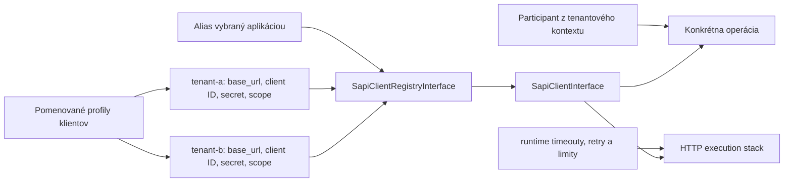

# Konfigurácia

<details>
<summary>Obsah stránky</summary>

- [Ako sa vyberá klient a konfigurácia](#ako-sa-vyberá-klient-a-konfigurácia)
- [`SapiClientsConfiguration`](#sapiclientsconfiguration)
  - [Pomenovaní OAuth klienti](#pomenovaní-oauth-klienti)
  - [OAuth poverenia zákazníka v databáze](#oauth-poverenia-zákazníka-v-databáze)
- [Predpoklady u poskytovateľa](#predpoklady-u-poskytovateľa)
- [Participant](#participant)
- [Vlastné rozhrania hostiteľa](#vlastné-rozhrania-hostiteľa)
- [Laravel konfigurácia](#laravel-konfigurácia)
- [Participant pri viacerých zákazníkoch](#participant-pri-viacerých-zákazníkoch)

</details>

## Ako sa vyberá klient a konfigurácia



Profil určuje provider URL, OAuth poverenia a scope; participant je samostatný vstup operácie. `runtime` nastavuje limity vykonávania a nie je súčasťou identity klienta.

## `SapiClientsConfiguration`

`SapiClientsConfiguration` načíta pomenované profily klientov. Každý profil má vlastnú `base_url`, takže jedna aplikácia môže naraz hovoriť s testovacím aj produkčným prostredím; `base_url` na najvyššej úrovni konfigurácie sa odmietne. `default_client` určuje profil používaný predvolenými service bindingmi. Každý profil musí mať explicitný scope vydaný poskytovateľom; konektor už nežiada send aj receive oprávnenia automaticky.

```php
use DreaM1\EfakturaConnector\Core\Configuration\SapiClientsConfiguration;

$clients = SapiClientsConfiguration::fromArray([
    'default_client' => 'tenant-a',
    'clients' => [
        'tenant-a' => [
            'base_url' => getenv('EFAKTURA_TENANT_A_BASE_URL'),
            'client_id' => getenv('EFAKTURA_TENANT_A_CLIENT_ID'),
            'client_secret' => getenv('EFAKTURA_TENANT_A_CLIENT_SECRET'),
            'client_scope' => getenv('EFAKTURA_TENANT_A_CLIENT_SCOPE') ?: '',
        ],
        'tenant-b' => [
            'base_url' => getenv('EFAKTURA_TENANT_B_BASE_URL'),
            'client_id' => getenv('EFAKTURA_TENANT_B_CLIENT_ID'),
            'client_secret' => getenv('EFAKTURA_TENANT_B_CLIENT_SECRET'),
            'client_scope' => getenv('EFAKTURA_TENANT_B_CLIENT_SCOPE') ?: '',
        ],
    ],
]);

$clients->assertReady();
$tenantAConfiguration = $clients->client('tenant-a');
```

| Kľúč | Význam |
| --- | --- |
| `clients.<alias>.base_url` | HTTPS serverová URL z OpenAPI pre daný profil. Odstránia sa koncové lomky, no ľubovoľná cesta v URL zostane zachovaná. Pre testovacie prostredie použite koreň `https://test-sapisk.datahosting.sk`, bez `/sapi`; endpointy pripájajú celé cesty `/sapi/...` a `/v1/...`. |
| `clients` | Mapa aliasov na samostatné profily OAuth poverení. |
| `default_client` | Alias profilu používaný predvolenými service bindingmi. |
| `client_id` | OAuth client ID vydané poskytovateľom. |
| `client_secret` | OAuth client secret; uchovávajte ho v secret store alebo chránenom environmente. |
| `client_scope` | Povinný scope povolený OAuth klientovi. Môže obsahovať `document:send`, `document:receive` alebo obe hodnoty oddelené medzerou. Zadajte iba oprávnenia, ktoré klient potrebuje; konektor nemá implicitný scope. |

`SapiClientsConfiguration` odmieta neznáme kľúče a validuje aliasy, profily a predvolený alias. `assertReady()` overí URL, poverenia a scope všetkých profilov bez sieťového volania; zavolajte ho v deployment checku ešte pred sprístupnením API. `SapiClientConfigurationInterface::assertReady()` kontroluje jeden profil. `baseUrl()` vracia normalizovaný `ProviderBaseUrl`; `clientId()` validovaný `OAuthClientId`; `clientSecret()` redigovaný `OAuthClientSecret`; a `clientScope()` validovaný `OAuthScope`. `ConnectorRuntimeConfigurationInterface` sprístupňuje typované HTTP limity, retry a circuit-breaker politiky, backpressure cooldown a validačné limity. Skladá sa z dvoch užších kontraktov: `HttpRuntimeConfigurationInterface` (HTTP transport) a `LocalValidationRuntimeConfigurationInterface` (limity lokálnej Schematron validácie); služba, ktorá potrebuje len jednu oblasť, má závisieť od užšieho kontraktu. Laravel bridge drží výber tried, vrstiev request execution a validačných zdrojov v `LaravelServiceConfiguration`.

Laravel používa jeden publikovaný súbor s oddielmi `clients`, `default_client`, `integrator_api`, `runtime` a `laravel`. PDS signing secret možno nastaviť v `integrator_api.pds.signing_secret`; je oddelený od Integrator API tokenu, Laravel ho sprístupní ako `PdsSigningConfiguration` a PDS požiadavke sa odovzdáva osobitne. Každý klientský profil má vlastný `SapiTokenProvider` a autentifikovaný API reťazec. Registry predvolene skladá executor stack pre každý profil; ak aplikácia poskytne alebo už rozlíšila vlastný HTTP executor, tento stack sa zdieľa. Token cache a koordinácia 429 cooldownu sa môžu zdieľať. Cache kľúč oddeľuje tokeny podľa URL, client ID, secretu a scope. Číselné limity a prevádzkové politiky patria do `runtime`; `laravel.request_execution` určuje základný executor, zapnuté vrstvy a backend HTTP locku; `laravel.validation` určuje poradie validačných krokov, cesty k zdrojom, pracovný adresár, Java binárku a adresár concurrency locku. `laravel.services` mapuje predvolené service bindingy na vlastné triedy vrátane `SapiClientFactoryInterface` a `SchematronConcurrencyLimiterInterface`.

### Minimálna publikovaná konfigurácia

Profil `clients.default` nesie provider URL, poverenia a explicitný scope; `default_client` ho vyberie pre priame service bindingy.

```php
return [
    'default_client' => 'default',
    'clients' => [
        'default' => [
            'base_url' => env('EFAKTURA_BASE_URL', ''),
            'client_id' => env('EFAKTURA_CLIENT_ID', ''),
            'client_secret' => env('EFAKTURA_CLIENT_SECRET', ''),
            'client_scope' => env('EFAKTURA_CLIENT_SCOPE', ''),
        ],
    ],
];
```

Po úprave publikovaného súboru obnovte Laravel config cache.

Pred nasadením pridajte do vlastného deployment checku alebo Artisan príkazu explicitnú kontrolu pripravenosti. Načíta konfiguráciu a overí URL, ID, secret a scope všetkých profilov; neposiela požiadavku poskytovateľovi:

```php
app(SapiClientsConfiguration::class)->assertReady();
```

Samotné `config:cache` hodnoty neoveruje. Pri jeho použití chráňte prístup k vygenerovanému `bootstrap/cache/config.php`, ktorý obsahuje aj nakonfigurované poverenia.

### Pomenovaní OAuth klienti

Vyberte klienta podľa aliasu cez `SapiClientRegistryInterface`. Výber poverení zostáva explicitný a participant sa odovzdáva samostatne každému participant-scoped volaniu.

```php
use DreaM1\EfakturaConnector\Core\Contracts\SapiClientRegistryInterface;

$client = app(SapiClientRegistryInterface::class)->client('tenant-a');
$submission = $client->documentSubmissionGateway();
$tracking = $client->documentTrackingProvider();
$profile = $client->profile(); // bez OAuth secretu
```

Priamy Laravel binding, napríklad `DocumentSubmissionGatewayInterface`, používa klienta určeného cez `default_client`. Použite registry, keď jedna aplikácia obsluhuje viac OAuth identít súčasne.

### OAuth poverenia zákazníka v databáze

Ak má každý zákazník vlastné OAuth poverenia uložené v modeli, implementujte na modeli Laravel kontrakt `TenantEFakturaCredentialsInterface` a použite `TenantEFakturaClientResolver`. Model poskytne stabilný interný kľúč, client ID, secret a voliteľný scope; `base_url` sa preberá zo spoločnej konfigurácie konektora. Secret ukladajte šifrovane a skryte ho pri serializácii modelu.

```php
use DreaM1\EfakturaConnector\Laravel\Connection\TenantEFakturaClientResolver;

$client = app(TenantEFakturaClientResolver::class)->forTenant($authorizedCustomer);
$submission = $client->documentSubmissionGateway();
```

Resolver používa model, ktorý mu odovzdáte; zákazníka a jeho oprávnenia preto najprv vyberte v hostiteľskej aplikácii. Tokeny sa ukladajú cez nakonfigurovaný `SapiTokenCacheInterface` s kľúčom odvodeným od URL, poverení a scope. Kontrakt modelu a celý príklad sú v návode [OAuth poverenia zákazníka v Laraveli](Tenant-Clients-in-Laravel).

Bez Laravelu zložte registry z validovanej konfigurácie, zdieľanej HTTP execution vrstvy, token cache a UBL writeru. Registry potom drží samostatný autentifikačný reťazec pre každý alias:

```php
use DreaM1\EfakturaConnector\Infrastructure\EFaktura\Connection\SapiClientFactory;
use DreaM1\EfakturaConnector\Infrastructure\EFaktura\Connection\SapiClientRegistry;

// Prvý argument je callback, ktorý pre profil klienta vráti HTTP executor; pri zdieľanom executore vráti vždy ten istý.
$factory = new SapiClientFactory(
    static function () use ($httpRequestExecutor) {
        return $httpRequestExecutor;
    },
    $tokenCache,
    $ublDocumentWriter
);
$registry = new SapiClientRegistry($clients, $factory);
$tenantA = $registry->client('tenant-a');
```

`base_url` každého profilu musí byť bezpečná HTTPS adresa s hostiteľom; nesmie obsahovať prihlasovacie údaje, query ani fragment. Chýbajúce poverenia alebo scope nebránia štartu aplikácie, ale `assertReady()` ich odmietne pred nasadením; prvé API použitie bez neho tiež skončí `ConfigurationException` ešte pred sieťovým volaním. Neznáme konfiguračné kľúče, neplatné číselné runtime nastavenia a connect timeout dlhší než celkový request timeout sa odmietnu pri parsovaní.

Ako `base_url` nastavte serverovú URL podľa OpenAPI daného prostredia. Konfigurácia zachová cestovú časť URL a odstráni iba koncové lomky, preto ju pri štandardnom nasadení nastavte na koreň bez `/sapi`. Ak reverzná proxy používa spoločný prefix pre SAPI aj Gateway, môžete ho zahrnúť do `base_url`; endpointové cesty `/sapi/...` a `/v1/...` sa pripoja zaň. Prefix `/sapi` ani `/v1` nepoužívajte ako spoločný. Testovacie OpenAPI používajú `https://test-sapisk.datahosting.sk` bez prefixu.

### File locky vo Windows

Na Windows `flock()` koordinuje procesy iba na lokálnom súborovom systéme, ktorý túto funkciu podporuje. PHP tu nevie overiť NTFS ACL, vlastníka, POSIX práva ani počet hardlinkov; bezpečnosť preto závisí od prístupových práv adresára so zámkami. Predvolené `%TEMP%` používajte iba vtedy, ak jeho ACL obmedzujú prístup na účty workerov. Pri `laravel.request_execution.execution_lock.driver=file` nastavte `laravel.request_execution.execution_lock.temporary_directory` a pre Schematron `laravel.validation.concurrency_lock_directory` na dedikovaný adresár, ktorého ACL povoľuje prístup iba príslušnému servisnému účtu. File locky nekorelujú viac hostov ani nepodporovaný zdieľaný filesystem. Windows job v CI spúšťa testy reálnej medziprocesovej koordinácie.

## Predpoklady u poskytovateľa

Pred použitím musí byť participant zaregistrovaný a mať aktivované potrebné služby v príslušnom prostredí. Bežné SAPI a Gateway volania používajú SAPI OAuth client-credentials token. Samostatný Integrator API klient používa integrátorský token na správu OAuth klientov a participant prístupov, zoznam participantov a požiadavky na aktiváciu kontraktu. Tento token nenahrádza OAuth klienta účastníka.

Integrator API má samostatnú konfiguráciu v oddiele `integrator_api`; jej `base_url` je samostatná a predvolene preberá hodnotu premennej `EFAKTURA_BASE_URL`. Nastavte `EFAKTURA_INTEGRATOR_ID` a `EFAKTURA_INTEGRATOR_API_TOKEN` v prostredí. PDS signing secret nastavte cez `EFAKTURA_PDS_SIGNING_SECRET`; Laravel ho načíta do `integrator_api.pds.signing_secret` a typovane ho poskytne cez `app(PdsSigningConfiguration::class)`. Laravel aplikácia získa nakonfigurovaného klienta cez `app(IntegratorAccountClientInterface::class)`. Úplný príklad je v [návode Integrator API](Integrator-API).

Testovacie a produkčné prostredie nastavte oddelene: použite zodpovedajúcu `base_url`, OAuth poverenia aj participant ID. Úspech v testovacom prostredí sám osebe nepotvrdzuje aktiváciu ani oprávnenia v produkcii.

`Participant` má syntaktický tvar `schéma:hodnota`; samotný parser neoveruje schému v číselníku. SAPI/Gateway requesty vytvorené cez `ApiRequest::forParticipant()` a `OutboundDocumentPayload` akceptujú iba aktívne a registrovateľné schémy pribaleného OpenPeppol zoznamu [9.7](https://docs.peppol.eu/edelivery/codelists/). Použite identifikátor pridelený vašim API povereniam; pri odoslaní sa hodnota v hlavičke musí zhodovať so `metadata.senderParticipantId` v tele. Integrator API requesty používajú samostatné participant ID reťazce a ich DTO lokálne kontrolujú iba neprázdnu hodnotu. Príklady s `0245` sú produkčné; eFaktúra Sandbox používa testovaciu schému `9915` ([dokumentácia](https://developers.efaktura.sk/sk/docs/sandbox)).

## Participant

Participant nie je globálna súčasť konfigurácie. Každé volanie s kontextom účastníka dostane `Participant` osobitne. Pri odoslaní sa participant odvodzuje z odosielateľa v `OutboundDocumentPayload`; pri inboxe, stave, MLS a webhookoch je argumentom služby.

```php
use DreaM1\EfakturaConnector\Domain\EFaktura\Participant;

$participant = Participant::parse('0245:1234567890');
// alebo: Participant::fromPeppolIdentifier($input) -> ?Participant
```

`parse()` vyhodí `InvalidInputException` (podtyp `InvalidArgumentException`), ak hodnota nemá tvar `štvorciferná-schéma:hodnota`. `fromPeppolIdentifier()` vráti `null`. Kontrolný súčet slovenského DIČ nie je súčasťou všeobecnej kontroly tvaru Participant. Hlavičku `X-Peppol-Participant-Id` nastaví `ApiRequest::forParticipant()`.

## Vlastné rozhrania hostiteľa

Predvolený HTTP executor používa procesový `InMemoryCircuitBreaker` a procesový `InMemoryHttpRequestBackpressure`. Pre viac inštancií vytvorte zdieľané implementácie `CircuitBreakerInterface` a `HttpRequestBackpressureInterface` a odovzdajte ich cez `HttpRequestExecutorOptions` do `DefaultHttpRequestExecutorFactory::create()`. Voliteľný `SapiTokenRefreshLockInterface` koordinuje obnovu tokenu po cache miss. Ak sa dlhý retry odloží, `ProviderApiException::retryAt()` vráti čas z `Retry-After`; `RequestDeferredException::retryAt()` určí, kedy možno bezpečne opakovať požiadavku, ktorá ešte neodišla do siete.

Vlastný breaker implementuje `CircuitBreakerInterface`: `acquireExecutionPermit()` atomicky povolí požiadavku (alebo rezervuje jedinú sondu v polootvorenom stave) a ku každej požiadavke vráti permit viazaný na generáciu breakera; výsledok hlásia metódy `record*ForPermit()`. Takto fungujú aj vstavané breakery. Podrobnosti o spracovaní stavov a výsledkov sú v časti [Backpressure a circuit breaker](Errors-Retry-and-Idempotency.md#backpressure-a-circuit-breaker).

Pri ručnom skladaní bez Laravelu načítajte oddiel `runtime` cez `ConnectorRuntimeConfiguration::fromArray()` a odovzdajte výsledok do `DefaultHttpRequestExecutorFactory::createFromRuntimeConfiguration()`. Factory použije nastavené timeouty pre svoj predvolený cURL executor, retry a cooldown nastavenia prenesie do stacku a predvolenému in-memory circuit breakeru nastaví nakonfigurovanú politiku. Závislosti ako vlastný základný executor alebo breaker nastavte cez `HttpRequestExecutorOptions`; ich vlastné nastavenia ostávajú na hostiteľovi. Zdroj času pre `Retry-After`, zdieľaný 429 cooldown a predvolený in-memory backpressure určuje `withClock()` s implementáciou `Infrastructure\EFaktura\Clock\ClockInterface`; bez neho sa použije `SystemClock`. Rovnaké rozhranie prijíma aj `SapiTokenProvider` pri výpočte expirácie tokenu. Vlastné hodiny sú určené najmä na deterministické testy.

Ak chcete použiť aj nakonfigurovaný limit tela Gateway dávky, odovzdajte tú istú runtime konfiguráciu ako siedmy argument `SapiClientFactory` po voliteľnom refresh locku, metrike a request-executor factory.

Pri samostatnom použití bez Laravel bridge hostiteľ skladá služby ručne a poskytuje:

- `SapiTokenCacheInterface` na načítanie, uloženie a odstránenie OAuth tokenu;
- `HttpRequestExecutorInterface` alebo vlastnú implementáciu transportu;
- podľa potreby vlastné logovanie, perzistenciu webhookov a aplikačný workflow.

Kľúč token cache zostavuje `SapiTokenProvider` z URL, klientskych údajov a scope. Cache vrstva ukladá token pod dodaným kľúčom; tajomstvá nepatria do zdrojového kódu.

`SapiTokenProvider` cacheuje access token do jeho expirácie a pri potrebe získava nový cez `/sapi/auth/token` s client credentials. Laravel bridge uložený token šifruje. `forget(SapiToken)` odstráni iba lokálnu položku zamietnutého tokenu; API neponúka vzdialené renew ani revoke operácie.

## Laravel konfigurácia

Laravel bridge predvolene používa `CurlRequestExecutor`, ktorý vytvára nový cURL handle pre každé volanie. Dlhšie žijúce queue alebo Octane workery môžu v zverejnenom `config/efaktura-connector.php` nastaviť alternatívny base executor:

```php
use DreaM1\EfakturaConnector\Infrastructure\EFaktura\Api\Transport\Execution\PooledCurlRequestExecutor;

return [
    'laravel' => [
        'request_execution' => [
            'executor' => PooledCurlRequestExecutor::class,
        ],
    ],
];
```

Nakonfigurovaná trieda musí implementovať `HttpRequestExecutorInterface`. Oba cURL executory pri požiadavke s telom potlačia automatickú hlavičku `Expect: 100-continue`, aby odoslanie dokumentu nečakalo na potvrdenie servera. `PooledCurlRequestExecutor` ponecháva jeden easy handle a jeho connection cache počas života Laravel singletonu; používajte ho iba pri sekvenčnom spracovaní v dlho žijúcom worker procese. Timeouty `runtime.http.connect_timeout_seconds` a `runtime.http.request_timeout_seconds` sa aplikujú na predvolené aj pooled cURL implementácie. Detaily sú v [HTTP transport dokumentácii](Transport-and-Authentication.md#http-executor).

Runtime konfigurácia zahŕňa HTTP connect/request timeouty a limity request/response tiel, retry, circuit breaker, backpressure, validačné nálezy a Schematron.

Premenné prostredia sú rozdelené podľa oblasti:

- HTTP a retry: `EFAKTURA_HTTP_CONNECT_TIMEOUT_SECONDS`, `EFAKTURA_HTTP_REQUEST_TIMEOUT_SECONDS`, `EFAKTURA_HTTP_RESPONSE_MAX_BYTES`, `EFAKTURA_HTTP_REQUEST_MAX_BYTES`, `EFAKTURA_HTTP_RETRY_ENABLED`, `EFAKTURA_HTTP_RETRY_MAX_ATTEMPTS`, `EFAKTURA_HTTP_RETRY_BASE_DELAY_MS`, `EFAKTURA_HTTP_RETRY_MAX_DELAY_MS` a `EFAKTURA_HTTP_RETRY_MAX_INLINE_DELAY_MS`.
- Circuit breaker a backpressure: `EFAKTURA_CIRCUIT_BREAKER_ENABLED`, `EFAKTURA_HTTP_BACKPRESSURE_ENABLED`, `EFAKTURA_HTTP_EXECUTION_LOCK_ENABLED`, `EFAKTURA_CIRCUIT_BREAKER_FAILURE_THRESHOLD` (počet zlyhaných operácií vrátane ich retry, nie jednotlivých pokusov), `EFAKTURA_CIRCUIT_BREAKER_FAILURE_WINDOW_SECONDS`, `EFAKTURA_CIRCUIT_BREAKER_OPEN_SECONDS` a `EFAKTURA_HTTP_RATE_LIMIT_FALLBACK_COOLDOWN_SECONDS`.
- Validácia: `EFAKTURA_VALIDATION_MAX_ISSUES` a premenné `EFAKTURA_SCHEMATRON_*`.
- Koordinácia cez Laravel cache: `EFAKTURA_CACHE_STORE` vyberá spoločný store; `EFAKTURA_HTTP_EXECUTION_LOCK_STORE` ho môže prepísať iba pre HTTP request lock.

Retry povoľuje 1 až 10 celkových pokusov vrátane prvého volania; oneskorenia môžu byť nula a `max_delay_ms` musí byť možné bezpečne previesť na mikrosekundy. Ostatné číselné limity musia byť kladné; report je najviac 128 MiB, chybový výstup 1 MiB, detail chyby 4096 znakov a validačný výsledok 1000 issues. Retry sa stále uplatní iba na požiadavky, ktorých `ApiRequest` povoľuje bezpečné opakovanie.

Laravel-only voľby majú tieto environment premenne: HTTP lock používa `EFAKTURA_HTTP_EXECUTION_LOCK_DRIVER`, `EFAKTURA_HTTP_EXECUTION_LOCK_STORE`, `EFAKTURA_HTTP_EXECUTION_LOCK_LEASE_SECONDS`, `EFAKTURA_HTTP_EXECUTION_LOCK_WAIT_SECONDS` a `EFAKTURA_HTTP_EXECUTION_LOCK_DIRECTORY`. Cestu k Java a validačným zdrojom nastavujú `EFAKTURA_JAVA_BINARY`, `EFAKTURA_VALIDATION_RESOURCE_DIRECTORY` a `EFAKTURA_VALIDATION_WORKING_DIRECTORY`. Schematron používa `EFAKTURA_SCHEMATRON_MAX_CONCURRENT_VALIDATIONS`, `EFAKTURA_SCHEMATRON_PROCESS_TIMEOUT_SECONDS`, `EFAKTURA_SCHEMATRON_MAX_REPORT_BYTES`, `EFAKTURA_SCHEMATRON_MAX_ERROR_OUTPUT_BYTES`, `EFAKTURA_SCHEMATRON_MAX_ERROR_DETAIL_CHARACTERS` a `EFAKTURA_SCHEMATRON_LOCK_DIRECTORY`.

Vrstvy request executora sa zapínajú v oddiele `runtime`, vedľa svojej politiky, a platia aj bez Laravelu (`createFromRuntimeConfiguration()` ich uplatní): `runtime.retry.enabled`, `runtime.circuit_breaker.enabled`, `runtime.backpressure.enabled` a `runtime.backpressure.execution_lock`. Všetky sú predvolene zapnuté. `execution_lock` sa uplatní iba vtedy, keď je zapnutý aj `backpressure`; pri vypnutom backpressure je zámok vždy vypnutý. Laravel-špecifické `laravel.request_execution.logging` a `laravel.request_execution.metrics` rozhodujú, či sa pripojí predvolený Laravel logger a metriky; HTTP metriky sa navyše pridajú až po registrácii `ConnectorMetricsInterface`.

| Vrstva | Kľúč | Env premenná |
|---|---|---|
| retry | `runtime.retry.enabled` | `EFAKTURA_HTTP_RETRY_ENABLED` |
| circuit breaker | `runtime.circuit_breaker.enabled` | `EFAKTURA_CIRCUIT_BREAKER_ENABLED` |
| backpressure (cooldown po 429) | `runtime.backpressure.enabled` | `EFAKTURA_HTTP_BACKPRESSURE_ENABLED` |
| execution lock | `runtime.backpressure.execution_lock` | `EFAKTURA_HTTP_EXECUTION_LOCK_ENABLED` |
| HTTP logging | `laravel.request_execution.logging` | `EFAKTURA_HTTP_LOGGING_ENABLED` |
| HTTP metrics | `laravel.request_execution.metrics` | `EFAKTURA_HTTP_METRICS_ENABLED` | Tá istá metrická služba sa používa aj pre udalosti token cache a Schematron validácie.

Príklad výberu cache store a časových limitov pre request lock:

```php
'laravel' => [
    'cache_store' => 'redis', // spoločný cache store pre bridge
    'request_execution' => [
        'execution_lock' => [
            'driver' => 'cache',
            'store' => null, // null zdedí laravel.cache_store
            'lease_seconds' => null, // null odvodí lease z request timeoutu
            'wait_seconds' => 120,
        ],
    ],
],
```

`laravel.cache_store` predvolene používa Laravel default store a vyberá store pre šifrovanú token cache, token refresh lock, cooldown po HTTP 429, circuit breaker a HTTP request lock. `laravel.request_execution.execution_lock.store` môže osobitne prepísať store len pre HTTP request lock. Jeho `driver` predvolene používa `cache`, teda `Cache::lock()` ak ho Laravel a zvolený store podporujú; inak sa použije lokálny súborový zámok. `lease_seconds` určuje platnosť cache zámku (predvolene `null`, teda timeout jedného HTTP pokusu plus päťsekundová rezerva) a `wait_seconds` (predvolene 120) maximálne čakanie na jeho získanie.

Pri vytvorení cache locku bridge odvodí lease z timeoutu jedného HTTP pokusu plus päťsekundovej rezervy; ak je `lease_seconds` zadaný výslovne, overí, že pokrýva timeout jedného HTTP pokusu plus päťsekundovú rezervu (zámok sa pred čakaním retry vrstvy uvoľní, takže retry nastavenia lease neovplyvňujú). Kontrola funguje pre vstavané cURL executory; pri vlastnom executore sa s predvoleným cache lockom konfigurácia odmietne, pretože jeho rozhranie neurčuje horný limit behu. Použite file driver alebo vlastnú implementáciu `ScopedHttpRequestExecutionLockInterface`. Príliš krátky lease vyhodí `InvalidArgumentException`.

Hodnoty možno nastaviť cez `EFAKTURA_CACHE_STORE`, `EFAKTURA_HTTP_EXECUTION_LOCK_DRIVER`, `EFAKTURA_HTTP_EXECUTION_LOCK_STORE`, `EFAKTURA_HTTP_EXECUTION_LOCK_LEASE_SECONDS` a `EFAKTURA_HTTP_EXECUTION_LOCK_WAIT_SECONDS`. Ak store podporuje atomické zámky a je zdieľaný, koordinuje aj workery na rôznych hostoch. Bez lock API sa použije lokálny súborový zámok; ak sa zámok nepodarí získať alebo cache zlyhá, request sa nespustí a vyhodí sa `RequestCoordinationException`.

Pri `driver=file` konektor namiesto cache používa PHP `flock()`; `temporary_directory` určuje jeho adresár a Laravel `basePath()` spolu s OS používateľom izoluje nezávislé aplikácie. Ak nastavíte `temporary_directory`, nastavte aj `driver=file`; inak konfigurácia zlyhá namiesto tichého ignorovania cesty. Pri samostatnom použití Core možno vlastnú implementáciu odovzdať cez `HttpRequestExecutorOptions::withExecutionLock()`.

`laravel.validation.resource_directory`, `working_directory`, `java_binary` a `concurrency_lock_directory` upravujú validačné zdroje, pracovný adresár, spustiteľnú Java binárku a umiestnenie concurrency lockov. `null` ponechá bundled zdroje, Laravel `basePath()`, Java z `JAVA_HOME`/`PATH` a predvolený lock adresár `sys_get_temp_dir()/efaktura-schematron-locks`. Procesy používajúce rovnaký lock adresár na tom istom hoste zdieľajú jednu sadu slotov a musia mať rovnaký limit; pracovný adresár tento rozsah nemení. Predvolené limitovanie výstupu Schematron reportu a chybového výstupu chráni pamäť procesu; možno ho prispôsobiť cez `runtime.schematron.max_report_bytes`, `max_error_output_bytes` a `max_error_detail_characters`.

Laravel predvolene používa `Cache::lock()` podľa rovnakého kľúča kvóty ako backpressure, ak ho Laravel a zvolený store podporujú; inak používa lokálny súborový zámok. SAPI/Gateway transport nastaví nepriame ID nakonfigurovaného OAuth klienta a scope; Integrator transport vytvorí samostatné ID z URL a integrator ID (token doň nevstupuje, takže rotácia tokenu zachová cooldown aj zámok). Ak request nemá explicitný scope kľúč, použije sa hash hlavičky `Authorization`. Požiadavky s rovnakým kľúčom sa serializujú cez kontrolu cooldownu a jeden pokus; zámok sa uvoľní pred čakaním retry vrstvy. Iné kľúče môžu bežať súbežne. Zdieľaný Laravel cache backend môže koordinovať aj viac hostov. Pri `driver=file` alebo pri chýbajúcom API cache lockov sa namiesto toho použije lokálny `flock()` v systémovom temp adresári; zámok koordinuje len workery s rovnakou kanonickou cestou aplikácie a OS používateľom. Pri samostatnom skladaní Core sa použije file-lock fallback alebo vlastný `ScopedHttpRequestExecutionLockInterface` nastavený cez `HttpRequestExecutorOptions::withExecutionLock()`. Do uloženého kľúča sa zapisuje iba hash; surový token ani secret sa v ňom nezverejní.

Laravel bridge používa vybraný `laravel.cache_store` na uchovanie obnovy OAuth tokenu, cooldownu po odpovedi 429, stavu circuit breakera a predvolene aj HTTP request locku. Cache locky umožňujú koordináciu naprieč hostmi; pri Laravel 5.6 alebo store bez tejto podpory sa používa lokálny file lock. Token refresh a ďalšie best-effort cache vrstvy pri výpadku pokračujú bez zámku; pri zlyhaní HTTP request locku sa samotný request nespustí.

Bridge načíta `config/efaktura-connector.php` do pomenovaných profilov klientov, Integrator API konfigurácie a typed runtime/Laravel nastavení. `base_url` profilu `default` používa `EFAKTURA_BASE_URL`; profil ďalej používa `EFAKTURA_CLIENT_ID`, `EFAKTURA_CLIENT_SECRET` a `EFAKTURA_CLIENT_SCOPE`; ďalšie profily pridajte do mapy `clients` a alias vyberte cez `SapiClientRegistryInterface`. Integrator API používa `EFAKTURA_INTEGRATOR_BASE_URL` (predvolene hodnota `EFAKTURA_BASE_URL`), `EFAKTURA_INTEGRATOR_ID` a `EFAKTURA_INTEGRATOR_API_TOKEN`; PDS podpis používa samostatné `EFAKTURA_PDS_SIGNING_SECRET`. `EFAKTURA_DEFAULT_CLIENT` určuje profil pre priame Laravel service bindingy. HTTP timeouty a retry možno nastaviť cez `EFAKTURA_HTTP_CONNECT_TIMEOUT_SECONDS` (predvolene 10 sekúnd), `EFAKTURA_HTTP_REQUEST_TIMEOUT_SECONDS` (45 sekúnd), `EFAKTURA_HTTP_RETRY_MAX_ATTEMPTS` (3 pokusy) a `EFAKTURA_HTTP_RETRY_BASE_DELAY_MS` (500 ms). Retry sa uplatní iba na požiadavky označené ako bezpečné. Súbor možno zverejniť:

```sh
php artisan vendor:publish --tag=config
```

Laravel bridge viaže predvolenú cache tokenu do Laravel Cache a token ukladá šifrovane cez Laravel Crypt. Inštalácia musí mať nakonfigurovaný `APP_KEY` a bezpečné cache úložisko. Aplikácia môže bindings nahradiť vlastnými implementáciami.

Laravel konfigurácia obsahuje `laravel.validation.stages`: usporiadaný zoznam tried implementujúcich `UblValidationStageInterface`. Predvolené poradie je UBL XSD, doplnková kontrola BR-CO-25 a Peppol Schematron. Schematron vydania `2026-Q4-MR` obsahuje aj slovenské pravidlá `SK-R-001` až `SK-R-007`, preto samostatný `PeppolSlovakBillingValidationStage` nie je predvolený. Pridajte ho do vlastnej pipeline len vtedy, ak Schematron nepokrýva tieto pravidlá. Ak zoznam prepíšete, uveďte všetky kroky, ktoré majú bežať; prázdny zoznam parser odmietne. Kontajner vytvorí každú triedu kroku, takže jej závislosti môže automaticky injektovať. Každý krok musí mať stabilné, jedinečné a neprázdne ID, ktoré PHP nepremení na celočíselný kľúč (napríklad `schema` alebo `peppol_schematron`). Vlastné kroky a výsledky opisuje [lokálna validácia](Validation.md).

Predvolený `PeppolBillingHeaderValidationStage` dopĺňa Peppol Schematron jedinou kontrolou BR-CO-25: kladná faktúra musí mať dátum splatnosti alebo platobné podmienky. Pribalený Schematron toto pravidlo samostatne neobsahuje; ostatné hlavičkové kontroly vykonáva Schematron, takže sa neopakujú. Stage vynechajte iba vtedy, ak BR-CO-25 kontrolujete iným spôsobom.

Vlastný krok môže implementovať aj `UblValidationRuleVersionProviderInterface`; pipeline potom jeho mapu verzií vloží do metadát kroku. Trvanie a stav výsledku doplní automaticky.

Bez Laravelu sa konfigurácia tried nepoužíva. Pri ručnom skladaní odovzdajte `LocalUblValidator` neprázdny zoznam inštancií krokov; príklad je v [lokálnej validácii](Validation.md).

## Participant pri viacerých zákazníkoch

Ak aplikácia obsluhuje viac participantov, vyberte `Participant` z kontextu konkrétneho dokladu alebo tenant konfigurácie pre každé volanie. Nepredpokladajte, že identita je súčasťou OAuth konfigurácie. Odosielateľ faktúry musí zodpovedať oprávneniam OAuth klienta u poskytovateľa.

<details>
<summary>Súvisiace návody</summary>

- [Inštalácia](Installation)
- [Laravel bridge](Laravel)
- [OAuth poverenia zákazníka](Tenant-Clients-in-Laravel)
- [HTTP transport a autentifikácia](Transport-and-Authentication)

</details>
