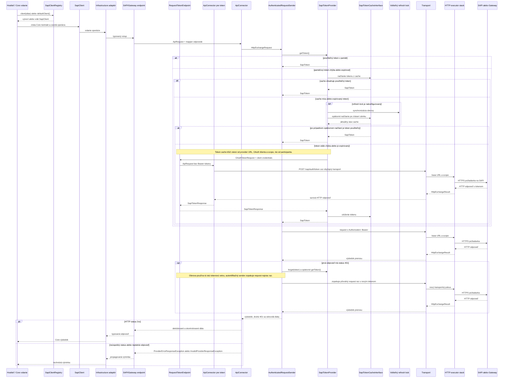
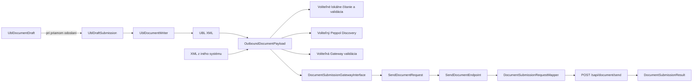
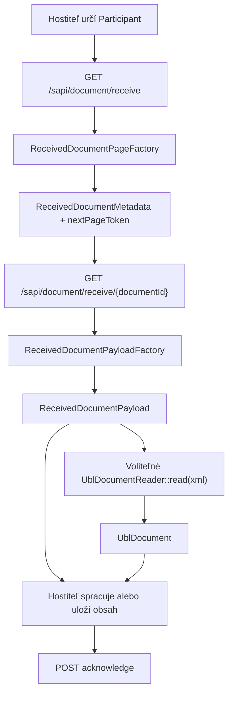
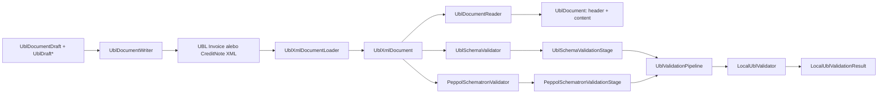

# Tok dát a prehľad tried

Táto stránka sleduje údaje od verejného kontraktu konektora po API odpoveď alebo výsledný UBL model. Opisuje implementáciu balíka; poradie kontrol, uloženie dokladov a obchodný workflow určuje hostiteľská aplikácia.

Obsah stránky

- [Zostavenie služieb](#zostavenie-služieb)
- [Spoločný tok vzdialenej požiadavky](#spoločný-tok-vzdialenej-požiadavky)
  - [Čo sa deje s jedným requestom](#čo-sa-deje-s-jedným-requestom)
- [Odoslanie dokladu](#odoslanie-dokladu)
- [Príjem dokladu](#príjem-dokladu)
- [Discovery, stav a webhooky](#discovery-stav-a-webhooky)
- [UBL modely a lokálne validácie](#ubl-modely-a-lokálne-validácie)

## Zostavenie služieb

Hostiteľ používa kontrakty z `Core` a môže ich napojiť na predvolené implementácie v `Infrastructure`. Laravel service provider skladá predvolené služby do kontajnera. Pri samostatnom použití bez Laravelu vytvorí tieto objekty hostiteľ.

```mermaid
flowchart LR
    Host[Hostiteľská aplikácia] --> RegistryPort[Core SapiClientRegistryInterface]
    Registry[SapiClientRegistry] -.implementuje.-> RegistryPort
    Registry -->|alias alebo predvolený klient| SapiFactory[SapiClientFactory]
    SapiFactory --> SapiClient
    SapiClient -.implementuje.-> SapiClientPort[Core SapiClientInterface]
    Host --> SapiClientPort
    SapiClientPort --> Core[Core kontrakt operácie]
    Core --> Adapter[Infrastructure adaptér]
    Adapter --> Endpoint[SAPI alebo Peppol endpoint]
    Endpoint --> Api[ApiConnector]
    Api --> Auth[AuthenticatedRequestSender]
    Auth --> Transport[ProviderTransport]
    Transport --> Executor[HTTP executor stack]
    Host --> IntegratorFactoryPort[Core IntegratorAccountClientFactoryInterface]
    IntegratorFactory[Infrastructure IntegratorAccountClientFactory] -.implementuje.-> IntegratorFactoryPort
    IntegratorFactoryPort --> IntegratorFactory
    IntegratorFactory --> IntegratorClient[Infrastructure IntegratorAccountClient]
    IntegratorFactory --> IntegratorTransport[ProviderTransport]
    IntegratorClient -.implementuje.-> IntegratorPort[Core IntegratorAccountClientInterface]
    Host --> IntegratorPort
    IntegratorClient --> ClientFacade[IntegratorClientManagementFacade]
    IntegratorClient --> ParticipantFacade[IntegratorParticipantManagementFacade]
    IntegratorClient --> DocumentFacade[IntegratorDocumentFacade]
    IntegratorClient --> PdsFacade[IntegratorPdsFacade]
    SapiClient -->|lazy typované služby| Adapter
    ClientFacade --> IntegratorEndpoint[Integrator endpoint + ApiConnector]
    ParticipantFacade --> IntegratorEndpoint
    DocumentFacade --> IntegratorEndpoint
    IntegratorEndpoint --> IntegratorAuth[IntegratorTokenRequestSender]
    IntegratorAuth --> IntegratorTransport
    PdsFacade --> PdsEndpoint[SubmitPdsSubjectsEndpoint + ApiConnector]
    PdsEndpoint --> PdsAuth[PdsAuthenticatedRequestSender]
    PdsAuth --> IntegratorTransport
    IntegratorTransport --> Executor
    Executor --> Provider[SAPI-SK, Peppol Gateway alebo Integrator API]
    Adapter --> Domain[Doménové hodnoty]
    Core --> Domain
```

`SapiClientRegistry` vracia klienta podľa aliasu alebo predvoleného nastavenia a vytvára ho až pri prvom použití. `SapiClientFactory` pre daný profil skladá autentifikovaný `ApiConnector` a `SapiClient`; každý klient má vlastný `SapiTokenProvider`. Executor môže byť zdieľaný alebo vytvorený pre konkrétny profil podľa konfigurácie factory. `SapiClient` vytvára jednotlivé adaptéry až pri prvom vyžiadaní príslušnej služby a potom ich uchováva v typovaných vlastnostiach. `UblDraftSubmission` zdieľa SAPI submission gateway a kontrola schopnosti príjemcu zdieľa discovery provider. `SapiClient` preto drží služby bez reťazcovej mapy cache; verejné Core kontrakty klienta sa nemenia.

`Core` definuje verejné porty, vstupné a výstupné dátové objekty a technické výnimky. `Domain` normalizuje hodnoty, napríklad identifikátor participanta, stav dokladu či UBL údaje. `Infrastructure` vytvára API požiadavky, vykonáva HTTP a mapuje odpovede na typované modely.

`IntegratorAccountClientFactory` skladá jeden `ProviderTransport` (`forIntegratorAccount()`) a dva `ApiConnector` objekty. Bežné operácie idú cez `IntegratorTokenRequestSender`, ktorý nastaví `X-Integrator-Token`; PDS endpoint používa `PdsAuthenticatedRequestSender` nad tým istým transportom. PDS sender vyžaduje práve jeden neprázdny `X-PDS-Secret` a odstráni hlavičky `Authorization` aj `X-Integrator-Token`. Obe vetvy obchádzajú `AuthenticatedRequestSender` a `SapiTokenProvider`. Oba konektory dostane `IntegratorAccountClient`, ktorý z nich vytvorí typované skupiny pre správu klientov, účastníkov, súhrny dokladov a PDS a deleguje do nich operácie. Toto rozdelenie je interné pre Infrastructure; verejné operácie naďalej poskytuje jedno `IntegratorAccountClientInterface`. Integrator OAuth klienti sa preto dajú spravovať bez toho, aby integrátorský token vstupoval do konfigurácie bežného SAPI OAuth klienta.

## Spoločný tok vzdialenej požiadavky

Endpoint zostaví nemenný `ApiRequest`. Ten nesie HTTP metódu, cestu, query, hlavičky, JSON telo, participanta, kontext logovania a príznak bezpečného opakovania. Cesta s parametrami sa URL-kóduje a query sa serializuje v RFC 3986 formáte.

SAPI OAuth token sa získava cez štandardné SAPI a používa sa aj pre volania Peppol Gateway. `SapiTokenProvider` najprv kontroluje token v pamäti, potom cache; ak je nakonfigurovaný `SapiTokenRefreshLockInterface`, po získaní zámku znovu načíta cache, aby obmedzil duplicitné obnovy. Laravel bridge poskytuje cache lock, ak je dostupný, inak lokálny súborový zámok; samostatné použitie môže zámok dodať hostiteľ. Identita participanta nie je súčasťou OAuth konfigurácie ani token cache kľúča; endpoint ju pre účastnícke volanie pridá cez `ApiRequest::forParticipant()` do hlavičky `X-Peppol-Participant-Id`.

Integrator API má oddelený `IntegratorAccountClient`, ktorý neposiela SAPI Bearer token; `ProviderTransport::forIntegratorAccount()` viaže jeho nastavenia na base URL a pripraví scope key pre zdieľanie cooldownu. Bežné Integrator volania prechádzajú cez tokenový sender. PDS endpoint používa samostatný `ApiConnector` a `PdsAuthenticatedRequestSender` nad tým istým transportom; sender overí podpisovú hlavičku a odstráni ostatné autentifikačné hlavičky.

`ApiConnector` kontroluje úspešný HTTP status a dekóduje JSON alebo bezpečne parsuje XML. Neúspešný status sa zmení na `ProviderErrorResponseException`, ktorá zachová status, hlavičky a telo a dostane rozpoznaný `ProviderErrorEnvelope` z `ProviderErrorEnvelopeParser`. Neplatný JSON/XML alebo chýbajúce povinné polia úspešnej odpovede vyvolajú `InvalidProviderResponseException` s HTTP kontextom.

Predvolený executor vytvára `DefaultHttpRequestExecutorFactory`: cURL, voliteľné logovanie a metriky, retry podľa `RetryPolicy`, circuit breaker a backpressure. Vykonanie prechádza zvonka dovnútra cez circuit breaker, retry, backpressure, logger, metriky a cURL. Bez frameworku používajú tieto ochrany in-memory stav; Laravel bridge ho ukladá do Laravel Cache a koordinuje lock operácie cache alebo lokálnymi súborovými zámkami. GET je štandardne bezpečný na retry. Iné metódy sa opakujú iba pri výslovnom označení endpointom. Pri HTTP 401 `AuthenticatedRequestSender` zahodí lokálny token a zopakuje volanie s novým tokenom najviac raz. Toto autorizačné opakovanie je samostatné od HTTP retry. Napríklad `SendDocumentEndpoint` posiela idempotency key, ale nastaví `retrySafe(false)`, takže nejednoznačný výsledok odoslania sa automaticky neopakuje pri chybe spojenia ani retryable odpovedi.

### Čo sa deje s jedným requestom

```mermaid
flowchart LR
    Host[Hostiteľ / Core volanie] --> Registry[SapiClientRegistry]
    Registry --> SapiClient[SapiClient podľa aliasu]
    SapiClient --> Core[Core kontrakt operácie]
    Core --> Adapter[Infrastructure adaptér]
    Adapter --> Endpoint[API endpoint]
    Endpoint --> ApiRequest[ApiRequest]
    ApiRequest --> API[ApiConnector a HttpExchangeRequest]
    API --> Auth[AuthenticatedRequestSender]
    Auth --> Token[SapiTokenProvider]
    Token --> TokenCache[Pamäť a token cache]
    TokenCache -->|použiteľný token| Auth
    Token -. pri chýbajúcom alebo expirovanom tokene .-> TokenEndpoint[RequestTokenEndpoint]
    TokenEndpoint --> TokenAPI[ApiConnector pre token bez Bearer]
    TokenAPI -->|token request| Transport[Transport pridá base URL a scope]
    Auth --> Transport
    Transport --> BP[Backpressure a voliteľný request lock]
    BP --> CB[Circuit breaker]
    CB --> Retry[Retry]
    Retry --> Log[Voliteľné logovanie]
    Log --> Metrics[Voliteľné metriky]
    Metrics --> Curl[cURL: HTTPS URL a TLS kontroly]
    Curl -->|HTTPS request| Provider[SAPI / Peppol Gateway]
    Provider -->|HTTP response| Curl
    Curl --> Exchange[HttpExchangeResult]
    Exchange -->|odpoveď bežného requestu| Auth
    Exchange -->|tokenová odpoveď| TokenAPI
    TokenAPI -->|SapiTokenResponse| TokenEndpoint
    TokenEndpoint -->|SapiToken| Token
    Token --> TokenCache
    Auth -. prvý status 401: zahodí token a zopakuje request raz .-> Token
    Auth --> Decode[ApiConnector: status a dekódovanie]
    Decode --> Factory[Factory alebo Mapper: provider odpoveď → Core model]
    Factory --> Result[Endpoint vráti Core model; adaptér ho odovzdá hostiteľovi]
    Result --> Host
```

1. **Vstup a mapovanie.** Hostiteľ podľa potreby získa pomenovaný alebo predvolený `SapiClient` cez `SapiClientRegistry` a zavolá Core kontrakt poskytnutý klientom s typovanými hodnotami. Adaptér odovzdá typovaný request alebo kontext endpointu, ktorý vráti Core model. Endpoint prevedie vstupné hodnoty na provider hlavičky, query a telo a zostaví `ApiRequest`.
2. **Príprava `ApiRequest`.** Cesta zostáva relatívna k poskytovateľovi. Názvy path parametrov musia presne zodpovedať placeholderom v šablóne; hodnoty sú neprázdne reťazce (biele znaky samy nestačia) alebo celé čísla, hodnoty `.` a `..` sa odmietnu a ostatné sa kódujú cez `rawurlencode()` ako jednotlivé segmenty. Query hodnoty môžu byť reťazce, celé čísla alebo `null`; `null` sa vynechá, `0` a prázdny reťazec sa zachovajú a iné typy vyvolajú `InvalidInputException`. Pri opakovanom `withQuery()` neskoršia nenull hodnota nahradí skoršiu hodnotu s rovnakým kľúčom; `null` ju nevymaže. Výsledok sa serializuje vo formáte RFC 3986. `withJsonBody()` zakóduje telo hneď pri zostavení requestu; neplatné JSON dáta preto zlyhajú ešte pred získaním tokenu alebo sieťovým volaním. Predvolená hlavička `Accept` žiada JSON; endpoint môže zvoliť XML. `ApiRequest::forParticipant()` pridá SAPI/Gateway participant ID do hlavičky a skontroluje, že jeho schéma je aktívna a registrovateľná. Pri novom dokumente `OutboundDocumentPayload` používa rovnakú kontrolu. Integrator requesty namiesto `Participant` používajú neprázdne participant ID reťazce a schému číselníka lokálne nekontrolujú. `DocumentRequestContext` ostáva iba metadátom pre logovanie a neposiela sa poskytovateľovi. `ApiRequest::httpMethod()` a `HttpExchangeRequest::httpMethod()` vracajú typovaný `HttpMethod`; na HTTP hranici sa jeho názov prevedie cez `value()`. GET je bezpečný na opakovanie predvolene; ostatné metódy nie.
3. **Prevod na transportný request.** `ApiRequest` a `HttpExchangeRequest` zdieľajú internú abstraktnú triedu `AbstractHttpRequest`, ktorá drží ich spoločné HTTP údaje. `ApiConnector` z nej zostaví `HttpExchangeRequest` na jednom mieste: prenesie metódu, cestu s query, hlavičky, telo, `Accept`, kontext pre logy a príznak bezpečného opakovania. Base URL a scope sa doplnia neskôr v transportnej vrstve.
4. **Autorizácia a URL.** Pri SAPI a Gateway volaní `AuthenticatedRequestSender` získa token cez `SapiTokenProvider` a nahradí prípadnú hlavičku `Authorization` aktuálnym `Bearer` tokenom. Provider kontroluje najprv token v pamäti a potom cache; pri chýbajúcom alebo čoskoro expirujúcom tokene použije SAPI client-credentials endpoint. Ak je nakonfigurovaný refresh lock, po získaní zámku znovu načíta cache. Samotné tokenové volanie používa obyčajný transport bez Bearer dekorátora. Bežné Integrator volania prechádzajú cez `IntegratorTokenRequestSender`, ktorý odstráni `Authorization` a nastaví `X-Integrator-Token`. PDS endpoint používa samostatný `ApiConnector` cez `PdsAuthenticatedRequestSender`, ktorý vyžaduje jeden neprázdny `X-PDS-Secret` a odstráni `Authorization` aj `X-Integrator-Token`. Oba Integrator sendery delegujú do toho istého `ProviderTransport`; všetky vetvy odovzdajú request executor stacku. Vstavané cURL executory pri vykonaní použijú interný `Transport\Execution\ProviderRequestUrlResolver`, ktorý spojí base URL s relatívnou cestou a overí výslednú HTTPS adresu. Iba SAPI/Gateway `401` spustí zahodenie SAPI tokenu a jeden pokus s obnoveným tokenom; táto obnova je oddelená od HTTP retry politiky.
5. **Kontroly a pokusy o prenos.** Predvolený executor je zvonka dovnútra zložený ako (voliteľný) `RejectionObservingHttpRequestExecutor` → `CircuitBreakerHttpRequestExecutor` → `RetryingHttpRequestExecutor` → `BackpressureHttpRequestExecutor` → `RateLimitRecordingHttpRequestExecutor` → voliteľný logger → voliteľné metriky → cURL executor. Circuit breaker môže volanie zablokovať pri otvorenom okruhu. Backpressure pred každým pokusom skontroluje cooldown pre daný request a pri aktívnom limite vyhodí `RequestDeferredException` ešte pred sieťou; zámok drží iba počas pokusu, nie počas čakania pred ďalším pokusom. Retry opakuje iba request označený ako bezpečný: pri chybe spojenia alebo pri odpovedi `429`/`5xx`, ak to povoľuje retry politika a odpoveď poskytovateľa označuje ako opakovateľnú. Pri `429` sa uloží cooldown podľa `Retry-After`, alebo podľa nakonfigurovanej náhradnej hodnoty, ak hlavička chýba. Pri opakovaní určuje čakanie platná hlavička `Retry-After` alebo backoff politika. Ak sú nakonfigurované, logger a metriky zaznamenajú každý reálny pokus.
6. **cURL prenos.** Executor odošle metódu, URL, hlavičky a telo. Pridá `Content-Type: application/json`, ak request má telo, a príslušnú `Accept` hlavičku. Používa iba HTTPS, overuje TLS certifikát aj názov hostiteľa a nenasleduje presmerovania. Odpoveď číta do konfigurovateľného limitu; po jeho prekročení prenos preruší a vyhodí `ProviderResponseTooLargeException`, ktorá sa automaticky neopakuje. Inak vráti surový status, telo a vybrané hlavičky (Content-Type, Retry-After a identifikátory korelácie/požiadavky) v `HttpExchangeResult`. cURL vrstva JSON ani XML neinterpretuje.
7. **Spracovanie odpovede.** `ApiConnector` akceptuje iba HTTP status `2xx`. Ostatné statusy prevedie na `ProviderErrorResponseException` so statusom, hlavičkami a telom odpovede. Pri JSON odpovedi dekóduje objekt alebo zoznam a statická factory endpointu (`<Resource>Factory` alebo `<Resource>Mapper`) vytvorí Core model; úspešné `204` bez tela sa mapperu odovzdá ako prázdne pole. Neplatný JSON/XML alebo neplatná štruktúra odpovede skončí ako `InvalidProviderResponseException` s HTTP kontextom. XML sa pred vrátením bezpečne parsuje. Pri `send()` sa telo úspešnej odpovede nespracúva, keď ho operácia nepotrebuje. Endpoint vráti Core model (alebo `bool`/`void`), ktorý adaptér odovzdá hostiteľovi; samostatné response DTO ostáva iba pre OAuth `SapiTokenResponse`.

Konkrétne retry limity, cooldowny, zdieľanie stavu a nastavenie executorov opisuje [HTTP transport a autentifikácia](Transport-and-Authentication.md); typy chýb a správanie pri neistom výsledku sú v [chybách, retry a idempotencii](Errors-Retry-and-Idempotency.md).

## Odoslanie dokladu

Hostiteľ môže vytvoriť XML alebo ho dostať z iného systému a naplniť `OutboundDocumentPayload`. Ak už pracuje s `UblDocumentDraft`, môže namiesto ručného skladania payloadu použiť Core kontrakt `UblDraftSubmissionInterface`, ktorý implementuje `UblDraftSubmission`. Obe cesty končia pri rovnakom payload modeli a gatewayi. Konektor poskytuje samostatné lokálne a vzdialené kontroly, ale odosielací adaptér ich sám nespúšťa.

Tok volania a mapovanie:

| Krok | Trieda alebo typ | Úloha a prenášané údaje |
| --- | --- | --- |
| Pohodlný vstup | `UblDraftSubmission` | `preparePayload(sender, receiver, draft, creationDateTime)` zapíše draft a odvodí metadáta; `send(sender, receiver, draft, creationDateTime, idempotencyKey)` prijíma `IdempotencyKey` a deleguje explicitné transportné identity a payload do gatewaya. |
| Aplikačný vstup | `SendDocumentRequest` | Nesie `OutboundDocumentPayload`, `Participant` a `IdempotencyKey`; pri vytvorení overí, že participant zodpovedá odosielateľovi payloadu. |
| Verejný port | `DocumentSubmissionGatewayInterface` | Metóda `send(SendDocumentRequest)` predstavuje odoslanie jedného dokladu. |
| Adaptér | `SapiDocumentSubmissionGateway` | Odovzdá typovaný request endpointu, ktorý vráti `DocumentSubmissionResult`. |
| Endpoint | `SendDocumentEndpoint` | Mapuje hodnoty Core requestu na HTTP hlavičky, telo a `ApiRequest`; odosielací POST neoznačí ako automaticky bezpečný na retry. |
| API telo | `DocumentSubmissionRequestMapper` | Mapuje polia do OpenAPI `SapiSendDocumentRequest`: `metadata`, `payload`, `payloadFormat: XML`, `payloadEncoding: UTF-8` a voliteľný `checksum`. OpenAPI povoľuje vynechať `payloadEncoding` (predvolené UTF-8); konektor ho posiela explicitne. |
| Endpoint a odpoveď | `SendDocumentEndpoint`, `DocumentSubmissionResultFactory` | Pridajú participant/idempotency hlavičky a z odpovede `SapiSendDocumentResponse` zostavia priamo `DocumentSubmissionResult` (`providerDocumentId`, `status`, `timestamp`, prípadné `receivedAt`). |
| Výsledok | `DocumentSubmissionResult` | Vráti technický výsledok prijatia požiadavky poskytovateľom. Nevyjadruje konečné doručenie v Peppol. |

Rovnaký `DocumentSubmissionRequestMapper` používa aj `ValidateDocumentEndpoint` pre `POST /v1/validate-document`. `RecipientCapabilityCheck` volá Discovery pre príjemcu, typ a proces. Obe kontroly zostávajú samostatnými volaniami, ktoré hostiteľ spustí podľa svojho workflow. Odosielací POST sa pri neistom výsledku odoslania automaticky neopakuje; pred opakovaním treba pracovať s rovnakým idempotency key a overiť stav.

## Príjem dokladu

Príjem pozostáva z troch oddelených volaní. Zoznam obsahuje metadáta a kurzor ďalšej stránky; detail stiahne telo dokumentu; operácia `acknowledge` samostatne vykoná technické potvrdenie príjmu.

`SapiReceivedDocumentProvider` implementuje `ReceivedDocumentProviderInterface` a skladá endpointy pre list, detail a acknowledge. `ReceivedDocumentMetadataFactory` validuje povinné polia a vytvára `Domain\EFaktura\ReceivedDocumentMetadata`. `ReceivedDocumentPage` nesie položky stránky spolu s `nextPageToken`; `ReceivedDocumentPayload` obsahuje metadáta detailu cez `metadata()`, payload cez `xml()` a formát oznámený poskytovateľom cez `payloadFormat()`. `acknowledge()` vracia `ReceivedDocumentAcknowledgement` s ID dokladu, stavom a časom potvrdenia z odpovede SAPI.

`SapiReceivedDocumentProvider::getInboxPage()` prijíma `ListReceivedDocumentsRequest` s participantom a voliteľnými hodnotami `PageToken`, `PageSize` a status filtrom `RECEIVED` alebo `ACKNOWLEDGED`. Endpoint mapuje request na hlavičku a query. Pri ukladaní kurzora použite `PageToken::value()` a pri obnove `PageToken::fromString()`; veľkosť vytvorte cez `PageSize::fromInt()`. OpenAPI má query `limit` ako voliteľnú s predvolenou hodnotou 20.

`ReceivedDocumentPayloadFactory` overí metadáta, payload a to, že `payloadFormat` je prítomný reťazec (schéma `SapiReceivedDocumentDetailResponse`); OpenAPI preň neurčuje enum. Adaptér prenesie metadáta vrátane `creationDateTime` a hodnotu formátu do Core modelov bez normalizácie; providerové ID v `ReceivedDocumentMetadata` a `ReceivedDocumentReference` majú typ `ProviderDocumentId`. `ReceivedDocumentPayload` poskytuje XML cez `xml()`; ak ho hostiteľ chce čítať ako UBL, samostatne zavolá `$ublReader->read($payload->xml())`. Čítanie nespúšťa obchodnú validáciu ani acknowledge; obe operácie hostiteľ riadi samostatne. `DocumentRequestContext` zostáva samostatnou hostiteľskou logovacou hodnotou; neposiela sa poskytovateľovi a rovnakú referenciu možno použiť na stiahnutie aj potvrdenie. Konektor neurčuje, kedy hostiteľ uloží obsah alebo zavolá acknowledge.

## Discovery, stav a webhooky

| Core kontrakt | Predvolená implementácia | API mapovanie |
| --- | --- | --- |
| `DocumentDiscoveryProviderInterface` | `PeppolGatewayDiscoveryProvider` | Adaptér odovzdá typovaný Core request endpointu, ktorý cez `CheckReceivingCapabilityResponseFactory` vráti `CheckReceivingCapabilityResponse`; adaptér overí, že patrí hľadanému participantovi. |
| `ParticipantProfileProviderInterface` | `PeppolGatewayParticipantProfileProvider` | Prijíma `Participant`; endpoint cez `ParticipantProfileFactory` vráti Core `ParticipantProfile` so schopnosťami. |
| `DocumentTrackingProviderInterface` | `PeppolGatewayDocumentTrackingProvider` | Odovzdáva typovaný `SentDocumentReference` alebo `MessageLevelStatusIdentifier` endpointom; endpointy vracajú Core status modely (`SentDocumentStatus`, `ProviderMessageLevelStatusResponse`, `MessageLevelStatusContent`) s typovaným `ProviderDocumentStatus`; XML sa parsuje bezpečne. |
| `WebhookRegistryInterface` | `PeppolGatewayWebhookRegistry` | Odovzdáva Core webhook requesty alebo participant a identifikátor priamo endpointom ; endpointy vracajú Core modely `Webhook*` cez factory. |
| `TokenHealthProviderInterface` | `SapiTokenHealthProvider` | `getTokenStatus()` vracia Core `TokenStatus`; adapter mapuje SAPI odpoveď vrátane expiračných a refresh polí. `isTokenValid()` poskytuje zjednodušený bool výsledok. Odpoveď 401 (neplatný alebo expirovaný token) sa vráti ako `valid = false`; token sa nenahrádza ani sa volanie neopakuje. |

Webhook registry spravuje registráciu u Gateway. `PeppolWebhookEventFactory` vyžaduje injektovaný podpisový verifikátor, volá ho pred JSON parserom a potom mapuje podporované udalosti na typované modely. Knižnica obsahuje `PeppolWebhookHmacSha256SignatureVerifier`, ktorý overí HMAC-SHA256 nad timestampom, ID z hlavičky a presnými raw body bajtmi podľa testu webhooku od DataHosting. Knižnica neobsahuje HTTP route ani automatický výber algoritmu. Hostiteľ zabezpečí route, uloženie signing secretu, výber verifikátora, deduplikáciu a opakované spracovanie.

## UBL modely a lokálne validácie

Načítanie XML, zápis draftu a validácia sú lokálne operácie. Nespúšťajú API volanie.

| Smer | Triedy | Výsledné údaje |
| --- | --- | --- |
| Draft → XML | `UblDocumentDraft`, `UblDraftParty`, `UblDraftLine`, `UblDraftTaxCategory`, `UblDraftTaxSubtotal`, `UblDraftTotals`, `UblDraftPaymentMeans`, `UblDocumentWriter` | UBL 2.1 Invoice alebo CreditNote XML. Desatinné sumy a množstvá sa prenášajú ako presné reťazce. |
| XML → model | `UblXmlDocumentLoader`, `UblDocumentReader`, `UblDocumentHeaderReader`, `UblDocumentContentReader` | `UblDocument` s `UblDocumentHeader`, stranami, riadkami a súhrnom DPH. Reader načíta aj všetky riadky. |
| XML bezpečnosť | `Support\Xml\SecureXmlDocumentParser`, `UblXmlDocumentLoader` | Odmietne neplatné/nebezpečné XML a nepodporované korene; načítanie XML samo osebe nie je XSD ani Peppol validácia. |
| Doplnkové pravidlo | `PeppolBillingHeaderRules`, `PeppolBillingHeaderValidationStage` | Kontrola BR-CO-25 pre kladné faktúry bez dátumu splatnosti a platobných podmienok; pribalený Schematron toto pravidlo neobsahuje. |
| UBL schéma | `UblSchemaValidator` | Kontrola UBL 2.1 XSD cez libxml. Porušenia sú `SchemaValidationException`. |
| Obchodné pravidlá | `PeppolSchematronValidator` | CEN/EN 16931 a Peppol Schematron cez Saxon; vracia nálezy v `PeppolSchematronValidationResult`, ktorý adaptačný stage prevedie na všeobecný výsledok pipeline. |
| Zložený výsledok | `UblSchemaValidationStage`, `PeppolBillingHeaderValidationStage`, `PeppolSchematronValidationStage`, `UblValidationPipeline`, `LocalUblValidator` | Spustí nakonfigurované kroky v poradí zo zoznamu; predvolene XSD, doplnkovú kontrolu BR-CO-25 a Schematron. Vráti `LocalUblValidationResult` s nálezmi a metadátami každého kroku: trvanie, stav a dostupné verzie pravidiel. |

Lokálne kontroly nepodmieňujú čítanie ani zápis UBL a samy nevolajú Gateway. Verzie, licencie, presné cesty súborov a aktualizačný postup sú v [lokálnych validačných podkladoch](../../resources/validation/README.md). Súhrn štandardov je v [technickom prehľade eFaktúry](../eFaktura/README.md).

Súvisiace návody

- Zoznam podporovaných ciest a API mapovanie: [Prehľad API](API-Reference.md).
- UBL elementy, drafty a čítaný model: [Čítanie a zápis UBL](UBL-Documents.md).
- XSD, Schematron, verzie a runtime: [Lokálna validácia](Validation.md) a `resources/validation/README.md`.
- Hranice vrstiev a bezpečnostné zásady: [Architektúra a hlavné toky](Architecture-and-Testing.md).

