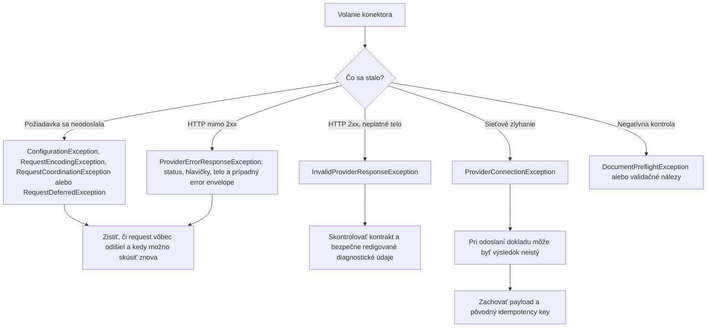

# Výnimky, retry a idempotencia

Výnimky konektora dedia z `EFakturaException`. Kategóriu zlyhania určujte podľa triedy výnimky; text `getMessage()` je technická anglická správa pre logy. Používateľské hlásenie mapuje hostiteľská aplikácia podľa typu a dostupných údajov.

PHP ukážka nižšie je samostatný offline skript. Po `composer install` uložte ju ako `docs/wiki/offline-example.php` a spustite z koreňa repozitára príkazom `php docs/wiki/offline-example.php`. Používa syntetický payload a lokálnu náhradu gatewaya, ktorá vyvolá simulované zlyhanie spojenia; API nekontaktuje.

<details>
<summary>Obsah stránky</summary>

- [Rýchle rozhodnutie podľa výsledku](#rýchle-rozhodnutie-podľa-výsledku)
- [API a transport](#api-a-transport)
- [Dokument a validácia](#dokument-a-validácia)
- [HTTP chyba a zamietnutie požiadavky](#http-chyba-a-zamietnutie-požiadavky)
- [Token endpoint a neplatné odpovede](#token-endpoint-a-neplatné-odpovede)
- [Retry politika](#retry-politika)
- [Backpressure a circuit breaker](#backpressure-a-circuit-breaker)
- [Idempotentné odoslanie](#idempotentné-odoslanie)

</details>

## Rýchle rozhodnutie podľa výsledku



Rozhodujte podľa typu výsledku, nie podľa textu výnimky. Každá `ProviderApiException` má `requestMayHaveReachedProvider()`: `false` znamená, že sa požiadavka určite neodoslala (`RequestDeferredException`, `TokenRequestException`, `CircuitBreakerOpenException` a zlyhanie cURL pred odoslaním), takže jej zopakovanie nemôže duplikovať vedľajší účinok. `true` je konzervatívna odpoveď pre všetko ostatné; pri odosielaní dokladu môže ísť o prípad, keď provider dokument prijal, ale odpoveď sa stratila.

### Rozhodnutie z jedného miesta: `FailureClassifier`

Aby hostiteľ (queue job, scheduler) nemusel skúmať triedy výnimiek, `FailureClassifier::classify(Throwable)` vráti `FailureAssessment`. Je to čistá funkcia: nič neposiela a nerozhoduje za hostiteľa. Správu výnimky nepreberá, takže ostáva technická anglická.

| Metóda | Význam |
| --- | --- |
| `category()` | Jedna z konštánt `FailureAssessment::CATEGORY_*`: `authentication`, `deferred`, `transient`, `rejected`, `invalid_response`, `invalid_input`, `configuration`, `internal`. |
| `isRetryable()` | Zopakovanie rovnakej operácie môže uspieť bez zmeny vstupu alebo konfigurácie. |
| `requestMayHaveReachedProvider()` | Rovnaké pravidlo ako pri `ProviderApiException`; cudzie a interné výnimky sú konzervatívne `true`. |
| `isOutcomeUnknown()` | Provider mohol požiadavku spracovať bez toho, aby hostiteľ poznal výsledok (sieťové zlyhanie, 5xx, 408, nečitateľná 2xx odpoveď). |
| `isSafeToRepeatBlindly()` | Retryable a požiadavka určite neodišla. Len vtedy je zopakovanie bez rizika duplicity. |
| `needsAdministratorAttention()` | Chybné poverenia, scope alebo konfigurácia; retry nepomôže. |
| `retryAt()` | Najskorší odporúčaný čas z `Retry-After` alebo z lokálneho backpressure. |

`isRetryable()` neznamená „zopakuj naslepo“. Pri odoslaní dokladu platí `isOutcomeUnknown()` a `requestMayHaveReachedProvider()`: zopakujte s rovnakým idempotency key a rovnakým payloadom, alebo najprv skontrolujte stav cez tracking. Konektor odoslanie dokladu automaticky neopakuje.

```php
use DreaM1\EfakturaConnector\Core\Exceptions\FailureClassifier;
use DreaM1\EfakturaConnector\Support\Exceptions\ConnectorThrowable;

try {
    $client->documentSubmissionGateway()->send($request);
} catch (ConnectorThrowable $failure) {
    $assessment = FailureClassifier::classify($failure);

    if ($assessment->needsAdministratorAttention()) {
        // alarm: poverenia alebo konfigurácia
    } elseif ($assessment->isRetryable()) {
        // znova zaradiť s rovnakým payloadom a idempotency key; nie skôr ako $assessment->retryAt()
    } else {
        // označiť ako zlyhané; pri isOutcomeUnknown() najprv overiť stav cez tracking
    }
}
```

## API a transport

| Typ výnimky | Kedy vzniká | Dostupné údaje |
| --- | --- | --- |
| `ProviderConnectionException` | Požiadavku nebolo možné dokončiť, napr. sieťové zlyhanie. Poskytovateľ ju mohol dostať, okrem zlyhania pred odoslaním (`requestMayHaveReachedProvider() === false`). |
| `CircuitBreakerOpenException` | Otvorený circuit breaker odmietol požiadavku lokálne. Podtrieda `ProviderConnectionException`, ale nič sa neodoslalo (`requestMayHaveReachedProvider() === false`). | Základné údaje chyby poskytovateľa. | Základné údaje chyby poskytovateľa. |
| `ProviderErrorResponseException` | Poskytovateľ odpovedal HTTP mimo 2xx. | Typovaný `httpStatusCode()` alebo `null`, surový `rawStatusCode()`, `responseHeaders()`, `retryAt(): ?RetryDeadline`, surové `body()` a parsované `errorEnvelope()` (alebo `null`, ak telo nemá známy formát). |
| `InvalidProviderResponseException` | HTTP 2xx, ale JSON/XML alebo povinné polia nezodpovedajú kontraktu. | Zachytené `httpStatusCode()` alebo `null`, `rawStatusCode()`, `responseHeaders()`, `schema()` a `field()` ak sú známe. |
| `ProviderResponseTooLargeException` | Transport prerušil čítanie, keď telo prekročilo nakonfigurovaný limit; odpoveď sa automaticky neopakuje. | `responseBodyLimit()` a dostupné `httpStatusCode()`, `rawStatusCode()` a `responseHeaders()`. |
| `RequestDeferredException` | Backpressure vrstva odložila požiadavku pred odoslaním. | `retryAt()` ako `RetryDeadline`; Unix timestamp získate cez `unixTimestamp()`. |
| `RequestCoordinationException` | Nebolo možné získať nakonfigurovaný lokálny alebo zdieľaný HTTP lock; chránená požiadavka sa nespustila. | Pôvodnú príčinu cez `getPrevious()`, ak je dostupná. |
| `TokenRequestException` | Zlyhalo získanie OAuth tokenu. | Pôvodná príčina v `getPrevious()`. |
| `RequestEncodingException` | Request body sa nedá enkódovať. Volanie ešte nebolo odoslané. | Technická správa. |
| `RequestBodyTooLargeException` | Serializované batch telo prekročilo lokálny limit; HTTP volanie sa nespustilo. | `maxBytes()` vracia nastavený limit v bajtoch. |
| `ConfigurationException` | Chýba alebo je neplatná konfigurácia. | Technická správa. |

`ApiConnector` zachová pôvodné telo chyby a na API hranici ho tolerantne spracuje cez `ProviderErrorEnvelopeParser::parse()`. Rozpoznaný výsledok pripojí k `ProviderErrorResponseException::errorEnvelope()`; výnimka vytvorená priamo bez typovaného envelope telo sama neparsuje.

`ProviderApiException` je spoločný predok API/transport chýb. `httpStatusCode()` vracia typovaný `HttpStatusCode` iba pre platné HTTP statusy 100–599; `rawStatusCode()` zachová prijatú číselnú hodnotu pre diagnostiku. Neplatný prijatý status sa pri klasifikácii spracuje ako 5xx podľa [RFC 9110, §15](https://www.rfc-editor.org/rfc/rfc9110.html#section-15).

Neznáma hodnota enumu v úspešnej providerovej odpovedi sama osebe nie je chybný tvar odpovede. Neprázdne statusy a typy webhook udalostí sa zachovajú; pri statusových value objectoch použite `isKnown()` a pri `WebhookEventType` `isSupported()`. `payloadFormat` a `TokenStatus::tokenType()` sú reťazce a zachovávajú nové hodnoty. Vstupné value objecty si zachovávajú svoje doterajšie `fromString()` pravidlá a requesty overujú povolené hodnoty pre danú operáciu. OAuth `token_type` pre SAPI sa porovnáva bez ohľadu na veľkosť písmen a normalizuje na `Bearer`.

Výnimky UBL a Peppol validácie patria do namespace `Core\Ubl\Exceptions`; ich validačné dátové typy zostávajú v `Core\Ubl\Validation`.

Každú zámerne vyvolanú výnimku konektora implementuje rozhranie `Support\Exceptions\ConnectorThrowable`, takže ich hostiteľ zachytí jedným `catch` bez toho, aby zachytil cudzie chyby. Patria sem `EFakturaException` a jej potomkovia, `InvalidInputException`, `InvariantViolationException`, `XmlParseException` a `LockStorageException`. Hierarchia má viac koreňov: `EFakturaException` dedí z `RuntimeException`, `InvalidInputException` z `InvalidArgumentException` a `InvariantViolationException` z `LogicException`. Preto na zachytenie všetkých zámerných chýb konektora použite `catch (ConnectorThrowable $e)`; `catch (EFakturaException $e)` nezachytí neplatný vstup. `XmlParseException` a `LockStorageException` sú nízkoúrovňové; balík ich na verejných hraniciach prevádza na `InvalidXmlException` alebo `InvalidProviderResponseException` (XML), resp. `RequestCoordinationException` alebo `LocalValidationInfrastructureException` (zámky), a vidíte ich hlavne pri priamom použití tried zo `Support` alebo pri zlom nastavení lock adresára.

Neplatná hodnota odovzdaná value objectu alebo requestu (prázdny identifikátor, veľkosť stránky mimo rozsahu, zlý formát účastníka) vyvolá `Support\Exceptions\InvalidInputException`. Je to podtyp `InvalidArgumentException`, takže existujúce `catch (InvalidArgumentException)` ho stále zachytí. Chyba konfigurácie, ktorú opraví administrátor (napríklad továreň executora, ktorá nevrátila `HttpRequestExecutorInterface`, alebo nesplnená podmienka v príkaze `CheckConnectorCommand`), vyvolá `ConfigurationException`. Porušený interný invariant (zatvorený cURL handle, opakovaný vstup do poolovaného executora, chýbajúca základná URL v transporte, nesprávne použitie UBL writera) vyvolá `Support\Exceptions\InvariantViolationException`; ide o chybu v balíku alebo jeho zneužitie, nie o hodnotu od hostiteľa. Balík nevyhadzuje holé výnimky SPL; architektonický test to stráži.

Neplatný vstup dodaný hostiteľom pri parsovaní webhooku vyvolá `InvalidWebhookPayloadException`, ktorá dedí z `InvalidInputException`. Nejde o chybu HTTP receivera ani overenia podpisu; tieto zodpovednosti zostávajú hostiteľovi.

## Dokument a validácia

| Typ výnimky | Význam |
| --- | --- |
| `RecipientUnsupportedException` | Discovery úspešne odpovedalo, že príjemca nepodporuje požadovaný typ alebo proces. |
| `DocumentRejectedByProviderException` | Vzdialená validácia vrátila `valid: false`. |
| `DocumentPreflightException` | Abstraktný predok negatívnych výsledkov kontroly. Nie je to HTTP/transport chyba. |
| `InvalidXmlException` | XML je neplatné alebo nebezpečné; `isUnsafe()` rozlišuje bezpečnostný dôvod. |
| `UnsupportedDocumentTypeException` | Koreň nie je podporovaný UBL Invoice alebo CreditNote. |
| `SchemaValidationException` | UBL XSD validácia neprešla; obsahuje `version()`, `issues()` a `omittedCount()`. |
| `PeppolBillingViolationException` | Spoločný abstraktný predok oboch výnimiek nižšie; nesie `violatedRules()`. |
| `PeppolBillingRulesException` | Hlavička porušuje doplnkové pravidlo BR-CO-25; obsahuje `violatedRules()`. |
| `PeppolBillingDraftRulesException` | `PeppolBillingDraftRulesInterface::assertSatisfied()` odmietlo draft pred serializáciou; `violatedRules()` vráti identifikátory porušených pravidiel. |
| `LocalValidationInfrastructureException` | Validáciu nebolo možné vykonať pre Java, Saxon, proces alebo zdroje. |

Peppol Schematron nálezy sa vracajú ako `PeppolSchematronValidationResult`, nie ako výnimky. Upozornenia a informačné nálezy neblokujú validitu, chyba ju blokuje a vynechané nálezy označujú neúplný výsledok. `LocalValidationInfrastructureException` signalizuje, že validáciu nebolo možné spustiť alebo dokončiť.

## HTTP chyba a zamietnutie požiadavky

Negatívna odpoveď na úspešne vykonanú kontrolu je `DocumentPreflightException`. HTTP 400 pri validácii zostáva `ProviderErrorResponseException`. Výnimka zachováva pôvodné telo cez `body()` a rozpoznanú JSON obálku sprístupní cez `errorEnvelope()`. `ProviderErrorEnvelope::category()` vracia nullable `ProviderErrorCategory`; cez `value()` získate presný text a `isKnown()` rozpozná kategórie `AUTH`, `VALIDATION`, `PROCESSING`, `TEMPORARY` a `PERMANENT`. `ProviderErrorEnvelope::code()` vracia nullable `ProviderErrorCode`; jeho `value()` zachová presný kód poskytovateľa vrátane neznámych hodnôt. Neznáme kategórie sa zachovajú, no bezpečný API log ich nezapisuje. Hostiteľ rozhoduje, čo `category`, `code` a `details` znamenajú pre aplikáciu; pri retry kandidátoch transport požiadavku zopakuje iba pri rozpoznanej hodnote `retryable: true`.

Zachovajte surový obsah iba podľa bezpečnostnej a retenčnej politiky hostiteľa. Ak ho logujete, redigujte tajomstvá, osobné údaje a voľný text podľa potrieb aplikácie.

## Token endpoint a neplatné odpovede

Ak backpressure počas obnovy tokenu odloží požiadavku na SAPI token endpoint, `SapiTokenProvider::getToken()` vyhodí priamo `RequestDeferredException`. Tokenový request sa ešte neodoslal; výnimka sa neobalí do `TokenRequestException`. Naplánujte ďalší pokus podľa `retryAt()->unixTimestamp()`. `TokenRequestException` označuje zlyhanie samotného volania token endpointu, napríklad chybu spojenia, HTTP chybu alebo neplatnú odpoveď; pôvodnú výnimku nájdete v `getPrevious()`.

Aj voliteľné polia odpovede môžu mať obsahové obmedzenia. Ak prítomná hodnota poruší validáciu svojho tvaru alebo obsahu, napríklad prázdne `documentId`, vznikne `InvalidProviderResponseException` so schémou, poľom a dostupným HTTP kontextom.

## Retry politika

`RetryPolicy::default()` povoľuje najviac 3 pokusy celkovo, začína oneskorením 500 ms a exponenciálne ho zvyšuje až po konfigurovaný strop 30 sekúnd. Predvolený počet pokusov preto čaká 500 ms a potom 1 sekundu. Konfigurácia môže nastaviť 1 až 10 celkových pokusov vrátane prvého volania. `ApiRequest` predvolene povoľuje retry iba pre GET; každú inú HTTP metódu môže endpoint výslovne označiť ako bezpečnú. Integrator klient takto označuje vytvorenie/aktiváciu s idempotency key a úplnú náhradu participant prístupov cez PUT; rotáciu secretu ani odstránenie klienta automaticky neopakuje.

`RetryingHttpRequestExecutor` opakuje sieťové zlyhania a odpovede 5xx/429 len pre retry-safe požiadavky. Pri HTTP 5xx alebo 429 predvolená skladba navyše vyžaduje rozpoznanú chybovú obálku s `retryable: true`; chýbajúci, nečitateľný alebo `false` príznak retry zastaví. Pri chybe spojenia bez HTTP odpovede sa čaká podľa exponenciálneho oneskorenia politiky (predvolene 500 ms a potom 1 sekunda); ak je oneskorenie dlhšie než inline limit politiky, executor nečaká a vyhodí pôvodnú `ProviderConnectionException`. Pri retry po HTTP odpovedi sa synchronne čaká najviac 1 sekundu; ak platná hlavička `Retry-After` vyžaduje dlhšie čakanie, executor vráti provider odpoveď bez ďalšieho pokusu. `ProviderApiException::retryAt()` prevedie platnú hlavičku na `RetryDeadline`; Unix timestamp získate cez `unixTimestamp()`.

Ak retry vrstva vráti konečnú HTTP 429 odpoveď, backpressure uloží cooldown z `Retry-After` alebo sekundový fallback. Ďalšie volania v rovnakom transportnom scope vyvolajú `RequestDeferredException` ešte pred sieťovým volaním. Pre SAPI/Gateway scope sa identifikuje originom, OAuth klientom a scope a zostáva stabilný po obnove Bearer tokenu; pre Integrator API vychádza z originu a hashovanej integrator konfigurácie. Výnimka poskytuje `retryAt()` a znamená, že konkrétna požiadavka nebola odoslaná. Dlhé čakanie patrí do hostiteľskej fronty; pri opakovaní odoslania dokladu použite rovnaký idempotency key a identický payload.

SAPI acknowledge je podľa OpenAPI idempotentný, preto ho endpoint označuje ako bezpečný na automatický retry.

Predvolená skladba používa príznak `retryable` z chybovej odpovede. Odosielanie dokladov je v balíku nebezpečné na automatické retry; klient pri opakovanom pokuse musí použiť rovnaký idempotency key a identický payload.

HTTP význam hlavičky `Retry-After` a stavov 429/5xx je opísaný v [RFC 9110](https://www.rfc-editor.org/rfc/rfc9110). Konektor túto všeobecnú sémantiku kombinuje s retry príznakom v odpovedi poskytovateľa a limitmi `RetryPolicy`; všeobecný HTTP štandard sám neurčuje, či je konkrétna operácia SAPI alebo Gateway bezpečné opakovať. Konkrétne pravidlá a odkazy na provider kontrakty sú v [Source-Alignment](Source-Alignment.md).

## Backpressure a circuit breaker

`BackpressureHttpRequestExecutor` pred každým pokusom skontroluje uložený cooldown (aj pred opakovaním po čakaní retry vrstvy); termín z odpovede 429 zapisuje `RateLimitRecordingHttpRequestExecutor` po každom pokuse (z `Retry-After`, alebo sekundový cooldown, ak hlavička chýba či nie je platná); retry vrstva ho prečíta pred určením čakania. Ďalšie požiadavky v rovnakom transportnom scope sa do tohto termínu neodošlú a vyvolajú `RequestDeferredException`. SAPI/Gateway scope sa nemení pri obnove Bearer tokenu; Integrator API používa samostatný hashovaný scope z originu a ID integratora; rotácia tokenu ho nemení. Výnimka obsahuje najskorší čas ďalšieho pokusu v `retryAt()`. Samostatná predvolená skladba používa `InMemoryHttpRequestBackpressure`, ktorá zdieľa cooldown iba medzi volaniami tej istej inštancie procesu.

`CircuitBreakerHttpRequestExecutor` obklopí retry vrstvu. `InMemoryCircuitBreaker` otvorí obvod po piatich neúspešných operáciách (chyba spojenia alebo odpoveď HTTP 5xx) v priebehu 60 sekúnd a blokuje nové volania 30 sekúnd; v polootvorenom stave povolí jeden skúšobný request. HTTP 429 sa nezapočítava ako zlyhanie. `DefaultHttpRequestExecutorFactory` zahŕňa oba dekorátory a v samostatnom použití predvolene používa in-memory úložiská.

Circuit breaker má jediný kontrakt, `CircuitBreakerInterface`. `acquireExecutionPermit()` atomicky povolí požiadavku, ktorá môže byť jedinou sondou v polootvorenom stave, alebo vráti `null`, keď je okruh otvorený. Permit je viazaný na generáciu stavu, takže výsledok pomalej požiadavky zo staršej generácie nemôže prepísať novší stav. Výsledok sa hlási cez `recordSuccessForPermit()`, `recordFailureForPermit()` alebo neutrálne cez `recordNeutralForPermit()`; HTTP 429 a lokálne chyby sú neutrálne. `isOpen()` je len diagnostika. Vstavaný in-memory aj Laravel cache breaker zdieľajú rovnaký stavový automat.

Chyba spojenia a konečná odpoveď HTTP 5xx sú zlyhania; neočakávaná lokálna výnimka, vrátane `RequestDeferredException` z backpressure, uvoľní permit neutrálne. Odpoveď HTTP 429 je neutrálna, takže nezmení históriu chýb ani neuzavrie breaker úspechom sondy.

Breaker obklopuje retry vrstvu, preto vyhodnocuje celú operáciu, nie jednotlivé pokusy:

- Operácia, ktorá po všetkých pokusoch skončí chybou spojenia alebo 5xx, sa počíta ako jedno zlyhanie; prah `failure_threshold` teda znamená počet operácií, nie pokusov. Pokus s úspešnou odpoveďou po predchádzajúcich 5xx sa počíta ako úspech.
- Počas retry cyklu sa stav breakera znova nekontroluje. Operácia, ktorá už bola povolená, dobehne všetky svoje pokusy aj vtedy, keď sa obvod medzitým otvoril.
- V polootvorenom stave drží skúšobný permit celá operácia vrátane čakania medzi pokusmi. Ostatné požiadavky sú dovtedy odmietnuté, kým sonda neskončí úspechom, zlyhaním alebo neutrálne.
- Odmietnutie otvoreným obvodom vyhodí `ProviderConnectionException` ešte pred retry vrstvou, takže sa neopakuje.

Logger a metriky sú pod breakerom a vidia iba skutočné pokusy. Odmietnutia otvoreným obvodom (`CircuitBreakerOpenException`, podtrieda `ProviderConnectionException`) a odloženia cez backpressure zaznamená najvonkajšia `RejectionObservingHttpRequestExecutor` raz za operáciu: metrika s výsledkom `circuit_open` alebo `deferred` a udalosť `recordFailure` loggera.

Laravel bridge nahrádza tieto úložiská implementáciami `LaravelCacheHttpRequestBackpressure` a `LaravelCacheCircuitBreaker`, takže zdieľaný Laravel cache store uchováva cooldown aj breaker medzi workermi. Cache store s podporou atomických zámkov koordinuje aj aktualizácie naprieč hostmi; bez tejto podpory sa aktualizácie zamykajú lokálne cez súbory. Pri zlyhaní cache je backpressure najlepšia snaha a circuit breaker prejde na lokálny stav v pamäti.

## Idempotentné odoslanie

Pre nové odoslanie vytvorte `IdempotencyKey` cez `IdempotencyKeyGenerator::generate()` a uložte ho spolu s payloadom. Hodnotový objekt uchováva UUID v4 kompatibilné s formátom v DataHosting OpenAPI; pri ukladaní použite `value()` a pri načítaní ho obnovte cez `IdempotencyKey::fromString()`. Kľúč sa vždy uloží malými písmenami, takže ten istý UUID zapísaný veľkými aj malými písmenami dá rovnakú hlavičku `Idempotency-Key`; `value()` preto môže vrátiť iný zápis, než ste odovzdali. Pri opakovaní toho istého pokusu použite rovnaký objekt kľúča a identický payload. `SendDocumentRequest` nesie kľúč spolu s participantom a payloadom; endpoint neoznačí odosielací POST ako bezpečný na automatický retry. Ak požiadavka skončí timeoutom alebo chybou, stav odoslania môže byť neistý; pred ďalším krokom skontrolujte stav cez tracking API. Zmena XML znamená nový payload a nový idempotency key.

```php
<?php
use DreaM1\EfakturaConnector\Core\Documents\IdempotencyKey;
use DreaM1\EfakturaConnector\Core\Documents\IdempotencyKeyGenerator;
use DreaM1\EfakturaConnector\Core\Documents\DocumentSubmissionResult;
use DreaM1\EfakturaConnector\Core\Documents\OutboundDocumentPayload;
use DreaM1\EfakturaConnector\Core\Documents\Sha256Checksum;
use DreaM1\EfakturaConnector\Core\Documents\SendDocumentRequest;
use DreaM1\EfakturaConnector\Core\Exceptions\ProviderConnectionException;
use DreaM1\EfakturaConnector\Core\Contracts\DocumentSubmissionGatewayInterface;
use DreaM1\EfakturaConnector\Core\Ubl\PeppolDocumentTypeIdentifierBuilder;
use DreaM1\EfakturaConnector\Domain\EFaktura\Participant;
use DreaM1\EfakturaConnector\Domain\EFaktura\PeppolProcessIdentifier;
use DreaM1\EfakturaConnector\Domain\EFaktura\SubmittedDocumentId;
use DreaM1\EfakturaConnector\Domain\Ubl\PeppolBillingProfile;
use DreaM1\EfakturaConnector\Support\Timestamp;

require dirname(__DIR__, 2) . '/vendor/autoload.php';

final class WikiOfflineFailingGateway implements DocumentSubmissionGatewayInterface
{
    public function send(SendDocumentRequest $request): DocumentSubmissionResult
    {
        throw new ProviderConnectionException('Synthetic offline connection failure.');
    }
}

$participant = Participant::parse('9915:sender-demo');
$receiver = Participant::parse('9915:receiver-demo');
$xml = '<Invoice xmlns="urn:oasis:names:specification:ubl:schema:xsd:Invoice-2"><ID>OFFLINE-RETRY-001</ID></Invoice>';
$payload = new OutboundDocumentPayload(
    SubmittedDocumentId::fromString('OFFLINE-RETRY-001'),
    PeppolDocumentTypeIdentifierBuilder::forDocument('Invoice'),
    PeppolProcessIdentifier::fromString(PeppolBillingProfile::PROCESS_ID),
    $participant,
    $receiver,
    Timestamp::fromDateTimeImmutable(new DateTimeImmutable('2026-11-26T12:00:00+00:00')),
    $xml,
    Sha256Checksum::fromContent($xml)
);
$gateway = new WikiOfflineFailingGateway();
$idempotencyKey = IdempotencyKeyGenerator::generate();
$storedAttempt = [
    'idempotency_key' => $idempotencyKey->value(),
    'payload' => $payload,
];

try {
    $gateway->send(new SendDocumentRequest(
        $participant,
        $payload,
        $idempotencyKey
    ));
} catch (ProviderConnectionException $exception) {
    // Obnovte kľúč z uloženej hodnoty a zostavte retry z toho istého payloadu.
    $retryKey = IdempotencyKey::fromString($storedAttempt['idempotency_key']);
    $retryRequest = new SendDocumentRequest(
        $participant,
        $storedAttempt['payload'],
        $retryKey
    );

    echo 'Synthetic failure: ', $exception->getMessage(), PHP_EOL;
    echo 'Retry keeps key ', $retryRequest->idempotencyKey()->value(), ' and document ',
        $retryRequest->payload()->documentId()->value(), PHP_EOL;
}
```

Pole `storedAttempt` je v tomto príklade iba v pamäti. Aplikácia má pred prvým odoslaním trvalo uložiť identický XML payload a hodnotu kľúča, aby ich vedela obnoviť po reštarte.

<details>
<summary>Súvisiace návody</summary>

- [HTTP transport a autentifikácia](Transport-and-Authentication)
- [Odosielanie dokladov](Sending-Documents)
- [Riešenie problémov](Troubleshooting)

</details>
