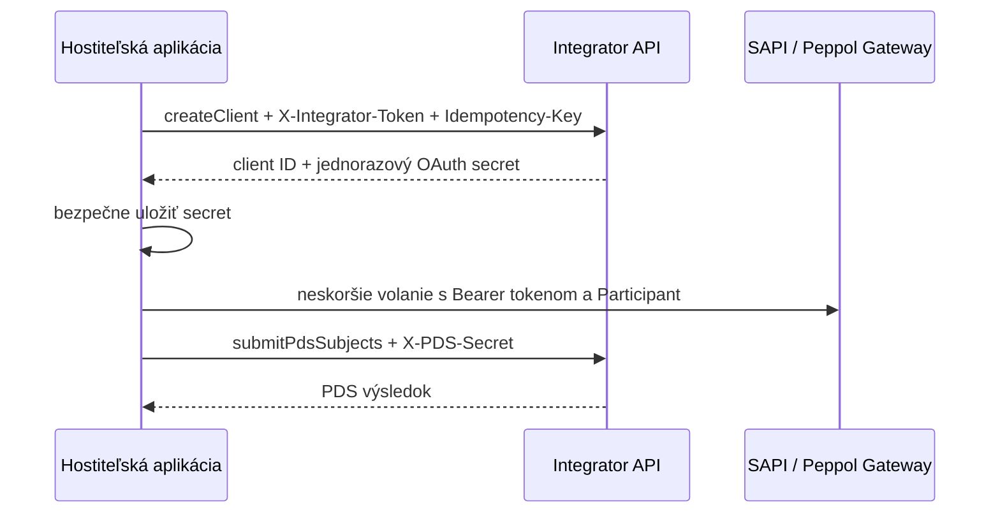

# Integrator API

Konektor poskytuje samostatného klienta pre DataHosting Integrator API. Bežné operácie používajú `X-Integrator-Token`; odoslanie PDS subjects používa podpis `X-PDS-Secret`. OAuth client ID a secret, ktoré spravujete cez tieto operácie, slúžia následne na samostatné SAPI a Peppol Gateway volania účastníkov.



Klientsky OAuth secret a PDS signing secret sú dve rozdielne poverenia. PDS požiadavka používa vlastný podpis; hlavička `X-Integrator-Token` sa na ňu neposiela.

## Laravel konfigurácia

V publikovanom `config/efaktura-connector.php` nastavte oddiel `integrator_api`. Hodnoty možno zadať cez premenné prostredia `EFAKTURA_INTEGRATOR_BASE_URL`, `EFAKTURA_INTEGRATOR_ID` a `EFAKTURA_INTEGRATOR_API_TOKEN`. Ak samostatnú URL nenastavíte, použije sa `EFAKTURA_BASE_URL`. Voliteľný PDS signing secret nastavte cez `EFAKTURA_PDS_SIGNING_SECRET`; Laravel ho načíta z `integrator_api.pds.signing_secret` do typovanej `PdsSigningConfiguration`.

```php
use DreaM1\EfakturaConnector\Core\Configuration\PdsSigningConfiguration;
use DreaM1\EfakturaConnector\Core\Contracts\IntegratorAccountClientInterface;

$integrator = app(IntegratorAccountClientInterface::class);
$pdsSecret  = app(PdsSigningConfiguration::class)->requireSigningSecret();
```

`PdsSigningConfiguration` sa rozlíši aj bez Integrator API poverení. Prázdna alebo chýbajúca hodnota znamená, že secret nie je nastavený: `hasSigningSecret()` vráti `false` a `requireSigningSecret()` vyhodí `ConfigurationException`. Neznámy kľúč v `integrator_api.pds` alebo hodnota obsahujúca iba medzery končí `ConfigurationException` pri rozlíšení. Secret sa ku klientovi nepripája automaticky; odovzdáva sa explicitne do `SubmitPdsSubjectsRequest`.

ID integrátora a token sú pri rozlíšení klienta povinné. Token uchovávajte v prostredí alebo secret store. Bez Laravelu vytvorte klienta explicitne podľa nasledujúceho príkladu.

## Vytvorenie klienta

Vytvorte HTTP executor stack rovnako ako pri ostatných API volaniach a zostavte klienta s URL prostredia, identifikátorom integrátora a Integrator API tokenom:

```php
use DreaM1\EfakturaConnector\Core\Configuration\IntegratorAccountConfiguration;
use DreaM1\EfakturaConnector\Core\Configuration\IntegratorToken;
use DreaM1\EfakturaConnector\Core\Documents\IdempotencyKeyGenerator;
use DreaM1\EfakturaConnector\Core\IntegratorApi\CreateClientRequest;
use DreaM1\EfakturaConnector\Core\IntegratorApi\IntegratorId;
use DreaM1\EfakturaConnector\Core\IntegratorApi\IntegratorParticipantAccess;
use DreaM1\EfakturaConnector\Domain\EFaktura\Participant;
use DreaM1\EfakturaConnector\Infrastructure\EFaktura\Api\Transport\Execution\DefaultHttpRequestExecutorFactory;
use DreaM1\EfakturaConnector\Infrastructure\EFaktura\Api\Transport\Execution\HttpRequestExecutorOptions;
use DreaM1\EfakturaConnector\Infrastructure\EFaktura\Connection\IntegratorAccountClientFactory;

// Načítajte token z bezpečného úložiska hostiteľskej aplikácie.
$integratorToken = getenv('EFAKTURA_INTEGRATOR_API_TOKEN');
if ($integratorToken === false || $integratorToken === '') {
    throw new RuntimeException('Missing Integrator API token.');
}

$executor = DefaultHttpRequestExecutorFactory::create(
    HttpRequestExecutorOptions::defaults()
);
$integrator = (new IntegratorAccountClientFactory(static function () use ($executor) {
    return $executor;
}))->create(
    new IntegratorAccountConfiguration(
        'https://test-sapisk.datahosting.sk',
        IntegratorId::fromString('your-integrator-id'),
        IntegratorToken::fromString($integratorToken)
    )
);

$created = $integrator->createClient(new CreateClientRequest(
    IdempotencyKeyGenerator::generate(),
    'ERP client',
    'api@example.sk',
    [new IntegratorParticipantAccess(
        Participant::parse('0245:1234567890'),
        true,
        true
    )]
));

$oneTimeSecret = $created->clientSecret();
if ($oneTimeSecret !== null) {
    $secretValue = $oneTimeSecret->reveal();
    // Store this value securely; the API returns it only during create or rotation.
}
```

Pre produkciu zmeňte `baseUrl` a použite zodpovedajúci integrátorský token. `ProviderBaseUrl` vyžaduje bezpečnú HTTPS adresu. Bežné operácie posielajú token v hlavičke `X-Integrator-Token`; PDS odoslanie používa samostatný `PdsAuthenticatedRequestSender` nad spoločným transportom a posiela podpis `X-PDS-Secret` bez Integrator API tokenu.

## Dostupné operácie

`IntegratorAccountClientInterface` pokrýva tieto volania:

| Metóda rozhrania | HTTP operácia | Správanie |
| --- | --- | --- |
| `listClients()` | `GET /v1/integrators/{integratorId}/clients` | Cursor stránkovanie, voliteľné `status`, `pageToken` a `limit`. |
| `createClient()` | `POST /v1/integrators/{integratorId}/clients` | Vyžaduje `Idempotency-Key`; odpoveď môže obsahovať jednorazový secret. |
| `getClient()` | `GET /v1/integrators/{integratorId}/clients/{clientId}` | Vráti metadáta klienta a jeho participant prístupy. |
| `deleteClient()` | `DELETE /v1/integrators/{integratorId}/clients/{clientId}` | Očakáva `204 No Content`. |
| `replaceClientParticipantAccess()` | `PUT /v1/integrators/{integratorId}/clients/{clientId}/participants` | Nahradí celý zoznam `participant_id`, `can_send`, `can_receive`. |
| `rotateClientSecret()` | `PUT /v1/integrators/{integratorId}/clients/{clientId}/secret` | Vráti nový jednorazový secret; automatický retry je vypnutý, lebo druhá rotácia by mohla zneplatniť prvý výsledok. |
| `listParticipants()` | `GET /v1/integrators/{integratorId}/participants` | Cursor stránkovanie cez `pageToken` a `limit`. |
| `getDocumentSummary()` | `GET /v1/integrators/{integratorId}/document-summary` | `month` musí byť kalendárny mesiac vo formáte `yyyyMM`. |
| `requestParticipantActivation()` | `POST /v1/integrators/{integratorId}/participants/{participantId}/activations` | Vyžaduje idempotency UUID a režim `SEND_ONLY` alebo `SEND_AND_RECEIVE`. |
| `submitPdsSubjects()` | `POST /v1/integrators/{integratorId}/pds/subjects` | Odosiela typovaný zoznam PDS subjects podpísaný cez `X-PDS-Secret`. |

Vstupné DTO `IntegratorParticipantAccess` a `ActivateParticipantRequest` prijímajú existujúci `Participant` z `Domain\EFaktura`, vytvorený cez `Participant::parse()`. Integrator API používa rovnaký Peppol identifikátor účastníka ako SAPI a Gateway. Typ overuje syntax `scheme:value`; dostupnosť schémy v code liste sa overuje iba pri operáciách, ktoré ju vyžadujú. `IntegratorAccountConfiguration` prijíma integrátor ID ako `IntegratorId` value object a operácie nad OAuth klientom používajú `IntegratorClientReference` vytvorený z `OAuthClientId`.

Všetky cesty, query parametre, response polia a chybové statusy sú uvedené v [API prehľade](API-Reference) a lokálnom OpenAPI snapshote `docs/eFaktura/api/openapi.json`. Odpovede sa mapujú na typované Core hodnoty; neúspešné statusy používajú spoločné `ProviderErrorResponseException`.

| Operácia | Čo vráti | Čo uložiť alebo zvážiť |
| --- | --- | --- |
| `createClient()` | Nový client ID a jednorazový client secret | Secret bezpečne uložiť hneď; z neskoršieho detailu ho nemožno získať. |
| `rotateClientSecret()` | Nový jednorazový secret | Zachovať ho z odpovede; automatický retry rotácie je vypnutý. |
| `submitPdsSubjects()` | Výsledok prijatia PDS dávky | PDS signing secret patrí do PDS requestu, nie do SAPI OAuth konfigurácie. |

Stav OAuth klienta a režim kontraktu sú uzavreté value objecty. Na filtrovanie použite napríklad `IntegratorClientStatus::fromString('APPROVED')`; pri aktivácii odovzdajte `ParticipantContractMode::fromString('SEND_AND_RECEIVE')`. Response modely vracajú rovnaké typy, ich textová hodnota je dostupná cez `value()`.

## Odoslanie PDS subjects

`submitPdsSubjects()` odošle typované PDS údaje cez `POST /v1/integrators/{integratorId}/pds/subjects`. Telo tvorí `PdsSubjectBatch` z hodnôt `PdsSubject`; požiadavka nesie samostatný `PdsSigningSecret`:

```php
use DreaM1\EfakturaConnector\Core\IntegratorApi\PdsSubject;
use DreaM1\EfakturaConnector\Core\IntegratorApi\PdsSubjectBatch;
use DreaM1\EfakturaConnector\Core\IntegratorApi\PdsSigningSecret;
use DreaM1\EfakturaConnector\Core\IntegratorApi\PdsVerificationToken;
use DreaM1\EfakturaConnector\Core\IntegratorApi\SubmitPdsSubjectsRequest;

$pdsSecret = getenv('EFAKTURA_PDS_SIGNING_SECRET');
if ($pdsSecret === false || $pdsSecret === '') {
    throw new RuntimeException('Missing PDS signing secret.');
}

$batch = new PdsSubjectBatch([
    new PdsSubject(
        null,
        '2022706466',
        'Synthetic Company s.r.o.',
        'info@example.test',
        null,
        PdsVerificationToken::fromString('synthetic-verification-token')
    ),
]);

$response = $integrator->submitPdsSubjects(new SubmitPdsSubjectsRequest(
    $batch,
    PdsSigningSecret::fromString($pdsSecret)
));
```

Endpoint serializuje polia podľa OpenAPI a podpisuje presné bajty odchádzajúceho JSON tela HMAC-SHA512 v hlavičke `X-PDS-Secret`; `PdsAuthenticatedRequestSender` vyžaduje práve jeden neprázdny podpis, inak vyhodí `InvalidInputException`, a odstráni prípadné `Authorization` a `X-Integrator-Token` hlavičky. Pri Laraveli použite namiesto `getenv()` priamo `app(PdsSigningConfiguration::class)->requireSigningSecret()`, ktoré už vráti `PdsSigningSecret`; mimo Laravel bridge secret načítajte zo secret store hostiteľskej aplikácie, prípadne cez `PdsSigningConfiguration::fromArray(['signing_secret' => ...])`. PDS signing secret je oddelený od Integrator API tokenu. Osobné údaje, PDS verification token a signing secret sa redigujú pri `var_dump()` a v komunikačných logoch. OpenAPI opisuje `X-PDS-Secret` ako SHA-512 podpis tela, ale nešpecifikuje presný formát; HMAC-SHA512 s hex výstupom je implementačná interpretácia, ktorú treba potvrdiť u DataHosting.

## Retry a bezpečnosť údajov

GET operácie používajú predvolenú retry politiku. Vytvorenie klienta a aktivácia účastníka sú retry-safe, pretože každá požiadavka nesie stabilný `Idempotency-Key`; pri opakovaní tej istej logickej požiadavky zachovajte rovnaký kľúč aj telo. Nahradenie participant prístupov je PUT s rovnakým výsledkom pri opakovanom identickom tele. Rotácia secretu, zmazanie klienta a `submitPdsSubjects()` sa automaticky neopakujú.

Integrátor API token a vydané OAuth secrets sú citlivé poverenia. Tokenový header sa do komunikácie logu nezapisuje, jednorazový secret je v response modeli redigovaný pri `var_dump()` a log sanitizer odstraňuje polia pomenované ako token alebo secret. Objekty s tajomstvom (`IntegratorToken`, `PdsSigningSecret`, `PdsVerificationToken`, `OAuthClientSecret`, `WebhookSigningSecret`, `OAuthAccessToken`) a objekty, ktoré ich držia (`SapiClientConfiguration`, `SapiToken`), nejde serializovať: `serialize()` vyhodí `InvariantViolationException`, aby sa tajomstvo nezapísalo do fronty, cache alebo session. Hostiteľ musí citlivé hodnoty bezpečne ukladať a obmedziť ich ďalšie logovanie.
