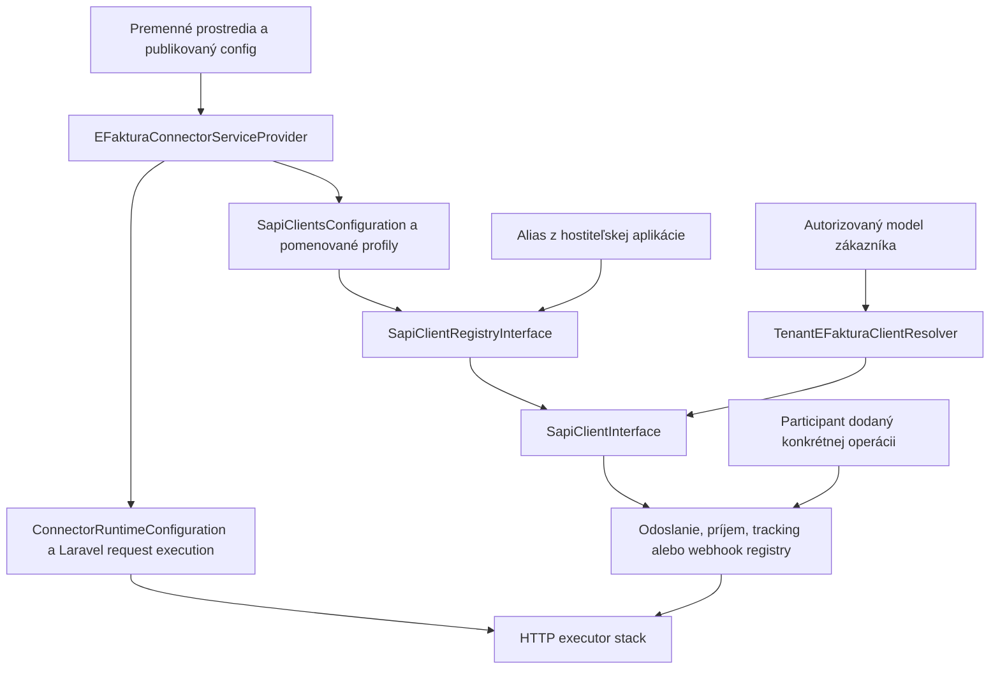

# Laravel bridge

Laravel bridge je voliteľný. Composer navrhuje `illuminate/support` v rozsahu `^5.6 || ^8.83 || ^9.0 || ^10.0 || ^11.0 || ^12.0 || ^13.0`; PHP musí spĺňať požiadavky zvolenej verzie Laravelu. CI testuje bridge na Laravel 5.6/PHP 7.4 a Laravel 13/PHP 8.4 v oddelených Composer projektoch a na Laravel 8/PHP 7.4 cez vývojovú závislosť hlavného projektu; verzie 9 až 12 sa samostatne netestujú. Laravel 5.6 používa lokálne súborové zámky tam, kde novšie verzie alebo cache store poskytujúce `Cache::lock()` používajú zdieľané cache zámky. Laravel načíta service provider cez Composer package discovery. Jadro balíka Laravel nevyžaduje a CI testuje jeho PHP 7.4 kompatibilitu v hlavnej matici.

<details>
<summary>Obsah stránky</summary>

- [Tok Laravel konfigurácie ku klientovi](#tok-laravel-konfigurácie-ku-klientovi)
- [Konfigurácia](#konfigurácia)
  - [Kde a ako upraviť hodnoty](#kde-a-ako-upraviť-hodnoty)
  - [Viac OAuth klientov pre tenantov](#viac-oauth-klientov-pre-tenantov)
  - [SAPI, Peppol Gateway, Integrator API a PDS](#sapi-peppol-gateway-integrator-api-a-pds)
  - [Diagnostika](#diagnostika)
  - [Request execution a validácia](#request-execution-a-validácia)
- [Predvolené bindings](#predvolené-bindings)
  - [Príklad konfigurácie workerov](#príklad-konfigurácie-workerov)
  - [Konfigurácia Laravel Horizon](#konfigurácia-laravel-horizon)
  - [Metriky](#metriky)
- [Resolving services](#resolving-services)
- [OAuth poverenia z modelu zákazníka](Tenant-Clients-in-Laravel)
- [Hranice bridge](#hranice-bridge)

</details>

## Tok Laravel konfigurácie ku klientovi



Pomenovaný profil vyberá aplikácia cez registry. Tenant resolver sa použije až po autorizácii konkrétneho modelu; participant sa naďalej odovzdáva operácii samostatne.

## Konfigurácia

Service provider načíta `config/efaktura-connector.php`. Publikovanie konfigurácie:

```sh
php artisan vendor:publish --tag=efaktura-connector-config
```

Zverejnený konfiguračný súbor spravuje hostiteľská aplikácia. Ak v ňom uvediete vlastné `laravel.validation.stages`, nové predvolené validačné kroky sa do tohto zoznamu automaticky nepridajú. Pôvodný tag `config` zostáva dostupný kvôli spätnej kompatibilite.

Kompletný príklad premenných pre konektor vlož do existujúceho Laravel `.env`. Nahraď testovacie poverenia hodnotami vydanými poskytovateľom; ostatné Laravel premenné, napríklad `APP_KEY` a databázové nastavenia, ponechaj podľa aplikácie.

```dotenv
# SAPI a Peppol Gateway používajú spoločnú URL a OAuth profil.
EFAKTURA_BASE_URL=https://test-sapisk.datahosting.sk
EFAKTURA_DEFAULT_CLIENT=default
EFAKTURA_CLIENT_ID=replace-with-client-id
EFAKTURA_CLIENT_SECRET=replace-with-client-secret
# Uveď iba scope pridelený poskytovateľom tomuto klientovi.
EFAKTURA_CLIENT_SCOPE="document:send document:receive"

# Integrator API používa samostatný token. URL môže zostať rovnaká ako EFAKTURA_BASE_URL.
EFAKTURA_INTEGRATOR_BASE_URL=https://test-sapisk.datahosting.sk
EFAKTURA_INTEGRATOR_ID=...
EFAKTURA_INTEGRATOR_API_TOKEN=replace-with-integrator-api-token
# PDS secret je iný než Integrator API token.
EFAKTURA_PDS_SIGNING_SECRET=replace-with-pds-signing-secret

# Laravel cache store pre tokeny, cooldowny a koordináciu requestov.
EFAKTURA_CACHE_STORE=redis

# HTTP timeouty a limity tiel (sekundy/bajty).
EFAKTURA_HTTP_CONNECT_TIMEOUT_SECONDS=10
EFAKTURA_HTTP_REQUEST_TIMEOUT_SECONDS=45
EFAKTURA_HTTP_RESPONSE_MAX_BYTES=16777216
EFAKTURA_HTTP_REQUEST_MAX_BYTES=104857600

# Retry sa použije iba pri požiadavkách, ktoré sú označené ako bezpečné na opakovanie.
EFAKTURA_HTTP_RETRY_ENABLED=true
EFAKTURA_HTTP_RETRY_MAX_ATTEMPTS=3
EFAKTURA_HTTP_RETRY_BASE_DELAY_MS=500
EFAKTURA_HTTP_RETRY_MAX_DELAY_MS=30000
EFAKTURA_HTTP_RETRY_MAX_INLINE_DELAY_MS=1000

# Circuit breaker a cooldown po HTTP 429.
EFAKTURA_CIRCUIT_BREAKER_FAILURE_THRESHOLD=5
EFAKTURA_CIRCUIT_BREAKER_FAILURE_WINDOW_SECONDS=60
EFAKTURA_CIRCUIT_BREAKER_OPEN_SECONDS=30
EFAKTURA_HTTP_RATE_LIMIT_FALLBACK_COOLDOWN_SECONDS=1

# HTTP request lock. Bez podpory atómových cache lockov sa použije lokálny súborový lock.
EFAKTURA_HTTP_EXECUTION_LOCK_DRIVER=cache
EFAKTURA_HTTP_EXECUTION_LOCK_STORE=redis
# EFAKTURA_HTTP_EXECUTION_LOCK_LEASE_SECONDS vynechajte; lease sa odvodí z timeoutu requestu
EFAKTURA_HTTP_EXECUTION_LOCK_WAIT_SECONDS=120

# Lokálna validácia UBL a Schematron.
EFAKTURA_VALIDATION_MAX_ISSUES=8
EFAKTURA_SCHEMATRON_MAX_CONCURRENT_VALIDATIONS=2
EFAKTURA_SCHEMATRON_PROCESS_TIMEOUT_SECONDS=60
EFAKTURA_SCHEMATRON_MAX_REPORT_BYTES=33554432
EFAKTURA_SCHEMATRON_MAX_ERROR_OUTPUT_BYTES=65536
EFAKTURA_SCHEMATRON_MAX_ERROR_DETAIL_CHARACTERS=512
# Voliteľný limit haldy Javy pre jeden Schematron proces v MB (64 až 65536); bez hodnoty platí predvolba JVM.
# EFAKTURA_SCHEMATRON_JAVA_MAX_HEAP_MB=
# Nasledujúce cesty sú voliteľné; predvolene sa použijú pribalené zdroje a Java z PATH/JAVA_HOME.
# EFAKTURA_VALIDATION_RESOURCE_DIRECTORY=
# EFAKTURA_VALIDATION_WORKING_DIRECTORY=
# EFAKTURA_SCHEMATRON_LOCK_DIRECTORY=
# EFAKTURA_JAVA_BINARY=
# Pri EFAKTURA_HTTP_EXECUTION_LOCK_DRIVER=file nastav existujúci zabezpečený adresár:
# EFAKTURA_HTTP_EXECUTION_LOCK_DIRECTORY=C:\path\to\private-lock-directory
```

Premenné `EFAKTURA_CLIENT_ID`, `EFAKTURA_CLIENT_SECRET` a `EFAKTURA_CLIENT_SCOPE` nakonfigurujú profil `default`. Pre tenantov s viacerými pevne nastavenými OAuth klientmi použi pomenované profily podľa nasledujúceho príkladu. Ak sú poverenia každého zákazníka uložené v databáze, použi `TenantEFakturaClientResolver`; postup je v návode [OAuth poverenia z modelu zákazníka](Tenant-Clients-in-Laravel).

### Kde a ako upraviť hodnoty

Hodnoty konektora sa menia na troch miestach. Použite najjednoduchšie, ktoré stačí:

| Miesto | Na čo slúži |
| --- | --- |
| `.env` | Poverenia, URL, timeouty, limity a prepínače vrstiev (premenné `EFAKTURA_*`). Väčšina nasadení potrebuje iba tento súbor. |
| `config/efaktura-connector.php` | Súbor vo vašej aplikácii, ktorý vytvorí `vendor:publish`. Upravujte ho pre veci, ktoré premenná nevie vyjadriť: viac pomenovaných OAuth klientov v `clients`, vlastný `laravel.request_execution.executor`, zoznam `laravel.validation.stages` a mapovanie `laravel.services`. |
| `config/efaktura-connector.php` v balíku (`vendor/dream1/efaktura-connector/config/`) | Iba predvolené hodnoty. **Needitujte ho**: zmena sa stratí pri aktualizácii balíka. |

Postup:

1. `php artisan vendor:publish --tag=efaktura-connector-config` skopíruje súbor do `config/efaktura-connector.php` vašej aplikácie. Existujúci súbor bez `--force` neprepíše.
2. Hodnoty z `.env` načíta súbor cez `env()`. Premennú teda nastavíte v `.env` a nemusíte meniť PHP súbor; v súbore ju prepíšete natvrdo iba vtedy, keď ju nechcete riadiť prostredím.
3. Po zmene spustite `php artisan config:clear`. Ak nasadzujete s `php artisan config:cache`, spustite ho znova po každej zmene `.env` aj konfiguračného súboru; cache sa inak nezmení a `env()` mimo konfigurácie sa pri nej nečíta.
4. Skontrolujte výsledok príkazom `php artisan efaktura:check` (pozri [Diagnostika](#diagnostika)).

Publikovaný súbor môže obsahovať aj iba kľúče, ktoré meníte: bridge ho zlúči s predvolenými hodnotami balíka aj do vnorených sekcií, takže vynechaná hodnota (napríklad `runtime.http.connect_timeout_seconds`) zostane riadená svojou premennou `EFAKTURA_*`. Výnimky: zoznamy, ako `laravel.validation.stages`, a pomenované profily v `clients` sa preberajú presne tak, ako ich uvediete, a nedopĺňajú sa predvolenými; do `stages` preto uveďte všetky kroky, ktoré chcete použiť. Zlučovanie sa preskočí pri `config:cache`, pretože cache už obsahuje zlúčený výsledok. Po aktualizácii balíka sa nové predvolené hodnoty doplnia samy, iba zoznam `laravel.validation.stages` v už publikovanom súbore musíte doplniť ručne.

### Viac OAuth klientov pre tenantov

Pridaj pre každého tenanta samostatný profil do mapy `clients`. Každý profil má vlastnú `base_url`, takže tenanti môžu používať rôzne prostredia. Ak použiješ túto variantu, v hlavnom `.env` bloku nahraď `EFAKTURA_DEFAULT_CLIENT` a `EFAKTURA_CLIENT_*` premenné nasledujúcimi hodnotami a definuj poverenia pre každý alias:

```dotenv
EFAKTURA_DEFAULT_CLIENT=tenant-a
EFAKTURA_TENANT_A_BASE_URL=https://test-sapisk.datahosting.sk
EFAKTURA_TENANT_A_CLIENT_ID=replace-with-tenant-a-client-id
EFAKTURA_TENANT_A_CLIENT_SECRET=replace-with-tenant-a-client-secret
EFAKTURA_TENANT_A_CLIENT_SCOPE="document:send document:receive"
EFAKTURA_TENANT_B_BASE_URL=https://test-sapisk.datahosting.sk
EFAKTURA_TENANT_B_CLIENT_ID=replace-with-tenant-b-client-id
EFAKTURA_TENANT_B_CLIENT_SECRET=replace-with-tenant-b-client-secret
EFAKTURA_TENANT_B_CLIENT_SCOPE="document:send"
```

V `config/efaktura-connector.php` nahraď položky `default_client` a `clients` týmto nastavením. Ostatné časti súboru, napríklad `integrator_api`, `runtime` a `laravel`, ponechaj:

```php
'default_client' => env('EFAKTURA_DEFAULT_CLIENT', 'tenant-a'),
'clients' => [
    'tenant-a' => [
        'base_url' => env('EFAKTURA_TENANT_A_BASE_URL', ''),
        'client_id' => env('EFAKTURA_TENANT_A_CLIENT_ID', ''),
        'client_secret' => env('EFAKTURA_TENANT_A_CLIENT_SECRET', ''),
        'client_scope' => env('EFAKTURA_TENANT_A_CLIENT_SCOPE', ''),
    ],
    'tenant-b' => [
        'base_url' => env('EFAKTURA_TENANT_B_BASE_URL', ''),
        'client_id' => env('EFAKTURA_TENANT_B_CLIENT_ID', ''),
        'client_secret' => env('EFAKTURA_TENANT_B_CLIENT_SECRET', ''),
        'client_scope' => env('EFAKTURA_TENANT_B_CLIENT_SCOPE', ''),
    ],
],
```

Vyber alias z už autorizovaného tenantového kontextu a cez registry získaj jeho klienta:

```php
use DreaM1\EfakturaConnector\Core\Contracts\SapiClientRegistryInterface;

$tenantAlias = 'tenant-b'; // alias priradený tenantu v hostiteľskej aplikácii
$client = app(SapiClientRegistryInterface::class)->client($tenantAlias);

$sapi = $client->documentSubmissionGateway();
$peppol = $client->peppolGatewayDocumentSubmission();
```

Priame Laravel service bindingy používajú profil určený cez `default_client` — v tomto príklade `tenant-a`. Na požiadavku konkrétneho tenanta použi registry a jeho alias. Každý profil má vlastného token providera; SAPI aj Peppol Gateway použijú poverenia vybraného profilu. Participant sa naďalej odovzdáva konkrétnej operácii.

### SAPI, Peppol Gateway, Integrator API a PDS

SAPI a Peppol Gateway používajú pomenované profily v `clients`; každý profil nesie vlastnú `base_url`. Použite serverový koreň bez `/sapi` alebo `/v1`; participant sa zadáva pri konkrétnej operácii. Integrator API má samostatné `integrator_api.base_url`, `integrator_api.integrator_id` a `integrator_api.token`; jeho URL sa nedopĺňa z profilu klienta.

#### Kompletný súbor `config/efaktura-connector.php`

Tento kompletný príklad zodpovedá súboru, ktorý publikuje balík. Môžeš ho skopírovať do `config/efaktura-connector.php`:

```php
<?php

/**
 * Package defaults for provider connection, runtime policy and Laravel service wiring.
 *
 * The `clients` profiles are parsed by SapiClientsConfiguration, Integrator API connection values by
 * IntegratorAccountConfiguration, `runtime` by ConnectorRuntimeConfiguration, and `laravel` by
 * LaravelServiceConfiguration and the service provider. The optional `integrator_api.pds` section is
 * parsed separately by PdsSigningConfiguration, not as part of the Integrator API connection values.
 * Environment variables provide deployment defaults; a published Laravel config file can override
 * these values directly. Time and size units are stated in each setting name.
 *
 * @return array{
 *     default_client: string,
 *     clients: array<string, array{
 *         base_url?: string,
 *         client_id?: string,
 *         client_secret?: string,
 *         client_scope?: string
 *     }>,
 *     integrator_api: array{
 *         base_url: string,
 *         integrator_id: string,
 *         token: string,
 *         pds: array{signing_secret: string}
 *     },
 *     runtime: array{
 *         http: array{
 *             connect_timeout_seconds: int|string,
 *             request_timeout_seconds: int|string,
 *             response_max_bytes: int|string,
 *             request_max_bytes: int|string
 *         },
 *         retry: array{
 *             enabled: bool|int|string,
 *             max_attempts: int|string,
 *             base_delay_ms: int|string,
 *             max_delay_ms: int|string,
 *             max_inline_delay_ms: int|string
 *         },
 *         circuit_breaker: array{
 *             enabled: bool|int|string,
 *             failure_threshold: int|string,
 *             failure_window_seconds: int|string,
 *             open_seconds: int|string
 *         },
 *         backpressure: array{
 *             enabled: bool|int|string,
 *             execution_lock: bool|int|string,
 *             fallback_cooldown_seconds: int|string
 *         },
 *         validation: array{max_issues: int|string},
 *         schematron: array{
 *             max_concurrent_validations: int|string,
 *             process_timeout_seconds: int|string,
 *             max_report_bytes: int|string,
 *             max_error_output_bytes: int|string,
 *             max_error_detail_characters: int|string,
 *             java_max_heap_mb: int|string|null
 *         }
 *     },
 *     laravel: array{
 *         cache_store: string|null,
 *         request_execution: array{
 *             executor: class-string<
 *                 HttpRequestExecutorInterface
 *             >,
 *             logging: bool|int|string,
 *             metrics: bool|int|string,
 *             execution_lock: array{
 *                 driver: 'cache'|'file',
 *                 store: string|null,
 *                 lease_seconds: int|string|null,
 *                 wait_seconds: int|string,
 *                 temporary_directory: string|null
 *             }
 *         },
 *         validation: array{
 *             stages: list<class-string<
 *                 UblValidationStageInterface
 *             >>,
 *             resource_directory: string|null,
 *             working_directory: string|null,
 *             concurrency_lock_directory: string|null,
 *             java_binary: string|null
 *         },
 *         services: array<class-string, class-string>
 *     }
 * }
 */

use DreaM1\EfakturaConnector\Core\CircuitBreaker\CircuitBreakerDefaults;
use DreaM1\EfakturaConnector\Core\Configuration\ConnectorRuntimeConfiguration;
use DreaM1\EfakturaConnector\Core\Configuration\SapiClientsConfiguration;
use DreaM1\EfakturaConnector\Core\Retry\RetryPolicy;
use DreaM1\EfakturaConnector\Core\Ubl\Contracts\UblValidationStageInterface;
use DreaM1\EfakturaConnector\Infrastructure\EFaktura\Api\Transport\Execution\HttpRequestExecutorInterface;
use DreaM1\EfakturaConnector\Laravel\Configuration\LaravelServiceConfiguration;

return [
    /** Alias used by the package's direct Laravel service bindings. */
    'default_client' => env('EFAKTURA_DEFAULT_CLIENT', SapiClientsConfiguration::DEFAULT_CLIENT_NAME),

    /**
     * Named OAuth credentials. Each profile names its own provider URL and gets an isolated token
     * provider; empty credentials allow the host application to boot before provider access is configured.
     */
    'clients' => [
        SapiClientsConfiguration::DEFAULT_CLIENT_NAME => [
            /** Provider API URL of this profile, for example the server root without `/sapi` or `/v1`. */
            'base_url'      => env('EFAKTURA_BASE_URL', ''),
            'client_id'     => env('EFAKTURA_CLIENT_ID', ''),
            'client_secret' => env('EFAKTURA_CLIENT_SECRET', ''),
            /** Explicit provider-issued OAuth scopes; an empty value is rejected by assertReady(). */
            'client_scope' => env(
                'EFAKTURA_CLIENT_SCOPE',
                ''
            ),
        ],
    ],

    /** Credentials for the separate DataHosting Integrator API. */
    'integrator_api' => [
        /** Defaults to the EFAKTURA_BASE_URL environment value when no Integrator-specific URL is set. */
        'base_url'      => env('EFAKTURA_INTEGRATOR_BASE_URL', env('EFAKTURA_BASE_URL', '')),
        'integrator_id' => env('EFAKTURA_INTEGRATOR_ID', ''),
        /** Keep this secret in the environment or a secret store. */
        'token' => env('EFAKTURA_INTEGRATOR_API_TOKEN', ''),
        /** Separate PDS request signing secret; this is not the Integrator API token. */
        'pds' => [
            'signing_secret' => env('EFAKTURA_PDS_SIGNING_SECRET', ''),
        ],
    ],

    /**
     * Framework-independent HTTP, retry, rate-limit and local validation policies.
     * These settings are parsed into ConnectorRuntimeConfiguration and are not Laravel bindings.
     */
    'runtime' => [
        /** HTTP timeouts and accepted response body size, and encoded body size of the Gateway batch send (`POST /v1/send-documents`). */
        'http' => [
            'connect_timeout_seconds' => env(
                'EFAKTURA_HTTP_CONNECT_TIMEOUT_SECONDS',
                ConnectorRuntimeConfiguration::DEFAULT_HTTP_CONNECT_TIMEOUT_SECONDS
            ),
            'request_timeout_seconds' => env(
                'EFAKTURA_HTTP_REQUEST_TIMEOUT_SECONDS',
                ConnectorRuntimeConfiguration::DEFAULT_HTTP_REQUEST_TIMEOUT_SECONDS
            ),
            'response_max_bytes' => env(
                'EFAKTURA_HTTP_RESPONSE_MAX_BYTES',
                ConnectorRuntimeConfiguration::DEFAULT_HTTP_RESPONSE_MAX_BYTES
            ),
            'request_max_bytes' => env(
                'EFAKTURA_HTTP_REQUEST_MAX_BYTES',
                ConnectorRuntimeConfiguration::DEFAULT_HTTP_REQUEST_MAX_BYTES
            ),
        ],
        /** Retry policy for requests whose ApiRequest explicitly permits retry. */
        'retry' => [
            'enabled'             => env('EFAKTURA_HTTP_RETRY_ENABLED', true),
            'max_attempts'        => env('EFAKTURA_HTTP_RETRY_MAX_ATTEMPTS', RetryPolicy::DEFAULT_MAX_ATTEMPTS),
            'base_delay_ms'       => env('EFAKTURA_HTTP_RETRY_BASE_DELAY_MS', RetryPolicy::DEFAULT_BASE_DELAY_MS),
            'max_delay_ms'        => env('EFAKTURA_HTTP_RETRY_MAX_DELAY_MS', RetryPolicy::DEFAULT_MAX_DELAY_MS),
            'max_inline_delay_ms' => env(
                'EFAKTURA_HTTP_RETRY_MAX_INLINE_DELAY_MS',
                RetryPolicy::DEFAULT_MAX_INLINE_DELAY_MS
            ),
        ],
        /** Circuit breaker layer switch plus failure threshold, observation window and open duration. */
        'circuit_breaker' => [
            'enabled'           => env('EFAKTURA_CIRCUIT_BREAKER_ENABLED', true),
            'failure_threshold' => env(
                'EFAKTURA_CIRCUIT_BREAKER_FAILURE_THRESHOLD',
                CircuitBreakerDefaults::FAILURE_THRESHOLD
            ),
            'failure_window_seconds' => env(
                'EFAKTURA_CIRCUIT_BREAKER_FAILURE_WINDOW_SECONDS',
                CircuitBreakerDefaults::FAILURE_WINDOW_SECONDS
            ),
            'open_seconds' => env(
                'EFAKTURA_CIRCUIT_BREAKER_OPEN_SECONDS',
                CircuitBreakerDefaults::OPEN_DURATION_SECONDS
            ),
        ],
        /**
         * Shared cooldown after HTTP 429. `execution_lock` additionally serializes requests per rate-limit
         * scope and has an effect only while backpressure is enabled. The fallback is the wait after a 429
         * response that has no usable Retry-After value.
         */
        'backpressure' => [
            'enabled'                   => env('EFAKTURA_HTTP_BACKPRESSURE_ENABLED', true),
            'execution_lock'            => env('EFAKTURA_HTTP_EXECUTION_LOCK_ENABLED', true),
            'fallback_cooldown_seconds' => env(
                'EFAKTURA_HTTP_RATE_LIMIT_FALLBACK_COOLDOWN_SECONDS',
                ConnectorRuntimeConfiguration::DEFAULT_HTTP_RATE_LIMIT_COOLDOWN_SECONDS
            ),
        ],
        /** Maximum findings retained per local validation stage; additional findings are counted as omitted. */
        'validation' => [
            'max_issues' => env(
                'EFAKTURA_VALIDATION_MAX_ISSUES',
                ConnectorRuntimeConfiguration::DEFAULT_VALIDATION_MAX_ISSUES
            ),
        ],
        /** Time, concurrency and output limits for local Peppol Schematron execution. */
        'schematron' => [
            'max_concurrent_validations' => env(
                'EFAKTURA_SCHEMATRON_MAX_CONCURRENT_VALIDATIONS',
                ConnectorRuntimeConfiguration::DEFAULT_SCHEMATRON_MAX_CONCURRENT_VALIDATIONS
            ),
            'process_timeout_seconds' => env(
                'EFAKTURA_SCHEMATRON_PROCESS_TIMEOUT_SECONDS',
                ConnectorRuntimeConfiguration::DEFAULT_SCHEMATRON_PROCESS_TIMEOUT_SECONDS
            ),
            'max_report_bytes' => env(
                'EFAKTURA_SCHEMATRON_MAX_REPORT_BYTES',
                ConnectorRuntimeConfiguration::DEFAULT_SCHEMATRON_MAX_REPORT_BYTES
            ),
            'max_error_output_bytes' => env(
                'EFAKTURA_SCHEMATRON_MAX_ERROR_OUTPUT_BYTES',
                ConnectorRuntimeConfiguration::DEFAULT_SCHEMATRON_MAX_ERROR_OUTPUT_BYTES
            ),
            'max_error_detail_characters' => env(
                'EFAKTURA_SCHEMATRON_MAX_ERROR_DETAIL_CHARACTERS',
                ConnectorRuntimeConfiguration::DEFAULT_SCHEMATRON_MAX_ERROR_DETAIL_CHARACTERS
            ),
            /** Optional heap limit (-Xmx) of each Java process in megabytes, 64 to 65536; null keeps the JVM default. */
            'java_max_heap_mb' => env('EFAKTURA_SCHEMATRON_JAVA_MAX_HEAP_MB'),
        ],
    ],

    /**
     * Laravel-specific executor, validation and service-container choices.
     * Framework-independent policy values belong in `runtime` above.
     */
    'laravel' => [
        /** Shared store for token, breaker, cooldown and lock state; null uses Laravel's default. */
        'cache_store' => env('EFAKTURA_CACHE_STORE'),
        /** Base HTTP executor, optional decorator layers and request-lock coordination. */
        'request_execution' => [
            'executor' => LaravelServiceConfiguration::DEFAULT_REQUEST_EXECUTOR_CLASS,
            /** Attach the default Laravel HTTP logger; the other layer switches live in `runtime`. */
            'logging' => env('EFAKTURA_HTTP_LOGGING_ENABLED', true),
            /** Attach HTTP metrics when the host binds ConnectorMetricsInterface. */
            'metrics' => env('EFAKTURA_HTTP_METRICS_ENABLED', true),
            /** Atomic lock backend; store optionally overrides the shared laravel.cache_store. */
            'execution_lock' => [
                'driver' => env(
                    'EFAKTURA_HTTP_EXECUTION_LOCK_DRIVER',
                    LaravelServiceConfiguration::DEFAULT_EXECUTION_LOCK_DRIVER
                ),
                'store' => env('EFAKTURA_HTTP_EXECUTION_LOCK_STORE'),
                /**
                 * Cache-lock lease in seconds. Null derives it as the request timeout plus a 5 second margin;
                 * an explicit value must not be shorter. Retries run unlocked, so retry settings do not matter.
                 */
                'lease_seconds' => env('EFAKTURA_HTTP_EXECUTION_LOCK_LEASE_SECONDS'),
                /** Maximum wait before a competing request fails with RequestCoordinationException. */
                'wait_seconds' => env(
                    'EFAKTURA_HTTP_EXECUTION_LOCK_WAIT_SECONDS',
                    LaravelServiceConfiguration::DEFAULT_EXECUTION_LOCK_WAIT_SECONDS
                ),
                /** Optional directory used only when driver is `file`. */
                'temporary_directory' => env('EFAKTURA_HTTP_EXECUTION_LOCK_DIRECTORY'),
            ],
        ],
        /** Local validation stages and paths used by the Schematron process. */
        'validation' => [
            'stages' => LaravelServiceConfiguration::DEFAULT_VALIDATION_STAGE_CLASSES,
            /** Null uses bundled validation resources. */
            'resource_directory' => env('EFAKTURA_VALIDATION_RESOURCE_DIRECTORY'),
            /** Null uses the Laravel application base path as the validation working directory. */
            'working_directory' => env('EFAKTURA_VALIDATION_WORKING_DIRECTORY'),
            /** Optional directory for file-backed Schematron concurrency locks. */
            'concurrency_lock_directory' => env('EFAKTURA_SCHEMATRON_LOCK_DIRECTORY'),
            /** Null prefers JAVA_HOME, then searches PATH for the Java executable. */
            'java_binary' => env('EFAKTURA_JAVA_BINARY'),
        ],
        /** Map service contract class names to compatible host implementation class names. */
        'services' => [
            // \DreaM1\EfakturaConnector\Infrastructure\EFaktura\Api\Transport\Coordination\HttpRequestBackpressureInterface::class
            //     => App\Infrastructure\CustomHttpRequestBackpressure::class,
        ],
    ],
];
```

PDS signing secret je odlišný od tokenu posielaného v `X-Integrator-Token`. Laravel ho načíta z `integrator_api.pds.signing_secret` do typovanej `PdsSigningConfiguration`; secret získaš cez `app(PdsSigningConfiguration::class)->requireSigningSecret()` a odovzdáš ho explicitne do `SubmitPdsSubjectsRequest`. Prázdna hodnota znamená nenastavený secret (`hasSigningSecret()` vráti `false`, `requireSigningSecret()` vyhodí `ConfigurationException`); neznámy kľúč v `integrator_api.pds` je chyba konfigurácie.
Klientov pre SAPI a Peppol vyberiete cez registry. Predvolený alias musí zodpovedať jednému profilu v `clients`:

```php
use DreaM1\EfakturaConnector\Core\Contracts\IntegratorAccountClientInterface;

$client = app(SapiClientRegistryInterface::class)->client('default');
$sapi = $client->documentSubmissionGateway();
$peppol = $client->peppolGatewayDocumentSubmission();

$integrator = app(IntegratorAccountClientInterface::class);
```

Pri viacerých OAuth identitách pridajte ďalšie profily do `clients` a vyberte ich aliasom, napríklad `client('tenant-b')`. SAPI a Peppol použijú OAuth údaje z vybraného profilu; Integrator API naďalej používa svoj samostatný token.

PDS subjects sa odosielajú cez Integrator klienta. Tento príklad vytvorí jednu položku; nahraďte ukážkové údaje údajmi určenými pre PDS:

```php
use DreaM1\EfakturaConnector\Core\IntegratorApi\PdsSigningSecret;
use DreaM1\EfakturaConnector\Core\IntegratorApi\PdsSubject;
use DreaM1\EfakturaConnector\Core\IntegratorApi\PdsSubjectBatch;
use DreaM1\EfakturaConnector\Core\IntegratorApi\SubmitPdsSubjectsRequest;

$secret = config('efaktura-connector.integrator_api.pds.signing_secret');
if (! is_string($secret) || $secret === '') {
    throw new \RuntimeException('Missing PDS signing secret.');
}

$request = new SubmitPdsSubjectsRequest(
    new PdsSubjectBatch([
        new PdsSubject(
            null,
            'DIC-SUBJEKTU',
            'Názov spoločnosti',
            'kontakt@example.sk',
            null,
            null
        ),
    ]),
    PdsSigningSecret::fromString($secret)
);

$response = app(IntegratorAccountClientInterface::class)->submitPdsSubjects($request);
```

PDS podpisový secret načítajte z chráneného prostredia alebo secret store. PDS request sa podpisuje osobitne a neposiela `X-Integrator-Token`.

Uvedený scope je explicitný príklad pre klienta s oprávneniami na odosielanie aj príjem. V produkcii nastavte iba scope vydané poskytovateľom a potrebné pre daný klientsky profil. Bez `EFAKTURA_CLIENT_SCOPE` konektor nevytvorí široký predvolený scope a `assertReady()` konfiguráciu odmietne. Hodnoty `client_secret` nevkladajte do repozitára.

HTTP vykonávanie je synchrónne. `flock()` súbor v systémovom temp adresári serializuje requesty medzi workermi s rovnakým Laravel `basePath()` a OS používateľom a drží zámok počas každého pokusu, nie počas čakania pred ďalším pokusom. Súkromné práva adresára a súboru obmedzujú prístup na daného používateľa; workery pod odlišnými OS používateľmi majú oddelené zámky. Lock sa nezdieľa medzi hostmi. Predvolené timeouty sú 10 sekúnd na spojenie a 45 sekúnd na celý request. Retry sa povoľuje len pre requesty označené ako bezpečné; predvolene sú to tri pokusy s počiatočným oneskorením 500 ms. Metriky sú vypnuté, kým aplikácia nezaregistruje `ConnectorMetricsInterface`.

Provider vytvorí `SapiClientConfiguration` pre pripojenie a `ConnectorRuntimeConfiguration` pre timeouty, retry a limity. Výber tried služieb patrí do Laravel časti configu; pre bežné interface-to-class bindingy použite `laravel.services`:

```php
use DreaM1\EfakturaConnector\Infrastructure\EFaktura\Api\Transport\Coordination\HttpRequestBackpressureInterface;

return [
    'laravel' => [
        'services' => [
            HttpRequestBackpressureInterface::class => App\Infrastructure\CustomHttpRequestBackpressure::class,
        ],
    ],
];
```

Každá nakonfigurovaná trieda musí implementovať príslušný kontrakt a musí ju vedieť vytvoriť Laravel kontajner. Špeciálne skladané služby, napríklad `SapiClientFactoryInterface`, `HttpRequestExecutorInterface` a `CircuitBreakerInterface`, možno tiež nahradiť cez túto mapu; vlastná client factory dostane alias a konfiguráciu každého profilu. Úplné nahradenie HTTP executora obíde predvolenú skladbu vrstiev. Nastavenia executora a validačných krokov patria do `laravel.request_execution.executor` a `laravel.validation.stages`; ostatné servisné väzby patria do `laravel.services`.

### Diagnostika

Po nasadení spustite lokálnu kontrolu:

```sh
php artisan efaktura:check
```

Príkaz overí vybraný OAuth profil, `APP_KEY` pri použití predvolenej šifrovanej token cache, dostupné cache alebo lokálne súborové zámky a validačné zdroje. Ak je zapnutý Schematron stage, overí zapisovateľnosť pracovného a lock adresára, `flock`, `proc_open` a spustí nakonfigurovaný Java executable s `-version`, ktorý musí byť Java 11 alebo novšia. Kontrola môže na chvíľu vytvoriť a uvoľniť náhodný lock v zvolenom cache store alebo lokálny súborový lock. Neposiela požiadavky na SAPI ani Peppol Gateway, nevypisuje poverenia a pri chybe vráti nenulový exit code.

`laravel.cache_store` alebo `EFAKTURA_CACHE_STORE` vyberá spoločný store pre tokeny, token refresh lock, circuit breaker, cooldown po HTTP 429 a HTTP execution lock. Ak treba, `laravel.request_execution.execution_lock.store` môže nastaviť iný store iba pre HTTP execution lock. Bez oboch nastavení sa použije predvolený Laravel cache store. Ak zvolená verzia Laravelu alebo cache store neposkytuje atómové zámky, bridge použije lokálne súborové zámky; tie koordinujú procesy iba na rovnakom hostiteľovi a OS používateľovi.

### Request execution a validácia

Základný HTTP executor sa vyberá v `laravel.request_execution.executor`. Nastavenia v `runtime.http` určujú cURL timeouty; `runtime.retry` určuje retry policy a jej zapnutie. Vrstvy sa zapínajú v `runtime`: `retry.enabled`, `circuit_breaker.enabled`, `backpressure.enabled` a `backpressure.execution_lock` (každá má env premennú, pozri [Konfigurácia](Configuration.md)); `execution_lock` sa používa len s backpressure. Laravel-špecifické `laravel.request_execution.logging` a `.metrics` rozhodujú o pripojení loggera a metrík. HTTP logovanie používa predvolený logger cez Laravel `Log`; metriky HTTP sa pridajú, keď aplikácia zaregistruje `ConnectorMetricsInterface`.

Predvolený `LaravelHttpRequestExecutionLogger` zapíše jeden štruktúrovaný záznam pre každý skutočný HTTP pokus do predvoleného Laravel log kanála. Pri odpovedi zaznamená metódu, cestu bez query reťazca, HTTP status a trvanie v milisekundách; pri chybe navyše typ výnimky a, ak ho provider v chybovej odpovedi poslal v bezpečnom tvare, `correlation_id`. Odpovede 2xx sa zapisujú na úrovni `info`, neúspešné statusy na `warning` alebo `error`. Cesta obsahuje identifikátory providera (napríklad ID dokumentu), vďaka čomu sa dá zlyhané volanie dohľadať; ak ich v logoch nechcete, nahraďte logger. Záznam neobsahuje host ani query, hlavičky, telo, token ani správu výnimky. Kanál si nastavte cez štandardnú konfiguráciu `logging`; logger možno vypnúť cez `laravel.request_execution.logging` (env `EFAKTURA_HTTP_LOGGING_ENABLED`) alebo nahradiť cez `laravel.services`:

```php
use App\Logging\CustomEfakturaLogger;
use DreaM1\EfakturaConnector\Infrastructure\EFaktura\Api\Transport\Execution\HttpRequestExecutionLoggerInterface;

return [
    'laravel' => [
        'services' => [
            HttpRequestExecutionLoggerInterface::class => CustomEfakturaLogger::class,
        ],
    ],
];
```

Vlastný logger implementuje `HttpRequestExecutionLoggerInterface`. Ak do logu pridáva request alebo response údaje, pred uložením ich sanitizujte; vstavaný logger zámerne zaznamenáva len prevádzkové metadáta.

```php
use DreaM1\EfakturaConnector\Infrastructure\EFaktura\Api\Transport\Execution\PooledCurlRequestExecutor;
use DreaM1\EfakturaConnector\Infrastructure\EFaktura\Validation\Schematron\PeppolSchematronValidationStage;
use DreaM1\EfakturaConnector\Infrastructure\EFaktura\Validation\Schema\UblSchemaValidationStage;

return [
    'runtime' => [
        'retry' => ['enabled' => true, 'max_attempts' => 3, 'base_delay_ms' => 500],
        'circuit_breaker' => [
            'enabled' => true,
            'failure_threshold' => 5,
            'failure_window_seconds' => 60,
            'open_seconds' => 30,
        ],
        'backpressure' => ['enabled' => true, 'execution_lock' => true],
    ],
    'laravel' => [
        'request_execution' => [
            'executor' => PooledCurlRequestExecutor::class,
            'logging' => true,
            'metrics' => true,
            'execution_lock' => [
                'driver' => 'cache',
                'temporary_directory' => null,
            ],
        ],
        'validation' => [
            'stages' => [
                UblSchemaValidationStage::class,
                PeppolSchematronValidationStage::class,
            ],
            'resource_directory' => null,
            'working_directory' => null,
            'concurrency_lock_directory' => null,
            'java_binary' => null,
        ],
    ],
];
```

`laravel.validation.stages` určuje celý validačný pipeline a jeho poradie. Voliteľné `resource_directory`, `working_directory`, `concurrency_lock_directory` a `java_binary` upravujú bundled zdroje, pracovný adresár procesov, umiestnenie súborových concurrency lockov a spustiteľnú Java binárku. `laravel.request_execution.execution_lock.temporary_directory` vyberá existujúci zapisovateľný adresár pre HTTP locky. `null` ponecháva predvolené cesty, Laravel `basePath()` alebo výber Java z `JAVA_HOME`/`PATH`. Limity počtu issues a veľkosti reportov ostávajú v `runtime.validation` a `runtime.schematron`. Vlastnú viac-hostovú koordináciu Schematron validácií možno zaregistrovať cez `laravel.services` pod `SchematronConcurrencyLimiterInterface`.

## Predvolené bindings

Konektor neregistruje vlastné queue ani plánovač úloh. V hostiteľskej aplikácii rozdeľ API operácie a lokálnu Schematron validáciu do samostatných front, napríklad `efaktura-api` a `efaktura-schematron`, a priraď im odlišné worker pooly a pravidlá autoscalingu. API pool dimenzuj podľa limitov poskytovateľa a metrík latencie/429; Schematron pool obmedz CPU a pamäťou pre až dva Java procesy na jednu validáciu. Počet validačných workerov zosúlaď s `runtime.schematron.max_concurrent_validations`. Detaily a viac-hostové obmedzenia vysvetľuje [kapacitný sprievodca](Architecture-and-Testing.md).

### Príklad konfigurácie workerov

Nasledujúci príklad pre Laravel 13 používa Redis queue connection a Supervisor na jednom hoste. Jeden API worker spracúva sieťové operácie ako konzervatívny začiatok pre jednu OAuth identitu. Predvolený zámok serializuje requesty v rovnakom provider scope; ďalšie workery preň čakajú. Laravel s podporou `Cache::lock()` použije cache zámok, ktorý môže koordinovať aj medzi hostmi pri zdieľanom store. Laravel 5.6 a cache store bez tohto API použijú lokálny súborový zámok. Pri `driver=file` súborový zámok obmedzuje koordináciu na rovnakú cestu aplikácie a OS používateľa na jednom hoste. Jeden validačný worker spúšťa najviac jednu Schematron validáciu naraz, teda najviac dva Saxon procesy. Počty sú východiskové hodnoty pre toto príkladové nasadenie, nie univerzálne kvóty.

V `config/queue.php` nastavte `retry_after` vyššie než najdlhší worker timeout. V tomto príklade oba pooly používajú rovnaký Redis connection:

```php
'redis' => [
    'driver' => 'redis',
    'connection' => 'default',
    'queue' => 'default',
    'retry_after' => 420,
    'block_for' => 5,
],
```

V `config/efaktura-connector.php` zosúlaď Schematron sloty s jedným validačným workerom:

```php
'runtime' => [
    'schematron' => [
        'max_concurrent_validations' => 1,
    ],
],
```

Príklad Supervisor konfigurácie (upravte cesty, používateľa, počty workerov a logy pre svoje prostredie):

```ini
[program:efaktura-api]
directory=/var/www/efaktura-app
command=php artisan queue:work redis --queue=efaktura-api --sleep=1 --timeout=360 --max-jobs=1000
process_name=%(program_name)s_%(process_num)02d
numprocs=1
user=www-data
autostart=true
autorestart=true
stopasgroup=true
killasgroup=true
stopwaitsecs=420
redirect_stderr=true
stdout_logfile=/var/log/supervisor/efaktura-api.log

[program:efaktura-schematron]
directory=/var/www/efaktura-app
command=php artisan queue:work redis --queue=efaktura-schematron --sleep=1 --timeout=150 --max-jobs=100
process_name=%(program_name)s_%(process_num)02d
numprocs=1
user=www-data
autostart=true
autorestart=true
stopasgroup=true
killasgroup=true
stopwaitsecs=210
redirect_stderr=true
stdout_logfile=/var/log/supervisor/efaktura-schematron.log
```

API worker timeout 360 sekúnd je príklad pre jednu konektorovú operáciu s predvoleným 45-sekundovým cURL timeoutom, najviac tromi pokusmi a možnou obnovou tokenu. Schematron worker timeout 150 sekúnd ponecháva rezervu nad samostatným 60-sekundovým čakaním na slot a 60-sekundovým limitom Saxon behu. Worker timeout vyžaduje PHP `pcntl`; Supervisor `stopwaitsecs` nastavte nad worker timeout. Pri API joboch, ktoré vykonávajú viac než jednu konektorovú operáciu, alebo ak zvýšite HTTP timeouty a počet pokusov, upravte `--timeout`, `retry_after` a `stopwaitsecs` spoločne. Laravel vyžaduje, aby `retry_after` prevyšoval worker timeout s rezervou; pozrite [dokumentáciu Laravel 13 k queue timeoutom](https://laravel.com/docs/13.x/queues#job-expirations-and-timeouts).

Nepoužívajte jednotný automatický retry počet pre všetky API joby. Retry a časové pokusy nastavte podľa konkrétnej operácie; pri `RequestDeferredException` získajte čas na naplánovanie cez `retryAt()->unixTimestamp()`. Pri nejednoznačnom výsledku odoslania dokladu najprv overte stav a pri bezpečnom opakovaní zachovajte rovnaký idempotency key aj payload. Pri viacerých hostoch lokálne súborové zámky Schematronu nesčítavajú limity medzi strojmi; validačnú frontu pripnite k jednému hostu alebo použite zdieľaný `SchematronConcurrencyLimiterInterface`.

### Konfigurácia Laravel Horizon

Ak aplikácia používa Horizon 5 s Laravel 13, definuj samostatný supervisor pre každú frontu v `config/horizon.php`. Hodnoty `maxProcesses` a `timeout` patria ku konkrétnemu supervisoru, takže API a validáciu možno škálovať a časovo obmedziť nezávisle. Tento príklad zodpovedá vyššie uvedenému nasadeniu na jednom hoste: po jednom workerovi v každej fronte, API timeout 360 sekúnd a Schematron timeout 150 sekúnd.

```php
'environments' => [
    'production' => [
        'efaktura-api' => [
            'connection' => 'redis',
            'queue' => ['efaktura-api'],
            'balance' => false,
            'maxProcesses' => 1,
            'tries' => 1,
            'timeout' => 360,
            'maxJobs' => 1000,
            'memory' => 128,
            'sleep' => 1,
        ],
        'efaktura-schematron' => [
            'connection' => 'redis',
            'queue' => ['efaktura-schematron'],
            'balance' => false,
            'maxProcesses' => 1,
            'tries' => 1,
            'timeout' => 150,
            'maxJobs' => 100,
            'memory' => 256,
            'sleep' => 1,
        ],
    ],
],
```

Oba pooly majú vlastný počet workerov: API `maxProcesses` môžete zvýšiť, no workery s rovnakou aplikáciou a OS používateľom budú stále vykonávať HTTP requesty postupne; iné OS identity alebo hosty majú samostatný lock. Počet Schematron workerov nesmie prekročiť `runtime.schematron.max_concurrent_validations`; zvýšenie limitu validácie zvýši aj spotrebu CPU a pamäte. `tries` je nastavené na 1, aby Horizon automaticky neopakoval zlyhanú operáciu; bezpečné opakovanie a odloženie podľa `retryAt()->unixTimestamp()` nastavte v konkrétnej job triede. Ak job používa uvoľnenie späť do fronty, nastavte mu vlastné `$tries` alebo `retryUntil()`.

Redis `retry_after` ponechajte vyšší než najdlhší Horizon `timeout` (v ukážke 420 sekúnd). Spustite Horizon príkazom `php artisan horizon` a nechajte ho spravovať procesným monitorom; pri deployi použite `php artisan horizon:terminate`, aby sa po dokončení aktívnych jobov spustila nová verzia. Ďalšie možnosti supervisorov a vyvažovania opisuje [dokumentácia Laravel 13 Horizon](https://laravel.com/docs/13.x/horizon#configuration).

Lokálna Schematron validácia používa predvolene dva súbežné validačné sloty. Nastavte ich cez `runtime.schematron.max_concurrent_validations` alebo `EFAKTURA_SCHEMATRON_MAX_CONCURRENT_VALIDATIONS`. Workery na rovnakom hoste zdieľajú sloty, ak používajú rovnaký `laravel.validation.concurrency_lock_directory` (predvolene `sys_get_temp_dir()/efaktura-schematron-locks`); musia preto používať rovnaký limit. Rozsah nezávisí od `working_directory`, ktorý určuje pracovné súbory validátora. Pri multi-host nasadení použite vlastný `SchematronRunnerInterface` napojený na zdieľanú službu alebo dodajte zdieľaný `SchematronConcurrencyLimiterInterface`.

Bridge tiež registruje `LaravelSapiTokenRefreshLock`, ktorý koordinuje token refresh, a `LaravelCacheHttpRequestBackpressure` spolu s `LaravelCacheCircuitBreaker`, ktoré zdieľajú cooldown 429 a stav okruhu medzi workermi. Ak Laravel a cache store podporujú `Cache::lock`, zámky koordinujú workery aj medzi hostmi; inak bridge použije lokálne súborové zámky, ktoré koordinujú len procesy na tom istom hostiteľovi. Ak zámok token refreshu nemožno získať, callback sa vykoná raz bez zámku a token provider pred vydaním požiadavky znovu skontroluje zdieľanú cache. Circuit breaker pri chybe cache prejde na lokálny stav v pamäti; backpressure pri chybe cache zlyhá otvorene a nemusí načítať ani uložiť cooldown.

Bridge registruje `SapiClientConfiguration`, predvolené API porty (`UblDraftSubmissionInterface`, `DocumentSubmissionGatewayInterface`, `DocumentTrackingProviderInterface`, `ReceivedDocumentProviderInterface`, `WebhookRegistryInterface` a ďalšie), UBL reader/writer a validačné služby. Každý port sa berie z predvoleného klienta registra (`default_client`), takže používa jeho transport, token provider a vrstvy vykonávania. Samostatný `HttpTransportInterface`, `ApiConnector` ani `SapiTokenProvider` kontajner neposkytuje, lebo transport patrí vždy jednému účtu; pre iný profil použite `SapiClientRegistryInterface`. Port môžete nahradiť v `laravel.services`. Konkrétnu `UblDraftSubmission` možno naďalej vytvoriť priamo; pri injektovaní závislostí použite Core kontrakt. Laravel ho vytvorí s predvoleným writerom a gatewayom:

```php
use DreaM1\EfakturaConnector\Core\Contracts\UblDraftSubmissionInterface;
use DreaM1\EfakturaConnector\Core\Documents\IdempotencyKeyGenerator;
use DreaM1\EfakturaConnector\Domain\EFaktura\Participant;

$sender = app(UblDraftSubmissionInterface::class);
$senderParticipant = Participant::parse('0245:1234567890');
$receiverParticipant = Participant::parse('0245:9876543210');
$idempotencyKey = IdempotencyKeyGenerator::generate();
$result = $sender->send(
    $senderParticipant,
    $receiverParticipant,
    $draft,
    $creationDateTime,
    $idempotencyKey
);
```

Ukážka používa produkčné ID so schémou `0245`. Pri odosielaní cez eFaktúra Sandbox použite ID so schémou `9915` v transportných metadátach aj v raw UBL `EndpointID/@schemeID`; pozrite [sprievodcu odosielaním](Sending-Documents.md#payload).

Služba používa ten istý gateway ako `DocumentSubmissionGatewayInterface`. Tiež poskytuje:

- `LaravelSapiTokenCache`, ktorá používa Laravel Cache a šifruje token cez `Crypt`;
- `LaravelSapiTokenRefreshLock`, ktorá používa Laravel `Cache::lock` alebo lokálny súborový fallback; ak sa zámok nepodarí získať, refresh sa vykoná raz best-effort bez zámku;
- `LaravelCacheHttpRequestBackpressure` a `LaravelCacheCircuitBreaker`, ktoré zdieľajú cooldown po HTTP 429 a stav circuit breakera cez Laravel Cache;
- `LaravelCacheHttpRequestExecutionLock`, predvolený cache lock cez `Cache::lock()` s lokálnym súborovým fallbackom, ak API cache lockov nie je dostupné; `FileHttpRequestExecutionLock` sa použije pri `laravel.request_execution.execution_lock.driver=file` a koordinuje len rovnakú cestu aplikácie a OS používateľa na jednom hoste;
- `DefaultHttpRequestExecutorFactory`, ktorá skladá cURL, retry, backpressure a circuit-breaker vrstvy;
- `SaxonSchematronRunner` s cestou ku pribaleným validačným zdrojom.

HTTP base executor je nakonfigurovaný kľúčom `laravel.request_execution.executor`. Predvolená hodnota `CurlRequestExecutor::class` zachováva doterajšie správanie. Dlhšie žijúce sekvenčné workery môžu nastaviť `PooledCurlRequestExecutor::class`, ktorý znovu používa cURL easy handle počas života Laravel singletonu. Vlastná trieda musí implementovať `HttpRequestExecutorInterface`; timeouty platia pre predvolený a pooled cURL executor. Predvolený cache execution lock preto prijíma iba tieto vstavané executory. Pri vlastnom executore použite file driver alebo vlastnú implementáciu `ScopedHttpRequestExecutionLockInterface`, pretože rozhranie executora neurčuje maximálny čas vykonávania. Bežné service bindingy možno prepísať v `laravel.services`.

Zdieľaná cache koordinácia HTTP locku, cooldownu, circuit breakera a token refreshu používa `Cache::lock`, ak ho zvolený store podporuje. Bez podpory cache lockov bridge použije lokálne súborové zámky; tie nekoordinujú hosty navzájom. Ak sa predvolený HTTP lock nepodarí získať, požiadavka sa zastaví pred sieťovým volaním a vyhodí `RequestCoordinationException`. Pri výpadku cache môže cooldown zostať neuložený, circuit breaker používa lokálny stav procesu a token refresh pokračuje jedným best-effort callbackom. Hostiteľ môže nahradiť binding `ScopedHttpRequestExecutionLockInterface` alebo ostatné vlastné implementácie pre cache, transport, logovanie, metriky či testy. Token cache používa `Crypt` a vyžaduje nastavený, stabilný aplikačný `APP_KEY`.

### Metriky

Balík nepridáva závislosť od konkrétneho metrického backendu. Pre Prometheus, OpenTelemetry alebo interný monitoring vytvorte triedu aplikácie, ktorá implementuje `ConnectorMetricsInterface`, a zaregistrujte ju v Laravel kontajneri:

```php
use App\Monitoring\EfakturaMetrics;
use DreaM1\EfakturaConnector\Infrastructure\EFaktura\Metrics\ConnectorMetricsInterface;

$this->app->singleton(ConnectorMetricsInterface::class, EfakturaMetrics::class);
```

V implementácii namapujte `recordApiRequest()` na počítadlo requestov a histogram trvania (štítky môžu byť `method`, `statusCode` a `outcome`), `recordTokenCacheEvent()` na počítadlo s pevným štítkom `event` a `recordSchematronValidation()` na počítadlo výsledkov alebo histogram trvania so štítkami `outcome` a `rulesetCount`. Prispôsobte názvy a volania API konkrétnemu balíku pre Prometheus, OpenTelemetry alebo iný backend. Bridge používa túto službu automaticky pre HTTP pokusy, udalosti token cache a Schematron validácie.

Rozhranie neposkytuje URL, cestu, payload, token, cache kľúč ani identifikátor účastníka, takže metrické štítky ostávajú nízkokardinalitné. Výnimky backendu sa ignorujú a neovplyvnia volanie konektora. `laravel.request_execution.metrics = false` (env `EFAKTURA_HTTP_METRICS_ENABLED`) vypne HTTP metriky; ak je metrická služba zaregistrovaná, udalosti token cache a Schematron validácie ju používajú naďalej. Zoznam udalostí a ich význam je v [sprievodcovi transportom](Transport-and-Authentication.md#metriky).

#### Výpadky zdieľanej cache

Cache-backed koordinácia pri výpadku cache pokračuje bez nej (fail-open): token cache číta ako miss, circuit breaker prejde na lokálny stav, cooldown po `429` sa neuloží a refresh lock sa preskočí. Nič z toho nevyhodí výnimku, takže výpadok sám nie je vidieť. Ak vaša metrická trieda navyše implementuje `CacheFailureMetricsInterface`, dostane `recordCacheFailure(string $component)` pri každej zlyhanej cache operácii. Štítok `component` je jeden z `token_cache`, `token_refresh_lock`, `circuit_breaker` a `backpressure` (konštanty `CacheFailureMetricsInterface::COMPONENT_*`); nikdy neobsahuje cache kľúč, token ani hodnotu požiadavky. Rozhranie je samostatné, takže existujúce implementácie `ConnectorMetricsInterface` fungujú bez zmeny. Na namapovanie stačí počítadlo so štítkom `component` a upozornenie, keď rastie.

## Resolving services

Service provider Laravelu viaže `CodeListRegistryInterface` na pribalený `CodeListRegistry`. Do služby injektujte Core rozhranie a číselník vyberte cez `CodeListIdentifiers`. Metóda `options()` vracia objekty `CodeListOption`, ktoré oddeľujú reťazcovú hodnotu od zobrazovaného názvu:

```php
use DreaM1\EfakturaConnector\Core\CodeLists\CodeListIdentifiers;
use DreaM1\EfakturaConnector\Core\Contracts\CodeListRegistryInterface;

$unitOptions = app(CodeListRegistryInterface::class)
    ->get(CodeListIdentifiers::UNITS)
    ->options();
```

Základné porty možno injektovať do aplikačnej služby:

```php
use DreaM1\EfakturaConnector\Core\Contracts\DocumentSubmissionGatewayInterface;
use DreaM1\EfakturaConnector\Core\Contracts\ReceivedDocumentProviderInterface;

/** Application service that delegates sending and inbox access to connector contracts. */
final class InvoiceSender
{
    private DocumentSubmissionGatewayInterface $submission;
    private ReceivedDocumentProviderInterface $inbox;

    /**
     * Receives the configured connector services from Laravel's container.
     *
     * @param DocumentSubmissionGatewayInterface $submission Gateway for sending documents.
     * @param ReceivedDocumentProviderInterface $inbox Provider for received documents.
     */
    public function __construct(
        DocumentSubmissionGatewayInterface $submission,
        ReceivedDocumentProviderInterface $inbox
    ) {
        $this->submission = $submission;
        $this->inbox = $inbox;
    }
}
```

## Hranice bridge

Bridge registruje knižničné služby, ale nevytvára databázové tabuľky faktúr, queue, webhook HTTP route ani obchodný workflow. Tieto časti patria hostiteľskej Laravel aplikácii. Integrácia sa dá používať aj bez zverejnenia config súboru, ak aplikácia nastaví hodnoty do Laravel config repository.

<details>
<summary>Súvisiace návody</summary>

- [Konfigurácia](Configuration)
- [OAuth poverenia zákazníka](Tenant-Clients-in-Laravel)

</details>
