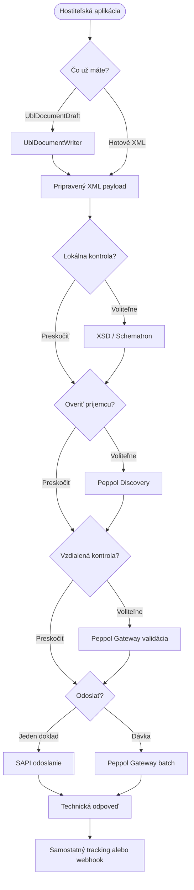
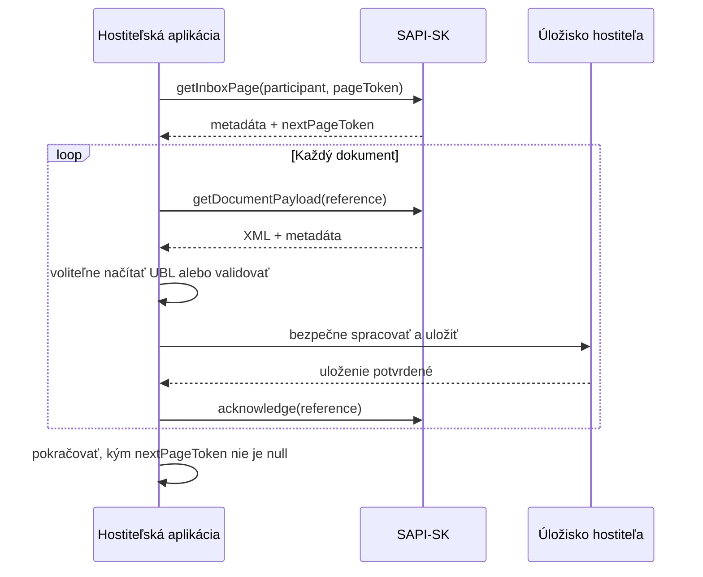
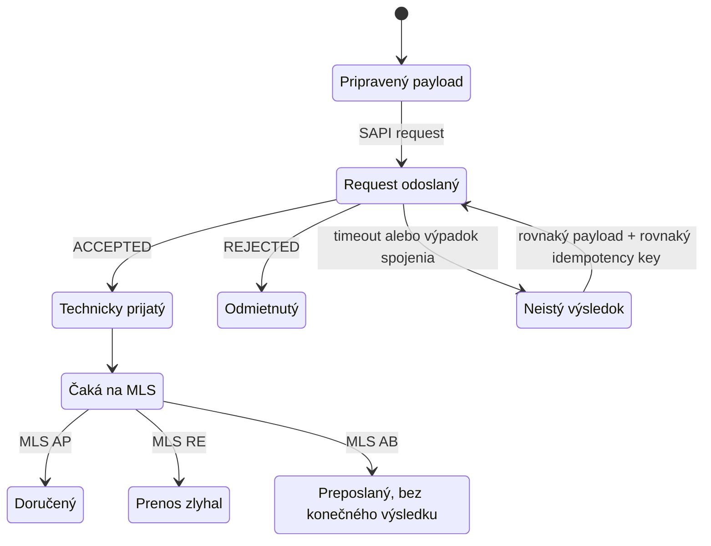

# Praktické scenáre a diagramy

Táto stránka ponúka rýchly vizuálny prehľad práce s dokladmi. Konkrétne kontrakty a úplné príklady nájdete v návodoch na [UBL](UBL-Documents), [validáciu](Validation), [odosielanie](Sending-Documents), [príjem](Receiving-Documents) a [tracking a webhooky](Tracking-and-Webhooks).

Každý PHP blok je samostatný offline skript. Po `composer install` uložte blok ako `docs/wiki/offline-example.php` a z koreňa repozitára spustite `php docs/wiki/offline-example.php`. Skripty načítajú Composer autoloader, používajú syntetické údaje a náhradné služby; neposielajú HTTP požiadavky. V hostiteľskej aplikácii nahraďte tieto náhrady skutočnými klientskymi službami.

Hostiteľská aplikácia zabezpečuje výber dokladu, uloženie XML a idempotency key, rozhodnutie o potvrdení príjmu aj obchodné workflow.

## Mapa práce s dokladom



Kontroly sú samostatné volania. Konektor ich nespúšťa automaticky pred odoslaním. Ak robíte vzdialenú validáciu, odovzdajte jej ten istý `OutboundDocumentPayload`, ktorý následne pošlete.

## Ktorú cestu použiť?

| Potrebujete… | Použite | Potom |
| --- | --- | --- |
| Vytvoriť UBL Invoice alebo CreditNote | `UblDocumentDraft` a UBL writer | XML môžete samostatne načítať alebo validovať. |
| Poslať jeden doklad | SAPI `DocumentSubmissionGatewayInterface` | Výsledok sledujte cez tracking alebo webhook. |
| Poslať viac dokladov v jednej požiadavke | Peppol Gateway batch submission | Uložte identifikátory a stabilný idempotency key. |
| Načítať prijaté doklady | `ReceivedDocumentProviderInterface` | Stiahnite a bezpečne spracujte obsah; potvrdenie je samostatné. |
| Zistiť doručenie alebo chybu | Tracking a MLS, prípadne webhook | Udalosti spracúvajte idempotentne. |

## Ukážka: skontrolovať a odoslať ten istý payload

V aplikácii pripravte payload raz cez UBL writer a použite ho na kontrolu aj odoslanie. Samostatný offline príklad zostaví payload zo syntetických hodnôt a obe sieťové služby nahradí lokálnymi falošnými službami.

```php
<?php
use DreaM1\EfakturaConnector\Core\Documents\IdempotencyKeyGenerator;
use DreaM1\EfakturaConnector\Core\Documents\DocumentSubmissionResult;
use DreaM1\EfakturaConnector\Core\Documents\OutboundDocumentPayload;
use DreaM1\EfakturaConnector\Core\Documents\SendDocumentRequest;
use DreaM1\EfakturaConnector\Core\Documents\ValidateDocumentRequest;
use DreaM1\EfakturaConnector\Core\Documents\Sha256Checksum;
use DreaM1\EfakturaConnector\Core\Contracts\DocumentSubmissionGatewayInterface;
use DreaM1\EfakturaConnector\Core\Contracts\ProviderDocumentValidationCheckInterface;
use DreaM1\EfakturaConnector\Core\Ubl\PeppolDocumentTypeIdentifierBuilder;
use DreaM1\EfakturaConnector\Domain\EFaktura\Participant;
use DreaM1\EfakturaConnector\Domain\EFaktura\PeppolProcessIdentifier;
use DreaM1\EfakturaConnector\Domain\EFaktura\ProviderDocumentId;
use DreaM1\EfakturaConnector\Domain\EFaktura\ProviderDocumentStatus;
use DreaM1\EfakturaConnector\Domain\EFaktura\SubmittedDocumentId;
use DreaM1\EfakturaConnector\Domain\Ubl\PeppolBillingProfile;
use DreaM1\EfakturaConnector\Support\Timestamp;

require dirname(__DIR__, 2) . '/vendor/autoload.php';

final class WikiOfflineValidationCheck implements ProviderDocumentValidationCheckInterface
{
    public function check(ValidateDocumentRequest $request): void
    {
        echo 'Offline validation received ', $request->payload()->documentId()->value(), PHP_EOL;
    }
}

final class WikiOfflineSubmissionGateway implements DocumentSubmissionGatewayInterface
{
    public function send(SendDocumentRequest $request): DocumentSubmissionResult
    {
        echo 'Offline submission received ', $request->payload()->documentId()->value(), PHP_EOL;

        return new DocumentSubmissionResult(
            ProviderDocumentId::fromString('offline-provider-id'),
            ProviderDocumentStatus::fromString(ProviderDocumentStatus::ACCEPTED),
            Timestamp::fromDateTimeImmutable(new DateTimeImmutable('2026-11-26T12:00:01+00:00'))
        );
    }
}

$senderParticipant = Participant::parse('9915:sender-demo');
$receiverParticipant = Participant::parse('9915:receiver-demo');
$xml = '<Invoice xmlns="urn:oasis:names:specification:ubl:schema:xsd:Invoice-2"><ID>OFFLINE-001</ID></Invoice>';
$payload = new OutboundDocumentPayload(
    SubmittedDocumentId::fromString('OFFLINE-001'),
    PeppolDocumentTypeIdentifierBuilder::forDocument('Invoice'),
    PeppolProcessIdentifier::fromString(PeppolBillingProfile::PROCESS_ID),
    $senderParticipant,
    $receiverParticipant,
    Timestamp::fromDateTimeImmutable(new DateTimeImmutable('2026-11-26T12:00:00+00:00')),
    $xml,
    Sha256Checksum::fromContent($xml)
);
$providerValidation = new WikiOfflineValidationCheck();
$gateway = new WikiOfflineSubmissionGateway();
$idempotencyKey = IdempotencyKeyGenerator::generate();

$providerValidation->check(
    new ValidateDocumentRequest($senderParticipant, $payload)
);

$result = $gateway->send(
    new SendDocumentRequest($senderParticipant, $payload, $idempotencyKey)
);

if ($result->status()->value() === 'ACCEPTED') {
    echo "Synthetic ACCEPTED result; production tracking is a separate call.\n";
}
```

Lokálne triedy `WikiOfflineValidationCheck` a `WikiOfflineSubmissionGateway` iba prijmú typované Core requesty a vrátia syntetický výsledok. V produkcii payload pripravte cez `$client->ublDraftSubmission()->preparePayload(...)` a použite skutočné klientské služby. Pri timeout-e zachovajte presný payload a pôvodný idempotency key.

## Ukážka: čítať inbox a až potom potvrdiť



Praktický dôsledok: zlyhanie pri ukladaní má zastaviť alebo odložiť potvrdenie, aby hostiteľ mohol dokument znovu načítať. `acknowledge()` je technické potvrdenie príjmu, nie schválenie ani zaúčtovanie faktúry. Stránkovaný príklad s konkrétnymi typmi je v [návode na príjem](Receiving-Documents).

## Ako čítať výsledok odoslania



| Výsledok | Čo hovorí | Rozumný ďalší krok |
| --- | --- | --- |
| `ACCEPTED` zo SAPI | Požiadavka bola technicky prijatá. | Uložiť provider ID a sledovať konečný stav. |
| `REJECTED` zo SAPI | SAPI vrátilo odmietnutie odoslania. | Spracovať odpoveď podľa pravidiel hostiteľa. |
| MLS `AP` | Peppol potvrdil doručenie. | Označiť ako doručené podľa workflow aplikácie. |
| MLS `RE` | Doručenie zlyhalo. | Preskúmať MLS a rozhodnúť o oprave alebo novom odoslaní. |
| MLS `AB` | Správa bola preposlaná, konečný výsledok ešte nie je známy. | Pokračovať v trackingu. |
| Timeout bez provider ID | Výsledok môže byť neistý. | Zopakovať uložený request s pôvodným key; nevytvoriť nový. |

Kódy MLS a ich typované pomocné metódy sú opísané v [návode na tracking](Tracking-and-Webhooks). Webhook aj polling môžu oznámiť tú istú zmenu, preto hostiteľ ukladá udalosti deduplikovane a stav aktualizuje idempotentne.

## Rýchla kontrola UBL nálezov

Nasledujúci skript zostaví syntetický validačný výsledok s jedným varovaním. XML sa bezpečne parsuje, ale validačný stage je zámerne offline náhrada; produkčný `LocalUblValidationInterface` spustí nakonfigurované lokálne kontroly.

```php
<?php
use DreaM1\EfakturaConnector\Core\Contracts\LocalUblValidationInterface;
use DreaM1\EfakturaConnector\Core\Ubl\UblXmlDocument;
use DreaM1\EfakturaConnector\Core\Ubl\Validation\LimitedValidationIssues;
use DreaM1\EfakturaConnector\Core\Ubl\Validation\LocalUblValidationResult;
use DreaM1\EfakturaConnector\Core\Ubl\Validation\UblValidationFinding;
use DreaM1\EfakturaConnector\Core\Ubl\Validation\UblValidationGuidance;
use DreaM1\EfakturaConnector\Core\Ubl\Validation\UblValidationIssueInterface;
use DreaM1\EfakturaConnector\Core\Ubl\Validation\UblValidationLocation;
use DreaM1\EfakturaConnector\Core\Ubl\Validation\UblValidationSeverity;
use DreaM1\EfakturaConnector\Core\Ubl\Validation\UblValidationStepResult;

require dirname(__DIR__, 2) . '/vendor/autoload.php';

final class WikiOfflineValidationIssue implements UblValidationIssueInterface
{
    public function severity(): UblValidationSeverity
    {
        return UblValidationSeverity::warning();
    }

    public function toArray(): array
    {
        return ['message' => 'Synthetic warning for this offline example.'];
    }

    public function toFinding(string $stageId): UblValidationFinding
    {
        return new UblValidationFinding(
            $stageId,
            $this,
            'DEMO-WARNING',
            'Synthetic warning for this offline example.',
            new UblValidationLocation(),
            [],
            $this->severity(),
            new UblValidationGuidance(
                'https://example.test/rules/demo',
                'Review this synthetic warning.'
            )
        );
    }
}

$syntheticResult = LocalUblValidationResult::fromStepResults([
    'offline-demo' => new UblValidationStepResult(
        new LimitedValidationIssues([new WikiOfflineValidationIssue()], 0)
    ),
]);
$localValidator = new class($syntheticResult) implements LocalUblValidationInterface {
    private LocalUblValidationResult $result;

    public function __construct(LocalUblValidationResult $result)
    {
        $this->result = $result;
    }

    public function validateDocument(UblXmlDocument $document): LocalUblValidationResult
    {
        return $this->result;
    }
};
$ublDocument = UblXmlDocument::fromXml(
    '<Invoice xmlns="urn:oasis:names:specification:ubl:schema:xsd:Invoice-2"><ID>OFFLINE-001</ID></Invoice>'
);

$result = $localValidator->validateDocument($ublDocument);

if (!$result->isValid()) {
    echo "Validation contains an error or incomplete step.\n";
}

if (!$result->isComplete()) {
    echo "At least one validation step is incomplete.\n";
}

foreach ($result->issues() as $issue) {
    $guidance = $issue->guidance();
    if ($guidance !== null) {
        echo $guidance->referenceUrl(), ': ', $guidance->recommendedAction(), PHP_EOL;
    }
}
```

Nálezy majú závažnosť `error`, `warning` alebo `info`. Varovania a informačné nálezy samy osebe nespôsobia, že `isValid()` vráti `false`. Reader iba bezpečne načíta podporovaný UBL; XSD a Schematron kontroly treba spustiť osobitne.

## Časté zámenné kroky

- Načítanie XML nie je lokálna ani vzdialená validácia.
- `ACCEPTED` zo SAPI nie je potvrdenie doručenia príjemcovi.
- Zoznam a stiahnutie dokumentu z inboxu ho nepotvrdia automaticky.
- Webhook najprv overte nad pôvodnými raw body bajtmi; až potom parsujte JSON.
- Pri opakovaní toho istého odoslania zachovajte payload aj idempotency key.

<details>
<summary>Súvisiace návody</summary>

- [Čítanie a zápis UBL](UBL-Documents)
- [Lokálna validácia](Validation)
- [Odosielanie dokladov](Sending-Documents)
- [Príjem dokladov](Receiving-Documents)
- [Stav, Discovery a webhooky](Tracking-and-Webhooks)
- [Výnimky, retry a idempotencia](Errors-Retry-and-Idempotency)

</details>
