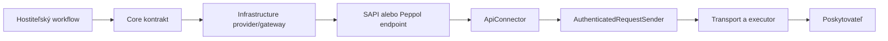

# Štruktúra balíka a hranice modulov

Repozitár obsahuje samostatné PHP jadro, voliteľný Laravel bridge, lokálne validačné zdroje, testy a dokumentáciu. Jadro nepozná hostiteľský workflow ani jeho perzistenciu; rozhrania v `Core` umožňujú aplikácii používať alebo nahradiť implementácie z `Infrastructure`.

<details>
<summary>Obsah stránky</summary>

- [Koreň repozitára](#koreň-repozitára)
- [PHP zdrojový kód](#php-zdrojový-kód)
- [Tok požiadavky a lokálne UBL operácie](#tok-požiadavky-a-lokálne-ubl-operácie)
- [Umiestnenie zmien v projekte](#umiestnenie-zmien-v-projekte)
- [Testy a dokumentácia](#testy-a-dokumentácia)

</details>

## Koreň repozitára

| Cesta | Účel |
| --- | --- |
| `composer.json` | PHP požiadavky, PSR-4 autoload, voliteľný Laravel provider a príkazy balíka. |
| `src/` | Frameworkovo nezávislé jadro konektora. |
| `integrations/laravel/` | Laravel service provider a implementácie viazané na Laravel. |
| `config/efaktura-connector.php` | Predvolená konfigurácia, ktorú číta Laravel bridge. |
| `resources/validation/` | Verziované UBL XSD, CEN/Peppol Schematron, Saxon a licenčné oznámenia. |
| `resources/code-lists/` | Referenčné číselníky na vyhľadávanie a výber hodnôt UBL vrátane vydaní Peppol Billing; `unit-aliases.json` je neoficiálne mapovanie bežných skratiek jednotiek (`ks`, `kg`, `hod`) na kódy UN/ECE. |
| `tests/` | Architektonické, unit a integračné testy balíka. |
| `phpunit.xml.dist`, `phpcs.xml.dist`, `.php-cs-fixer.dist.php`, `phpstan.neon.dist`, `phpstan-baseline.neon` | Nastavenie testov, kontroly štýlu, formátovania a statickej analýzy PHPStan. Do Composer distribúcie sa nebalia (`export-ignore`). |
| `tools/` | Skripty na kontrolu zdrojov, čistého Composer konzumenta a Laravel 5.6/PHP 7.4 aj Laravel 13/PHP 8.4 bridge testy. Do Composer distribúcie sa nebalia (`export-ignore`). Composer deklaruje voliteľný Laravel rozsah 5.6 a 8.83–13. |
| `docs/wiki/` | Návody a referenčná dokumentácia samotného balíka. |
| `docs/eFaktura/` | Lokálny OpenAPI snapshot a dokumentácia poskytovateľa. |

## PHP zdrojový kód

```text
src/
├── Core/
│   ├── CircuitBreaker/       kontrakty a procesný circuit breaker
│   ├── Configuration/        nastavenie URL, SAPI OAuth a Integrator poverení, runtime
│   │   └── Internal/         pomocné parsovanie nastavení runtime
│   ├── IntegratorApi/        typované Integrator API požiadavky, výsledky a hodnoty
│   ├── CodeLists/            stabilné identifikátory číselníkov a hodnoty možností výberu
│   ├── Connection/           požiadavky discovery a výsledky kontroly účastníka
│   │   └── Health/           stav tokenu, profil a schopnosti účastníka
│   ├── Contracts/            porty pre klientov, Integrator API, číselníky, odoslanie, príjem, stav, discovery, webhooky a validáciu
│   ├── Documents/            payloady, výsledky, kontext logovania a chyby toku dokumentov
│   ├── Exceptions/           typované chyby konfigurácie a komunikácie s poskytovateľom
│   ├── MessageStatuses/      typované správy a odpovede MLS
│   ├── Pagination/           typované hodnoty veľkosti stránky a kurzora
│   ├── ProviderErrors/       chybová obálka poskytovateľa, jej kódy, kategórie a detaily
│   ├── Retry/                retry politika a spracovanie hlavičky Retry-After
│   ├── Ubl/                  kontrakty UBL, možnosti čítania, názvy elementov a verzie
│   │   ├── Contracts/        kontrakty čítania, zápisu a validačných fáz
│   │   └── Validation/       validačné typy a výnimky pre UBL a Peppol
│   ├── Webhooks/             webhookové modely, vstupy a parser udalostí
│   └── Xml/                  typované pomocné hodnoty pre XML
├── Domain/
│   ├── EFaktura/            participant, stavy, limity a hodnoty poskytovateľa
│   │   ├── CodeList/        doménové zoznamy kódov
│   │   └── Webhooks/        typy udalostí, stavy registrácií, limity payloadu a validácia ID
│   └── Ubl/                  UBL hodnoty, čítaný doklad a nemenné drafty Invoice/CreditNote
│       ├── Code/            hodnoty kódov krajiny, meny a merných jednotiek
│       ├── CodeList/        UBL zoznamy kódov
│       └── Draft/           nemenné návrhy Invoice a CreditNote
├── Infrastructure/
│   ├── ResourcePath.php      cesty k pribaleným zdrojom s oddeľovačmi pre danú platformu
│   ├── EFaktura/
│   │   ├── Api/              OAuth, endpointy, HTTP transport a mapovanie odpovedí
│   │   │   ├── Authentication/ OAuth autentifikácia a odosielanie autentifikovaných požiadaviek
│   │   │   ├── Endpoints/    endpointy SAPI, Peppol Gateway a Integrator API
│   │   │   ├── Logging/      redakcia citlivých údajov z API komunikácie a UBL payloadov
│   │   │   ├── Response/     statické Factory/Mapper triedy mapujúce odpovede na Core modely vrátane Integrator API; response DTO len pre OAuth token
│   │   │   ├── Serialization/ request mappery: tela požiadaviek zo Core requestov
│   │   │   └── Transport/    spoločné HTTP typy, OAuth a Integrator token transporty
│   │   │       ├── Coordination/ backpressure a zámky medzi požiadavkami
│   │   │       └── Execution/    cURL vykonávače, URL resolver a skladanie transportných vrstiev
│   │   ├── Clock/            hodiny a ich systémová implementácia
│   │   ├── Http/             základ HTTP požiadaviek
│   │   │   └── Protocol/     HTTP metódy, hlavičky a media types
│   │   ├── Coordination/     bezpečné súborové zámky pre HTTP requesty a Schematron
│   │   ├── Connection/       klienti, továrne a typované balíky služieb SAPI a Integrator
│   │   │   └── Facades/      interné skupiny Integrator operácií podľa oblasti
│   │   ├── Documents/        adaptéry pre odoslanie, príjem a sledovanie stavu
│   │   │   └── Checks/       vzdialená validácia a kontrola príjemcu
│   │   ├── Metrics/          voliteľné metriky HTTP pokusov, OAuth token cache a Schematron behov
│   │   ├── Validation/       lokálna pipeline a spoločné validačné pomocné triedy
│   │   │   ├── Schema/       validátor UBL XSD a adaptačná fáza
│   │   │   └── Schematron/   CEN/Peppol pravidlá, Saxon a koordinácia behov
│   │   └── Webhooks/         adaptér registry webhookov pre Peppol Gateway
│   ├── Ubl/                  čítanie, zápis, validačné pravidlá a číselníky UBL
│   │   ├── CodeList/         registry a poskytovatelia pribalených číselníkov
│   │   ├── Reader/           bezpečné načítanie XML a čítanie doménového modelu
│   │   ├── Validation/       pravidlá draftu, hlavičky a slovenské pravidlá
│   │   └── Writer/           zápis Invoice a CreditNote do UBL XML
├── Testing/                  offline FakeSapiClient a FakeDocumentSubmissionGateway pre testy hostiteľskej aplikácie
└── Support/                  zdieľané pomocné typy: HTTP stavové kódy, URL a hash validácia, dekódovanie JSON a bezpečné XML parsovanie
    ├── Exceptions/           spoločné rozhranie a základné typy výnimiek konektora
    └── Xml/                  bezpečné parsovanie XML bez sieťového prístupu

integrations/laravel/src/
├── EFakturaConnectorServiceProvider.php   Laravel bindings a publikovanie konfigurácie
├── Authentication/
│   ├── LaravelSapiTokenCache.php          šifrovaná token cache nad Laravel Cache
│   └── LaravelSapiTokenRefreshLock.php    zdieľaný zámok obnovy tokenu
├── Configuration/
│   ├── LaravelExecutionLockLeasePolicy.php politika lease pre zámky requestov
│   └── LaravelServiceConfiguration.php    konfigurácia Laravel integrácie
├── Cache/
│   └── LaravelCacheStore.php               adaptér Laravel cache store
├── Connection/
│   └── TenantEFakturaClientResolver.php    klient z OAuth poverení modelu zákazníka
├── Contracts/
│   └── TenantEFakturaCredentialsInterface.php kontrakt poverení modelu zákazníka
├── Console/
│   └── CheckConnectorCommand.php           kontrola pripravenosti konfigurácie konektora
├── Logging/
│   └── LaravelHttpRequestExecutionLogger.php logovanie HTTP requestov cez Laravel
├── Transport/
│   ├── LaravelCacheCircuitBreaker.php     zdieľaný stav circuit breakera
│   ├── LaravelCacheHttpRequestBackpressure.php zdieľané cooldowny HTTP 429
│   ├── LaravelCacheHttpRequestExecutionLock.php zdieľaný zámok HTTP requestov
│   ├── LaravelCacheLock.php               adaptér zámku nad Laravel Cache
│   └── LaravelHttpRequestExecutorFactory.php skladanie HTTP executorov
└── Validation/
    └── LaravelValidationServiceRegistrar.php registrácia validačných služieb
```

Composer mapuje prefix `DreaM1\EfakturaConnector\` na `src/`; napríklad `DreaM1\EfakturaConnector\Core\Contracts\` zodpovedá `src/Core/Contracts/`. Voliteľný prefix `DreaM1\EfakturaConnector\Laravel\` mapuje na `integrations/laravel/src/`. Verejné Core typy používajú namespace `DreaM1\EfakturaConnector\Core\...`.

`Domain\EFaktura\Webhooks\WebhookIdentifier` je nemenný hodnotový objekt, ktorý odmieta prázdne ID webhooku a vracia pôvodný reťazec cez `value()`. `Infrastructure\Ubl\UblDocumentType` centralizuje štrukturálne rozdiely medzi UBL `Invoice` a `CreditNote`, ktoré používajú načítanie XML, čítačka, zapisovač a XSD validátor. `Infrastructure\ResourcePath` skladá cesty k pribaleným číselníkom a validačným zdrojom so separátormi aktuálneho operačného systému.

Predvolená samostatná transportná skladba používa in-memory backpressure a circuit breaker, ktorých stav sa nezdieľa medzi PHP workermi. Predvolený backpressure wrapper však cez `FileHttpRequestExecutionLock` sériovo vykonáva HTTP requesty medzi procesmi s rovnakou kanonickou cestou aplikácie a OS používateľom. Laravel bridge používa Laravel Cache pre backpressure a circuit breaker a predvolene aj pre HTTP request lock cez `Cache::lock()`, spolu so zámkom obnovy OAuth tokenu. Ak Laravel alebo cache store lock API neposkytuje, bridge použije lokálne súborové zámky. Pri `driver=file` sa namiesto cache používa `FileHttpRequestExecutionLock` s koreňom v `basePath()`. Zdieľaná cache koordinácia vyžaduje podporu atómových zámkov; súborový lock sa nezdieľa medzi OS používateľmi ani hostmi.

`Core` a `Domain` nevolajú HTTP ani Laravel. `Infrastructure` implementuje porty a mapuje provider API do modelov konektora. Laravel bridge skladá tieto implementácie do kontajnera; pri použití bez Laravelu ich aplikácia zostaví sama.

## Tok požiadavky a lokálne UBL operácie

Pri vzdialenej operácii aplikačný port alebo provider adaptér zavolá endpoint. Endpoint zostaví `ApiRequest`, `ApiConnector` spracuje HTTP odpoveď a endpoint alebo adaptér ju prevedie na typovaný výsledok.



UBL čítanie a zápis sú lokálne operácie bez HTTP. `UblXmlDocumentLoader` bezpečne načíta XML, `UblDocumentReader` vytvorí doménové hodnoty a `UblDocumentWriter` serializuje draft na XML. Validátory sú samostatné služby, takže samotné čítanie automaticky nespúšťa XSD ani Peppol kontroly.

## Umiestnenie zmien v projekte

| Zmena | Miesto |
| --- | --- |
| Nová aplikáciou používaná schopnosť konektora | kontrakt alebo DTO v `src/Core/`, implementácia v príslušnom `src/Infrastructure/EFaktura/` adaptéri |
| Nové volanie SAPI alebo Peppol Gateway | endpoint v `Infrastructure/EFaktura/Api/Endpoints/`, request mapper v `Serialization/`, response factory v `Response/` (vracia Core model) a API prehľad v `docs/wiki/API-Reference.md` |
| Nový stav alebo nemenná hodnota | model v `src/Domain/EFaktura/` alebo `src/Domain/Ubl/`; neukladať provider HTTP logiku do domény |
| Zmena UBL čítania alebo generovania | `Infrastructure/Ubl/Reader/` alebo `Writer/` a príslušné typy v `Domain/Ubl/` |
| Zmena lokálnych validačných podkladov | `resources/validation/` a postup v `resources/validation/README.md`; verzie zosúladiť s `ValidationResources` |
| Nová Laravel väzba alebo konfigurácia | `integrations/laravel/` a `config/efaktura-connector.php`; jadro ponechať bez závislosti od Laravelu |

## Testy a dokumentácia

- `tests/Unit/` overuje hodnoty, mapovanie odpovedí, endpointy a jednotlivé infraštruktúrne komponenty; testy Core UBL validácie a XML sú v samostatných podadresároch a transportné testy sú pri API testoch.
- `tests/Integration/` používa pripravené odpovede a fake transport na overenie celých tokov bez volania produkčného poskytovateľa.
- `tests/Architecture/` chráni hranice balíka a jeho závislostí.
- Zmeny verejných endpointov aktualizujú API referenciu; zmeny konfigurácie aktualizujú stránku [Konfigurácia](Configuration); zmeny validačných artefaktov aktualizujú `resources/validation/README.md`.

Poskytovateľský API kontrakt je v `docs/eFaktura/api/openapi.json`. Prehľad zodpovedností a hlavných tokov je v [architektúre a tokoch](Architecture-and-Testing).

<details>
<summary>Súvisiace návody</summary>

- [Architektúra a hlavné toky](Architecture-and-Testing)
- [Tok dát a triedy](Data-Flow-and-Classes)
- [API špecifikácie a pokrytie](Source-Alignment)

</details>
