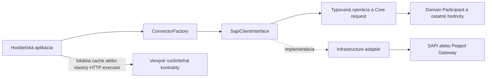

# Verejné PHP API

Aplikačné rozhranie balíka tvoria verejné triedy, rozhrania, traity, konštanty, vlastnosti a metódy v týchto priestoroch mien:

- `DreaM1\EfakturaConnector\ConnectorFactory` — stabilný frameworkovo nezávislý composition root pre predvolené SAPI a Integrator klienty.
- `DreaM1\EfakturaConnector\Core\` — kontrakty, konfigurácia, požiadavky, výsledky a výnimky.
- `DreaM1\EfakturaConnector\Domain\` — doménové hodnoty, stavy a modely UBL dokumentov.
- `DreaM1\EfakturaConnector\Laravel\` — voliteľné integrácie pre aplikácie používajúce Laravel bridge.
- `DreaM1\EfakturaConnector\Testing\` — offline `FakeSapiClient` a nahrávajúci `FakeDocumentSubmissionGateway` pre testy hostiteľskej aplikácie.
- Vybrané typy `Support` a `Infrastructure`, ktoré sú označené `@api` — pomocné hodnoty, integračné body a typy používané v ich verejných signatúrach.

Pre frameworkovo nezávislé zostavenie klientov použite `ConnectorFactory`. Predvolená token cache je iba procesová; dlhobežné aplikácie môžu odovzdať vlastnú chránenú implementáciu `SapiTokenCacheInterface`. Executor options, refresh lock, metriky a hodiny sa pridávajú cez nemenné metódy `withExecutorOptions()`, `withTokenRefreshLock()`, `withMetrics()` a `withClock()` (pozri [architektúru](Architecture-and-Testing)). Verejné typy `Support` (vrátane `Timestamp`, `HttpStatusCode` a vybraných výnimiek) a typy `Infrastructure` označené `@api` sú zahrnuté do kontroly kompatibility v `tests/Architecture/public-api.json`.

Integrator API klient používa `Core\Contracts\IntegratorAccountClientInterface`, `IntegratorAccountClientFactoryInterface` a `Core\Configuration\IntegratorAccountConfiguration` s `IntegratorToken`; voliteľný PDS signing secret poskytuje `Core\Configuration\PdsSigningConfiguration`. Vstupné a výstupné modely pre jeho operácie sú v `Core\IntegratorApi\`. Klient je samostatný od `SapiClientInterface`, pretože používa `X-Integrator-Token` namiesto SAPI OAuth poverení.

`SapiClientInterface::profile()` vracia iba ne-citlivé metadáta klienta (URL, client ID a scope). Plná OAuth konfigurácia ani client secret nie sú dostupné cez klientsky facade.

`SapiTokenCacheInterface`, `SapiToken` a OAuth token value objekty označené `@api` sú stabilné body pre implementácie cache. Cache má chrániť bearer token pri ukladaní; nikdy nevypisujte jeho hodnotu do logov.

`Core\Pagination\PageSize::MAX_OPENAPI_INT32_VALUE` označuje hornú hranicu `int32` pre stránkovacie query parametre. Konkrétne endpointy môžu mať nižší limit.

## Rozhrania na odber

`SapiClientInterface`, `IntegratorAccountClientInterface`, konfiguračné rozhrania runtime a `SapiClientConfigurationInterface` sú určené na volanie hostiteľom. Ich vlastná implementácia nie je podporovaná a nové metódy sa môžu pridať v minor vydaní. `TenantEFakturaCredentialsInterface` je zmrazené rozhranie, ktoré hostiteľ implementuje na svojom modeli; nové požiadavky sa budú pridávať len cez samostatné voliteľné rozhrania.

Typy v `Core\Configuration\Internal` sú interným konfiguračným detailom. Neoznačené typy v `Infrastructure` a `Support` slúžia na vnútorné spracovanie; aplikácie majú závisieť od Core kontraktov, Domain hodnôt a výslovne označených `@api` typov.

## Ako prechádza volanie cez verejné API



Používajte factory a kontrakty na hranici hostiteľskej aplikácie. Konkrétne Infrastructure triedy zostávajú vnútornou implementáciou, okrem tried výslovne označených `@api`.

## Samostatné zostavenie SAPI klienta

Nasledujúci skript používa ukážkové lokálne poverenia a URL `example.test`. Po `composer install` ho uložte ako `docs/wiki/offline-example.php` a spustite z koreňa repozitára príkazom `php docs/wiki/offline-example.php`. Vytvorí klienta a jeho submission službu, ale nevolá žiadnu API operáciu.

```php
<?php
use DreaM1\EfakturaConnector\ConnectorFactory;
use DreaM1\EfakturaConnector\Core\Configuration\SapiClientConfiguration;

require dirname(__DIR__, 2) . '/vendor/autoload.php';

$configuration = SapiClientConfiguration::fromArray([
    'base_url' => 'https://example.test',
    'client_id' => 'offline-demo-client',
    'client_secret' => 'offline-demo-secret',
    'client_scope' => SapiClientConfiguration::SAPI_SCOPE_DOCUMENT_SEND,
]);
$configuration->assertReady();

$client = (new ConnectorFactory())->createSapiClient('billing', $configuration);
$submission = $client->documentSubmissionGateway();
echo 'Constructed offline submission service: ', get_class($submission), PHP_EOL;
```

`assertReady()` kontroluje konfiguráciu lokálne a neposiela request. Predvolená token cache `ConnectorFactory` je iba procesová; pre dlhšie alebo viacprocesové nasadenie odovzdajte chránenú vlastnú cache implementáciu.

## Čiastkové modely a pomocné typy

Väčšina verejných výsledkov sa skladá z menších nemenných hodnôt. Hostiteľ ich zvyčajne dostane z getterov nadradeného modelu, preto ich nevytvára ručne. Všetky sú súčasťou kontroly kompatibility v `tests/Architecture/public-api.json`.

### Odoslané doklady

| Typ | Obsah |
| --- | --- |
| `SentDocumentIdentity` | `identifier()` (`ProviderDocumentId`), `documentId()` (`SubmittedDocumentId`), `documentTypeId()`, `processId()` a `payloadFormat()` (reťazec bez uzavretého zoznamu). |
| `SentDocumentParties` | `sender()` a `receiver()` ako `Participant`. |
| `SentDocumentTiming` | `createdAt()` a `updatedAt()` ako `Timestamp`. |
| `SentDocumentOutcome` | Výsledok doručenia: nullable `provider()` (`SentDocumentProviderReference`) a nullable `error()` (`SentDocumentError`), podľa toho, čo provider uviedol. |
| `SentDocumentProviderReference` | `name()` provider-a, `documentId()` (`ProviderDocumentId`) a `messageId()` (`ProviderMessageId`). |
| `SentDocumentError` | Súhrn `message()` (ak ho provider uviedol) a zoznam `details()` ako `ProviderErrorDetail`. Je to údaj providera, nie technická výnimka konektora. |

### Discovery, MLS a chyby providera

| Typ | Obsah |
| --- | --- |
| `CheckReceivingCapabilityRequest` | Vstup kontroly príjemcu: `participant()`, `documentTypeId()` a `processId()`. |
| `ParticipantCapabilities` | Iterovateľná a spočítateľná zbierka `ParticipantCapability` v profile účastníka; `empty()` vytvorí prázdnu zbierku. |
| `ProviderMessageLevelStatusResult` | `code()` (`MessageLevelStatusCode`), `description()` a zoznam `reasons()`. |
| `ProviderMessageLevelStatusReason` | Dôvod MLS: `lineId()`, `code()` a `description()`; vytvára sa cez `create()`. |
| `ProviderErrorDetail` | Jeden detail chybovej obálky: `field()`, `issue()` a `value()`; `fromArray()` a `toArray()`. |
| `PageCursor` | Obal na `nextPageToken()` (`PageToken`) vo výsledkoch so stránkovaním. |
| `WebhookEvents` | Statické `normalize()` overí zoznam `WebhookEventType` a vráti ho ako zoznam s nulovým začiatkom; `values()` vráti ich reťazcové hodnoty. |

### Integrator API

| Typ | Obsah |
| --- | --- |
| `ListClientsRequest` | `pageToken()`, `limit()` a `status()` (`IntegratorClientStatus`). |
| `ListParticipantsRequest` | `pageToken()` a `limit()`. |
| `GetDocumentSummaryRequest` | `month()` vo formáte `yyyyMM`. |
| `ReplaceClientParticipantAccessRequest` | `client()` (`IntegratorClientReference`) a nový úplný zoznam `participants()`. |
| `IntegratorParticipantAccessResponse` | `participantId()`, `canSend()` a `canReceive()`. |
| `IntegratorParticipantCompany` | `dic()`, `legalName()`, `email()` a `phone()` účastníka. |
| `IntegratorParticipantContract` | `internalTransferRequired()`, `isOwner()` a `activeContractMode()`. |
| `IntegratorParticipantTimestamps` | `sourceCreatedAt()` a `receivedAt()`. |
| `ParticipantDocumentSummary` | Mesačný súhrn jedného účastníka: `participantId()`, `sent()` a `received()`. |

### Konfigurácia, limity a retry

| Typ | Obsah |
| --- | --- |
| `SapiClientProfile` | `baseUrl()`, `clientId()` a `clientScope()`; `fromConfiguration()` ho vytvorí z konfigurácie klienta. Neobsahuje secret. |
| `HttpRequestBodyLimit` | Limit serializovaného tela požiadavky: `default()` je 100 MiB, `fromBytes()` povolí najviac 1 GiB. |
| `EFakturaDocumentLimits`, `UblDocumentLimits` | `MAX_XML_SIZE_BYTES`: XML dokladu môže mať najviac 10 240 KB. |
| `EFakturaProviderDataLimits` | `PAGE_SIZE_MIN` (1) a `PAGE_SIZE_MAX` (100) pre stránkovanie providera. |
| `WebhookEventLimits` | `MAX_PAYLOAD_SIZE_BYTES`: payload webhooku môže mať najviac 1 MiB. |
| `RetryAfter` | `deadline($headers, $now)` prevedie hlavičku `Retry-After` (sekundy alebo HTTP dátum) na `RetryDeadline`, alebo vráti `null`, ak chýba či je neplatná. |
| `AbstractStatefulCircuitBreaker`, `CircuitBreakerExecutionPermit` | Základ pre vlastný istič s uloženým stavom. `acquireExecutionPermit()` vráti povolenie s `generation()` a príznakom `isHalfOpenProbe()`; výsledok sa zapíše cez `recordSuccessForPermit()`, `recordFailureForPermit()` alebo `recordNeutralForPermit()`. Procesový istič je `InMemoryCircuitBreaker`. |
| `SchematronConcurrencyPermitInterface` | Držané miesto v limite súbežných lokálnych Schematron validácií; `release()` ho uvoľní. |

### Lokálna validácia

| Typ | Obsah |
| --- | --- |
| `UblSchemaValidationIssue` | Nález XSD s `line`, `column` a správou; `severity()`, `toArray()` a `toFinding($stageId)`. |
| `PeppolBillingRuleIssue` | Nález ľahkej kontroly Peppol Billing (`PeppolBillingHeaderValidationStage`) s identifikátorom pravidla `rule()`; rovnaké `severity()`, `toArray()` a `toFinding()`. |
| `PeppolValidationLine`, `PeppolValidationAdjustment` | Hodnoty riadku faktúry alebo dobropisu a jeho zliav či poplatkov, ktoré `PeppolValidationIssue` pripája k nálezu Schematron. Obsahujú iba reťazcové hodnoty a `toArray()`. |

### UBL: čítaný doklad

Tieto typy sú súčasťou `UblDocumentContent` a `UblDocumentLine`. Čítanie nie je obchodná validácia, preto sú hodnoty reťazce, ako ich obsahuje XML; `recognized*()` getter vráti číselníkový objekt, keď je kód známy.

| Typ | Obsah |
| --- | --- |
| `UblDocumentAddress` | `street()`, `buildingNumber()`, `postalCode()`, `city()`, `countryCode()` a `recognizedCountryCode()` (`CountryCode`). |
| `UblDocumentPartyIdentifiers` | `registrationId()`, `vatId()` a `taxRegistrationId()`. |
| `UblDocumentLineQuantity` | `quantity()`, `unit()` a `recognizedUnitCode()` (`UnitCode`). |
| `UblDocumentLineAmounts` | `unitPrice()`, `lineTotal()`, `currency()` a `recognizedCurrencyCode()` (`CurrencyCode`). |
| `UblDocumentLineVat` | `rate()` a `category()` riadku. |
| `UblDocumentTaxSummary` | `category()`, `rate()`, `taxableAmount()` a `taxAmount()`; `fromValues()`, `fromArray()` a `toArray()`. |
| `UblVersion`, `XmlEncoding`, `XmlBooleanValue`, `UblElementName`, `UblAttributeName` | Konštanty, ktoré používa writer a reader: `UblVersion::VERSION` (`2.1`), `XmlEncoding::UTF_8`, `XmlBooleanValue::TRUE`/`FALSE` a názvy UBL elementov a atribútov. |

### UBL: podmodely draftu

Voliteľné časti Peppol Billing 3 sa pripájajú k `UblDocumentDraft`, `UblDraftParty` a `UblDraftLine` cez `with*()` metódy (pozri [UBL doklady](UBL-Documents)). Všetky sú nemenné.

| Typ | Obsah |
| --- | --- |
| `UblDraftAllowanceCharge` | Zľava alebo poplatok: `isCharge()`, `amount()`, `taxCategory()`, `reasonCode()`, `reason()`, `multiplierFactor()` a `baseAmount()`. |
| `UblDraftPriceAllowance` | Zľava na cene položky: `amount()` a `baseAmount()`. |
| `UblDraftPeriod` | Obdobie: `startDate()`, `endDate()` a `descriptionCode()`. |
| `UblDraftDelivery` | Miesto dodania: `actualDeliveryDate()`, `locationIdentifier()`, `address()` a `deliveryPartyName()`. |
| `UblDraftPayee` | Príjemca platby: `name()`, `identifier()` a `legalCompanyId()`. |
| `UblDraftTaxRepresentative` | Daňový zástupca: `name()`, `address()` a `vatIdentifier()`. |
| `UblDraftContact` | Kontakt: `name()`, `telephone()` a `email()` (`EmailAddress`). |
| `UblDraftCommodityClassification` | Klasifikácia položky: `code()`, `listId()` a `listVersionId()`. |
| `UblDraftItemProperty` | Vlastnosť položky: `name()` a `value()`. |
| `UblDraftText` | Pomocná trieda: `emptyToNull()` zmení prázdny reťazec na `null`, aby writer prázdny element nezapísal. |
