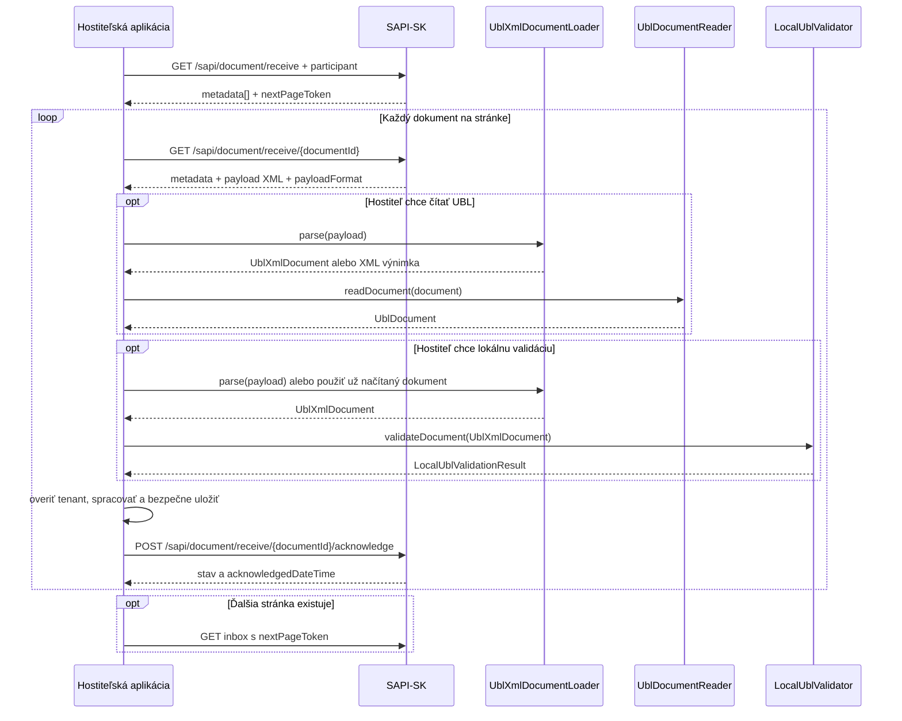

# Príjem dokladov

`SapiReceivedDocumentProvider` implementuje `ReceivedDocumentProviderInterface` a skladá tri SAPI operácie: zoznam prijatých dokladov, stiahnutie XML a samostatné technické potvrdenie príjmu.

<details>
<summary>Obsah stránky</summary>

- [Tok príjmu dokumentu](#tok-príjmu-dokumentu)
- [Načítanie po stránkach](#načítanie-po-stránkach)
- [Technické potvrdenie príjmu](#technické-potvrdenie-príjmu)
- [Stránkovanie a opakovanie](#stránkovanie-a-opakovanie)

</details>

| Operácia | Endpoint |
| --- | --- |
| Zoznam / stránka inboxu | `GET /sapi/document/receive` |
| Stiahnutie dokladu | `GET /sapi/document/receive/{documentId}` |
| Technické potvrdenie príjmu | `POST /sapi/document/receive/{documentId}/acknowledge` |

SAPI OpenAPI podporuje pri zozname kurzor `pageToken`, voliteľný `limit` 1–100 (predvolene 20) a filter `status=RECEIVED|ACKNOWLEDGED`; záznamy sa vracajú od najstarších. `getInboxPage()` prijíma `ListReceivedDocumentsRequest`, ktorý obsahuje participant, voliteľný `PageToken`, `PageSize` a filter `ProviderDocumentStatus`. Zoznam ani načítanie detailu dokument automaticky nepotvrdzuje.

Odpoveď bez poľa `nextPageToken` (alebo s hodnotou `null`, prázdnym či bielym reťazcom) znamená poslednú stránku: `nextPageToken()` vráti `null`. Rovnako sa čítajú aj zoznamy webhookov a Integrator API. Neprázdny token zachová `PageToken` bez zmeny a token, ktorý nie je reťazec, je neplatná odpoveď (`InvalidProviderResponseException`). Core stránkovanie používa `PageToken` a `PageSize`. Token z predchádzajúcej stránky možno odovzdať priamo ďalšiemu volaniu; pri ukladaní do hostiteľského úložiska použite `value()` a pri obnove ho vytvorte cez `PageToken::fromString()`. Veľkosť stránky vytvorte cez `PageSize::fromInt()`.

SAPI OpenAPI označuje acknowledge za idempotentný: opakované potvrdenie už potvrdeného dokladu vráti úspech.

## Tok príjmu dokumentu

Zoznam, stiahnutie obsahu, lokálne spracovanie a technické potvrdenie sú samostatné kroky. Hostiteľ si riadi kurzor stránkovania, bezpečné uloženie a okamih potvrdenia.



`payloadFormat` je podľa OpenAPI obyčajný reťazec, preto hostiteľ rozhoduje, či telo odovzdá UBL čítačke. Ak XML načítate, reader ho bezpečne parsuje, ale XSD ani Schematron sa nespúšťajú automaticky. Potvrdenie volajte až podľa pravidiel hostiteľa; konektor neporovnáva obsah XML s participant metadátami ani neukladá prijatý dokument.

## Načítanie po stránkach

```php
use DreaM1\EfakturaConnector\Core\Documents\DocumentRequestContext;
use DreaM1\EfakturaConnector\Core\Documents\ListReceivedDocumentsRequest;
use DreaM1\EfakturaConnector\Core\Documents\ReceivedDocumentReference;
use DreaM1\EfakturaConnector\Core\Pagination\PageSize;
use DreaM1\EfakturaConnector\Domain\EFaktura\Participant;
use DreaM1\EfakturaConnector\Infrastructure\EFaktura\Api\Endpoints\Sapi\AcknowledgeReceivedDocumentEndpoint;
use DreaM1\EfakturaConnector\Infrastructure\EFaktura\Api\Endpoints\Sapi\GetReceivedDocumentEndpoint;
use DreaM1\EfakturaConnector\Infrastructure\EFaktura\Api\Endpoints\Sapi\ListReceivedDocumentsEndpoint;
use DreaM1\EfakturaConnector\Infrastructure\EFaktura\Documents\SapiReceivedDocumentProvider;
use DreaM1\EfakturaConnector\Infrastructure\Ubl\Reader\UblDocumentReader;
use DreaM1\EfakturaConnector\Infrastructure\Ubl\Reader\UblXmlDocumentLoader;

$provider = new SapiReceivedDocumentProvider(
    new ListReceivedDocumentsEndpoint($connector),
    new GetReceivedDocumentEndpoint($connector),
    new AcknowledgeReceivedDocumentEndpoint($connector),
);
$ublReader = new UblDocumentReader(new UblXmlDocumentLoader());
$participant = Participant::parse('0245:1234567890');

$pageToken = null;
do {
    $page = $provider->getInboxPage(new ListReceivedDocumentsRequest(
        $participant,
        $pageToken,
        PageSize::fromInt(50)
    ));
    $pageToken = $page->nextPageToken();

    foreach ($page->documents() as $metadata) {
        $context = new DocumentRequestContext(
            $myDb->resolveId($metadata->documentId()->value()),
            $metadata->documentId()->value()
        );
        $reference = new ReceivedDocumentReference(
            $participant,
            $metadata->documentId(),
            $context
        );
        $document = $provider->getDocumentPayload($reference);
        $ublDocument = $ublReader->read($document->xml());

        // Spracujte alebo bezpečne uložte $ublDocument podľa workflow hostiteľa.
        // Potvrdenie ostáva samostatným rozhodnutím hostiteľa.
        $acknowledgement = $provider->acknowledge($reference);
        // Výsledok obsahuje ProviderDocumentStatus cez status(), ProviderDocumentId cez documentId()
        // a acknowledgedDateTime(). Reťazec stavu získate cez status()->value().
    }
} while ($pageToken !== null);
```

`ReceivedDocumentMetadata::documentId()` a `ReceivedDocumentReference::providerDocumentId()` používajú `ProviderDocumentId`. Pri načítaní ID z vlastného úložiska ho obnovte cez `ProviderDocumentId::fromString()`; na reťazec sa prevedie cez `value()` iba pri ukladaní alebo zostavovaní logovacieho kontextu. Rovnakú referenciu možno použiť na stiahnutie aj potvrdenie. `DocumentRequestContext` zostáva samostatný reťazcový kontext hostiteľa a neposiela sa poskytovateľovi.

Metadáta z inboxu obsahujú `documentId`, `documentTypeId`, `processId`, `senderParticipantId`, `receiverParticipantId` a `creationDateTime`. K odosielateľovi a príjemcovi možno pristúpiť typovane cez `sender()` a `receiver()`, ktoré vracajú `Participant`; chybné Peppol ID sa odmietne už pri mapovaní odpovede SAPI. Detail ich vracia znova spolu s payloadom; cez `ReceivedDocumentPayload::metadata()` sú dostupné v rovnakom typovanom `ReceivedDocumentMetadata` modeli.

SAPI detail vracia aj pole `payloadFormat`, ktoré OpenAPI definuje iba ako reťazec bez enum hodnôt. Endpoint overí typ reťazca a provider jeho hodnotu prenesie do `ReceivedDocumentPayload::payloadFormat()` bez normalizácie. Payload poskytuje XML cez `xml()`; ak ho hostiteľ chce čítať ako UBL, samostatne zavolá `$ublReader->read($document->xml())`. Čítačka bezpečne načíta XML a odmietne nebezpečné, chybné alebo nepodporované UBL XML cez príslušnú `UblValidationException`. Načítanie neznamená XSD/Schematron validáciu a nespúšťa `acknowledge()`; hostiteľ môže `payloadFormat()` vyhodnotiť samostatne podľa svojho workflow.

## Technické potvrdenie príjmu

Operácia `acknowledge()` odošle poskytovateľovi technické potvrdenie príjmu dokumentu. Neznamená obchodné schválenie faktúry, zaúčtovanie, vznik záväzku ani vytvorenie objednávky. Rozhodnutie o potvrdení a jeho načasovaní patrí hostiteľskej aplikácii.

Volanie vracia `ReceivedDocumentAcknowledgement` s `documentId`, výsledným `status` a `acknowledgedDateTime`, ktoré poskytovateľ vrátil. Tieto údaje potvrdzujú technický výsledok operácie; neurčujú obchodný stav dokladu.

UBL reader dokáže načítať bezpečné Invoice/CreditNote XML, ale čítanie samo osebe nespúšťa XSD ani Peppol validáciu.

Pri synchronizácii získajte príjemcu cez `$metadata->receiver()` a porovnajte ho s participantom aktuálneho tenantu pomocou `equals()`. Obe metódy vracajú typovaný `Participant`; SAPI metadata factory odmietne neplatné participant ID ako `InvalidProviderResponseException`. Ak XML načítate, porovnajte v ňom aj identifikátory odosielateľa a príjemcu s metadátami SAPI. Konektor mapuje metadáta a XML samostatne; ich vzájomnú zhodu ani vlastníctvo tenantom nekontroluje. O potvrdení rozhodnite až podľa pravidiel hostiteľa po bezpečnom spracovaní alebo uložení.

## Stránkovanie a opakovanie

Vždy pokračujte s `nextPageToken()` až po `null`. Spracovanie a perzistenciu urobte idempotentne, pretože rovnaký doklad môže byť vrátený pri opakovaní synchronizácie. Zlyhanie uloženia XML má zastaviť alebo odložiť potvrdenie tak, aby hostiteľ nestratil možnosť doklad znovu stiahnuť.

<details>
<summary>Súvisiace návody</summary>

- [Stav, Discovery a webhooky](Tracking-and-Webhooks)
- [Čítanie a zápis UBL](UBL-Documents)
- [Výnimky, retry a idempotencia](Errors-Retry-and-Idempotency)

</details>
