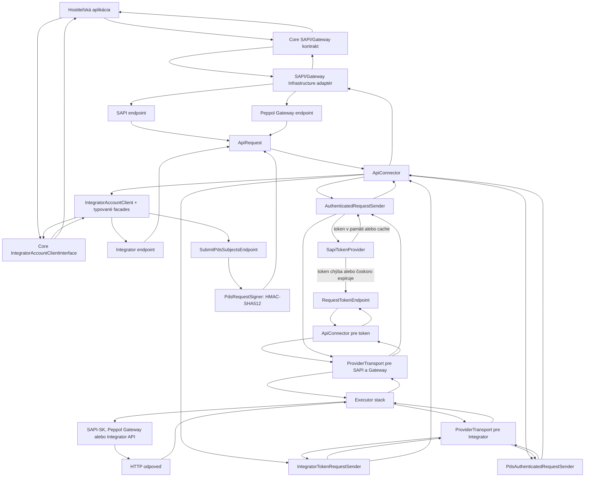
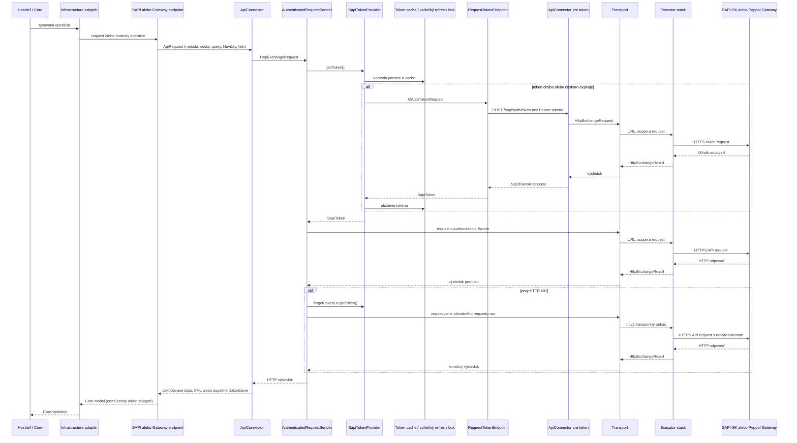
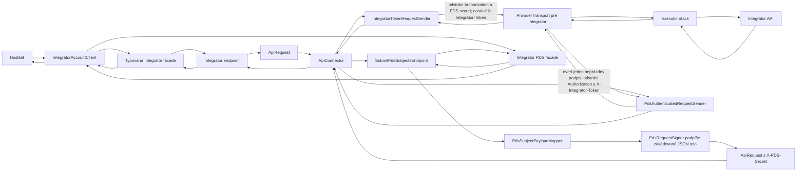

# Graf toku API requestov

Táto stránka zobrazuje všetky vzdialené vetvy requestov konektora: SAPI, Peppol Gateway, Integrator API, PDS a získanie SAPI OAuth tokenu. Lokálne UBL čítanie, zápis a validácia cez API request neposielajú.

## Prehľad všetkých vetiev



SAPI aj Peppol Gateway používajú rovnaký SAPI OAuth token. Bežné Integrator API requesty používajú `X-Integrator-Token`; nejde o token získavaný cez SAPI OAuth. PDS submission patrí do Integrator API, ale autentifikuje sa podpisom `X-PDS-Secret` vypočítaným nad už zakódovaným JSON telom. Každá vetva používa spoločné `ApiRequest` a `ApiConnector`; líši sa autentifikačným senderom a transportom.

## SAPI a Peppol Gateway



SAPI vetva pokrýva token, odoslanie a príjem dokumentov aj stav tokenu. Gateway vetva pokrýva discovery, kontrolu a odoslanie dokumentov, stav doručenia a správu webhookov. Odpovede `401` obnovuje `AuthenticatedRequestSender` najviac raz; toto obnovenie je oddelené od HTTP retry.

V nasledujúcich tabuľkách hlavičky uvádzajú autentifikáciu aj hlavičky špecifické pre operáciu. Transport automaticky pridáva `Content-Type: application/json` pri JSON tele; `Accept` je predvolene `application/json`. Výnimkou je XML obsah MLS, pri ktorom endpoint nastaví `Accept: application/xml`. `—` znamená, že query alebo body nie sú definované. Request body, ktorý je uvedený, je podľa OpenAPI povinný; povinnosť jednotlivých polí sa riadi schémou. Odpoveď uvádza úspešný HTTP status a PHP návratový typ; ak sa názov líši, nasleduje aj OpenAPI schéma.

### SAPI-SK endpointy

Okrem tokenového endpointu používajú tieto operácie `Authorization: Bearer <SAPI token>`. Tokenový request je bez Authorization hlavičky a posiela OAuth client credentials v JSON tele. `X-Peppol-Participant-Id` určuje participant scope, nie autentifikáciu.

| Endpoint (HTTP cesta; trieda) | Hlavičky | Query parametre | Request body (povinné / voliteľné) | Typ odpovede |
| --- | --- | --- | --- | --- |
| `POST /sapi/auth/token`; `RequestTokenEndpoint` | Bez autentifikačnej hlavičky | — | Povinný JSON objekt: povinné `client_id`, `client_secret`, `grant_type` (hodnota `client_credentials`); voliteľné `scope` | `200` → PHP `SapiTokenResponse`; OpenAPI `SapiTokenResponse` |
| `GET /sapi/auth/token/status`; `GetTokenStatusEndpoint` | `Authorization: Bearer <SAPI token>` | — | — | `200` → OpenAPI schéma `SapiTokenStatusResponse` → Core `TokenStatus` (cez `TokenStatusFactory`) |
| `POST /sapi/document/send`; `SendDocumentEndpoint` | `Authorization: Bearer <SAPI token>`; povinné `X-Peppol-Participant-Id`, `Idempotency-Key` | — | Povinný JSON: povinné `metadata` (objekt s povinnými `documentId`, `documentTypeId`, `processId`, `senderParticipantId`, `receiverParticipantId`, `creationDateTime`), `payload`, `payloadFormat` (`XML`); voliteľné `payloadEncoding` (predvolené UTF-8), `checksum` | `202` → Core `DocumentSubmissionResult` (cez `DocumentSubmissionResultFactory`); OpenAPI `SapiSendDocumentResponse` |
| `GET /sapi/document/receive`; `ListReceivedDocumentsEndpoint` | `Authorization: Bearer <SAPI token>`; povinné `X-Peppol-Participant-Id` | `pageToken` voliteľný string; `limit` voliteľný integer, predvolene 20, rozsah 1–100; `status` voliteľný enum `RECEIVED` alebo `ACKNOWLEDGED` | — | `200` → Core `ReceivedDocumentPage` (cez `ReceivedDocumentPageFactory`); OpenAPI `SapiReceivedDocumentListResponse` |
| `GET /sapi/document/receive/{documentId}`; `GetReceivedDocumentEndpoint` | `Authorization: Bearer <SAPI token>`; povinné `X-Peppol-Participant-Id` | — | — | `200` → Core `ReceivedDocumentPayload` (cez `ReceivedDocumentPayloadFactory`); OpenAPI `SapiReceivedDocumentDetailResponse` |
| `POST /sapi/document/receive/{documentId}/acknowledge`; `AcknowledgeReceivedDocumentEndpoint` | `Authorization: Bearer <SAPI token>`; povinné `X-Peppol-Participant-Id` | — | — | `200` → Core `ReceivedDocumentAcknowledgement` (cez `ReceivedDocumentAcknowledgementFactory`); OpenAPI `SapiAcknowledgeResponse` |

Pri odoslaní a Gateway validácii konektor posiela `payloadEncoding: UTF-8`, hoci ho OpenAPI označuje ako voliteľné. `checksum` odošle iba vtedy, keď ho payload obsahuje.

### Peppol Gateway endpointy

Všetky Gateway endpointy používajú `Authorization: Bearer <SAPI token>`. `X-Peppol-Participant-Id`, ak je uvedený, určuje scope participanta a nie je autentifikačným údajom. Telo každého JSON requestu je povinné tam, kde je uvedené.

| Endpoint (HTTP cesta; trieda) | Hlavičky | Query parametre | Request body (povinné / voliteľné) | Typ odpovede |
| --- | --- | --- | --- | --- |
| `POST /v1/discovery/receives`; `CheckReceivingCapabilityEndpoint` | `Authorization: Bearer <SAPI token>` | — | Povinný JSON objekt: povinné `participantId`, `documentTypeId`; voliteľné `processId` | `200` → Core `CheckReceivingCapabilityResponse` (cez `CheckReceivingCapabilityResponseFactory`); OpenAPI `DiscoveryReceivesResponse` |
| `GET /v1/participants/{participantId}`; `GetParticipantProfileEndpoint` | `Authorization: Bearer <SAPI token>` | — | — | `200` → Core `ParticipantProfile` (cez `ParticipantProfileFactory`); OpenAPI `ParticipantResponse` |
| `POST /v1/validate-document`; `ValidateDocumentEndpoint` | `Authorization: Bearer <SAPI token>`; povinné `X-Peppol-Participant-Id` | — | Povinný JSON: povinné `metadata` (`documentId`, `documentTypeId`, `processId`, `senderParticipantId`, `receiverParticipantId`, `creationDateTime`), `payload`, `payloadFormat` (`XML`); voliteľné `payloadEncoding` (predvolené UTF-8), `checksum` | `200` → `bool` (cez `DocumentValidationVerdictReader`); OpenAPI `ValidateDocumentResponse` |
| `POST /v1/send-documents`; `SendDocumentsEndpoint` | `Authorization: Bearer <SAPI token>`; povinné `X-Peppol-Participant-Id`, `Idempotency-Key` | — | Povinný JSON objekt s povinným `documents` poľom; položka má povinné `type` (`UBL_XML` alebo `SBDH_XML`) a `payload`; `receiverParticipantId` je voliteľný v schéme, povinný pre `UBL_XML` a odvodený pri `SBDH_XML` | `200` → Core `SendDocumentsResult` (cez `SendDocumentsResultFactory`); OpenAPI schéma `SendDocumentsResponse` |
| `GET /v1/sent-documents/{identifier}`; `GetSentDocumentEndpoint` | `Authorization: Bearer <SAPI token>`; povinné `X-Peppol-Participant-Id` | — | — | `200` → Core `SentDocumentStatus` (cez `SentDocumentStatusFactory`); OpenAPI `SentDocumentResponse` |
| `GET /v1/sent-documents/{identifier}/message-level-statuses`; `ListMessageLevelStatusesEndpoint` | `Authorization: Bearer <SAPI token>`; povinné `X-Peppol-Participant-Id` | — | — | `200` → Core `ProviderMessageLevelStatusResponse` (cez `ProviderMessageLevelStatusResponseFactory`); OpenAPI `MessageLevelStatusListResponse` |
| `GET /v1/sent-documents/{identifier}/message-level-statuses/{statusIdentifier}/content`; `GetMessageLevelStatusContentEndpoint` | `Authorization: Bearer <SAPI token>`; povinné `X-Peppol-Participant-Id`; `Accept: application/xml` | — | — | `200` → Core `MessageLevelStatusContent` (XML, `application/xml`) |
| `GET /v1/webhooks`; `ListWebhooksEndpoint` | `Authorization: Bearer <SAPI token>`; povinné `X-Peppol-Participant-Id` | `pageToken` voliteľný string; `limit` voliteľný integer (`int32`) | — | `200` → Core `WebhookRegistryPage` cez `WebhookRegistryPageFactory`; OpenAPI `WebhookList` |
| `POST /v1/webhooks`; `RegisterWebhookEndpoint` | `Authorization: Bearer <SAPI token>`; povinné `X-Peppol-Participant-Id` | — | Povinný JSON objekt: povinné `url`, `events` (hodnoty `sent_document.status_changed` alebo `inbox_document.received`); voliteľné `description` | `201` → Core `WebhookRegistrationResponse` cez `WebhookRegistrationResponseFactory`; OpenAPI `WebhookCreateResponse` |
| `GET /v1/webhooks/{webhookId}`; `GetWebhookEndpoint` | `Authorization: Bearer <SAPI token>`; povinné `X-Peppol-Participant-Id` | — | — | `200` → Core `Webhook` cez `WebhookFactory`; OpenAPI `Webhook` |
| `PATCH /v1/webhooks/{webhookId}`; `UpdateWebhookEndpoint` | `Authorization: Bearer <SAPI token>`; povinné `X-Peppol-Participant-Id` | — | Povinný JSON objekt; voliteľné `url`, `events` (hodnoty `sent_document.status_changed` alebo `inbox_document.received`), `status` (`ACTIVE` alebo `DISABLED`), `description`; treba zadať aspoň jedno pole | `200` → Core `Webhook` cez `WebhookFactory`; OpenAPI `Webhook` |
| `DELETE /v1/webhooks/{webhookId}`; `DeleteWebhookEndpoint` | `Authorization: Bearer <SAPI token>`; povinné `X-Peppol-Participant-Id` | — | — | `204` → bez tela (`void`) |

## Integrator API a PDS



Bežná vetva zahŕňa správu OAuth klientov, prístupov participantov, aktiváciu, participant list a súhrny dokumentov. PDS vetva odosiela subjecty cez `POST /v1/integrators/{integratorId}/pds/subjects`. Obe vetvy zdieľajú `ProviderTransport` a executor stack, no každý request dostane iba autentifikáciu zodpovedajúcu svojej vetve.

### Integrator API endpointy

Tieto requesty používa `IntegratorTokenRequestSender`, ktorý odstráni prípadné `Authorization` a `X-PDS-Secret` hlavičky a nastaví nakonfigurovaný `X-Integrator-Token`.

| Endpoint (HTTP cesta; trieda) | Hlavičky | Query parametre | Request body (povinné / voliteľné) | Typ odpovede |
| --- | --- | --- | --- | --- |
| `GET /v1/integrators/{integratorId}/clients`; `ListClientsEndpoint` | Povinné `X-Integrator-Token` | `pageToken` voliteľný string; `limit` voliteľný integer (`int32`); `status` voliteľný enum `APPROVED` alebo `DELETED` | — | `200` → Core `IntegratorClientList` (cez `IntegratorClientListFactory`); OpenAPI `IntegratorClientListResponse` |
| `POST /v1/integrators/{integratorId}/clients`; `CreateClientEndpoint` | Povinné `X-Integrator-Token`, `Idempotency-Key` | — | Povinný JSON objekt; OpenAPI neoznačuje žiadne pole ako povinné. Voliteľné `name`, `contact_email`, `participants`; položky `participants[]` majú `participant_id`, `can_send`, `can_receive` (schéma ich neoznačuje ako povinné; konektor pri položke odošle všetky tri) | `200` → Core `IntegratorClientCreation` (cez `IntegratorClientCreationFactory`); OpenAPI `IntegratorClientCreateResponse` |
| `GET /v1/integrators/{integratorId}/clients/{clientId}`; `GetClientEndpoint` | Povinné `X-Integrator-Token` | — | — | `200` → Core `IntegratorClient` (cez `IntegratorClientFactory`); OpenAPI `IntegratorClientResponse` |
| `DELETE /v1/integrators/{integratorId}/clients/{clientId}`; `DeleteClientEndpoint` | Povinné `X-Integrator-Token` | — | — | `204` → bez tela (`void`) |
| `PUT /v1/integrators/{integratorId}/clients/{clientId}/secret`; `RotateClientSecretEndpoint` | Povinné `X-Integrator-Token` | — | — | `200` → Core `IntegratorClientSecretRotation` (cez `IntegratorClientSecretRotationFactory`); OpenAPI `IntegratorClientSecretResponse` |
| `PUT /v1/integrators/{integratorId}/clients/{clientId}/participants`; `ReplaceClientParticipantAccessEndpoint` | Povinné `X-Integrator-Token` | — | Povinný JSON objekt; `participants` a polia položiek `participant_id`, `can_send`, `can_receive` nie sú v OpenAPI označené ako povinné; konektor vždy odošle `participants` aj všetky tri polia položky | `200` → Core `IntegratorClient` (cez `IntegratorClientFactory`); OpenAPI `IntegratorClientResponse` |
| `GET /v1/integrators/{integratorId}/participants`; `ListParticipantsEndpoint` | Povinné `X-Integrator-Token` | `pageToken` voliteľný string; `limit` voliteľný integer (`int32`) | — | `200` → Core `IntegratorParticipantList` (cez `IntegratorParticipantListFactory`); OpenAPI `IntegratorParticipantListResponse` |
| `POST /v1/integrators/{integratorId}/participants/{participantId}/activations`; `RequestParticipantActivationEndpoint` | Povinné `X-Integrator-Token`, `Idempotency-Key` | — | Povinný JSON objekt: povinné `mode` (`SEND_ONLY` alebo `SEND_AND_RECEIVE`); voliteľné `requested_by_user_id` | `200` → Core `ParticipantActivation` (cez `ParticipantActivationFactory`); OpenAPI `ParticipantActivationResponse` |
| `GET /v1/integrators/{integratorId}/document-summary`; `GetDocumentSummaryEndpoint` | Povinné `X-Integrator-Token` | `month` povinný string vo formáte `yyyyMM` | — | `200` → Core `IntegratorDocumentSummary` (cez `IntegratorDocumentSummaryFactory`); OpenAPI `IntegratorDocumentSummaryResponse` |

### Integrator PDS endpoint

| Endpoint (HTTP cesta; trieda) | Hlavičky | Query parametre | Request body (povinné / voliteľné) | Typ odpovede |
| --- | --- | --- | --- | --- |
| `POST /v1/integrators/{integratorId}/pds/subjects`; `SubmitPdsSubjectsEndpoint` | Povinný HMAC-SHA512 podpis v `X-PDS-Secret`; `Authorization` a `X-Integrator-Token` sa odstránia | — | Povinné JSON pole subjectov; podľa OpenAPI sú v každom objekte voliteľné `created`, `dic`, `legalName`, `company_email`, `company_phone`, `verification_token` | `200` → Core `PdsSubjectResponse` |

Všetky cesty v tabuľkách sú relatívne k `base_url`; hodnoty v zložených zátvorkách sú URL-kódované path parametre. Typ odpovede uvádza PHP model, ktorý vracia endpoint; OpenAPI schému uvádzam osobitne tam, kde má iný názov. Zoznam ciest, query parametrov, hlavičiek a tiel zodpovedá `docs/eFaktura/api/openapi.json` a implementačným mapperom.

## Ukážkové requesty a odpovede

Ukážky používajú vymyslené identifikátory. JSON request zobrazuje iba telo; metódu, cestu, query a hlavičky uvádza tabuľka endpointov. Hodnota XML v ukážkach je skrátená. Tokeny, secrets a overovacie údaje sú zástupné.

Chybové ukážky používajú OpenAPI error envelope: SAPI/Gateway vracia `SapiErrorResponseEnvelope`, Integrator API `IntegratorSapiErrorResponseEnvelope` s rovnakým tvarom. HTTP status je uvedený mimo JSON. Kódy, správy a korelačné ID sú ukážkové; pole `retryable` je odporúčanie poskytovateľa a nemení retry bezpečnosť operácie v konektore.

### SAPI-SK

<details>
<summary><code>POST /sapi/auth/token</code></summary>

Request JSON:

```json
{
  "client_id": "client-example-1",
  "client_secret": "<redacted>",
  "grant_type": "client_credentials",
  "scope": "document:send document:receive"
}
```

Response JSON (`200`):

```json
{
  "access_token": "<redacted>",
  "token_type": "Bearer",
  "expires_in": 3600,
  "scope": "document:send document:receive"
}
```
Error response (`HTTP 400`):

```json
{"error":{"category":"VALIDATION","code":"<provider-code>","message":"Token request is invalid.","retryable":false,"correlation_id":"550e8400-e29b-41d4-a716-446655440000"}}
```
</details>

<details>
<summary><code>GET /sapi/auth/token/status</code></summary>

Request body: none.

Response JSON (`200`):

```json
{
  "valid": true,
  "token_type": "access",
  "client_id": "client-example-1",
  "issued_at": "2026-11-26T09:00:00Z",
  "expires_at": "2026-11-26T10:00:00Z",
  "expires_in_seconds": 3600,
  "should_refresh": false,
  "refresh_recommended_at": "2026-11-26T09:55:00Z"
}
```
Error response (`HTTP 401`):

```json
{"error":{"category":"AUTH","code":"<provider-code>","message":"SAPI token is missing or invalid.","retryable":false,"correlation_id":"550e8400-e29b-41d4-a716-446655440000"}}
```
</details>

<details>
<summary><code>POST /sapi/document/send</code></summary>

Request JSON:

```json
{
  "metadata": {
    "documentId": "INV-EXAMPLE-001",
    "documentTypeId": "urn:example:document-type",
    "processId": "urn:example:process",
    "senderParticipantId": "0245:0000000001",
    "receiverParticipantId": "0245:0000000002",
    "creationDateTime": "2026-11-26T09:00:00Z"
  },
  "payload": "<Invoice>…</Invoice>",
  "payloadFormat": "XML",
  "payloadEncoding": "UTF-8"
}
```

Response JSON (`202`):

```json
{
  "providerDocumentId": "provider-doc-example-1",
  "status": "ACCEPTED",
  "timestamp": "2026-11-26T09:00:02Z",
  "receivedAt": "2026-11-26T09:00:01Z"
}
```
Error response (`HTTP 422`):

```json
{"error":{"category":"VALIDATION","code":"<provider-code>","message":"Document payload is invalid.","retryable":false,"correlation_id":"550e8400-e29b-41d4-a716-446655440000"}}
```
</details>

<details>
<summary><code>GET /sapi/document/receive</code></summary>

Request body: none. Pagination/filter examples are `?limit=20&status=RECEIVED` and, on later pages, `pageToken=<opaque-token>`.

Response JSON (`200`):

```json
{
  "documents": [
    {
      "documentId": "INV-EXAMPLE-002",
      "documentTypeId": "urn:example:document-type",
      "processId": "urn:example:process",
      "senderParticipantId": "0245:0000000002",
      "receiverParticipantId": "0245:0000000001",
      "creationDateTime": "2026-11-26T08:30:00Z"
    }
  ],
  "nextPageToken": "<opaque-token>"
}
```
Error response (`HTTP 400`):

```json
{"error":{"category":"VALIDATION","code":"<provider-code>","message":"Query parameters are invalid.","retryable":false,"correlation_id":"550e8400-e29b-41d4-a716-446655440000"}}
```
</details>

<details>
<summary><code>GET /sapi/document/receive/{documentId}</code></summary>

Request body: none.

Response JSON (`200`):

```json
{
  "metadata": {
    "documentId": "INV-EXAMPLE-002",
    "documentTypeId": "urn:example:document-type",
    "processId": "urn:example:process",
    "senderParticipantId": "0245:0000000002",
    "receiverParticipantId": "0245:0000000001",
    "creationDateTime": "2026-11-26T08:30:00Z"
  },
  "payload": "<Invoice>…</Invoice>",
  "payloadFormat": "XML"
}
```
Error response (`HTTP 404`):

```json
{"error":{"category":"PERMANENT","code":"<provider-code>","message":"Received document was not found.","retryable":false,"correlation_id":"550e8400-e29b-41d4-a716-446655440000"}}
```
</details>

<details>
<summary><code>POST /sapi/document/receive/{documentId}/acknowledge</code></summary>

Request body: none.

Response JSON (`200`):

```json
{
  "documentId": "INV-EXAMPLE-002",
  "status": "ACKNOWLEDGED",
  "acknowledgedDateTime": "2026-11-26T09:10:00Z"
}
```
Error response (`HTTP 404`):

```json
{"error":{"category":"PERMANENT","code":"<provider-code>","message":"Received document was not found.","retryable":false,"correlation_id":"550e8400-e29b-41d4-a716-446655440000"}}
```
</details>

### Peppol Gateway

<details>
<summary><code>POST /v1/discovery/receives</code></summary>

Request JSON:

```json
{
  "participantId": "0245:0000000002",
  "documentTypeId": "urn:example:document-type",
  "processId": "urn:example:process"
}
```

Response JSON (`200`):

```json
{
  "participantId": "0245:0000000002",
  "receives": true,
  "endpoint": "https://ap.example.test/endpoint",
  "capability": {
    "documentTypeId": "urn:example:document-type",
    "processId": "urn:example:process",
    "transportProfile": "peppol-transport-as4-v2_0"
  }
}
```
Error response (`HTTP 400`):

```json
{"error":{"category":"VALIDATION","code":"<provider-code>","message":"Discovery request is invalid.","retryable":false,"correlation_id":"550e8400-e29b-41d4-a716-446655440000"}}
```
</details>

<details>
<summary><code>GET /v1/participants/{participantId}</code></summary>

Request body: none.

Response JSON (`200`):

```json
{
  "participantId": "0245:0000000002",
  "reachable": true,
  "name": "Example Receiver",
  "capabilities": [
    {
      "documentTypeId": "urn:example:document-type",
      "processId": "urn:example:process",
      "transportProfile": "peppol-transport-as4-v2_0"
    }
  ]
}
```
Error response (`HTTP 502`):

```json
{"error":{"category":"TEMPORARY","code":"<provider-code>","message":"Discovery provider is temporarily unavailable.","retryable":true,"correlation_id":"550e8400-e29b-41d4-a716-446655440000"}}
```
</details>

<details>
<summary><code>POST /v1/validate-document</code></summary>

Request JSON: rovnaký tvar ako pri `POST /sapi/document/send`.

```json
{
  "metadata": {
    "documentId": "INV-EXAMPLE-003",
    "documentTypeId": "urn:example:document-type",
    "processId": "urn:example:process",
    "senderParticipantId": "0245:0000000001",
    "receiverParticipantId": "0245:0000000002",
    "creationDateTime": "2026-11-26T09:15:00Z"
  },
  "payload": "<Invoice>…</Invoice>",
  "payloadFormat": "XML",
  "payloadEncoding": "UTF-8"
}
```

Response JSON (`200`):

```json
{
  "valid": true
}
```
Error response (`HTTP 400`):

```json
{"error":{"category":"VALIDATION","code":"<provider-code>","message":"Document validation request is invalid.","retryable":false,"correlation_id":"550e8400-e29b-41d4-a716-446655440000"}}
```
</details>

<details>
<summary><code>POST /v1/send-documents</code></summary>

Request JSON:

```json
{
  "documents": [
    {
      "type": "UBL_XML",
      "receiverParticipantId": "0245:0000000002",
      "payload": "<Invoice>…</Invoice>"
    }
  ]
}
```

Response JSON (`200`):

```json
{
  "count": 1,
  "identifiers": ["gateway-doc-example-1"]
}
```
Error response (`HTTP 413`):

```json
{"error":{"category":"VALIDATION","code":"<provider-code>","message":"Request body is too large.","retryable":false,"correlation_id":"550e8400-e29b-41d4-a716-446655440000"}}
```
</details>

<details>
<summary><code>GET /v1/sent-documents/{identifier}</code></summary>

Request body: none.

Response JSON (`200`):

```json
{
  "identifier": "gateway-doc-example-1",
  "status": "SENT_TO_ACCESS_POINT",
  "senderParticipantId": "0245:0000000001",
  "receiverParticipantId": "0245:0000000002",
  "documentId": "INV-EXAMPLE-003",
  "documentTypeId": "urn:example:document-type",
  "processId": "urn:example:process",
  "payloadFormat": "UBL_XML",
  "provider": {
    "name": "Example Access Point",
    "documentId": "provider-doc-example-1",
    "messageId": "message-example-1"
  },
  "createdAt": "2026-11-26T09:15:00Z",
  "updatedAt": "2026-11-26T09:16:00Z"
}
```
Error response (`HTTP 404`):

```json
{"error":{"category":"PERMANENT","code":"<provider-code>","message":"Sent document was not found.","retryable":false,"correlation_id":"550e8400-e29b-41d4-a716-446655440000"}}
```
</details>

<details>
<summary><code>GET /v1/sent-documents/{identifier}/message-level-statuses</code></summary>

Request body: none.

Response JSON (`200`):

```json
{
  "items": [
    {
      "identifier": "status-example-1",
      "messageId": "message-example-1",
      "responseCode": "AP",
      "responseDescription": "Message accepted",
      "reasons": [],
      "senderParticipantId": "0245:0000000001",
      "receiverParticipantId": "0245:0000000002",
      "documentTypeId": "urn:example:document-type",
      "receivedAt": "2026-11-26T09:16:00Z"
    }
  ]
}
```
Error response (`HTTP 404`):

```json
{"error":{"category":"PERMANENT","code":"<provider-code>","message":"Sent document was not found.","retryable":false,"correlation_id":"550e8400-e29b-41d4-a716-446655440000"}}
```
</details>

<details>
<summary><code>GET /v1/sent-documents/{identifier}/message-level-statuses/{statusIdentifier}/content</code></summary>

Request body: none.

Response XML (`200`, `application/xml`):

```xml
<ApplicationResponse>…</ApplicationResponse>
```
Error response (`HTTP 404`):

```json
{"error":{"category":"PERMANENT","code":"<provider-code>","message":"Message-level status content was not found.","retryable":false,"correlation_id":"550e8400-e29b-41d4-a716-446655440000"}}
```
</details>

<details>
<summary><code>GET /v1/webhooks</code></summary>

Request body: none. Example query: `?limit=20`.

Response JSON (`200`):

```json
{
  "webhooks": [
    {
      "id": "webhook-example-1",
      "url": "https://erp.example.test/webhooks/peppol",
      "events": ["sent_document.status_changed"],
      "status": "ACTIVE",
      "description": "Example endpoint",
      "createdAt": "2026-11-01T08:00:00Z",
      "updatedAt": "2026-11-01T08:00:00Z"
    }
  ],
  "nextPageToken": null
}
```
Error response (`HTTP 401`):

```json
{"error":{"category":"AUTH","code":"<provider-code>","message":"SAPI token is missing or invalid.","retryable":false,"correlation_id":"550e8400-e29b-41d4-a716-446655440000"}}
```
</details>

<details>
<summary><code>POST /v1/webhooks</code></summary>

Request JSON:

```json
{
  "url": "https://erp.example.test/webhooks/peppol",
  "events": ["sent_document.status_changed"],
  "description": "Example endpoint"
}
```

Response JSON (`201`):

```json
{
  "id": "webhook-example-1",
  "url": "https://erp.example.test/webhooks/peppol",
  "events": ["sent_document.status_changed"],
  "status": "ACTIVE",
  "description": "Example endpoint",
  "createdAt": "2026-11-26T09:20:00Z",
  "updatedAt": "2026-11-26T09:20:00Z",
  "signingSecret": "<redacted>"
}
```
Error response (`HTTP 422`):

```json
{"error":{"category":"VALIDATION","code":"<provider-code>","message":"Webhook request is invalid.","retryable":false,"correlation_id":"550e8400-e29b-41d4-a716-446655440000"}}
```
</details>

<details>
<summary><code>GET /v1/webhooks/{webhookId}</code></summary>

Request body: none.

Response JSON (`200`):

```json
{
  "id": "webhook-example-1",
  "url": "https://erp.example.test/webhooks/peppol",
  "events": ["sent_document.status_changed"],
  "status": "ACTIVE",
  "description": "Example endpoint",
  "createdAt": "2026-11-01T08:00:00Z",
  "updatedAt": "2026-11-26T09:20:00Z"
}
```
Error response (`HTTP 404`):

```json
{"error":{"category":"PERMANENT","code":"<provider-code>","message":"Webhook was not found.","retryable":false,"correlation_id":"550e8400-e29b-41d4-a716-446655440000"}}
```
</details>

<details>
<summary><code>PATCH /v1/webhooks/{webhookId}</code></summary>

Request JSON:

```json
{
  "status": "DISABLED",
  "description": "Temporarily disabled"
}
```

Response JSON (`200`):

```json
{
  "id": "webhook-example-1",
  "url": "https://erp.example.test/webhooks/peppol",
  "events": ["sent_document.status_changed"],
  "status": "DISABLED",
  "description": "Temporarily disabled",
  "createdAt": "2026-11-01T08:00:00Z",
  "updatedAt": "2026-11-26T09:25:00Z"
}
```
Error response (`HTTP 422`):

```json
{"error":{"category":"VALIDATION","code":"<provider-code>","message":"Webhook update is invalid.","retryable":false,"correlation_id":"550e8400-e29b-41d4-a716-446655440000"}}
```
</details>

<details>
<summary><code>DELETE /v1/webhooks/{webhookId}</code></summary>

Request body: none.

Response: `204 No Content`; no JSON body.
Error response (`HTTP 404`):

```json
{"error":{"category":"PERMANENT","code":"<provider-code>","message":"Webhook was not found.","retryable":false,"correlation_id":"550e8400-e29b-41d4-a716-446655440000"}}
```
</details>

### Integrator API

<details>
<summary><code>GET /v1/integrators/{integratorId}/clients</code></summary>

Request body: none. Example query: `?limit=20&status=APPROVED`.

Response JSON (`200`):

```json
{
  "clients": [
    {
      "client_id": "client-example-1",
      "client_name": "Example ERP",
      "status": "APPROVED",
      "created_at": "2026-11-01T08:00:00Z",
      "approved_at": "2026-11-01T08:05:00Z",
      "participants": [
        {
          "participant_id": "0245:0000000001",
          "can_send": true,
          "can_receive": true
        }
      ]
    }
  ],
  "nextPageToken": "<opaque-token>"
}
```
Error response (`HTTP 403`):

```json
{"error":{"category":"AUTH","code":"<provider-code>","message":"Integrator is not permitted to list clients.","retryable":false,"correlation_id":"550e8400-e29b-41d4-a716-446655440000"}}
```
</details>

<details>
<summary><code>POST /v1/integrators/{integratorId}/clients</code></summary>

Request JSON:

```json
{
  "name": "Example ERP",
  "contact_email": "billing@example.test",
  "participants": [
    {
      "participant_id": "0245:0000000001",
      "can_send": true,
      "can_receive": false
    }
  ]
}
```

Response JSON (`200`):

```json
{
  "client_id": "client-example-1",
  "client_secret": "<redacted>",
  "client_name": "Example ERP",
  "status": "APPROVED",
  "participants": [
    {
      "participant_id": "0245:0000000001",
      "can_send": true,
      "can_receive": false
    }
  ]
}
```
Error response (`HTTP 409`):

```json
{"error":{"category":"PERMANENT","code":"<provider-code>","message":"A client with these details already exists.","retryable":false,"correlation_id":"550e8400-e29b-41d4-a716-446655440000"}}
```
</details>

<details>
<summary><code>GET /v1/integrators/{integratorId}/clients/{clientId}</code></summary>

Request body: none.

Response JSON (`200`):

```json
{
  "client_id": "client-example-1",
  "client_name": "Example ERP",
  "status": "APPROVED",
  "created_at": "2026-11-01T08:00:00Z",
  "approved_at": "2026-11-01T08:05:00Z",
  "participants": [
    {
      "participant_id": "0245:0000000001",
      "can_send": true,
      "can_receive": false
    }
  ]
}
```
Error response (`HTTP 404`):

```json
{"error":{"category":"PERMANENT","code":"<provider-code>","message":"OAuth client was not found.","retryable":false,"correlation_id":"550e8400-e29b-41d4-a716-446655440000"}}
```
</details>

<details>
<summary><code>DELETE /v1/integrators/{integratorId}/clients/{clientId}</code></summary>

Request body: none.

Response: `204 No Content`; no JSON body.
Error response (`HTTP 404`):

```json
{"error":{"category":"PERMANENT","code":"<provider-code>","message":"OAuth client was not found.","retryable":false,"correlation_id":"550e8400-e29b-41d4-a716-446655440000"}}
```
</details>

<details>
<summary><code>PUT /v1/integrators/{integratorId}/clients/{clientId}/secret</code></summary>

Request body: none.

Response JSON (`200`):

```json
{
  "client_id": "client-example-1",
  "client_secret": "<redacted>"
}
```
Error response (`HTTP 404`):

```json
{"error":{"category":"PERMANENT","code":"<provider-code>","message":"OAuth client was not found.","retryable":false,"correlation_id":"550e8400-e29b-41d4-a716-446655440000"}}
```
</details>

<details>
<summary><code>PUT /v1/integrators/{integratorId}/clients/{clientId}/participants</code></summary>

Request JSON:

```json
{
  "participants": [
    {
      "participant_id": "0245:0000000001",
      "can_send": true,
      "can_receive": true
    }
  ]
}
```

Response JSON (`200`):

```json
{
  "client_id": "client-example-1",
  "client_name": "Example ERP",
  "status": "APPROVED",
  "created_at": "2026-11-01T08:00:00Z",
  "approved_at": "2026-11-01T08:05:00Z",
  "participants": [
    {
      "participant_id": "0245:0000000001",
      "can_send": true,
      "can_receive": true
    }
  ]
}
```
Error response (`HTTP 409`):

```json
{"error":{"category":"PERMANENT","code":"<provider-code>","message":"Participant access conflicts with the current client state.","retryable":false,"correlation_id":"550e8400-e29b-41d4-a716-446655440000"}}
```
</details>

<details>
<summary><code>GET /v1/integrators/{integratorId}/participants</code></summary>

Request body: none. Example query: `?limit=20&pageToken=<opaque-token>`.

Response JSON (`200`):

```json
{
  "participants": [
    {
      "participant_id": "0245:0000000001",
      "dic": "<example-dic>",
      "legal_name": "Example Company s.r.o.",
      "company_email": "info@example.test",
      "company_phone": "+421900000001",
      "source_created_at": "2026-11-20T10:00:00Z",
      "received_at": "2026-11-21T10:00:00Z",
      "internal_transfer_required": false,
      "is_owner": true,
      "active_contract_mode": "SEND_AND_RECEIVE"
    }
  ],
  "nextPageToken": "<opaque-token>"
}
```
Error response (`HTTP 403`):

```json
{"error":{"category":"AUTH","code":"<provider-code>","message":"Integrator is not permitted to list participants.","retryable":false,"correlation_id":"550e8400-e29b-41d4-a716-446655440000"}}
```
</details>

<details>
<summary><code>POST /v1/integrators/{integratorId}/participants/{participantId}/activations</code></summary>

Request JSON:

```json
{
  "mode": "SEND_AND_RECEIVE",
  "requested_by_user_id": "user-example-1"
}
```

Response JSON (`200`):

```json
{
  "activation_id": "activation-example-1",
  "participant_id": "0245:0000000001",
  "integrator_id": "integrator-example-1",
  "mode": "SEND_AND_RECEIVE",
  "status": "PENDING",
  "requested_at": "2026-11-26T09:30:00Z"
}
```
Error response (`HTTP 409`):

```json
{"error":{"category":"PERMANENT","code":"<provider-code>","message":"Participant activation conflicts with the current state.","retryable":false,"correlation_id":"550e8400-e29b-41d4-a716-446655440000"}}
```
</details>

<details>
<summary><code>GET /v1/integrators/{integratorId}/document-summary</code></summary>

Request body: none. Example query: `?month=202610`.

Response JSON (`200`):

```json
{
  "month": "202610",
  "participants": [
    {
      "participant_id": "0245:0000000001",
      "sent": 12,
      "received": 8
    }
  ]
}
```
Error response (`HTTP 400`):

```json
{"error":{"category":"VALIDATION","code":"<provider-code>","message":"The month query parameter is invalid.","retryable":false,"correlation_id":"550e8400-e29b-41d4-a716-446655440000"}}
```
</details>

### Integrator PDS

<details>
<summary><code>POST /v1/integrators/{integratorId}/pds/subjects</code></summary>

Request JSON:

```json
[
  {
    "created": "2026-11-26T09:35:00Z",
    "dic": "<example-dic>",
    "legalName": "Example Company s.r.o.",
    "company_email": "info@example.test",
    "company_phone": "+421900000001",
    "verification_token": "<redacted>"
  }
]
```

Response JSON (`200`):

```json
{
  "code": 200,
  "description": "Accepted"
}
```
Error response (`HTTP 400`):

```json
{"error":{"category":"VALIDATION","code":"<provider-code>","message":"PDS subject data is invalid.","retryable":false,"correlation_id":"550e8400-e29b-41d4-a716-446655440000"}}
```
</details>

## Spoločné vykonanie a odpoveď

```mermaid
flowchart LR
    Request[ApiRequest] --> Connector[ApiConnector vytvorí HttpExchangeRequest]
    Connector --> Auth[Príslušný autentifikačný sender]
    Auth --> Transport[Transport pridá base URL a scope]
    Transport --> BP[Backpressure a voliteľný request lock]
    BP --> CB[Circuit breaker]
    CB --> Retry[Retry podľa bezpečnosti requestu]
    Retry --> Log[Voliteľné logovanie]
    Log --> Metrics[Voliteľné metriky]
    Metrics --> Curl[cURL: HTTPS, TLS, limit odpovede]
    Curl --> Provider[SAPI / Gateway / Integrator API]
    Provider --> Curl --> Exchange[HttpExchangeResult]
    Exchange --> Status{HTTP 2xx?}
    Status -->|nie| Error[ProviderErrorResponseException]
    Status -->|áno: JSON| Json[JSON dekódovanie a endpoint mapper]
    Status -->|áno: XML| XML[Bezpečné XML parsovanie]
    Status -->|áno: telo netreba| Done[Úspešné dokončenie]
    Json --> Model[Factory alebo Mapper: Core model]
    XML --> Body[Pôvodné XML bajty]
    Model --> Core[Endpoint vráti Core model; adaptér ho odovzdá]
    Body --> Core
    Done --> Core
    Error --> Caller[Hostiteľ dostane technickú výnimku]
    Core --> Caller
```



`GET` je štandardne bezpečný na retry. Ostatné operácie sa opakujú iba po výslovnom označení endpointom ako bezpečné. SAPI OAuth token request je označený ako retry-safe; odoslanie dokumentu automatický retry nemá. Odpoveď mimo `2xx` sa prevedie na technickú výnimku a pri neplatnom JSON, XML alebo tvare dát vznikne `InvalidProviderResponseException`.

Podrobnosti o endpointoch a HTTP metódach sú v [prehľade API](API-Reference.md), o autentifikácii a retry v [transporte a autentifikácii](Transport-and-Authentication.md) a o zodpovednostiach klientov v [toku dát a triedach](Data-Flow-and-Classes.md).
