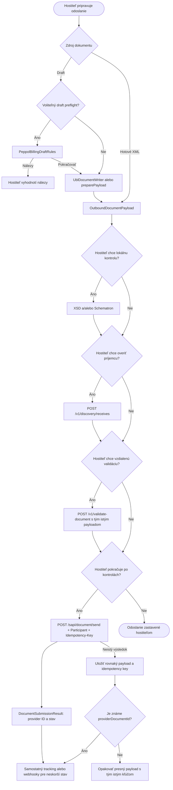

# Odosielanie dokladov

Tento návod sprevádza prípravu payloadu, voliteľné kontroly a samostatné odoslanie cez SAPI.

<details>
<summary>Obsah stránky</summary>

- [Payload](#payload)
- [Tok prípravy a odoslania](#tok-prípravy-a-odoslania)
- [Priame odoslanie UBL draftu](#priame-odoslanie-ubl-draftu)
- [Odoslanie cez SAPI](#odoslanie-cez-sapi)
- [Hromadné odosielanie cez Peppol Gateway](#hromadné-odosielanie-cez-peppol-gateway)
- [Kontroly pred odoslaním](#kontroly-pred-odoslaním)
- [Idempotencia a neistý výsledok](#idempotencia-a-neistý-výsledok)
- [Hranice zodpovednosti](#hranice-zodpovednosti)

</details>

`UblDraftSubmissionInterface::send()` môže vyhodiť chyby zápisu draftu (`DOMException` alebo `InvalidInputException`) aj výnimky odosielacieho gatewaya: `ProviderApiException` (vrátane odloženia `RequestDeferredException`), `RequestEncodingException` alebo `RequestCoordinationException`. `preparePayload()` iba pripraví payload a nevykonáva sieťové volanie. Typy výnimiek a ich spracovanie sú opísané v [prehľade výnimiek a retry](Errors-Retry-and-Idempotency.md).

## Tok prípravy a odoslania

Nasledujúci tok ukazuje možné kroky hostiteľskej aplikácie. Lokálna validácia, Discovery a vzdialená kontrola sú voliteľné samostatné volania; konektor ich nespúšťa implicitne pri odoslaní. Ak sa rozhodnete vykonať vzdialenú validáciu, na ňu aj na SAPI odoslanie odovzdajte ten istý pripravený payload.



SAPI odpoveď `ACCEPTED` znamená technické prijatie požiadavky. Konečný stav doručenia čítajte samostatne cez tracking alebo webhooky. Pri neistom výsledku sa nesmie vytvoriť nový idempotency key pre ten istý logický pokus; podrobnosti sú v [idempotencii a neistom výsledku](Errors-Retry-and-Idempotency.md).

## Payload

`OutboundDocumentPayload` je nemenný vstup pre odoslanie aj vzdialené kontroly. Obsahuje číslo dokladu, Peppol document type ID, process ID, identifikátory odosielateľa a príjemcu, čas vytvorenia, UBL XML a voliteľný kontrolný súčet.

```php
use DreaM1\EfakturaConnector\Core\Documents\OutboundDocumentPayload;
use DreaM1\EfakturaConnector\Core\Documents\Sha256Checksum;
use DreaM1\EfakturaConnector\Core\Ubl\PeppolDocumentTypeIdentifierBuilder;
use DreaM1\EfakturaConnector\Domain\Ubl\PeppolBillingProfile;
use DreaM1\EfakturaConnector\Domain\EFaktura\Participant;
use DreaM1\EfakturaConnector\Domain\EFaktura\PeppolProcessIdentifier;
use DreaM1\EfakturaConnector\Domain\EFaktura\SubmittedDocumentId;
use DreaM1\EfakturaConnector\Support\Timestamp;

$xml = file_get_contents('invoice.xml');
$senderParticipant = Participant::parse('0245:1234567890');
$receiverParticipant = Participant::parse('0245:9876543210');
$payload = new OutboundDocumentPayload(
    SubmittedDocumentId::fromString('INV-2026-001'),
    PeppolDocumentTypeIdentifierBuilder::forDocument('Invoice'),
    PeppolProcessIdentifier::fromString(PeppolBillingProfile::PROCESS_ID),
    $senderParticipant,
    $receiverParticipant,
    Timestamp::fromDateTimeImmutable(new DateTimeImmutable('now', new DateTimeZone('UTC'))),
    $xml,
    Sha256Checksum::fromContent($xml),
);
```

Pri výrobe payloadu používajte identifikátory a formát dátumu podľa SAPI-SK OpenAPI. `metadata.senderParticipantId` zostáva súčasťou payloadu. Hlavička `X-Peppol-Participant-Id` sa odovzdáva samostatným objektom `Participant`; podľa API sa jej identifikátor musí zhodovať s odosielateľom v metadátach.

`SendDocumentRequest` a `ValidateDocumentRequest` túto zhodu kontrolujú pri vytvorení requestu a pri nesúlade vyhodia `InvalidInputException`.

Príklady s `0245` používajú produkčné ID. V eFaktúra Sandboxe participant hlavička aj `metadata.senderParticipantId` musia používať sandbox ID so schémou `9915`; raw UBL payload musí mať schému `9915` aj v `EndpointID/@schemeID`. Knižnica tieto hodnoty automaticky neprepisuje. Pozrite [dokumentáciu SAPI](https://developers.efaktura.sk/en/docs/sapi-send-receive) a [Sandboxu](https://developers.efaktura.sk/sk/docs/sandbox).

## Priame odoslanie UBL draftu

Ak aplikácia vytvára doklad ako `UblDocumentDraft`, môže použiť Core kontrakt `UblDraftSubmissionInterface`, ktorý implementuje `UblDraftSubmission`. Služba draft zapíše cez `UblDocumentWriterInterface` a metadáta pre transport zostaví z explicitne dodaných Participant identifikátorov. Pri manuálnom skladaní možno naďalej vytvoriť konkrétnu implementáciu:

```php
use DreaM1\EfakturaConnector\Infrastructure\EFaktura\Api\Endpoints\Sapi\SendDocumentEndpoint;
use DreaM1\EfakturaConnector\Infrastructure\EFaktura\Documents\SapiDocumentSubmissionGateway;
use DreaM1\EfakturaConnector\Infrastructure\EFaktura\Documents\UblDraftSubmission;
use DreaM1\EfakturaConnector\Infrastructure\Ubl\Writer\UblDocumentWriter;
use DreaM1\EfakturaConnector\Core\Documents\IdempotencyKeyGenerator;

$gateway = new SapiDocumentSubmissionGateway(new SendDocumentEndpoint($connector));
$sender = new UblDraftSubmission(new UblDocumentWriter(), $gateway);
$senderParticipant = Participant::parse('0245:2022706466');
$receiverParticipant = Participant::parse('0088:7300010000001');
$creationDateTime = Timestamp::fromDateTimeImmutable(new DateTimeImmutable('now', new DateTimeZone('UTC')));
$idempotencyKey = IdempotencyKeyGenerator::generate();

$result = $sender->send(
    $senderParticipant,
    $receiverParticipant,
    $draft,
    $creationDateTime,
    $idempotencyKey
);
```

`documentId` sa vezme z čísla draftu, document type ID z druhu dokladu a `CustomizationID` a process ID z draftu. Participant identifikátory dodávateľa a odberateľa pre transport sa zadávajú samostatne; UBL `EndpointID` označuje elektronickú adresu strany a nemožno zaručiť, že je totožná s jej Participant ID. Odosielateľ odovzdaný službe musí zodpovedať Participant hlavičke SAPI. Čas vytvorenia nie je súčasťou UBL draftu, preto sa zadáva samostatne. Služba vytvorí SHA-256 checksum nad XML, ktoré zapísal writer.

Ak treba pred odoslaním vykonať vzdialenú kontrolu, pripravte payload raz a ten istý objekt použite na kontrolu aj odoslanie:

```php
use DreaM1\EfakturaConnector\Core\Documents\SendDocumentRequest;
use DreaM1\EfakturaConnector\Core\Documents\ValidateDocumentRequest;

$payload = $sender->preparePayload($senderParticipant, $receiverParticipant, $draft, $creationDateTime);
$providerValidation->check(new ValidateDocumentRequest($senderParticipant, $payload));
$result = $gateway->send(new SendDocumentRequest($senderParticipant, $payload, $idempotencyKey));
```

Pri opakovaní po neistom výsledku zachovajte rovnaký draft, čas vytvorenia aj idempotency key, prípadne uložte pripravený payload. `send()` nespúšťa lokálnu ani vzdialenú validáciu a nemení pravidlá retry existujúceho gatewaya.

## Odoslanie cez SAPI

`SapiDocumentSubmissionGateway` implementuje `DocumentSubmissionGatewayInterface` a volá štandardný SAPI endpoint `POST /sapi/document/send`.

```php

$gateway = new SapiDocumentSubmissionGateway(
    new SendDocumentEndpoint($connector)
);
$participant = Participant::parse('0245:1234567890');
$idempotencyKey = IdempotencyKeyGenerator::generate();
$result = $gateway->send(new SendDocumentRequest($participant, $payload, $idempotencyKey));

$result->providerDocumentId()->value();
$result->status()->value(); // ACCEPTED alebo REJECTED podľa odpovede API
$result->timestamp()->value(); // pôvodný ISO 8601 text z odpovede SAPI
$receivedAt = $result->receivedAt(); // Timestamp|null
if ($receivedAt !== null) {
    echo $receivedAt->value();
}
```

Pri stave `ACCEPTED` musí odpoveď obsahovať aj `receivedAt`; pri stave `REJECTED` môže byť toto pole vynechané. `timestamp` je povinný pri oboch stavoch. Neznámy status od poskytovateľa sa zachová (`isKnown()` vráti `false`); nepovažujte ho za prijatý ani odmietnutý, ale ako neistý výsledok a stav overte cez tracking s rovnakým idempotency kľúčom.

Odpoveď SAPI obsahuje ID dokladu, stav `ACCEPTED` alebo `REJECTED` a časové údaje typu `Timestamp`. `Timestamp` rozširuje `DateTimeImmutable`, preto ho možno použiť aj tam, kde sa očakáva `DateTimeInterface`. `Timestamp::value()` vráti pôvodný text, kým `dateTimeImmutable()` poskytne parsovaný okamih. Odpoveď neposkytuje samostatné pole s textom odmietnutia. HTTP chyba sa hlási cez `ProviderErrorResponseException`, ktorej telo sprístupňuje `body()`. `ACCEPTED` potvrdzuje technické prijatie, nie validáciu obsahu, doručenie príjemcovi ani právny účinok. Ďalší stav čítajte cez tracking provider alebo webhooky. Konektor posiela payload ako UTF-8 XML. Payload môže obsahovať voliteľný SHA-256 checksum v lowercase hex nad presnými bajtmi XML; pri zadaní sa jeho hodnota kontroluje. Maximálna veľkosť XML payloadu je 10 MB.

## Hromadné odosielanie cez Peppol Gateway

Peppol Gateway batch odoslanie je dostupné cez `$client->peppolGatewayDocumentSubmission()`. Volanie prijíma `SendDocumentsRequest`, ktorý obsahuje participant-a odosielateľa, zoznam `OutboundGatewayDocument` a stabilný `IdempotencyKey`. Používa `POST /v1/send-documents`, hlavičky `Idempotency-Key` vo formáte UUID a `X-Peppol-Participant-Id` a JSON telo s poľom `documents`. Ak serializované telo prekročí limit, `RequestBodyTooLargeException` vznikne ešte pred HTTP volaním.

Opis požiadavky uvádza tieto limity a pravidlá:

- najmenej 1 a najviac 100 dokumentov v jednej požiadavke (`SendDocumentsRequest` prázdnu dávku odmietne `InvalidInputException` ešte pred volaním providera);
- najviac 10 MB na XML payload;
- konektor pred odoslaním vynucuje konfigurovateľný limit serializovaného JSON tela, predvolene 100 MiB; nastavuje sa cez `runtime.http.request_max_bytes` alebo `EFAKTURA_HTTP_REQUEST_MAX_BYTES`. Limit má podporovaný rozsah 1 bajt až 1 GiB. Nasadenie poskytovateľa môže mať nižší limit cez `app.outbound.send-documents.max-request-size`;
- položka má typ `UBL_XML` alebo `SBDH_XML`; pri `UBL_XML` sa uvádza `receiverParticipantId`, pri `SBDH_XML` sa má odvodiť zo SBDH.

Živá Peppol Gateway OpenAPI schéma definuje úspešnú odpoveď `200` ako `SendDocumentsResponse` s povinnými poľami `count` a `identifiers`. Endpoint mapuje túto schému cez `SendDocumentsResultFactory` priamo na Core `SendDocumentsResult`. OpenAPI uvádza aj chybové odpovede `400`, `401`, `403`, `409`, `413` a `500`. Neurčuje však výsledok jednotlivých položiek pri čiastočnom úspechu, preto typovaný výsledok zachováva súhrnný počet a vrátené identifikátory.

`SendDocumentsResult::count()` vracia počet prijatých dokumentov a `identifiers()` typované Gateway ID (`ProviderDocumentId`), ktoré možno použiť pri načítaní stavu cez tracking provider. Odpoveď neposkytuje samostatný výsledok pre každú položku. Pre rovnakú dávku zachovajte a pri opakovanom volaní použite ten istý idempotency kľúč; konektor odoslanie automaticky neopakuje, pretože timeout môže nastať po prijatí dávky Gateway-om.

```php
use DreaM1\EfakturaConnector\Core\Documents\OutboundGatewayDocument;
use DreaM1\EfakturaConnector\Core\Documents\SendDocumentsRequest;
use DreaM1\EfakturaConnector\Core\Xml\XmlPayloadFormat;

$sender = Participant::parse('9915:sender-id');
$receiver = Participant::parse('9915:receiver-id');
$invoiceXml = file_get_contents('invoice.xml');
$sbdhXml = file_get_contents('sbdh.xml');

$submission = $client->peppolGatewayDocumentSubmission();
$request = new SendDocumentsRequest(
    $sender,
    [
        new OutboundGatewayDocument(XmlPayloadFormat::UBL_XML, $invoiceXml, $receiver),
        new OutboundGatewayDocument(XmlPayloadFormat::SBDH_XML, $sbdhXml),
    ],
    IdempotencyKeyGenerator::generate()
);

$result = $submission->send($request);
$result->count();
$result->identifiers()[0]->value();
```

Pri opakovaní po nejednoznačnom výsledku znovu použite pôvodný `IdempotencyKey`, nie nový UUID. UBL payload vyžaduje `receiverParticipantId`; pri SBDH sa príjemca určuje z XML obálky.

Lokálny OpenAPI snapshot testovacieho prostredia potvrdzuje batch cestu `/v1/send-documents` a odpoveď `200`. Pred nasadením overte aktuálny OpenAPI kontrakt prostredia, s ktorým bude aplikácia komunikovať.

## Kontroly pred odoslaním

Konektor poskytuje samostatné kontroly, ktoré hostiteľ zoradí podľa svojho workflow:

| Kontrola | Volanie | Význam |
| --- | --- | --- |
| `RecipientCapabilityCheck` | `POST /v1/discovery/receives` | Zistí, či príjemca podporuje daný typ dokumentu a proces. |
| `PeppolGatewayDocumentValidationCheck` | `POST /v1/validate-document` | Požiada Gateway o validáciu toho istého payloadu, ktorý sa bude odosielať. |

Záporný výsledok úspešnej kontroly vyvolá `DocumentPreflightException` alebo jej konkrétnu podtriedu. HTTP chyba (napríklad 400) je `ProviderErrorResponseException`; výnimka zachová pôvodné telo a `ApiConnector` k nej pripojí rozpoznanú provider error obálku cez `errorEnvelope()`. Hostiteľ rozhoduje, ako význam chyby spracovať a zobraziť.

Hostiteľ môže tieto samostatné operácie poskladať do prípravného toku: vytvoriť alebo načítať UBL, podľa potreby spustiť lokálne XSD/Schematron kontroly, overiť prijímateľa cez Discovery, vzdialene skontrolovať payload a až potom odoslať ten istý payload cez SAPI. Ak medzi prípravou a odoslaním uplynie čas, hostiteľ môže vzdialenú validáciu zopakovať bezprostredne pred odoslaním. Konektor toto poradie ani opakovanie nevykonáva automaticky.

## Idempotencia a neistý výsledok

Pri odoslaní vždy používajte stabilný UUID idempotency key uložený pri pokuse. Rovnaký kľúč s rovnakým payloadom vráti pôvodnú odpoveď; rovnaký kľúč s iným payloadom vráti `409 Conflict`. `SendDocumentRequest` nesie `IdempotencyKey`; jeho factory overí UUID formát pri vytvorení hodnoty.

Kľúč kompatibilný s OpenAPI kontraktom vytvoríte cez `IdempotencyKeyGenerator`. Vytvorte ho raz pre nové logické odoslanie, uložte ho spolu s pokusom a pri opakovaní použite uloženú hodnotu:

```php

$idempotencyKey = IdempotencyKeyGenerator::generate();
$result = $gateway->send(new SendDocumentRequest($participant, $payload, $idempotencyKey));
```

Pri retry znovu nevolajte `generate()`; pošlite rovnaký kľúč a identický payload.

Ak vznikne `ProviderConnectionException` alebo iná chyba, výsledok odoslania môže byť neistý: požiadavka mohla doraziť, aj keď odpoveď neprišla. Na rozlíšenie použite `$exception->requestMayHaveReachedProvider()`: pri `false` (odložená požiadavka, nedostupný token, otvorený circuit breaker, zlyhanie pred odoslaním) sa nič neodoslalo a odoslanie môžete bezpečne zopakovať. Ak už máte `providerDocumentId`, pred opakovaním skontrolujte stav cez `DocumentTrackingProviderInterface`. Tracking endpoint vyžaduje toto ID a nevie vyhľadať doklad podľa čísla faktúry ani idempotency kľúča. Ak sa odpoveď stratila skôr, než ste ID získali, zopakujte presne uložený payload s pôvodným idempotency key; idempotentná odpoveď vám vráti pôvodné ID a potom môžete stav overiť cez tracking. Zmenený payload musí mať nový kľúč.

## Hranice zodpovednosti

Konektor nevyberá faktúru z databázy, negeneruje aplikačný koncept a neurčuje obchodné pravidlá pre odosielanie. Hostiteľ zabezpečí validáciu, stavový workflow, uloženie hodnoty idempotency key a výsledku od poskytovateľa.

<details>
<summary>Súvisiace návody</summary>

- [Čítanie a zápis UBL](UBL-Documents)
- [Lokálna validácia](Validation)
- [Stav, Discovery a webhooky](Tracking-and-Webhooks)
- [Výnimky, retry a idempotencia](Errors-Retry-and-Idempotency)

</details>
