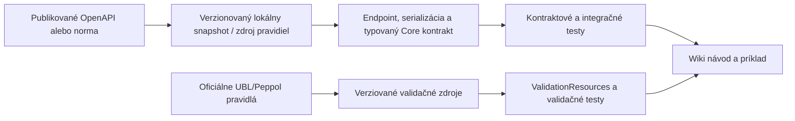

# API špecifikácie a pokrytie

Zdrojom pravdy pre implementované API tohto balíka sú DataHosting OpenAPI špecifikácie dostupné v testovacom prostredí:

- [SAPI-SK](https://test-sapisk.datahosting.sk/swagger-ui/index.html?urls.primaryName=SAPI-SK+API#/), [strojovo čitateľné SAPI-SK OpenAPI](https://test-sapisk.datahosting.sk/v3/api-docs/sapi-sk)
- [Peppol Gateway v1](https://test-sapisk.datahosting.sk/swagger-ui/index.html?urls.primaryName=Peppol+Gateway+API+v1)

Obsah stránky

- [Ako vystopovať zmenu kontraktu](#ako-vystopovať-zmenu-kontraktu)
- [Oficiálne a normatívne zdroje](#oficiálne-a-normatívne-zdroje)
  - [SAPI-SK a DataHosting Peppol Gateway](#sapi-sk-a-datahosting-peppol-gateway)
  - [Faktúry, UBL a Peppol BIS Billing](#faktúry-ubl-a-peppol-bis-billing)
  - [Peppol eDelivery](#peppol-edelivery)
  - [Použité všeobecné protokoly](#použité-všeobecné-protokoly)
- [Operácie DataHosting SAPI v balíku](#operácie-datahosting-sapi-v-balíku)
- [Operácie Peppol Gateway v balíku](#operácie-peppol-gateway-v-balíku)
- [Operácie Integrator API](#operácie-integrator-api)
- [Bezpečnosť opakovania](#bezpečnosť-opakovania)

## Ako vystopovať zmenu kontraktu

**Príklad: SAPI odoslanie dokladu.** Pre zmenu `POST /sapi/document/send` najprv porovnajte DataHosting SAPI OpenAPI s lokálnym snapshotom. Potom sledujte `SendDocumentRequest` a `OutboundDocumentPayload` v Core, ich mapovanie v `SendDocumentEndpoint`, testy odpovede a [návod na odosielanie](Sending-Documents). Lokálna UBL validácia je samostatná vetva a odoslanie ju nespúšťa automaticky.

DataHosting publikuje aj samostatné [Integrator API](https://test-sapisk.datahosting.sk/v3/api-docs/integrator-api), ktoré je súčasťou lokálneho snapshotu a má vlastný klient s `X-Integrator-Token`. Verejný, poskytovateľsky nezávislý SAPI-SK kontrakt slúži ako kontextový zdroj, nie ako cieľová implementačná špecifikácia tohto balíka.

Pri rozdiele medzi DataHosting SAPI/Gateway kontraktmi a inou dokumentáciou sa ich implementácia riadi týmito OpenAPI. `docs/eFaktura/api/openapi.json` je lokálny kombinovaný snapshot troch publikovaných skupín, nie samostatný živý export jednej z nich. Jeho `info.title` preto pomenúva SAPI-SK, Gateway aj Integrator API.

Pri porovnaní s kombinovaným OpenAPI snapshotom v dokumentácii hostiteľskej aplikácie mali oba súbory rovnakú verziu, cesty a názvy komponentových schém. Porovnávaná kópia však neobsahovala 12 dodatočných SAPI chybových odpovedí a výnimku z bearer autentifikácie pre token endpoint, ktoré sú v tomto repozitári. Pri prenose špecifikácie preto porovnávajte aj odpovede a bezpečnostné deklarácie jednotlivých operácií; pre tento balík je rozhodujúci jeho vlastný lokálny snapshot.

Pri porovnaní 21. 11. 2026 živé DataHosting testovacie skupiny obsahovali spolu 28 operácií: 6 SAPI, 12 Gateway a 10 Integrator. Lokálny snapshot bol neúplný: chýbala úspešná odpoveď batch odosielania, viaceré publikované HTTP odpovede a bezpečnostné schémy Integrator API; zároveň obsahoval 19 nepublikovaných `/v1/admin` operácií. Snapshot sme zosúladili s publikovanými skupinami a doplnili testy pre počet operácií, batch odpoveď, bezpečnostné schémy a odlišné chybové obálky Integrator API. Pri SAPI napríklad pribudli živé odpovede `500`, `503` pri odoslaní a ďalšie `400`, `500`, `502` odpovede; výnimka z bearer autentifikácie pre `POST /sapi/auth/token` zostáva zachovaná. Konektor pri neúspešnom HTTP stave vyhodí `ProviderErrorResponseException` a zachová stav, hlavičky aj telo odpovede; odosielací POST sa automaticky neopakuje.

Swagger konfigurácia v danom prostredí publikuje tri skupiny: `sapi-sk`, `peppol-gateway-v1` a `integrator-api`. Neobsahuje samostatnú admin skupinu; preto sú admin cesty zo starého lokálneho snapshotu odstránené. Integrator API si zachováva vlastnú autentifikáciu a samostatný `IntegratorAccountClientInterface`, nevyužíva SAPI OAuth klientsku službu.

Pri opakovanej kontrole 24. 11. 2026 živá [Peppol Gateway v1 OpenAPI schéma](https://test-sapisk.datahosting.sk/v3/api-docs/peppol-gateway-v1) uvádzala 12 operácií. Metódy, cesty, parametre, povinné polia requestov a odpovedí aj HTTP statusy sa zhodovali s Gateway operáciami v lokálnom snapshot-e. Výnimkou zostáva už opísaná normalizácia nekonzistentného poľa `capability`. V čase tejto kontroly konektor pokrýval 11 operácií; batch `POST /v1/send-documents` pribudol v implementácii 25. 11. 2026. Aktuálna API referencia uvádza všetkých 12 implementovaných operácií. Zmeny kontraktu Gateway neboli pri tejto kontrole potrebné.

Pri kontrole 24. 11. 2026 živé [SAPI-SK OpenAPI](https://test-sapisk.datahosting.sk/v3/api-docs/sapi-sk) naďalej uvádzalo šesť operácií. Parametre, bezpečnostné požiadavky, povinné polia requestov a odpovedí, error obálky aj HTTP statusy sa zhodovali s lokálnym snapshotom; zmeny kontraktu SAPI neboli potrebné. HTTP 429 je uvedené vo všeobecnom mapovaní kategórií chyby, nie v odpovediach jednotlivých SAPI operácií.

## Oficiálne a normatívne zdroje

### SAPI-SK a DataHosting Peppol Gateway

- [Oficiálna stránka SAPI-SK](https://www.sapi-sk.sk/) je verejný vstupný bod štandardu. Obsahuje odkazy na [interaktívnu API dokumentáciu](https://www.sapi-sk.sk/docs) a [verejný OpenAPI súbor](https://www.sapi-sk.sk/openapi.json); tieto zdroje môžu opisovať operácie, ktoré DataHosting kontrakt a tento balík nepodporujú.
- [DataHosting testovacie SAPI-SK OpenAPI](https://test-sapisk.datahosting.sk/swagger-ui/index.html?urls.primaryName=SAPI-SK+API#/), [Peppol Gateway v1 OpenAPI](https://test-sapisk.datahosting.sk/swagger-ui/index.html?urls.primaryName=Peppol+Gateway+API+v1) a [Integrator API OpenAPI](https://test-sapisk.datahosting.sk/v3/api-docs/integrator-api) opisujú tri skupiny nasadené v testovacom prostredí poskytovateľa. Ich zoznam je dostupný v [Swagger konfigurácii](https://test-sapisk.datahosting.sk/v3/api-docs/swagger-config).
- [Lokálny kombinovaný snapshot](../eFaktura/api/openapi.json) je verzovaný podklad použitý pri implementácii. Obsahuje viac skupín operácií a jeho metadáta `info.title` samy osebe neurčujú, ktoré cesty patria SAPI a ktoré Gateway.

Verejné SAPI-SK OpenAPI a DataHosting testovacie SAPI OpenAPI sú samostatné publikované kontrakty a nemusia mať rovnakú verziu, polia ani odpovede. Pri zmene konektora pre DataHosting testovacie prostredie porovnaj jeho aktuálne OpenAPI s lokálnym snapshotom a zaznamenaj dátum kontroly. Produkčné správanie z testovacieho kontraktu nevyvodzuj bez potvrdenia poskytovateľa. Peppol normy nižšie definujú sieťové a dokumentové pravidlá, nie konkrétne HTTP cesty, JSON schémy ani webhook podpisy DataHosting Gateway.

### Faktúry, UBL a Peppol BIS Billing

- [OASIS UBL 2.1](https://docs.oasis-open.org/ubl/os-UBL-2.1/UBL-2.1.html) je štandard syntaxe XML, ktorú číta a zapisuje UBL modul.
- [Európska komisia: súlad s normou eInvoicing](https://ec.europa.eu/digital-building-blocks/sites/spaces/DIGITAL/pages/467108926/Compliance%2Bwith%2BeInvoicing%2Bstandard) vysvetľuje väzbu sémantického modelu EN 16931 na syntaxe vrátane UBL.
- [OpenPeppol BIS Billing 3.0](https://docs.peppol.eu/poacc/billing/3.0/) je priebežne aktualizovaná dokumentácia obchodných pravidiel a profilov; užitočné podstránky sú [BIS](https://docs.peppol.eu/poacc/billing/3.0/bis/), [pravidlá](https://docs.peppol.eu/poacc/billing/3.0/rules/) a [zoznamy kódov](https://docs.peppol.eu/poacc/billing/3.0/codelist/).
- [Zoznamy kódov OpenPeppol pre `2026-Q4-MR`](https://test-docs.peppol.eu/poacc/billing/3.0/2026-Q4-MR/codelist/) sú zdrojom doplnkového súboru `resources/code-lists/peppol-billing-3.0-2026-Q4-MR.json`. Tento súbor uchováva aktuálne hodnoty, názvy, verzie a URL pre číselníky Billing, ktoré nemajú samostatný resolver; `PeppolBillingCodeList` poskytuje spoločné lookup API.
- [Oficiálny OpenPeppol UBL Schematron pre `2026-Q4-MR`](https://test-docs.peppol.eu/poacc/billing/3.0/2026-Q4-MR/files/PEPPOL-EN16931-UBL.sch) a [poznámky k vydaniu 3.0.22](https://test-docs.peppol.eu/poacc/billing/3.0/2026-Q4-MR/release-notes/) sú zdrojom aktívnych Peppol pravidiel v balíku. CEN ruleset 1.3.17 sa spravuje nezávisle; OpenPeppol uvádza v Q4-MR vlastné EN 16931 artefakty 1.3.16. Lokálna kópia oficiálneho `.sch`, jej SHA-256 a vygenerované XSLT sú v `resources/validation/peppol-3.0.22-2026-Q4-MR/`.
- [Peppol zoznam jednotiek UNECE Recommendation 20](https://docs.peppol.eu/poacc/billing/3.0/codelist/UNECERec20/) je zdrojom významov a použitia kódov jednotiek. Lokálny JSON je odvodený dátový súbor na zobrazenie názvov, nie úplná implementácia BIS validácie.

Aktuálna dokumentácia BIS môže opisovať novšie vydanie než XSLT/Schematron súbory pribalené v tomto repozitári. Pri tvrdeniach o lokálnej validácii vždy uvádzaj verziu a release z `ValidationResources` a priečinok pod `resources/validation/`; pri tvrdeniach o pravidlách, ktoré má momentálne uplatňovať Peppol, odkazuj na živú dokumentáciu OpenPeppol a uveď dátum kontroly.

### Peppol eDelivery

Tieto oficiálne špecifikácie opisujú širšiu sieť Peppol. Sú dôležitým kontextom pre discovery, identifikátory a doručovacie stavy, ale nie sú OpenAPI špecifikáciou DataHosting Gateway:

- [Index Peppol eDelivery](https://docs.peppol.eu/edelivery/) uvádza platné špecifikácie a ich vydania.
- [Peppol Service Metadata Publishing (SMP) 1.4.0](https://docs.peppol.eu/edelivery/smp/Peppol-EDN-Service-Metadata-Publishing-1.4.0-2025-02-06.pdf) a [politika identifikátorov 4.4.0](https://docs.peppol.eu/edelivery/policies/Peppol-EDN-Policy-for-use-of-identifiers-4.4.0-2025-02-06.pdf) popisujú publikovanie metadát a identifikátory v sieti.
- [Peppol AS4 Profile 2.0.3](https://docs.peppol.eu/edelivery/as4/specification/) opisuje prenos správ medzi Access Pointmi.
- [Message Level Status (MLS) 1.1.0](https://docs.peppol.eu/edelivery/specs/mls/v1.1.0/) a [prevádzkové usmernenie MLS](https://docs.peppol.eu/edelivery/guidelines/mls/SPOG%20on%20MLS%201.0.0%202026-07-02.pdf) pomáhajú interpretovať sieťové potvrdenia. Konkrétne mapovanie odpovedí Gateway je však potrebné kontrolovať voči jej vlastnému kontraktu.

Konektor sprístupňuje vybrané Gateway operácie pre discovery a MLS; sám osebe neimplementuje SML/SMP ani AS4 Access Point.

### Použité všeobecné protokoly

- [OAuth 2.0](https://www.rfc-editor.org/rfc/rfc6749) definuje client credentials grant a [Bearer token usage](https://www.rfc-editor.org/rfc/rfc6750) spôsob posielania access tokenu.
- [HTTP Semantics (RFC 9110)](https://www.rfc-editor.org/rfc/rfc9110) je referencia pre HTTP metódy, stavové kódy a `Retry-After`.
- [URI Generic Syntax (RFC 3986)](https://www.rfc-editor.org/rfc/rfc3986) je referencia pre kódovanie URI a parametrov ciest; [RFC 3339](https://www.rfc-editor.org/rfc/rfc3339) pre dátum a čas v textovom formáte.

Odkazy v tejto kapitole sú podklady na kontrolu a orientáciu, nie prísľub úplnej zhody implementácie so všetkými časťami uvedených štandardov. Rozsah podpory balíka je opísaný v jednotlivých sprievodcoch a chránený zodpovedajúcimi kontraktmi a testami.

## Operácie DataHosting SAPI v balíku

Balík implementuje podmnožinu operácií z DataHosting testovacieho SAPI OpenAPI: token client credentials, kontrolu stavu tokenu, odoslanie dokumentu, zoznam a detail prijatých dokumentov a ich acknowledge. Tento DataHosting token endpoint vracia access token a jeho kontrakt neobsahuje vzdialené operácie `/sapi/auth/renew` ani `/sapi/auth/revoke`. Toto tvrdenie sa vzťahuje iba na DataHosting API; nepopisuje celý verejný štandard SAPI-SK.

Odoslanie vyžaduje `Idempotency-Key` vo formáte UUID a `X-Peppol-Participant-Id`. Odpoveď na acknowledge povoľuje `RECEIVED` aj `ACKNOWLEDGED`. Chyby sa čítajú z obálky `error` vrátane kategórie, kódu, `retryable` a `correlation_id`.

## Operácie Peppol Gateway v balíku

Balík sprístupňuje discovery, vzdialenú validáciu a dávkové odosielanie dokumentov, profil participanta, stav odoslaného dokumentu, Message Level Statusy a ich XML obsah a operácie nad registráciami webhookov. `WebhookRegistryInterface::get()` načíta jednotlivý webhook; registry zároveň poskytuje registráciu, stránkovaný zoznam, úpravu a odstránenie. Tieto operácie používajú cesty `/v1/...` a bearer access token získaný cez SAPI.

Živá Peppol Gateway OpenAPI schéma deklaruje `DiscoveryReceivesResponse.capability` súčasne ako `type: null` a odkaz na objekt `ParticipantCapability`. Keďže ide o OpenAPI 3.1 a jeho schémy používajú JSON Schema, tieto obmedzenia sa skladajú a pôvodná deklarácia nepripúšťa hodnotu objektu. Lokálny snapshot túto chybu normalizuje na `oneOf` medzi `ParticipantCapability` a `null`; adaptér a testy preto zachovávajú oba zdokumentované výsledky.

Balík implementuje Gateway batch cestu `POST /v1/send-documents` cez `SapiClientInterface::peppolGatewayDocumentSubmission()`. `PeppolGatewayDocumentSubmissionInterface` prijíma typovaný `SendDocumentsRequest` a vracia `SendDocumentsResult` s `count` a `ProviderDocumentId[]`; operácia sa automaticky neopakuje. Živá schéma uvádza chybové stavy vrátane `400`, `401`, `403`, `409`, `413` a `500`, ale nešpecifikuje výsledok každej položky pri čiastočnom úspechu. Registrácia udalostí cez `/v1/webhooks` patrí Peppol Gateway API; odoslanie PDS subjects cez Integrator API je samostatná klientská požiadavka opísaná v [návode Integrator API](Integrator-API).

## Operácie Integrator API

Pri kontrole 24. 11. 2026 živé [Integrator API OpenAPI](https://test-sapisk.datahosting.sk/v3/api-docs/integrator-api) uvádzalo 10 operácií. Cesty, parametre, autentifikácia, request a response schémy aj HTTP statusy sa zhodovali s lokálnym kombinovaným snapshotom. Snapshot používa prefixované názvy chybových komponentov Integrator API, pretože spája viac OpenAPI skupín; význam polí chyby zodpovedá živému `SapiErrorResponseEnvelope`. `IntegratorAccountClientInterface` klientsky pokrýva aj `POST /v1/integrators/{integratorId}/pds/subjects`: odošle typovaný `PdsSubjectBatch` podpísaný secretom pre PDS požiadavky.

Všetky operácie okrem PDS subjects používajú hlavičku `X-Integrator-Token`; PDS požiadavka používa podpis v `X-PDS-Secret`. Označenie `povinné` pri tele znamená OpenAPI `requestBody.required`; pri väčšine objektových schém OpenAPI neoznačuje jednotlivé vlastnosti ako povinné. Úspešné odpovede `200` sú v OpenAPI deklarované s media type `*/*`; error odpovede používajú `application/json` a obálku `SapiErrorResponseEnvelope`. V obálke je povinné pole `error`; v ňom sú povinné `category`, `code`, `correlation_id`, `message` a `retryable`, kým `details` je voliteľné.

| Operácia | Request | Úspešná odpoveď | Chybové HTTP statusy | Klientské pokrytie |
| --- | --- | --- | --- | --- |
| `PUT /v1/integrators/{integratorId}/clients/{clientId}/secret` | Povinné path parametre `integratorId`, `clientId`; bez tela. | `200 IntegratorClientSecretResponse`: `client_id`, `client_secret`. | `401`, `403`, `404`, `500` | `rotateClientSecret()` |
| `PUT /v1/integrators/{integratorId}/clients/{clientId}/participants` | Povinné path parametre; povinné JSON telo `participants[]`, položka má `participant_id`, `can_send`, `can_receive`. Schéma neoznačuje vlastnosť `participants` ako povinnú. | `200 IntegratorClientResponse`: `client_id`, `client_name`, `status` (`APPROVED`/`DELETED`), `created_at`, `approved_at`, `participants[]` (rovnaký tvar prístupu k participantovi). | `400`, `401`, `403`, `404`, `409`, `500` | `replaceClientParticipantAccess()` |
| `POST /v1/integrators/{integratorId}/pds/subjects` | Povinný path `integratorId`, podpis v hlavičke `X-PDS-Secret` a povinné JSON pole `PdsSubjectRequest[]`; položka obsahuje `created`, `dic`, `legalName`, `company_email`, `company_phone`, `verification_token`. Tieto vlastnosti nie sú v schéme označené ako povinné. | `200 PdsSubjectResponse`: `code`, `description`. | `400`, `401`, `404`, `409`, `500`, `503` | `submitPdsSubjects()` serializuje `PdsSubjectBatch`, podpíše odchádzajúce telo pomocou `PdsSigningSecret` a mapuje odpoveď na `PdsSubjectResponse`. |
| `POST /v1/integrators/{integratorId}/participants/{participantId}/activations` | Povinné path `integratorId`, `participantId`, `Idempotency-Key` vo formáte UUID a JSON telo; povinné `mode` (`SEND_ONLY`/`SEND_AND_RECEIVE`), voliteľné `requested_by_user_id`. | `200 ParticipantActivationResponse`: `activation_id`, `participant_id`, `integrator_id`, `mode`, `status`, `requested_at`. | `400`, `401`, `403`, `404`, `409`, `500` | `requestParticipantActivation()` |
| `GET /v1/integrators/{integratorId}/clients` | Povinný path `integratorId`; voliteľné query `pageToken`, `limit` (integer) a `status` (`APPROVED`/`DELETED`). | `200 IntegratorClientListResponse`: `clients[]` (tvar `IntegratorClientResponse`), `nextPageToken`. | `400`, `401`, `403`, `500` | `listClients()` |
| `POST /v1/integrators/{integratorId}/clients` | Povinný path `integratorId`, `Idempotency-Key` vo formáte UUID a JSON telo `name`, `contact_email`, `participants[]` s `participant_id`, `can_send`, `can_receive`. Telo je povinné, schéma však neoznačuje jeho vlastnosti ako povinné. | `200 IntegratorClientCreateResponse`: `client_id`, `client_secret`, `client_name`, `status` (`APPROVED`/`DELETED`), `participants[]` (rovnaký tvar prístupu k participantovi). | `400`, `401`, `403`, `409`, `500` | `createClient()` |
| `GET /v1/integrators/{integratorId}/participants` | Povinný path `integratorId`; voliteľné query `pageToken`, `limit` (integer). | `200 IntegratorParticipantListResponse`: `participants[]` (`participant_id`, `dic`, `legal_name`, `company_email`, `company_phone`, `source_created_at`, `received_at`, `internal_transfer_required`, `is_owner`, `active_contract_mode` (`SEND_ONLY`/`SEND_AND_RECEIVE`)), `nextPageToken`. | `400`, `401`, `403`, `500` | `listParticipants()` |
| `GET /v1/integrators/{integratorId}/document-summary` | Povinný path `integratorId` a query `month` vo formáte `yyyyMM`. | `200 IntegratorDocumentSummaryResponse`: `month`, `participants[]` (`participant_id`, `sent`, `received`). | `400`, `401`, `403`, `500` | `getDocumentSummary()` |
| `GET /v1/integrators/{integratorId}/clients/{clientId}` | Povinné path parametre `integratorId`, `clientId`; bez tela. | `200 IntegratorClientResponse`: `client_id`, `client_name`, `status`, `created_at`, `approved_at`, `participants`. | `401`, `403`, `404`, `500` | `getClient()` |
| `DELETE /v1/integrators/{integratorId}/clients/{clientId}` | Povinné path parametre `integratorId`, `clientId`; bez tela. | `204 No Content`, bez odpovede. | `401`, `403`, `404`, `500` | `deleteClient()` |

OpenAPI neoznačuje polia úspešných response objektov ako povinné; mapper zachováva chýbajúce hodnoty ako `null`, pričom vynechaný zoznam na stránke mapuje na prázdne pole. Bežné požiadavky používajú `X-Integrator-Token`; PDS subjects sa odosielajú s podpisom v `X-PDS-Secret`. Chybové odpovede končia ako `ProviderErrorResponseException`. `createClient()` a `requestParticipantActivation()` môžu bezpečne opakovať identickú požiadavku s rovnakým idempotency UUID, výmena participant prístupov je bezpečná pri opakovaní rovnakého PUT. Rotácia secretu, delete a PDS submission sa automaticky neopakujú; v publikovaných skupinách nie sú `/v1/admin` operácie.

## Bezpečnosť opakovania

GET požiadavky sú štandardne bezpečné na retry. Integrator `POST` operácie s idempotency UUID povoľujú retry len s tým istým kľúčom a identickým telom. Nahradenie participant prístupov cez PUT je idempotentné; rotácia client secretu, delete klienta a odoslanie dokumentu sa automaticky neopakujú.

Súvisiace návody

- [Prehľad API](API-Reference)
- [Čítanie a zápis UBL](UBL-Documents)
- [Lokálna validácia](Validation)

