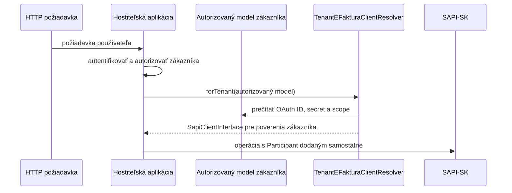

# OAuth poverenia zákazníka v Laraveli

Táto stránka opisuje výber OAuth klienta z modelu zákazníka. Ak sú poverenia známe pri nasadení, nakonfigurujte pomenované profily a vyberajte ich cez `SapiClientRegistryInterface`. `TenantEFakturaClientResolver` použite vtedy, keď má každý zákazník vlastné poverenia uložené v databáze.

Každý PHP blok je samostatný offline skript. Po `composer install` uložte ho ako `docs/wiki/offline-example.php` a z koreňa repozitára spustite `php docs/wiki/offline-example.php`. Skripty používajú syntetické poverenia a nevolajú provider API. Prvý ukazuje iba kontrakt adaptéra; v Laravel aplikácii ho implementuje chránený model alebo jeho adaptér.

<details>
<summary>Obsah stránky</summary>

- [Tok tenantového klienta](#tok-tenantového-klienta)
- [Kontrakt modelu](#kontrakt-modelu)
- [Výber klienta](#výber-klienta)

</details>

## Tok tenantového klienta



Resolver nevyberá zákazníka z HTTP parametra a neurčuje, ku ktorému zákazníkovi má používateľ prístup. To musí aplikácia overiť pred volaním `forTenant()`.

## Kontrakt modelu

Model alebo jeho adaptér musí implementovať `TenantEFakturaCredentialsInterface` z Laravel bridge. Poskytuje tieto hodnoty:

- `efakturaClientKey()` — stabilný, neprázdny a necitlivý kľúč zákazníka. Resolver z neho odvodí hashovaný názov klienta a nevracia samotný kľúč v `SapiClientInterface::name()`.
- `efakturaClientId()` a `efakturaClientSecret()` — OAuth údaje vydané poskytovateľom. Model vráti secret v dešifrovanej podobe iba pre túto operáciu.
- `efakturaClientScope()` — povinný explicitný scope vydaný poskytovateľom; zadajte iba oprávnenia potrebné pre zákazníka.

`base_url` sa berie z profilu predvoleného klienta v konfigurácii `efaktura-connector`, takže tenanti hovoria s rovnakým prostredím ako predvolený profil. Resolver nevyhľadáva model v databáze a nerozhoduje o oprávneniach používateľa.

```php
<?php
use DreaM1\EfakturaConnector\Laravel\Contracts\TenantEFakturaCredentialsInterface;

require dirname(__DIR__, 2) . '/vendor/autoload.php';

final class WikiOfflineTenantCredentials implements TenantEFakturaCredentialsInterface
{
    public function efakturaClientKey(): string
    {
        return 'tenant-demo';
    }

    public function efakturaClientId(): string
    {
        return 'offline-demo-client';
    }

    public function efakturaClientSecret(): string
    {
        return 'offline-demo-secret';
    }

    public function efakturaClientScope(): string
    {
        return 'document:send';
    }
}

$tenant = new WikiOfflineTenantCredentials();
echo 'Synthetic tenant key: ', $tenant->efakturaClientKey(), PHP_EOL;
```

Secret šifruj pri zápise do databázy. Atribút zároveň skry v JSON odpovediach a nikdy ho neloguj. Resolver pred vytvorením klienta overí URL, ID, secret aj scope; pri neplatnej konfigurácii vyhodí konfiguračnú výnimku bez volania poskytovateľa.

## Výber klienta

Po autorizácii zákazníka odovzdaj jeho model resolveru. Nasledujúci offline skript zostaví klienta s ukážkovým URL a povereniami, ale nevyvolá žiadnu operáciu nad API:

```php
<?php
use DreaM1\EfakturaConnector\ConnectorFactory;
use DreaM1\EfakturaConnector\Core\Configuration\SapiClientConfigurationInterface;
use DreaM1\EfakturaConnector\Core\Contracts\SapiClientFactoryInterface;
use DreaM1\EfakturaConnector\Core\Contracts\SapiClientInterface;
use DreaM1\EfakturaConnector\Laravel\Connection\TenantEFakturaClientResolver;
use DreaM1\EfakturaConnector\Laravel\Contracts\TenantEFakturaCredentialsInterface;

require dirname(__DIR__, 2) . '/vendor/autoload.php';

final class WikiOfflineResolverTenant implements TenantEFakturaCredentialsInterface
{
    public function efakturaClientKey(): string
    {
        return 'tenant-demo';
    }

    public function efakturaClientId(): string
    {
        return 'offline-demo-client';
    }

    public function efakturaClientSecret(): string
    {
        return 'offline-demo-secret';
    }

    public function efakturaClientScope(): string
    {
        return 'document:send';
    }
}

$factory = new class implements SapiClientFactoryInterface {
    private ConnectorFactory $connectorFactory;

    public function __construct()
    {
        $this->connectorFactory = new ConnectorFactory();
    }

    public function create(
        string $name,
        SapiClientConfigurationInterface $configuration
    ): SapiClientInterface {
        return $this->connectorFactory->createSapiClient($name, $configuration);
    }
};
$client = (new TenantEFakturaClientResolver($factory, 'https://example.test'))
    ->forTenant(new WikiOfflineResolverTenant());

$submission = $client->documentSubmissionGateway();
$tracking = $client->documentTrackingProvider();
echo 'Constructed offline services: ', get_class($submission), ', ', get_class($tracking), PHP_EOL;
```

Participant ostáva vstupom konkrétnej operácie aj pri klientovi zostavenom z tenantových poverení:

```php
<?php
use DreaM1\EfakturaConnector\Core\Documents\ListReceivedDocumentsRequest;
use DreaM1\EfakturaConnector\Core\Documents\ReceivedDocumentPage;
use DreaM1\EfakturaConnector\Core\Pagination\PageSize;
use DreaM1\EfakturaConnector\Domain\EFaktura\Participant;

require dirname(__DIR__, 2) . '/vendor/autoload.php';

$participant = Participant::parse('9915:tenant-demo');
$request = new ListReceivedDocumentsRequest($participant, null, PageSize::fromInt(50));
$offlineProvider = new class {
    public function getInboxPage(ListReceivedDocumentsRequest $request): ReceivedDocumentPage
    {
        echo 'Prepared synthetic inbox request for ', $request->participant()->value(), PHP_EOL;

        return new ReceivedDocumentPage([], null);
    }
};
$page = $offlineProvider->getInboxPage($request);
echo 'Synthetic page contains ', count($page->documents()), ' documents.', PHP_EOL;
```

V aplikácii nahraďte `$offlineProvider` službou `$client->receivedDocumentProvider()` a použite participanta získaného z autorizovaného tenantového kontextu.

Nepreberaj identitu zákazníka z neovereného aliasu požiadavky. Resolver používa presne model, ktorý mu aplikácia odovzdá. Ak sa poverenia zákazníka zmenia, ďalšie volanie `forTenant()` načíta nové hodnoty; resolver si klientov ani modely neponecháva v pamäti.

Token cache zostáva zdieľaná podľa konektora, ale jej kľúč je odvodený z provider URL, client ID, secretu a scope. Laravel adaptér ukladá token šifrovane. Participant sa aj naďalej odovzdáva osobitne pri participant-scoped operácii; nie je súčasťou OAuth poverení.

<details>
<summary>Súvisiace návody</summary>

- [Laravel bridge](Laravel)
- [Konfigurácia](Configuration)
- [HTTP transport a autentifikácia](Transport-and-Authentication)

</details>
