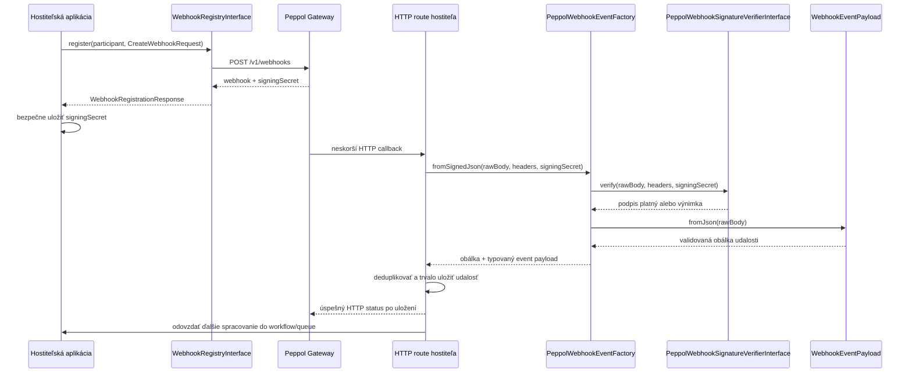

# Stav, Discovery a webhooky

Peppol Gateway poskytuje doplňujúce operácie nad SAPI: vyhľadanie prijímacej schopnosti, profil participanta, stav odoslaného dokladu, Message Level Status (MLS) a správu webhookov.

<details>
<summary>Obsah stránky</summary>

- [Discovery a profil participanta](#discovery-a-profil-participanta)
- [Stav odoslaného dokladu a MLS](#stav-odoslaného-dokladu-a-mls)
- [Správa webhookov](#správa-webhookov)
- [Podpis udalostí z registrácie `/v1/webhooks`](#podpis-udalostí-z-registrácie-v1webhooks)
- [Spracovanie udalostí hostiteľom](#spracovanie-udalostí-hostiteľom)
- [Tok registrácie a doručenia webhooku](#tok-registrácie-a-doručenia-webhooku)
- [Dôležité prevádzkové pravidlá](#dôležité-prevádzkové-pravidlá)
- [Zdroje kontraktu](#zdroje-kontraktu)

</details>

## Discovery a profil participanta

| Funkcia | Endpoint |
| --- | --- |
| Prijímač podporuje typ a proces | `POST /v1/discovery/receives` |
| Profil participanta | `GET /v1/participants/{participantId}` |

`PeppolGatewayDiscoveryProvider` implementuje `DocumentDiscoveryProviderInterface`. Request obsahuje participant, document type ID a process ID. Provider kontroluje, že identifikátor participanta vo výsledku odpovedá požadovanému účastníkovi.

## Stav odoslaného dokladu a MLS

| Funkcia | Endpoint |
| --- | --- |
| Stav odoslaného dokladu | `GET /v1/sent-documents/{identifier}` |
| Zoznam MLS potvrdení | `GET /v1/sent-documents/{identifier}/message-level-statuses` |
| Obsah konkrétneho MLS | `GET /v1/sent-documents/{identifier}/message-level-statuses/{statusIdentifier}/content` |

`PeppolGatewayDocumentTrackingProvider` implementuje `DocumentTrackingProviderInterface`. `SentDocumentReference` nesie participant, `ProviderDocumentId` a logovací kontext a používa sa pri stave dokladu aj zozname Message Level Status. Adaptér ho odovzdá endpointu, ktorý prevedie ID cez `value()` do URL cesty.

`SentDocumentStatus::identifier()` vracia `ProviderDocumentId`, ak poskytovateľ pole uviedol; `documentId()` vracia nullable `SubmittedDocumentId` odosielateľa. Reťazec získate cez `value()`. `status()` vracia nullable `ProviderDocumentStatus`. Neznámy neprázdny status provideru sa zachová a hostiteľ ho skontroluje cez `isKnown()`; pri neznámom stave `isOutboundStatus()` vráti `false`. Rovnaký hodnotový objekt stavu vracajú výsledky odoslania a potvrdenia príjmu. Metódy `sender()` a `receiver()` vracajú príslušné `Participant` objekty.

`SentDocumentStatus::payloadFormat()` vracia providerový reťazec bez uzavretého zoznamu hodnôt, aby hostiteľ mohol spracovať aj nový formát.

Referencia downstream poskytovateľa sprístupňuje `name`, typované `documentId` a `messageId` (`ProviderMessageId`); chyba sprístupňuje `message` a položky `details` (`field`, `issue`, `value`).

MLS položky cez `ProviderMessageLevelStatus` zachovávajú nullable `MessageLevelStatusIdentifier` v `identifier()`, `messageId` (`ProviderMessageId`), `MessageLevelStatusCode` v `responseCode()`, `responseDescription`, `reasons`, `documentTypeId` a `receivedAt`. Metódy `sender()` a `receiver()` vracajú participant objekty. MLS obsah môže byť XML a vracia sa cez `MessageLevelStatusContent`.

`DocumentTrackingProviderInterface::downloadMessageLevelStatus()` prijíma `MessageLevelStatusIdentifier`. Načítaný MLS záznam poskytuje toto ID cez `ProviderMessageLevelStatus::identifier()`; pre jeho obsah odovzdajte rovnaký objekt. Endpoint ho prevedie cez `value()` a bezpečne URL-kóduje ako parameter cesty.

`ProviderMessageLevelStatus::responseCode()` vracia nullable `MessageLevelStatusCode`. `value()` poskytne kód ako reťazec; objekt ho normalizuje na veľké písmená a zachová aj neznáme hodnoty, aby ich hostiteľ mohol vyhodnotiť.

Technické prijatie SAPI a stav prenosu v Peppol sú samostatné informácie. Konektor klasifikuje `AP` (`MessageLevelStatusCode::DELIVERED`) ako potvrdené doručenie, `RE` (`DELIVERY_FAILED`) ako neúspešné doručenie a `AB` (`FORWARDED`) ako preposlanie bez konečného výsledku. Pomocné metódy `isSuccess()`, `isFailure()` a `isForwarded()` vrátia `true` iba pre príslušný kód. Iné hodnoty vrátane `ERROR` zostávajú týmito metódami neklasifikované; hostiteľská aplikácia určuje ich obchodný význam a zobrazenie.

## Správa webhookov

`PeppolGatewayWebhookRegistry` implementuje `WebhookRegistryInterface`. Endpointy balíka pokrývajú tieto operácie:

| Funkcia | Endpoint |
| --- | --- |
| Registrácia | `POST /v1/webhooks` |
| Zoznam | `GET /v1/webhooks` |
| Detail | `GET /v1/webhooks/{webhookId}` |
| Úprava | `PATCH /v1/webhooks/{webhookId}` |
| Odstránenie | `DELETE /v1/webhooks/{webhookId}` |

Webhook register je vzdialená konfigurácia u poskytovateľa. Konektor neposkytuje web server ani trvalé úložisko udalostí pre hostiteľskú aplikáciu.

Core registry kontrakt podporuje načítanie jedného webhooku cez `get($participant, $webhookId)`, registráciu, stránkovaný zoznam, úpravu a odstránenie. Identifikátor pre `get()` vytvoríte cez `WebhookIdentifier::fromString()`. `delete()` vráti `false`, ak poskytovateľ odpovie `404`, `true` po potvrdenom odstránení a ostatné chyby nechá prejsť ako API výnimky.

`listPage()` prijíma `ListWebhooksRequest`; jeho kurzor a veľkosť stránky sú voliteľné `PageToken` a `PageSize` hodnoty. Výsledok vracia ďalší kurzor cez `WebhookRegistryPage::nextPageToken()`. Token možno použiť priamo v ďalšom requeste; na uloženie do databázy ho preveďte cez `value()` a obnovte cez `PageToken::fromString()`.

```php
use DreaM1\EfakturaConnector\Core\Pagination\PageSize;
use DreaM1\EfakturaConnector\Core\Webhooks\ListWebhooksRequest;

$pageToken = null;
do {
    $page = $registry->listPage(
        $participant,
        new ListWebhooksRequest($pageToken, PageSize::fromInt(50))
    );
    $pageToken = $page->nextPageToken();

    foreach ($page->webhooks()->items() as $webhook) {
        // Spracujte registráciu podľa workflow hostiteľa.
    }
} while ($pageToken !== null);
```

Tieto `/v1/webhooks` cesty, polia a eventy sú definované v Peppol Gateway v1 OpenAPI. Podporované eventy sú `sent_document.status_changed` a `inbox_document.received`; registračná odpoveď obsahuje `id`, `url`, `events`, `status`, voliteľný `description`, časové údaje a `signingSecret`. Core `WebhookRegistrationResponse` vracia URL ako `WebhookUrl`, popis ako voliteľný reťazec a tajomstvo ako `WebhookSigningSecret`.

Endpointy mapujú OpenAPI schémy cez `WebhookFactory`, `WebhookRegistrationResponseFactory` a `WebhookRegistryPageFactory` priamo na Core modely. `get()` a `update()` vracajú `Webhook`, `register()` vracia `WebhookRegistrationResponse` a `listPage()` vracia `WebhookRegistryPage`; factory kontrolujú povinné polia a HTTPS URL a zachovávajú neznáme neprázdne statusy a typy udalostí. Hostiteľ status klasifikuje cez `WebhookStatus::isKnown()` a udalosť cez `WebhookEventType::isSupported()`. Požiadavky na registráciu a zmenu naďalej validujú vstupy.

`WebhookUrl::fromString()` vytvorí hodnotový objekt callback URL a odmietne URL, ktoré nie sú absolútne HTTPS adresy alebo obsahujú vložené používateľské meno či heslo. `CreateWebhookRequest` prijíma tento objekt spolu s poľom `WebhookEventType` hodnôt; `WebhookUpdate::withEvents()` používa rovnaký typ. Requesty odmietnu nepodporovaný typ udalosti a prázdny zoznam udalostí je povolený. Modely `Webhook` a `WebhookRegistrationResponse` vracajú typované hodnoty cez `events()`; endpoint ich prevedie na reťazce pri zostavení HTTP tela. `WebhookIdentifier::fromString()` vytvorí hodnotový objekt ID webhooku a odmietne prázdny reťazec alebo hodnotu tvorenú iba medzerami. Modely webhookov vracajú ID aj URL ako tieto objekty; ich pôvodné reťazce sú dostupné cez `value()`.

V lokálnom OpenAPI je `signingSecret` súčasťou odpovede na vytvorenie webhooku, nie schém pre jeho neskorší detail alebo zoznam. Uložte ho bezpečne hneď pri registrácii; z neskoršej odpovede ho nemusí byť možné získať. Ak sa stratí, riaďte sa postupom poskytovateľa na výmenu alebo novú registráciu tajomstva.

`WebhookRegistrationResponse::signingSecret()` vracia `WebhookSigningSecret`. Reťazec odhaľte explicitne cez `reveal()` pri overovaní podpisu alebo bezpečnom uložení; výpis objektu cez `var_dump()` tajomstvo rediguje. `serialize()` objektu s tajomstvom vyhodí `InvariantViolationException`, aby sa secret nedostal v čitateľnej forme do fronty, cache ani session; uložte hodnotu z `reveal()` do úložiska tajomstiev.

Odpovede webhookov vyžadujú `id`, `url`, `events`, `status`, `createdAt` a `updatedAt`; odpoveď pri vytvorení vyžaduje aj `signingSecret`. `description` a `nextPageToken` môžu chýbať alebo byť `null`. Ostatné povinné webhookové polia nesmú byť `null`.

`UpdateWebhookRequest` prijíma `WebhookIdentifier` a typovaný `WebhookUpdate`. Update sa skladá nemennými `with*()` metódami; vynechané pole sa nemení, zatiaľ čo explicitné `null` sa odošle ako `null` podľa OpenAPI. Napríklad `WebhookUpdate::empty()->withDescription(null)->withStatus(null)->withEvents([])` odošle `null` pre popis a stav a nastaví prázdny zoznam udalostí. URL sa nastavuje cez `withUrl(?WebhookUrl $url)` a stav cez `withStatus(?WebhookStatus $status)`; povolené hodnoty vytvoríte cez `WebhookStatus::fromString('ACTIVE')` alebo `WebhookStatus::fromString('DISABLED')`.

Detail, úprava aj odstránenie odmietnu ID webhooku, ktoré je prázdne alebo obsahuje iba medzery, cez `InvalidInputException` ešte pred HTTP volaním. Neprázdna hodnota sa pred odoslaním netrimuje.

Webhook requesty a modely používajú validované objekty `WebhookUrl`, `WebhookIdentifier` a `WebhookEventType`; úpravy používajú `WebhookUpdate`. Getter `WebhookEventPayload::eventId()`/`eventType()` a `SentDocumentStatusChangedEvent::documentId()`/`status()` vracajú hodnotové objekty. Reťazcovú hodnotu získate cez `value()`.

```php
use DreaM1\EfakturaConnector\Core\Webhooks\CreateWebhookRequest;
use DreaM1\EfakturaConnector\Core\Webhooks\DeleteWebhookRequest;
use DreaM1\EfakturaConnector\Core\Webhooks\UpdateWebhookRequest;
use DreaM1\EfakturaConnector\Core\Webhooks\WebhookUpdate;
use DreaM1\EfakturaConnector\Core\Webhooks\WebhookUrl;
use DreaM1\EfakturaConnector\Domain\EFaktura\Webhooks\WebhookIdentifier;
use DreaM1\EfakturaConnector\Domain\EFaktura\Webhooks\WebhookEventType;

$url = WebhookUrl::fromString('https://example.test/webhooks');
$event = WebhookEventType::fromString(WebhookEventType::SENT_DOCUMENT_STATUS_CHANGED);
$create = new CreateWebhookRequest($url, [$event]);
$id = WebhookIdentifier::fromString('webhook-123');
$delete = new DeleteWebhookRequest($id);
$update = new UpdateWebhookRequest(
    $id,
    WebhookUpdate::empty()->withDescription('Invoice notifications')
);
$callbackUrl = $webhook->url()->value();
$webhookId = $webhook->id()->value();
```


## Podpis udalostí z registrácie `/v1/webhooks`

`WebhookRegistrationResponseFactory` parsuje a validuje odpoveď registrácie podľa Peppol Gateway OpenAPI a vracia Core model vrátane `signingSecret`. Táto registrácia sa týka udalostí, ktoré Gateway odosiela na URL hostiteľa. Dostupný Gateway snapshot opisuje správu registrácie a `signingSecret`, nie však kontrakt ich HTTP doručenia ani podpisový algoritmus.

Test webhooku od DataHosting potvrdil hlavičky `x-sapi-webhook-event`, `x-sapi-webhook-id`, `x-sapi-webhook-timestamp` a `x-sapi-webhook-signature` s hodnotou `t=<unix>,v1=<hex>`. Podpísaná správa je `{t}.{x-sapi-webhook-id}.{rawBody}` a podpis je hex HMAC-SHA256 s celým `signingSecret` vrátane prefixu `whsec_`. Verifikátor vyžaduje 64 hex znakov vo `v1`, zhodu `t` s `x-sapi-webhook-timestamp` a počíta podpis nad presnými raw body bajtmi.

`PeppolWebhookEventFactory::fromSignedJson()` prijíma raw telo, `PeppolWebhookHeaders` a uložený `WebhookSigningSecret`. Vyžaduje explicitný `PeppolWebhookSignatureVerifierInterface` a zavolá ho pred parsovaním JSON. Pre potvrdený Gateway kontrakt použite `PeppolWebhookHmacSha256SignatureVerifier`. Podpísaný vstup zahŕňa timestamp aj ID z HTTP hlavičiek. Factory mapuje `sent_document.status_changed` na `SentDocumentStatusChangedEvent`, `inbox_document.received` na `ReceivedDocumentMetadata` a `webhook.test` na validovanú obálku `WebhookEventPayload`. Mapovanie vychádza z ukážok callbackov v integračných podkladoch.

Pri rotácii signing secretu použite `fromSignedJsonWithAnySecret($rawBody, $headers, [$newSecret, $previousSecret])`. Secrety sa skúšajú v poradí a platí prvý, ktorý podpis overí; mapovanie je rovnaké ako pri `fromSignedJson()`. Prijíma 1 až `PeppolWebhookEventFactory::MAX_ROTATION_SECRETS` (5) hodnôt `WebhookSigningSecret`. Ak podpis neoverí žiadny secret, vyhodí `InvalidWebhookPayloadException` s poslednou chybou verifikátora ako `previous`. Predchádzajúci secret ponechajte iba dovtedy, kým ešte môžu prísť doručenia podpísané ním.

Pri registrácii uložte celý `signingSecret` bezpečne a bez odstraňovania prefixu `whsec_`. Hostiteľská aplikácia stále vystavuje HTTP route a vyberá správny secret. Gateway webhook používa HMAC-SHA256 s podpísaným vstupom `{t}.{id}.{rawBody}`.

## Spracovanie udalostí hostiteľom

### Tok registrácie a doručenia webhooku

Webhook má dva odlišné smery: register nastavuje odber udalostí cez Gateway API; samotné HTTP doručenie vykoná poskytovateľ na route hostiteľa. Knižnica neposkytuje route ani automatický algoritmus podpisu, ale poskytuje factory, ktorá pred mapovaním vyžaduje injektovaný podpisový verifikátor.



Gateway OpenAPI neuvádza callback podpisový kontrakt ani toleranciu veku timestampu; vzorec `{t}.{id}.{rawBody}` a HMAC-SHA256 potvrdil test webhooku DataHosting. Timestamp je podpísaný, no verifikátor bez potvrdenej tolerancie času jeho vek neobmedzuje. Hostiteľ môže zapnúť vlastnú politiku čerstvosti cez `PeppolWebhookEventFactory::withTimestampTolerance(300)`: metóda vráti kópiu factory, ktorá po úspešnom overení podpisu odmietne doručenie s timestampom vzdialeným od aktuálneho času o viac než zadaný počet sekúnd (oboma smermi). Voliteľný druhý argument `ClockInterface` slúži na testy. Kontrola zužuje okno pre replay, deduplikáciu podľa ID nenahrádza. Hostiteľ musí deduplikovať udalosti podľa ID a spracovanie držať idempotentné, keďže polling aj webhook môžu oznámiť rovnaký stav.

`WebhookEventPayload::fromJson()` odmietne surové JSON telo väčšie než 1 MiB ešte pred dekódovaním. `fromArray()` prijíma už dekódované dáta a nedokáže zistiť veľkosť pôvodného HTTP tela; ak aplikácia používa túto cestu, limit nastavte na serveri ešte pred JSON dekódovaním.

Obálka vracia `WebhookEventId` cez `eventId()` a `WebhookEventType` cez `eventType()`. Typ vytvoríte cez `WebhookEventType::fromString()`; neznáme neprázdne názvy zostávajú zachované, aby hostiteľ mohol rozhodnúť, ako s novou udalosťou naložiť. `isSupported()` kontroluje názvy, ktoré knižnica pozná. `WebhookEventPayload` kontroluje neprázdny identifikátor, ale neinterpretuje event-specific `data`.

Pole `occurredAt` musí byť úplný timestamp vo formáte RFC3339 vrátane časovej zóny, napríklad `2026-11-01T10:00:00Z` alebo `2026-11-01T10:00:00.123+01:00`. Voľné dátumové zápisy, neúplné timestampy a neplatné kalendárne dátumy sa odmietnu.

`Infrastructure\EFaktura\Webhooks\SentDocumentStatusChangedEventFactory` parsuje `senderParticipantId` a `receiverParticipantId` na `Participant`; neplatný participant ID odmietne ako `InvalidWebhookPayloadException`. Udalosť poskytuje objekty cez `sender()` a `receiver()`, providerové `documentId()` vracia `ProviderDocumentId` a `status()` vracia `ProviderDocumentStatus`. Neznámy neprázdny status sa zachová pre hostiteľa; známa hodnota, ktorá nepatrí medzi outbound statusy, sa naďalej odmietne. `status()->isKnown()` označí známe hodnoty. `hasError()` vráti `true`, ak `data.error` existuje a nie je `null`; prázdny objekt sa preto stále považuje za prítomnú chybu. Obsah chyby sa do doménovej udalosti nekopíruje. Reťazcové hodnoty objektov získate cez `value()`.

Hostiteľská aplikácia zabezpečí vlastnú prijímaciu route, výber tajomstva, trvalé uloženie a idempotentné spracovanie udalostí. Handler by mal vrátiť úspešný HTTP stav až po uložení a ťažšie spracovanie presunúť do queue. Staršia udalosť nesmie bez kontroly prepísať novší stav.

## Dôležité prevádzkové pravidlá

- Odpoveď SAPI `ACCEPTED` nepovažujte za potvrdenie doručenia.
- Pri neistom výsledku odoslania si najprv overte stav cez tracking API.
- Webhooky a polling môžu doručiť ten istý stav; spracovanie musí byť idempotentné.
- Token a signing secret neukladajte do logov ani nevracajte v administračných výpisoch.
- Podpis Gateway sa počíta ako HMAC-SHA256 nad `{t}.{x-sapi-webhook-id}.{rawBody}` s celým `signingSecret`. Použite presné raw body; neparsujte a nereserializujte ho pred overením.

## Zdroje kontraktu

HTTP cesty, polia a podporované eventy registra vychádzajú z [DataHosting Peppol Gateway v1 OpenAPI](https://test-sapisk.datahosting.sk/swagger-ui/index.html?urls.primaryName=Peppol+Gateway+API+v1) a z lokálneho [kombinovaného API snapshotu](../eFaktura/api/openapi.json). PDS subject submission je klientská operácia Integrator API opísaná v [samostatnom návode](Integrator-API). Gateway špecifikácia opisuje registráciu webhookov, ale nedáva úplný kontrakt pre doručenie a overenie podpisu; túto medzeru nemožno doplniť z normatívnej špecifikácie Peppol.

Pre interpretáciu sieťových potvrdení pozrite [oficiálnu špecifikáciu Peppol MLS](https://docs.peppol.eu/edelivery/specs/mls/v1.1.0/) a [prevádzkové usmernenie MLS](https://docs.peppol.eu/edelivery/guidelines/mls/SPOG%20on%20MLS%201.0.0%202026-07-02.pdf). Tieto dokumenty vysvetľujú Peppol Message Level Status, ale neurčujú DataHosting API ani jeho webhookové hlavičky. Ďalšie rozlíšenie zdrojov a obmedzení je v [Source-Alignment](Source-Alignment.md).

<details>
<summary>Súvisiace návody</summary>

- [Príjem dokladov](Receiving-Documents)
- [Odosielanie dokladov](Sending-Documents)
- [Prehľad API](API-Reference)

</details>
