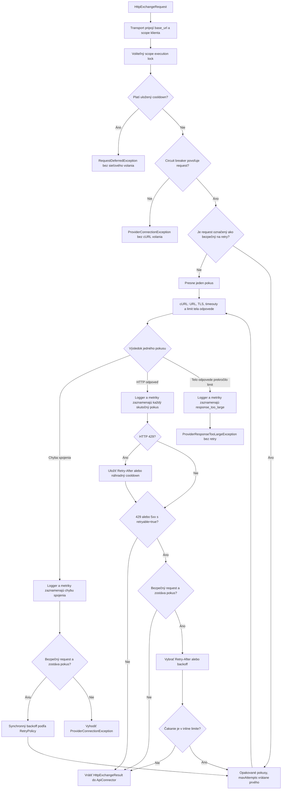

# HTTP transport a autentifikácia

<details>
<summary>Obsah stránky</summary>

- [OAuth token](#oauth-token)
- [Stav tokenu](#stav-tokenu)
- [Zostavenie bez frameworku](#zostavenie-bez-frameworku)
- [Vrstvy požiadavky](#vrstvy-požiadavky)
- [HTTP executor](#http-executor)
  - [Implementácie executorov](#implementácie-executorov)
  - [Rozhodovací tok vykonania](#rozhodovací-tok-vykonania)
  - [Opätovné použitie cURL spojení](#opätovné-použitie-curl-spojení)
  - [Vlastný stack bez Laravelu](#vlastný-stack-bez-laravelu)
  - [Ručné skladanie bez factory](#ručné-skladanie-bez-factory)
  - [Metriky](#metriky)
- [Retry](#retry)
- [Zdroje protokolu a API](#zdroje-protokolu-a-api)

</details>

## OAuth token

`SapiTokenProvider` získava DataHosting OAuth access token cez `/sapi/auth/token` v režime client credentials. Token sa používa ako Bearer token pri SAPI aj Peppol Gateway volaniach. Pred požiadavkou sa skontroluje cache; po HTTP 401 sa zamietnutý token zahodí, raz sa získa nový cez client credentials a pôvodná požiadavka sa zopakuje. Zahodí sa iba zamietnutý token: ak ho medzitým iný worker už nahradil čerstvým, ten ostane v cache.

Po expirácii sa získa nový access token cez ten istý DataHosting client-credentials endpoint. DataHosting OpenAPI používané týmto balíkom neobsahuje `/sapi/auth/renew` ani `/sapi/auth/revoke`; `forget(SapiToken)` maže iba lokálne uložený zamietnutý token. Tento rozsah nevyjadruje podporu celého poskytovateľsky nezávislého SAPI-SK štandardu. Kontrola stavu tokenu cez `/sapi/auth/token/status` je samostatná operácia.

Cache implementuje `SapiTokenCacheInterface`:

```php
/** Contract for loading, storing and invalidating SAPI tokens. */
interface SapiTokenCacheInterface
{
    /**
     * Returns the token stored under this key; SapiTokenProvider checks its expiry after loading.
     *
     * @param string $key Token cache key.
     * @return SapiToken|null Cached token, or null when no token is stored for the key.
     */
    public function load(string $key): ?SapiToken;

    /**
     * Stores a token under its cache key.
     *
     * @param string $key Token cache key.
     * @param SapiToken $token Token to store.
     */
    public function store(string $key, SapiToken $token): void;

    /**
     * Removes a cached token; an absent entry is not an error.
     *
     * @param string $key Token cache key.
     */
    public function forget(string $key): void;
}
```

`SapiToken` nesie iba hodnotu tokenu a čas lokálnej expirácie (autorizačná schéma je vždy `Bearer`); scope a deklarovaná životnosť sa neuchovávajú, takže cache ukladá len tieto dve polia. Laravel bridge poskytuje `LaravelSapiTokenCache`, ktorá token šifruje cez Laravel Crypt a ukladá ho do predvoleného Laravel cache store. Cez `LaravelSapiTokenRefreshLock` tiež koordinuje obnovu tokenu medzi workermi, ak cache store podporuje atomické zámky. Ak zámok nie je dostupný, získanie tokenu pokračuje bez koordinácie.

Pri samostatnom použití môže hostiteľ odovzdať vlastnú implementáciu `SapiTokenRefreshLockInterface` ako štvrtý konštruktorový argument `SapiTokenProvider`. Provider po získaní zámku znovu načíta cache a použije token, ktorý medzitým obnovil iný worker. Jadro balíka neposkytuje zámok viazaný na konkrétnu cache technológiu.

`SapiTokenProvider::getToken()` vracia `SapiToken`. `accessToken()` vracia redigovaný `OAuthAccessToken`; jeho `reveal()` sa používa pri zostavení autorizačnej hlavičky. `SapiToken` neposkytuje reťazcový tokenový accessor. Scope je `OAuthScope|null` a môže byť `null`, ak ho SAPI vynechá. `expiresAt()` je samostatný lokálny čas expirácie skrátený o bezpečnostnú rezervu. Laravel cache zachová tieto údaje; neúplný alebo neplatný záznam sa zahodí a token sa načíta znova.

## Stav tokenu

`TokenHealthProviderInterface` (v Laravel kontajneri implementovaný cez `SapiTokenHealthProvider`) poskytuje stav aktuálne použitého tokenu cez samostatné SAPI volanie `GET /sapi/auth/token/status`. `getTokenStatus()` vráti Core objekt `TokenStatus`; jednotlivé polia sú nullable, pretože odpoveď poskytovateľa ich môže vynechať:

```php
$status = $tokenHealthProvider->getTokenStatus();

$status->valid();                 // ?bool
$status->issuedAt();              // ?Timestamp
$status->expiresAt();             // ?Timestamp
$status->expiresInSeconds();     // ?int
$status->shouldRefresh();        // ?bool, odporúčanie poskytovateľa
$status->refreshRecommendedAt(); // ?Timestamp
$status->lifetime()->expiresAt(); // ?Timestamp
$status->refreshRecommendation()->refreshRecommendedAt(); // ?Timestamp
```

Ploché gettre zostávajú dostupné. `lifetime()` zoskupuje `issuedAt()`, `expiresAt()` a `expiresInSeconds()` do `TokenLifetime`; `refreshRecommendation()` zoskupuje `shouldRefresh()` a `refreshRecommendedAt()` do `TokenRefreshRecommendation`. Všetky polia v skupinách sú nullable, pretože ich poskytovateľ môže vynechať.

Použite `isTokenValid()`, ak potrebujete iba boolean. Ak odpoveď neobsahuje pole `valid`, táto metóda vyhodí `InvalidProviderResponseException`; `getTokenStatus()` ponechá chýbajúcu hodnotu ako `null`. Keď SAPI odmietne token odpoveďou 401, `getTokenStatus()` vráti stav s `valid = false` a ostatné polia ostanú `null` (SAPI pri odmietnutom tokene neposiela detaily), `isTokenValid()` vráti `false` a odmietnutý token sa lokálne zahodí, takže ďalšie API volanie získa nový. Na rozdiel od ostatných volaní sa pri kontrole stavu token nenahrádza a požiadavka sa neopakuje; inak by sa overoval iný token než ten, ktorý klient držal. Ostatné zlyhania HTTP volania (403, 404, 423, 5xx) sa prejavia typovanou `ProviderApiException`. Toto volanie nerobí aplikačnú operáciu s dokumentom. Obnova tokenu naďalej riadi `SapiTokenProvider` podľa cache, expirácie a odpovede 401; endpoint stavu neposkytuje vzdialenú obnovu tokenu.

## Zostavenie bez frameworku

```php
use DreaM1\EfakturaConnector\Infrastructure\EFaktura\Api\ApiConnector;
use DreaM1\EfakturaConnector\Infrastructure\EFaktura\Api\Authentication\AuthenticatedRequestSender;
use DreaM1\EfakturaConnector\Infrastructure\EFaktura\Api\Authentication\SapiTokenProvider;
use DreaM1\EfakturaConnector\Infrastructure\EFaktura\Api\Endpoints\Sapi\RequestTokenEndpoint;
use DreaM1\EfakturaConnector\Core\Configuration\ConnectorRuntimeConfiguration;
use DreaM1\EfakturaConnector\Infrastructure\EFaktura\Api\Transport\Execution\DefaultHttpRequestExecutorFactory;
use DreaM1\EfakturaConnector\Infrastructure\EFaktura\Api\Transport\Execution\HttpRequestExecutorOptions;
use DreaM1\EfakturaConnector\Infrastructure\EFaktura\Api\Transport\ProviderTransport;

$runtimeConfiguration = ConnectorRuntimeConfiguration::fromArray($packageConfiguration);
$executor = DefaultHttpRequestExecutorFactory::createFromRuntimeConfiguration(
    $runtimeConfiguration,
    HttpRequestExecutorOptions::defaults()
);
$transport = ProviderTransport::forSapiClient($configuration, $executor);
$tokenProvider = new SapiTokenProvider(
    new RequestTokenEndpoint($transport),
    $tokenCache,
    $configuration
);
$connector = new ApiConnector(
    new AuthenticatedRequestSender($transport, $tokenProvider)
);
```

`$packageConfiguration` je celé konfiguračné pole konektora s oddielom `runtime`. Táto factory metóda aplikuje HTTP timeouty, retry nastavenia a rate-limit cooldown aj bez Laravel bridge. Predvolený in-memory circuit breaker dostane nakonfigurovanú politiku. Ak odovzdáte vlastný `$baseExecutor` alebo breaker, ich vlastné nastavenia konfiguruje hostiteľ.

## Vrstvy požiadavky

```text
Gateway alebo Provider
  → Endpoint::send(Request)       route, request/response mapovanie
  → ApiConnector                  HTTP status, JSON/XML dekódovanie
  → AuthenticatedRequestSender   Bearer token a obnova po 401
  → Transport                     zostavenie URL a vykonanie
  → HttpRequestExecutor           retry, circuit breaker, backpressure a cURL
```

Endpointy sú bezstavové služby. Tam, kde API vyžaduje query, telo alebo validáciu vstupu, používajú nemenné request value objekty. `ApiRequest` zostavuje URL-enkódovanú cestu, query a JSON telo. Názvy path parametrov musia presne zodpovedať placeholderom v šablóne; hodnoty musia byť neprázdne reťazce (biele znaky samy nestačia) alebo celé čísla a hodnoty `.` a `..` sa odmietnu ako segmenty cesty. Každá hodnota sa URL-kóduje ako jeden segment. Query hodnoty môžu byť reťazce, celé čísla alebo `null`; `null` sa vynechá, ale `0` a prázdny reťazec zostanú explicitnými hodnotami. Pri opakovanom `withQuery()` neskoršia nenull hodnota prepíše skoršiu hodnotu s rovnakým kľúčom; `null` skoršiu hodnotu nevymaže. Iný typ vyvolá `InvalidArgumentException` už pri zostavovaní requestu. Telo sa JSON enkóduje pred získaním tokenu, takže chyba kódovania neodošle sieťovú požiadavku.

### Typovaný transportný request

`HttpExchangeRequest` nesie `HttpMethod`, zdieľaný `HttpRequestTarget`, `HttpHeaders` a všeobecný `HttpRequestContext`; jeho konštruktor vyžaduje tieto typované objekty. Metódy `path()` a `context()` poskytujú serializovanú cestu a pole metadát pre existujúce executory a loggery. `Transport` do jeho nemennej kópie pripojí nakonfigurovanú `ProviderBaseUrl`; vstavané cURL executory pri vykonaní cez interný `ProviderRequestUrlResolver` zostavia a overia výslednú HTTPS URL. Hotová URL sa do requestu neukladá.

#### Životný cyklus URL

URL sa skladá v troch krokoch:

1. Endpoint zostaví `ApiRequest` s cestou relatívnou k API poskytovateľa. Parametre cesty sa URL-kódujú ako jednotlivé segmenty a query sa serializuje pri príprave requestu.
2. `ApiConnector` namapuje metódu, cestu s query, hlavičky, telo, kontext, `Accept` a retry bezpečnosť z `ApiRequest` do nemenného `HttpExchangeRequest`. `ApiRequest` tak nepozná transportný request; nakonfigurovanú base URL request dostane až v ďalšom kroku.
3. `ProviderTransport::send()` vezme base URL z konfigurácie, na ktorú je viazaný: pri SAPI a Peppol Gateway z konfigurácie SAPI klienta (`forSapiClient()`), pri Integrator API z konfigurácie účtu (`forIntegratorAccount()`). Pripojí base URL a bezpečný scope key do kópie requestu a odovzdá ju implementácii `HttpRequestExecutorInterface`. Pri cURL odoslaní executor použije interný `ProviderRequestUrlResolver::resolve($request->baseUrlOrNull(), $request->path())`; resolver spojí base URL s cestou a overí výslednú adresu.

`ProviderBaseUrl` je typovaná, už validovaná konfigurácia. Odstraňuje koncové lomky a vyžaduje HTTPS adresu s hostiteľom; nepovoľuje používateľské meno, heslo, query ani fragment. Cestový prefix v base URL sa zachová a pripojí pred každú SAPI aj Gateway cestu. Napríklad `https://api.example.sk/proxy` vytvorí adresy `https://api.example.sk/proxy/sapi/...` a `https://api.example.sk/proxy/v1/...`. Pri štandardnom nasadení použite serverový koreň z OpenAPI; ako spoločný prefix nepridávajte `/sapi` ani `/v1`, pretože by sa aplikoval na obe skupiny endpointov.

Samotná cesta requestu musí začínať jednou lomkou, nesmie začínať `//` a nesmie obsahovať fragment, medzery ani riadiace znaky. Po spojení sa výsledná adresa znova overí ako absolútna HTTPS URL bez prihlasovacích údajov. Resolver neenkóduje parametre cesty ani query: tieto hodnoty musia byť pripravené už cez `ApiRequest`. `Transport\Execution\ProviderRequestUrlResolver` je označený `@internal`; ide o pomocnú triedu vstavaných executorov, nie o stabilný integračný kontrakt.

Vstavané cURL executory získajú URL takto:

```php
use DreaM1\EfakturaConnector\Infrastructure\EFaktura\Api\Transport\Execution\ProviderRequestUrlResolver;

$url = ProviderRequestUrlResolver::resolve(
    $request->baseUrlOrNull(),
    $request->path()
);
```

`ProviderTransport::send()` odovzdá executor stacku kópiu requestu s pripojenou base URL; pôvodná inštancia vytvorená z `ApiRequest` zostáva nezmenená a jej `baseUrlOrNull()` je `null`. Samostatne zostavený transportný request môže dostať base URL cez `withBaseUrl()`. Resolver vyhodí `LogicException`, ak nemá base URL, a `InvalidArgumentException` pri nebezpečnej ceste alebo výslednej URL; vstavané cURL executory ho volajú pred sieťovým prenosom. Vlastný `HttpRequestExecutorInterface` dostane `baseUrlOrNull()` a `path()` oddelene a musí URL zložiť a bezpečne overiť sám. Keďže resolver je interný, vlastný executor by sa na jeho API nemal spoliehať ako na stabilné rozšírenie. `withBaseUrl()` aj ostatné `with*()` metódy vracajú novú inštanciu; nemenia pôvodný request. Bežný endpoint preto nemá skladať URL sám a má odovzdať relatívny request do `Transport`.

Predvolený `CurlRequestExecutor` aj `PooledCurlRequestExecutor` získajú URL cez interný `ProviderRequestUrlResolver` bezprostredne pred cURL volaním. Ostatné dekorátory môžu pracovať s relatívnou cestou a metadátami requestu bez toho, aby URL vopred skladali. Vlastný `HttpRequestExecutorInterface` môže skontrolovať base URL cez `baseUrlOrNull()` a cestu cez `path()`; pred odoslaním musí sám vytvoriť a overiť absolútnu HTTPS URL.

## HTTP executor

`DefaultHttpRequestExecutorFactory` skladá predvolený cURL executor s retry, circuit breaker a backpressure vrstvami. Samostatné použitie má stav backpressure aj breakera v pamäti procesu. Laravel bridge používa zdieľaný Cache store: SAPI/Gateway cooldown sa identifikuje originom, OAuth klientom a scope a zostáva stabilný po obnove Bearer tokenu; Integrator transport nastavuje samostatný hash scope z URL, ID integratora a tokenu. Laravel circuit breaker sa konfiguruje pre SAPI/Gateway connection profil. Ak request obíde transport a nemá nastavený scope kľúč, backpressure použije hash autorizačnej hlavičky ako záložný kľúč. Na koordináciu medzi workermi potrebuje cache store atomické zámky.

Zabudované breakery viažu výsledok requestu na generáciu, ktorá ho povolila, takže oneskorený výsledok nemôže prepísať novší stav. Vlastný breaker implementuje `CircuitBreakerInterface` s rovnakými permitmi. Ak cache zlyhá, transport pokračuje s procesovým breakerom a backpressure sa uplatní iba vtedy, keď sa cooldown podarí uložiť. Samostatné použitie môže pridať vlastný logger; Laravel bridge predvolene zapisuje HTTP záznamy cez Laravel `Log` a umožňuje logger nahradiť. Rozhrania `HttpRequestExecutorInterface`, `HttpTransportInterface` a `HttpRequestExecutionLoggerInterface` sú v `Infrastructure/EFaktura/Api/Transport`; správanie retry a cooldownov opisuje [retry a idempotencia](Errors-Retry-and-Idempotency.md).

`HttpStatusCode` reprezentuje iba platné kódy 100–599. Neznámy kód v tomto rozsahu sa klasifikuje podľa prvej číslice; hodnota mimo rozsahu nemá typovaný kód, ale zostáva dostupná cez `rawStatusCode()` a pri spracovaní sa klasifikuje ako 5xx podľa [RFC 9110, §15](https://www.rfc-editor.org/rfc/rfc9110.html#section-15). Metriky zachovávajú aj triedy 1xx (`informational`) a 3xx (`redirection`).

### Implementácie executorov

Každá vrstva implementuje `HttpRequestExecutorInterface::execute(HttpExchangeRequest): HttpExchangeResult` a dekoruje executor pod sebou. Tým sa nemení formát requestu ani raw HTTP odpovede; vrstvy pridávajú ochranu, opakovanie alebo pozorovanie vykonania.

```text
Transport
└─ RejectionObservingHttpRequestExecutor  voliteľne zaznamená lokálne odmietnutie požiadavky
   └─ CircuitBreakerHttpRequestExecutor      povolenie/zaznamenanie výsledku okruhu
      └─ RetryingHttpRequestExecutor         1 alebo viac pokusov
         └─ BackpressureHttpRequestExecutor  kontrola cooldownu a zámok pre každý pokus
            └─ RateLimitRecordingHttpRequestExecutor  uloží cooldown z každej odpovede 429
               └─ LoggingHttpRequestExecutor    voliteľné logovanie každého pokusu v Core
                  └─ MetricsHttpRequestExecutor voliteľná metrika každého pokusu
                     └─ CurlRequestExecutor alebo PooledCurlRequestExecutor
```

`DefaultHttpRequestExecutorFactory` vytvára vrstvy od spodnej po vrchnú: najprv zvolí cURL executor, potom ho prípadne obalí metrikami a loggerom, následne (pri zapnutom backpressure) dekorátorom, ktorý zapisuje cooldown po `429`, a vrstvou, ktorá cooldown kontroluje a drží zámok, potom retry vrstvou a circuit breakerom; ak je nastavený logger alebo metriky, celý stack obalí vrstva hlásiaca lokálne odmietnutia. Kontrola cooldownu a zámok sú teda pod retry: každý pokus znova skontroluje cooldown a zámok sa uvoľní pred čakaním na ďalší pokus. V samostatnom Core použití sú logger a metriky voliteľné. Laravel bridge pripája predvolený logger cez Laravel `Log`; metrický sink dodáva aplikácia. Retry, breaker, backpressure a execution lock možno konfigurovať alebo vypnúť; konkrétne Laravel prepínače sú v časti [Laravel bridge](Laravel.md).

| Trieda | Čo vykoná a čo vráti |
| --- | --- |
| `CurlRequestExecutor` | Vykoná jeden synchronný HTTPS prenos cez cURL. Overuje TLS, nenasleduje presmerovania, uplatní connect aj celkový timeout a obmedzí veľkosť odpovede. Vráti surový `HttpExchangeResult`; JSON/XML nedekóduje. Chybu spojenia vyhodí ako `ProviderConnectionException`, prekročenie limitu odpovede ako `ProviderResponseTooLargeException`. |
| `PooledCurlRequestExecutor` | Používa rovnaké nastavenia a spracovanie ako `CurlRequestExecutor`, ale drží cURL easy handle medzi volaniami, aby libcurl mohol znovu použiť spojenia a DNS cache. Pred každým volaním resetuje requestové nastavenia. Vykonáva iba jedno volanie naraz; súbežné použitie alebo `close()` počas requestu vyhodí `LogicException`. Pri chybe handle zavrie a ďalšie volanie ho môže znova vytvoriť. |
| `RetryingHttpRequestExecutor` | Ak request nie je označený ako bezpečný, vykoná ho raz. Inak môže opakovať `ProviderConnectionException` a odpovede `429`/`5xx`, ak chybová obálka poskytovateľa obsahuje `retryable: true`. `maxAttempts` zahŕňa prvý pokus. Čaká podľa `Retry-After` alebo `RetryPolicy`. Pri odpovedi `429`/`5xx` vráti poslednú HTTP odpoveď bez ďalšieho pokusu, ak čakanie presiahne inline limit. Chyby spojenia opakuje po synchronnom backoffe; ak backoff presiahne inline limit, vyhodí pôvodnú výnimku bez čakania. GET je bezpečný predvolene, ostatné metódy musia byť výslovne označené. |
| `CircuitBreakerHttpRequestExecutor` | Pred volaním získa povolenie od breakera. Otvorený breaker zastaví request ešte pred cURL prenosom a vyhodí `ProviderConnectionException`. Chyba spojenia a konečná odpoveď `5xx` sa zaznamenajú ako zlyhanie; ostatné odpovede pod `500` ako úspech. Breaker s permitovým kontraktom považuje `429` za neutrálny výsledok; základný `CircuitBreakerInterface` ho zaznamená ako úspech. Keďže obaluje retry vrstvu, vyhodnotí výsledok celého retry cyklu, nie každý pokus osobitne. |
| `BackpressureHttpRequestExecutor` | Pred vykonaním skontroluje uložený cooldown. Ak ešte platí, vyhodí `RequestDeferredException` s časom, od ktorého možno request skúsiť. Pri zapnutom execution locku serializuje kontrolu a jeden pokus pre rovnaký rate-limit kľúč; zámok sa uvoľní pred čakaním retry vrstvy. Cooldown sám nezapisuje. |
| `RateLimitRecordingHttpRequestExecutor` | Po každej odpovedi `429` uloží cooldown podľa `Retry-After`, prípadne podľa fallback cooldownu. Nachádza sa pod retry vrstvou, takže každý pokus zapíše cooldown práve raz a retry ho vie prečítať z úložiska pred určením čakania. |
| `LoggingHttpRequestExecutor` | Zaznamená HTTP výmenu alebo transportnú `ProviderApiException` cez `HttpRequestExecutionLoggerInterface`. Neúspešný HTTP status je stále odpoveď a loguje sa ako výmena; o jeho premene na API výnimku rozhodne až `ApiConnector`. Výnimky loggera sa ignorujú a nemenia výsledok requestu. Keď je logger vo vnútri retry vrstvy, vidí každý reálny pokus. |
| `RejectionObservingHttpRequestExecutor` | Najvonkajšia voliteľná vrstva (pridá sa, ak je zapnutý breaker alebo backpressure a nastavený logger alebo metriky). Požiadavku odmietnutú pred akýmkoľvek HTTP pokusom, teda `CircuitBreakerOpenException` z otvoreného okruhu alebo `RequestDeferredException` z backpressure, zaznamená raz za operáciu: metrika s výsledkom `circuit_open` alebo `deferred` (bez statusu, s trvaním do odmietnutia) a udalosť `recordFailure` loggera. Chyba loggera ani metrík výnimku nenahradí. |
| `MetricsHttpRequestExecutor` | Pre každý reálny pokus zaznamená metódu, status, trvanie a výsledok (`informational`, `success`, `redirection`, `client_error`, `server_error`, `rate_limited`, `connection_error` alebo `response_too_large`). Odmietnutia pred pokusom zaznamenáva `RejectionObservingHttpRequestExecutor`. Neplatný status sa klasifikuje ako `server_error`. Prekročený limit odpovede má vlastný výsledok aj pri HTTP `2xx`. Záznamy metrík sú bezpečne izolované od requestu; chyba metrics backendu nezmení odpoveď ani výnimku. Keďže je vo vnútri retry vrstvy, každý pokus vytvorí samostatnú metriku. |

V predvolenej skladbe teda backpressure a circuit breaker obklopujú celý retry cyklus, kým logger, metriky a cURL sa spúšťajú pri každom skutočnom pokuse. Ak hostiteľ odovzdá vlastný `$baseExecutor`, factory nad ním stále môže zostaviť nakonfigurované dekorátory; vlastné timeouty a limity tohto executora si spravuje hostiteľ.

#### Rozhodovací tok vykonania

`ProviderTransport` odovzdá executorom relatívnu cestu a nakonfigurovanú `ProviderBaseUrl`. Vstavaný cURL executor zloží a overí absolútnu HTTPS URL až pri odoslaní. Vonkajšie vrstvy môžu request odmietnuť ešte pred sieťou; retry vrstva rozhoduje o opakovaní až podľa bezpečnosti operácie, odpovede poskytovateľa a časového limitu čakania.



Pri predvolenej retry politike sa odpoveď `429` alebo `5xx` zopakuje iba pri `retryable: true` v rozpoznanej provider error obálke. GET je bezpečný predvolene; zápisové operácie sa neopakujú, pokiaľ ich endpoint výslovne neoznačí. Dlhé čakanie po HTTP odpovedi sa vráti volajúcemu spolu s odpoveďou, aby ďalší pokus mohla naplánovať hostiteľská fronta. Odpoveď väčšia než nakonfigurovaný limit vyvolá `ProviderResponseTooLargeException` a neopakuje sa.

HTTP `401` nespracúva retry vrstva. `AuthenticatedRequestSender` vymaže lokálny token, cez SAPI client credentials získa nový a pôvodný request pošle ešte raz najviac raz; požiadavka na token používa obyčajný transport bez autentifikačného dekorátora. Každé z týchto odoslaní prejde executor stackom samostatne.

Laravel konfigurácia nastavuje connect timeout na 10 sekúnd, celkový cURL timeout na 45 sekúnd, najviac tri pokusy a počiatočné retry oneskorenie 500 ms. Retry policy možno upraviť cez `runtime.retry` alebo premenné `EFAKTURA_HTTP_RETRY_ENABLED`, `EFAKTURA_HTTP_RETRY_MAX_ATTEMPTS`, `EFAKTURA_HTTP_RETRY_BASE_DELAY_MS`, `EFAKTURA_HTTP_RETRY_MAX_DELAY_MS` a `EFAKTURA_HTTP_RETRY_MAX_INLINE_DELAY_MS`. Threshold, časové okná circuit breakera a náhradný cooldown po HTTP 429 sú v `runtime.circuit_breaker` a `runtime.backpressure`. Vykonávanie je synchrónne, bez async alebo multi-cURL.

Laravel bridge predvolene serializuje požiadavky s rovnakým backpressure kľúčom pomocou `Cache::lock()` na predvolenom Laravel cache store, ak ho Laravel a zvolený store podporujú; inak použije lokálny súborový zámok. SAPI/Gateway transport odvodzuje scope z identity OAuth klienta a scope; Integrator transport dodá samostatný hashovaný scope z URL a ID integratora; rotácia tokenu ho nemení. Pri requeste bez explicitného scope kľúča sa použije hash `Authorization`. Lock pokrýva kontrolu backpressure a jeden pokus; pred čakaním retry vrstvy sa uvoľní. Odlišné kvóty môžu bežať súbežne a zdieľaný cache backend môže koordinovať workery aj na rôznych hostoch.

Store, lease (predvolene odvodený z timeoutu requestu plus päť sekúnd) a maximálne čakanie (120 sekúnd) možno upraviť v `laravel.request_execution.execution_lock`; pri nedostupnom locku sa request nespustí. Pri `driver=file` sa používa `flock()` v systémovom temp adresári, izolovaný podľa Laravel `basePath()` a OS používateľa. Samostatné Core použitie má file-lock fallback. HTTP metriky sa nepoužijú, pokiaľ aplikácia nezaregistruje `ConnectorMetricsInterface`; podrobnosti o Laravel loggeri a metríkách sú v [návode pre Laravel bridge](Laravel.md).

Predvolený cURL executor uloží najviac 16 MiB odpovede do pamäte. Limit možno nastaviť cez `runtime.http.response_max_bytes` alebo `EFAKTURA_HTTP_RESPONSE_MAX_BYTES` (1 až 128 MiB); prekročenie preruší čítanie a vyhodí `ProviderResponseTooLargeException` bez automatického retry. Limit zakódovaného HTTP request body je predvolene 100 MiB a možno ho nastaviť cez `runtime.http.request_max_bytes` alebo `EFAKTURA_HTTP_REQUEST_MAX_BYTES` (1 bajt až 1 GiB); používa ho Gateway dávkové odoslanie. Pri každej odpovedi 429 sa cooldown uloží ešte pred rozhodnutím o ďalšom retry. Ak poskytovateľ nepošle `Retry-After`, retry počká aspoň nakonfigurovaný `runtime.backpressure.fallback_cooldown_seconds`.

`ConnectorRuntimeConfiguration::httpResponseBodyLimit()` sprístupňuje limit ako typovaný `HttpResponseBodyLimit`. Jeho `bytes()` vracia nakonfigurovanú hranicu a `wouldExceed()` kontroluje, či ďalší transportný blok limit prekročí.

`LoggingHttpRequestExecutor` zaznamenáva úspešnú odpoveď alebo transportnú výnimku cez hostiteľský logger. Zlyhanie loggera nezmení výsledok HTTP volania a neprepíše pôvodnú výnimku. Logger dostáva surový request a odpoveď; pred uložením použite `ApiCommunicationLogSanitizer` na request body, dekódované JSON response body, hlavičky a provider error. Sanitizér rediguje polia s povereniami a voľný text chyby, z UBL payloadu pripraví redigovaný záznam, hash idempotency key a neznáme hlavičky alebo hodnoty odpovede vynechá či rediguje. Hlavičku `Retry-After` ponechá iba pri podporovanej hodnote v sekundách alebo platnom HTTP-date bez okolitých medzier; neplatnú hodnotu rediguje. XML alebo neparsovateľné response telo uložte iba ako redigovaný súhrn, nikdy ako surový text. Sanitizácia nemení pôvodné telo dostupné cez `ProviderErrorResponseException::body()`; túto hodnotu nezapisujte priamo do logu.

### Opätovné použitie cURL spojení

`CurlRequestExecutor` vytvorí a zatvorí cURL handle pre každú požiadavku; tým zostáva predvolené správanie vhodné pre krátko žijúce PHP requesty. Pre dlho žijúce workery je dostupný voliteľný `PooledCurlRequestExecutor`. Znovu používa jeden easy handle a pred každou požiadavkou resetuje jej nastavenia; libcurl tak môže ponechať a opätovne použiť vhodné spojenia a DNS záznamy. [PHP `curl_reset`](https://www.php.net/manual/en/function.curl-reset.php) resetuje nastavenia handle a [libcurl easy interface](https://curl.se/libcurl/c/libcurl-easy.html) odporúča opakované použitie handle pre persistentné spojenia. Handle sa zatvorí volaním `close()` alebo pri zničení executor objektu.

Pooled executor vykonáva požiadavky synchronne a jednu po druhej. Zdieľajte ho iba v rámci jedného sekvenčného workeru; pre súbežné volania vytvorte samostatný executor pre každý worker. V Laravel konfigurácii ho možno vybrať nastavením `laravel.request_execution.executor` na `PooledCurlRequestExecutor::class`; predvolene zostáva použitý `CurlRequestExecutor`. Circuit breaker, backpressure a execution lock sa vypínajú v `runtime.circuit_breaker.enabled`, `runtime.backpressure.enabled` a `runtime.backpressure.execution_lock`, retry v `runtime.retry.enabled`; HTTP logging a metrics v `laravel.request_execution.logging` a `.metrics`. Vypnutie backpressure odstráni cooldown vrstvu; execution lock sa uplatní iba s backpressure.

Bez Laravelu sa pooled executor vloží ako druhý argument factory:

```php
use DreaM1\EfakturaConnector\Infrastructure\EFaktura\Api\Transport\Execution\PooledCurlRequestExecutor;

$baseExecutor = new PooledCurlRequestExecutor(
    $runtimeConfiguration->httpConnectTimeoutSeconds(),
    $runtimeConfiguration->httpRequestTimeoutSeconds(),
    $runtimeConfiguration->httpResponseBodyLimit()
);
$executor = DefaultHttpRequestExecutorFactory::createFromRuntimeConfiguration(
    $runtimeConfiguration,
    HttpRequestExecutorOptions::defaults()->withBaseExecutor($baseExecutor)
);
```

### Vlastný stack bez Laravelu

`DefaultHttpRequestExecutorFactory` možno použiť aj samostatne. Nasledujúci príklad nahrádza základný cURL executor pooled variantom a nastavuje vlastnú retry politiku, circuit breaker a cooldown po HTTP 429. Logger a metriky môže hostiteľ doplniť na vyznačené miesta vlastnými implementáciami rozhraní.

```php
use DreaM1\EfakturaConnector\Core\CircuitBreaker\CircuitBreakerPolicy;
use DreaM1\EfakturaConnector\Core\CircuitBreaker\InMemoryCircuitBreaker;
use DreaM1\EfakturaConnector\Core\Configuration\HttpResponseBodyLimit;
use DreaM1\EfakturaConnector\Core\Configuration\SapiClientConfiguration;
use DreaM1\EfakturaConnector\Core\Retry\RetryPolicy;
use DreaM1\EfakturaConnector\Infrastructure\EFaktura\Api\Transport\Coordination\InMemoryHttpRequestBackpressure;
use DreaM1\EfakturaConnector\Infrastructure\EFaktura\Api\Transport\Execution\DefaultHttpRequestExecutorFactory;
use DreaM1\EfakturaConnector\Infrastructure\EFaktura\Api\Transport\Execution\HttpRequestExecutorOptions;
use DreaM1\EfakturaConnector\Infrastructure\EFaktura\Api\Transport\Execution\PooledCurlRequestExecutor;
use DreaM1\EfakturaConnector\Infrastructure\EFaktura\Api\Transport\ProviderTransport;

$baseExecutor = new PooledCurlRequestExecutor(
    10,                 // connect timeout v sekundách
    45,                 // celkový timeout v sekundách
    HttpResponseBodyLimit::fromBytes(16 * 1024 * 1024) // limit odpovede: 16 MiB
);
$retryPolicy = new RetryPolicy(
    3,      // maximálny počet pokusov vrátane prvého
    250,    // počiatočný backoff v milisekundách
    5000,   // maximálny backoff v milisekundách
    1000    // najdlhšie čakanie na HTTP odpoveď vykonané synchronne
);
$circuitBreaker = new InMemoryCircuitBreaker(
    null,
    new CircuitBreakerPolicy(5, 60, 30) // 5 zlyhaní za 60 s otvorí okruh na 30 s
);
$backpressure = new InMemoryHttpRequestBackpressure();

$options = HttpRequestExecutorOptions::defaults()
    ->withBaseExecutor($baseExecutor)
    ->withCircuitBreaker($circuitBreaker)
    ->withBackpressure($backpressure)
    ->withRetryPolicy($retryPolicy)
    ->withRateLimitFallbackCooldownSeconds(15);
$executor = DefaultHttpRequestExecutorFactory::create($options);

$configuration = new SapiClientConfiguration(
    'https://api.example.test',
    getenv('EFAKTURA_CLIENT_ID') ?: '',
    getenv('EFAKTURA_CLIENT_SECRET') ?: '',
    getenv('EFAKTURA_CLIENT_SCOPE') ?: SapiClientConfiguration::SAPI_SCOPE_DOCUMENT_SEND . ' ' . SapiClientConfiguration::SAPI_SCOPE_DOCUMENT_RECEIVE
);
$transport = ProviderTransport::forSapiClient($configuration, $executor);
```

Factory zachová poradie vrstiev z predchádzajúceho prehľadu a sama pridá ukladanie cooldownu po `429` a retry vrstve odovzdá úložisko backpressure, preto netreba ručne skladať žiadny callback. Tento príklad používa in-memory breaker a backpressure, ktorých stav je lokálny pre PHP proces. `FileHttpRequestExecutionLock` koordinuje požiadavky v zdieľanom lokálnom prostredí podľa rate-limit kľúča; medzi rôznymi hostmi stav nezdieľa. `$transport` potom možno odovzdať do `AuthenticatedRequestSender` pre bežné SAPI/Gateway volania; tokenový endpoint používa tento obyčajný transport bez autentifikačného dekorátora.

### Ručné skladanie bez factory

Vrstvy možno vytvoriť priamo. Skladanie ide od základného HTTP executora smerom von: každý nový executor dostane predchádzajúci executor ako vnorený argument. Pri ručnom skladaní sa callback pre uloženie cooldownu po `429` pripája do retry executora; posledný argument backpressure executora potom označí, že cooldown už zaznamenala vnorená vrstva.

```php
use DreaM1\EfakturaConnector\Core\CircuitBreaker\CircuitBreakerPolicy;
use DreaM1\EfakturaConnector\Core\CircuitBreaker\InMemoryCircuitBreaker;
use DreaM1\EfakturaConnector\Core\Configuration\HttpResponseBodyLimit;
use DreaM1\EfakturaConnector\Core\Configuration\SapiClientConfiguration;
use DreaM1\EfakturaConnector\Core\Exceptions\ProviderApiException;
use DreaM1\EfakturaConnector\Core\Retry\RetryPolicy;
use DreaM1\EfakturaConnector\Infrastructure\EFaktura\Metrics\ConnectorMetricsInterface;
use DreaM1\EfakturaConnector\Infrastructure\EFaktura\Api\Transport\Coordination\InMemoryHttpRequestBackpressure;
use DreaM1\EfakturaConnector\Infrastructure\EFaktura\Api\Transport\Execution\BackpressureHttpRequestExecutor;
use DreaM1\EfakturaConnector\Infrastructure\EFaktura\Api\Transport\Execution\CircuitBreakerHttpRequestExecutor;
use DreaM1\EfakturaConnector\Infrastructure\EFaktura\Api\Transport\Coordination\FileHttpRequestExecutionLock;
use DreaM1\EfakturaConnector\Infrastructure\EFaktura\Api\Transport\HttpExchangeResult;
use DreaM1\EfakturaConnector\Infrastructure\EFaktura\Api\Transport\Execution\HttpRequestExecutionLoggerInterface;
use DreaM1\EfakturaConnector\Infrastructure\EFaktura\Api\Transport\HttpExchangeRequest;
use DreaM1\EfakturaConnector\Infrastructure\EFaktura\Api\Transport\Execution\LoggingHttpRequestExecutor;
use DreaM1\EfakturaConnector\Infrastructure\EFaktura\Api\Transport\Execution\MetricsHttpRequestExecutor;
use DreaM1\EfakturaConnector\Infrastructure\EFaktura\Api\Transport\Execution\PooledCurlRequestExecutor;
use DreaM1\EfakturaConnector\Infrastructure\EFaktura\Api\Transport\Execution\RateLimitRecordingHttpRequestExecutor;
use DreaM1\EfakturaConnector\Infrastructure\EFaktura\Api\Transport\Execution\RejectionObservingHttpRequestExecutor;
use DreaM1\EfakturaConnector\Infrastructure\EFaktura\Api\Transport\Execution\RetryingHttpRequestExecutor;
use DreaM1\EfakturaConnector\Infrastructure\EFaktura\Api\Transport\ProviderTransport;

/** Example logger that records request outcome metadata without request or response bodies. */
final class ExampleHttpRequestLogger implements HttpRequestExecutionLoggerInterface
{
    /**
     * Records the status and elapsed time of a completed request.
     *
     * @param HttpExchangeRequest $request Completed request.
     * @param HttpExchangeResult $exchange Received HTTP exchange.
     */
    public function recordResponse(HttpExchangeRequest $request, HttpExchangeResult $exchange): void
    {
        $durationSeconds = max(0.0, microtime(true) - $exchange->startedAt());
        error_log(sprintf(
            '[efaktura-api] %s status=%d duration=%.3fs',
            $request->httpMethod()->value(),
            $exchange->rawStatusCode(),
            $durationSeconds
        ));
    }

    /**
     * Records exception type, optional provider status and elapsed time after a request failure.
     *
     * @param HttpExchangeRequest $request Failed request.
     * @param ProviderApiException $exception Exception raised by the wrapped executor.
     * @param float $startedAt Unix timestamp captured before execution.
     */
    public function recordFailure(
        HttpExchangeRequest $request,
        ProviderApiException $exception,
        float $startedAt
    ): void {
        $statusCode = $exception->rawStatusCode();
        error_log(sprintf(
            '[efaktura-api] %s failed exception=%s status=%s duration=%.3fs',
            $request->httpMethod()->value(),
            get_class($exception),
            $statusCode === null ? 'n/a' : (string) $statusCode,
            max(0.0, microtime(true) - $startedAt)
        ));
    }
}

/** Example metrics adapter that writes the connector's fixed metric values to the error log. */
final class ExampleConnectorMetrics implements ConnectorMetricsInterface
{
    /**
     * Records the outcome and duration of one API request.
     *
     * @param string $method HTTP method.
     * @param int|null $statusCode Response status, or null when no response was received.
     * @param float $durationSeconds Request duration in seconds.
     * @param string $outcome One of ConnectorMetricsInterface::API_* outcome labels.
     */
    public function recordApiRequest(
        string $method,
        ?int $statusCode,
        float $durationSeconds,
        string $outcome
    ): void {
        error_log(sprintf(
            '[efaktura-metric] api method=%s status=%s outcome=%s duration=%.3fs',
            $method,
            $statusCode === null ? 'n/a' : (string) $statusCode,
            $outcome,
            $durationSeconds
        ));
    }

    /** Records a fixed token-cache event label. */
    public function recordTokenCacheEvent(string $event): void
    {
        error_log('[efaktura-metric] token_cache event=' . $event);
    }

    /**
     * Records the outcome and duration of a Schematron validation.
     *
     * @param float $durationSeconds Validation duration in seconds.
     * @param string $outcome One of ConnectorMetricsInterface::SCHEMATRON_* outcome labels.
     * @param int $rulesetCount Number of rule sets included in the run.
     */
    public function recordSchematronValidation(
        float $durationSeconds,
        string $outcome,
        int $rulesetCount
    ): void {
        error_log(sprintf(
            '[efaktura-metric] schematron outcome=%s duration=%.3fs rulesets=%d',
            $outcome,
            $durationSeconds,
            $rulesetCount
        ));
    }
}

$backpressure = new InMemoryHttpRequestBackpressure();
$fallbackCooldownSeconds = 15;
$logger = new ExampleHttpRequestLogger();
$metrics = new ExampleConnectorMetrics();

$executor = new PooledCurlRequestExecutor(10, 45, HttpResponseBodyLimit::fromBytes(16 * 1024 * 1024));

if ($metrics !== null) {
    $executor = new MetricsHttpRequestExecutor($executor, $metrics);
}
if ($logger !== null) {
    $executor = new LoggingHttpRequestExecutor($executor, $logger);
}

$executor = new RateLimitRecordingHttpRequestExecutor($executor, $backpressure, $fallbackCooldownSeconds);
$executor = new BackpressureHttpRequestExecutor(
    $executor,
    $backpressure,
    new FileHttpRequestExecutionLock()
);
$executor = new RetryingHttpRequestExecutor(
    $executor,
    new RetryPolicy(3, 250, 5000, 1000),
    null,
    null,
    $backpressure
);
$executor = new CircuitBreakerHttpRequestExecutor(
    $executor,
    new InMemoryCircuitBreaker(null, new CircuitBreakerPolicy(5, 60, 30))
);
// Najvonkajšia vrstva zaznamená požiadavky odmietnuté pred sieťou (otvorený okruh, cooldown).
$executor = new RejectionObservingHttpRequestExecutor($executor, $logger, $metrics);

$configuration = new SapiClientConfiguration(
    'https://api.example.test',
    getenv('EFAKTURA_CLIENT_ID') ?: '',
    getenv('EFAKTURA_CLIENT_SECRET') ?: '',
    getenv('EFAKTURA_CLIENT_SCOPE') ?: SapiClientConfiguration::SAPI_SCOPE_DOCUMENT_SEND . ' ' . SapiClientConfiguration::SAPI_SCOPE_DOCUMENT_RECEIVE
);
$transport = ProviderTransport::forSapiClient($configuration, $executor);
```

Retry vrstvu možno vynechať; `RateLimitRecordingHttpRequestExecutor` aj `BackpressureHttpRequestExecutor` fungujú samostatne. Pri zapnutom execution locku musí byť dostupné `flock()` a zapisovateľný systémový dočasný adresár. Logger a metriky v tomto príklade obalia základný cURL executor, takže zachytia každý pokus vytvorený retry vrstvou.

Tieto ukážkové implementácie zapisujú iba metódu, status, typ výnimky, trvanie a pevne definované metriky. Nezapisujú cestu requestu, hlavičky, token ani telo. V produkcii možno telo metód nahradiť volaním hostiteľského loggera a metrického backendu; výnimky z loggera a metrics backendu dekorátory potlačia, aby nemenili výsledok API volania.

### Metriky

Voliteľný `ConnectorMetricsInterface` v `Infrastructure/EFaktura/Metrics` poskytuje metriky bez závislosti od konkrétneho monitorovacieho systému. Hostiteľ implementuje tri metódy rozhrania a nastaví ju v `HttpRequestExecutorOptions::defaults()->withMetrics(...)`, ktoré odovzdá do `DefaultHttpRequestExecutorFactory::create()`. Každý skutočný HTTP pokus zaznamená metódu, HTTP status, trvanie a výsledok (`informational`, `success`, `redirection`, `client_error`, `server_error`, `rate_limited`, `connection_error` alebo `response_too_large`); retry preto vytvorí samostatný záznam pre každý pokus. Požiadavky odmietnuté lokálne pred akýmkoľvek pokusom (otvorený circuit breaker, odloženie backpressure) dostanú výsledok `circuit_open` alebo `deferred` s `null` statusom, raz za operáciu. Neplatný HTTP status sa klasifikuje ako `server_error`. Odpoveď presahujúca limit sa klasifikuje ako `response_too_large` aj vtedy, keď HTTP status hovorí `2xx`.

`SapiTokenProvider` zaznamenáva udalosti `memory_hit`, `cache_hit`, `cache_miss`, `cache_expired`, `refresh_success` a `refresh_failure`. Schematron metrika obsahuje trvanie validačného batchu, výsledok (`success` alebo `failure`) a počet pravidlových sád. Udalosti neobsahujú cestu ani URL požiadavky, hlavičky, payload, token, cache kľúč ani obsah dokumentu. Výnimka z implementácie metrík sa ignoruje, takže výpadok monitorovacieho backendu nezastaví API volanie, získanie tokenu ani validáciu.

Pri samostatnom použití odovzdajte tú istú implementáciu do factory a token providera:

```php
$executor = DefaultHttpRequestExecutorFactory::create(
    HttpRequestExecutorOptions::defaults()->withMetrics($connectorMetrics)
);
$tokenProvider = new SapiTokenProvider(
    new RequestTokenEndpoint($transport),
    $tokenCache,
    $configuration,
    null,
    $connectorMetrics
);
```

Pre samostatne skladaný Schematron runner odovzdajte tú istú implementáciu ako štvrtý argument `SaxonProcessExecutor` po limite súbežnosti a vlastnom concurrency limiteri.

Laravel bridge použije implementáciu zaregistrovanú pod `ConnectorMetricsInterface`; Schematron beh aj token provider dostanú tú istú službu automaticky. Postup registrácie je v [Laravel bridge](Laravel.md#metriky).

Balík poskytuje `ApiCommunicationLogSanitizer` na redakciu JSON tiel, hlavičiek a chýb poskytovateľa. `UblPayloadRedactor` zachová štruktúru UBL XML a nahradí citlivé hodnoty. Hlavičky sa logujú podľa allowlistu: `Authorization` sa redaguje, `Idempotency-Key` sa nahradí skráteným SHA-256 a ostatné hlavičky sa vynechajú. Hlavička `X-Peppol-Participant-Id` ostáva zámerne v čistom tvare, pretože určuje, v mene koho sa operácia vykonala; rovnaký identifikátor v tele požiadavky sa redaguje. Ak váš logger ukladá logy dlhšie alebo ich zdieľa, zvážte pri živnostníkoch (IČO identifikuje fyzickú osobu) vlastné hashovanie. Hostiteľ tieto nástroje použije vo svojej implementácii loggera; balík neukladá API komunikáciu do databázy.

## Retry

`ApiRequest` predvolene označí ako bezpečné na retry iba GET požiadavky. Endpoint môže výslovne povoliť bezpečný zápis ľubovoľnou HTTP metódou, napríklad SAPI token request, discovery query alebo idempotentné Integrator PUT. `RetryingHttpRequestExecutor` opakuje sieťové zlyhania podľa `RetryPolicy`; odpovede 5xx/429 opakuje iba vtedy, keď známa chybová obálka obsahuje `retryable: true`. Opakované odosielanie faktúry riadi idempotency key.

Pri neúspešnom HTTP stave vzniká `ProviderErrorResponseException` so statusom, hlavičkami a surovým telom odpovede. Pri 2xx odpovedi s neplatným JSON/XML alebo poľami, ktoré odmietne API mapovanie, vzniká `InvalidProviderResponseException`; tá zachová zachytený `rawStatusCode()` a `responseHeaders()`. `httpStatusCode()` vracia platný `HttpStatusCode` alebo `null`; `rawStatusCode()` zachová presnú prijatú číselnú hodnotu aj pri neplatnom HTTP kóde.

Pri chybe spojenia bez HTTP odpovede sa čaká synchronne podľa exponenciálneho oneskorenia `RetryPolicy` (predvolene 500 ms a potom 1 sekunda; nakonfigurovaný strop je 30 sekúnd). Ak je backoff dlhší než inline limit politiky (`maxInlineDelayMs`), executor nečaká a vyhodí pôvodnú výnimku, aby ďalší pokus naplánoval host. Pri retry po HTTP odpovedi sa synchronne čaká najviac jednu sekundu; ak platné `Retry-After` vyžaduje dlhšie čakanie, executor vráti provider odpoveď bez ďalšieho pokusu. Provider výnimka zachová hlavičku a `retryAt()` vráti `RetryDeadline`; Unix timestamp pre hostiteľský queue alebo scheduler získate cez `unixTimestamp()`.

## Zdroje protokolu a API

Konkrétne SAPI a Gateway cesty a autentifikačné výnimky v tomto balíku sa riadia [DataHosting testovacím OpenAPI pre SAPI-SK](https://test-sapisk.datahosting.sk/swagger-ui/index.html?urls.primaryName=SAPI-SK+API#/), [OpenAPI pre Peppol Gateway v1](https://test-sapisk.datahosting.sk/swagger-ui/index.html?urls.primaryName=Peppol+Gateway+API+v1) a ich [lokálnym snapshotom](../eFaktura/api/openapi.json). Samostatný [Integrator API](https://test-sapisk.datahosting.sk/v3/api-docs/integrator-api) klient používa `X-Integrator-Token`; jeho konfigurácia a operácie sú v [samostatnom návode](Integrator-API). Verejný vstupný bod SAPI-SK publikuje aj [interaktívnu dokumentáciu](https://www.sapi-sk.sk/docs) a [OpenAPI](https://www.sapi-sk.sk/openapi.json) ako kontextové zdroje, nie ako implementačný kontrakt tohto balíka.

OAuth správanie sa opiera o [RFC 6749](https://www.rfc-editor.org/rfc/rfc6749) a [RFC 6750](https://www.rfc-editor.org/rfc/rfc6750). Opakovanie a hlavička `Retry-After` treba interpretovať v kontexte [HTTP Semantics, RFC 9110](https://www.rfc-editor.org/rfc/rfc9110); presné retry rozhodnutie konektora navyše závisí od `ApiRequest` a chybovej obálky poskytovateľa. Zdrojový register a dátumové obmedzenia sú v [Source-Alignment](Source-Alignment.md).

<details>
<summary>Súvisiace návody</summary>

- [Konfigurácia](Configuration)
- [Laravel bridge](Laravel)
- [Výnimky, retry a idempotencia](Errors-Retry-and-Idempotency)

</details>
