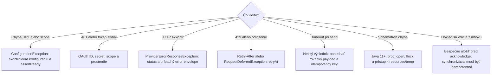

# Riešenie problémov

Táto stránka prepája bežné chyby s konkrétnymi kontrolami a podrobnejšími návodmi.

PHP ukážka nižšie je samostatný offline skript. Po `composer install` uložte ju ako `docs/wiki/offline-example.php` a spustite z koreňa repozitára príkazom `php docs/wiki/offline-example.php`. Lokálna náhradná služba simuluje odloženú požiadavku; neposiela HTTP požiadavku.

<details>
<summary>Obsah stránky</summary>

- [Rýchle smerovanie diagnostiky](#rýchle-smerovanie-diagnostiky)
- [`ConfigurationException` pri prvom volaní](#configurationexception-pri-prvom-volaní)
- [Token sa nezískava alebo API vracia 401](#token-sa-nezískava-alebo-api-vracia-401)
- [HTTP 4xx/5xx](#http-4xx5xx)
- [HTTP 429 alebo odložená požiadavka](#http-429-alebo-odložená-požiadavka)
- [`ProviderConnectionException` počas odosielania](#providerconnectionexception-počas-odosielania)
- [Neplatná odpoveď 2xx](#neplatná-odpoveď-2xx)
- [Schematron validácia nebeží](#schematron-validácia-nebeží)
- [Participant alebo Discovery neprejde](#participant-alebo-discovery-neprejde)
- [Prijatý doklad sa v inboxe opakuje](#prijatý-doklad-sa-v-inboxe-opakuje)
- [Kde hľadať viac](#kde-hľadať-viac)

</details>

## Rýchle smerovanie diagnostiky



Diagram je prvý krok; nasledujúce časti stránky uvádzajú kontroly pre každú vetvu.

## `ConfigurationException` pri prvom volaní

Skontrolujte, či aplikácia poskytuje `base_url`, `client_id`, `client_secret` a neprázdny scope. `base_url` musí byť bezpečné HTTPS URL bez prihlasovacích údajov, query a fragmentu. V Laraveli skontrolujte načítaný `efaktura-connector` config a cache konfigurácie.

## Token sa nezískava alebo API vracia 401

- Overte platnosť OAuth client ID a secret u poskytovateľa.
- Overte scope priradený klientovi; default balíka nemusí byť povolený pre každý účet.
- Skontrolujte, či web worker vidí aktualizované environment premenné.
- Pri Laravel bridge skontrolujte cache store a `APP_KEY`; token cache šifruje hodnoty cez Laravel Crypt.
- `TokenRequestException` môže obsahovať pôvodnú chybu v `getPrevious()`; citlivé údaje z nej nedávajte do používateľského výstupu.

Pri obnove tokenu môže `RequestDeferredException` znamenať, že zdieľaný cooldown podržal tokenový request ešte pred sieťou. Zachyťte túto výnimku samostatne od `TokenRequestException` a naplánujte opakovanie podľa `retryAt()->unixTimestamp()`; pozrite aj [prehľad výnimiek a retry](Errors-Retry-and-Idempotency.md).

## HTTP 4xx/5xx

Pri `ProviderErrorResponseException` zaznamenajte status a bezpečne redigované telo. `ApiConnector` zachová surové telo a rozpoznanú JSON obálku sprístupní cez `errorEnvelope()`; hostiteľ rozhoduje o aplikačnom význame chybových polí. Pri validačných chybách skontrolujte `details` a correlation ID v obálke, ak sa ju podarilo rozpoznať. Overte, že cesta patrí správnemu SAPI, Gateway alebo Integrator API a že použité poverenia majú potrebné oprávnenia.

## HTTP 429 alebo odložená požiadavka

Ak retry vrstva vráti konečnú odpoveď HTTP 429, dostanete `ProviderErrorResponseException`; platná `Retry-After` sprístupní v `retryAt()` hodnotu `RetryDeadline`.

Počas uloženého cooldownu ďalšia požiadavka v rovnakom transportnom scope vyvolá `RequestDeferredException` ešte pred odoslaním. SAPI/Gateway scope zostáva stabilný aj po obnove Bearer tokenu; Integrator API má vlastný hashovaný scope založený na URL a ID integrátora (token doň nevstupuje, rovnako ako do identity circuit breakera).

Naplánujte opakovanie podľa `retryAt()->unixTimestamp()` namiesto okamžitého retry. Pri chýbajúcej alebo neplatnej `Retry-After` backpressure použije sekundový cooldown.

```php
<?php
use DreaM1\EfakturaConnector\Core\Documents\ListReceivedDocumentsRequest;
use DreaM1\EfakturaConnector\Core\Documents\ReceivedDocumentPage;
use DreaM1\EfakturaConnector\Core\Exceptions\RequestDeferredException;
use DreaM1\EfakturaConnector\Core\Pagination\PageSize;
use DreaM1\EfakturaConnector\Core\Retry\RetryDeadline;
use DreaM1\EfakturaConnector\Domain\EFaktura\Participant;

require dirname(__DIR__, 2) . '/vendor/autoload.php';

$participant = Participant::parse('9915:tenant-demo');
$request = new ListReceivedDocumentsRequest(
    $participant,
    null,
    PageSize::fromInt(50)
);
$receivedDocumentProvider = new class {
    public function getInboxPage(ListReceivedDocumentsRequest $request): ReceivedDocumentPage
    {
        throw new RequestDeferredException(
            RetryDeadline::fromUnixTimestamp(time() + 60)
        );
    }
};

try {
    $page = $receivedDocumentProvider->getInboxPage($request);
} catch (RequestDeferredException $exception) {
    $notBefore = $exception->retryAt()->unixTimestamp();
    echo 'Synthetic request deferred until Unix timestamp ', $notBefore, PHP_EOL;
}
```

## `ProviderConnectionException` počas odosielania

Výsledok je neistý: provider mohol dokument dostať. Zachovajte pôvodný idempotency key a pred ďalším odoslaním načítajte stav cez `DocumentTrackingProviderInterface`. Nevytvárajte duplicitný pokus s novým kľúčom bez kontroly.

## Neplatná odpoveď 2xx

`InvalidProviderResponseException` znamená, že HTTP požiadavka uspela, ale telo nezodpovedalo očakávanému API kontraktu. Zaznamenajte endpoint, status, bezpečne redigovanú odpoveď a verziu OpenAPI. Overte kompatibilitu poskytovateľského prostredia a verzie konektora.

## Schematron validácia nebeží

- Spustite `java -version` v prostredí webového procesu alebo nastavte `JAVA_HOME` tak, aby ho PHP proces videl.
- Overte Java 11 alebo novšiu.
- Skontrolujte, že PHP povoľuje `proc_open`.
- Skontrolujte, že PHP povoľuje `flock` a že systémový temp adresár podporuje súborové zámky.
- Skontrolujte prístup PHP procesu k `resources/validation` a systémovému temp adresáru.
- Ak sa zobrazí `Local Peppol validation concurrency limit is busy.`, uvoľnite validačnú frontu alebo zvýšte `runtime.schematron.max_concurrent_validations` / `EFAKTURA_SCHEMATRON_MAX_CONCURRENT_VALIDATIONS`. Sloty koordinujú procesy na tom istom hoste.
- `PeppolSchematronValidationInterface::validateDocument()` vracia `PeppolSchematronValidationResult`; pri rozhodovaní skontrolujte `isValid()`, `hasErrors()` a `omittedCount()`. Výnimka `LocalValidationInfrastructureException` znamená, že validáciu nebolo možné vykonať.

## Participant alebo Discovery neprejde

Tvar Participant je `NNNN:hodnota`. Skontrolujte, že API volanie používa správneho participanta a že odosielateľ v dokumente zodpovedá oprávnenému klientovi. `RecipientUnsupportedException` je legitímny negatívny výsledok Discovery, nie transportná chyba.

Použite Participant ID a server URL pridelené pre vaše testovacie API poverenia. V eFaktúra Sandboxe použite testovaciu schému `9915` v hlavičke aj v `metadata.senderParticipantId` a v raw UBL `EndpointID/@schemeID`; `0245` je produkčná schéma. Pozrite [dokumentáciu Sandboxu](https://developers.efaktura.sk/sk/docs/sandbox).

Pre štandardné nasadenie nastavte `EFAKTURA_BASE_URL` na serverový koreň z OpenAPI; implementácia k nemu pripojí `/sapi/...` a `/v1/...`. Ak je API za reverznou proxy so spoločným prefixom, prefix sa zachová a pridá pred obe cesty.

## Prijatý doklad sa v inboxe opakuje

SAPI zoznam, stiahnutie a acknowledge sú oddelené kroky. Potvrdenie spravte až po úspešnom bezpečnom uložení/spracovaní podľa aplikácie. Synchronizáciu navrhnite ako idempotentnú, lebo opakované načítanie stránky môže vrátiť rovnaké ID.

## Kde hľadať viac

- Poskytovateľský API kontrakt: `docs/eFaktura/api/openapi.json`.
- Pri kontrole ciest a polí sa riaďte [SAPI-SK OpenAPI](https://test-sapisk.datahosting.sk/swagger-ui/index.html?urls.primaryName=SAPI-SK+API#/) a [Peppol Gateway v1 OpenAPI](https://test-sapisk.datahosting.sk/swagger-ui/index.html?urls.primaryName=Peppol+Gateway+API+v1); súhrn pokrytia balíka je v [API špecifikáciách a pokrytí](Source-Alignment).
- Verzie a údržba validačných zdrojov: `resources/validation/README.md`.
- UBL implementácia: `src/Infrastructure/Ubl` a `src/Domain/Ubl`.
- Prehľad vrstiev a tokov konektora: [Architektúra a hlavné toky](Architecture-and-Testing).

<details>
<summary>Súvisiace návody</summary>

- [Výnimky, retry a idempotencia](Errors-Retry-and-Idempotency)
- [HTTP transport a autentifikácia](Transport-and-Authentication)
- [Lokálna validácia](Validation)

</details>
