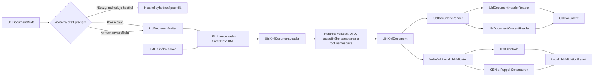

# Čítanie a zápis UBL

UBL modul pracuje samostatne od SAPI a Peppol Gateway. Podporuje UBL 2.1 `Invoice` a `CreditNote`.

<details>
<summary>Obsah stránky</summary>

- [Tok zápisu, čítania a validácie](#tok-zápisu-čítania-a-validácie)
- [Bezpečné načítanie XML a čítanie dokladu](#bezpečné-načítanie-xml-a-čítanie-dokladu)
- [Mapovanie medzi draftom, XML a čítaným modelom](#mapovanie-medzi-draftom-xml-a-čítaným-modelom)
- [Zápis Invoice a CreditNote](#zápis-invoice-a-creditnote)
  - [Dobropis s referenciou na pôvodnú faktúru](#dobropis-s-referenciou-na-pôvodnú-faktúru)
- [Praktický návod na vytvorenie faktúry](#praktický-návod-na-vytvorenie-faktúry)
- [Číselné hodnoty a kódy](#číselné-hodnoty-a-kódy)
- [Typ dokladu](#typ-dokladu)
- [Hranice použitia](#hranice-použitia)

</details>

UBL XML syntax vychádza zo štandardu [OASIS UBL 2.1](https://docs.oasis-open.org/ubl/os-UBL-2.1/UBL-2.1.html). Pravidlá sémantického modelu EN 16931 a profilu [Peppol BIS Billing 3.0](https://docs.peppol.eu/poacc/billing/3.0/) sú samostatná vrstva nad syntaxou a ich kontrolu zabezpečujú validátory opísané v [Lokálnej validácii](Validation.md). Presné verzie pribalených pravidiel a ich pôvod sú uvedené v [zdrojoch API a štandardov](Source-Alignment.md) a v `resources/validation/README.md`.

Pre konkrétnu štruktúru elementov pozrite oficiálne [UBL Invoice XSD](https://docs.oasis-open.org/ubl/os-UBL-2.1/xsd/maindoc/UBL-Invoice-2.1.xsd), [UBL CreditNote XSD](https://docs.oasis-open.org/ubl/os-UBL-2.1/xsd/maindoc/UBL-CreditNote-2.1.xsd), [Peppol Invoice syntax](https://docs.peppol.eu/poacc/billing/3.0/syntax/ubl-invoice/) a [Peppol CreditNote syntax](https://docs.peppol.eu/poacc/billing/3.0/syntax/ubl-creditnote/). OASIS XSD určuje štruktúru a poradie XML elementov; Peppol pravidlá navyše kontrolujú obchodný obsah. Živá dokumentácia Peppol sa môže líšiť od verzie Schematron pravidiel pripnutej v tomto balíku.

## Tok zápisu, čítania a validácie

Zápis, čítanie a validácia sú samostatné operácie nad draftom alebo XML. `UblDocumentWriter` vytvorí XML v poradí UBL schémy, loader bezpečne parsuje podporovaný koreň a vráti `UblXmlDocument`; reader z neho zostaví doménový model. Ten istý parsovaný dokument možno samostatne odovzdať lokálnej validačnej pipeline.



Loader odmieta neplatné alebo nebezpečné XML a podporuje iba UBL 2.1 `Invoice` a `CreditNote`. Čítanie modelu neznamená úspech XSD ani Peppol validácie. Zápis draftu zasa nekontroluje obchodnú správnosť a neposiela XML na API. Každý ďalší krok volá hostiteľ výslovne; podrobné poradie validačných krokov a tvar výsledku sú v [lokálnej validácii](Validation.md).

## Bezpečné načítanie XML a čítanie dokladu

`UblXmlDocumentLoaderInterface` bezpečne parsuje XML a vytvorí `UblXmlDocument`. Neplatné alebo nebezpečné XML vyvolá `UblValidationException` (typicky `InvalidXmlException`). `UblDocumentReaderInterface` prevedie načítaný dokument na doménový `UblDocument` s hlavičkou a obsahom.

Čítačka kontroluje bezpečnosť XML a podporovaný koreňový element, nie úplnú zhodu dokumentu s UBL XSD alebo Peppol BIS. Ak potrebujete potvrdiť štruktúru alebo obchodnú správnosť vstupu, zavolajte samostatné validátory.

```php
use DreaM1\EfakturaConnector\Infrastructure\Ubl\Reader\UblDocumentReader;
use DreaM1\EfakturaConnector\Infrastructure\Ubl\Reader\UblXmlDocumentLoader;

$loader = new UblXmlDocumentLoader();
$reader = new UblDocumentReader($loader);
$document = $reader->read($xml);

$document->header()->number();
$document->header()->supplierEndpoint(); // ?UblEndpointIdentifier dodávateľa z cbc:EndpointID
$document->header()->customerEndpoint(); // ?UblEndpointIdentifier odberateľa z cbc:EndpointID
$document->header()->deliveryDate();
$document->content()->lines();
```

Reader načíta všetky riadky faktúry alebo dobropisu.
Dátumové gettery hlavičky (`issueDate()`, `dueDate()`, `deliveryDate()` a `taxPointDate()`) vracajú validované `LocalDate|null`. Chýbajúci alebo neplatný kalendárny dátum vráti ako `null`; pôvodný text zostáva v `UblDocumentHeader::toArray()` pod zodpovedajúcim kľúčom. `supplierEndpoint()` a `customerEndpoint()` vracajú UBL `EndpointID` dodávateľa a odberateľa. `toArray()` používa polia `supplierEndpointScheme`/`supplierEndpointValue` a `customerEndpointScheme`/`customerEndpointValue`; staré `sender()`/`receiver()` aliasy a sender/receiver polia boli odstránené.
`documentRoot()` vracia typovaný koreň `Invoice` alebo `CreditNote`; `toArray()` ho zachová pod kľúčom `documentRoot`. Validácia ho používa na uplatnenie pravidiel špecifických pre typ dokladu.

Čítanie neoveruje Peppol BIS ani EN 16931 pravidlá. Vďaka tomu možno prečítať aj staršie a prijaté doklady, ktoré nevyhovujú aktuálnym pravidlám pre nové odoslania. Chýbajúce textové hodnoty hlavičky sa vracajú ako `null`. `UblDocumentContent::toArray()` a `fromArray()` sprístupňujú štruktúrovaný tvar dokumentu vhodný na uloženie.

Číselné reťazce krajiny, meny a jednotky zostávajú dostupné cez `countryCode()`, `currency()` a `unit()` presne tak, ako boli v XML. Ak reader kód rozpozná v pribalenom číselníku, sprístupní aj typovanú kanonickú hodnotu cez `recognizedCountryCode()`, `recognizedCurrencyCode()` alebo `recognizedUnitCode()`. Neznáme hodnoty čítanie neodmieta a typovaný getter vráti `null`.

`UblDocumentParty::toArray()` ukladá UBL endpoint cez polia `endpointScheme` a `endpointValue`; `fromArray()` načíta túto dvojicu, staré kľúče `participantScheme` a `participantValue` ignoruje a zachová hranicu medzi schémou a hodnotou aj vtedy, keď hodnota obsahuje dvojbodku.

## Mapovanie medzi draftom, XML a čítaným modelom

Zapisovač prijíma `UblDocumentDraft` a jeho podmodely z `Domain\Ubl\Draft`. Čítačka vracia odlišný model `UblDocument`; čítaný dokument nie je automaticky konvertovaný späť na draft.

Hodnoty Peppol `documentTypeId`, `CustomizationID` a `ProfileID` reprezentujú `PeppolDocumentTypeIdentifier`, `PeppolCustomizationIdentifier` a `PeppolProcessIdentifier`. `UblDocumentDraft::withSpecification()` prijíma oba identifikátory ako objekty; XML writer a pomocné metódy ich pri serializácii prevedú späť na reťazce.

UBL elektronickú adresu reprezentuje `UblEndpointIdentifier`; uchováva `schemeID` a hodnotu samostatne a môže zachovať aj chýbajúcu schému pri čítaní starého dokumentu. `Participant` z `Domain\EFaktura` predstavuje transportné Peppol ID a používa sa osobitne. `cbc:EndpointID/@schemeID` musí pri Peppol BIS faktúre patriť do číselníka EAS; `PeppolBillingDraftRules` túto podmienku kontroluje. Transportné ID a UBL `EndpointID` nemusia byť rovnaké.

Číslo dokladu v `UblDocumentDraft` aj číslo pôvodnej faktúry v `UblDraftReferences::withBillingReference()` sú hodnoty `UblDocumentNumber`; číslo v načítanom `UblDocumentHeader` zostáva reťazec. Ostatné draftové ID prvky, napríklad ID riadka, odkazy na dokumenty, objednávky, daňové registrácie a platobné účty, používajú `UblDraftIdentifier`. Jeho prvý argument je hodnota ID a druhý voliteľný argument je `schemeID`. ID číselníkových hodnôt, ako `listID` pri klasifikácii položky, zostávajú reťazce, pretože označujú metadáta zoznamu, nie UBL identifikátorový prvok.

Draft používa aj `TaxCategoryCode` pre kategóriu DPH a `PaymentMeansCode` pre spôsob úhrady. Tieto kódy vytvárajte cez `fromString()`; neznáme neprázdne hodnoty sa zachovajú a writer ich zapíše v pôvodnom tvare.

`UblDocumentDraft::typeCode()` vracia `UblDocumentTypeCode` a `withTypeCode()` prijíma tento objekt. `UblDraftPartyTaxScheme` používa `TaxSchemeCode`; `UblDraftDocumentReference::withDocumentType()` prijíma `AdditionalDocumentTypeCode` alebo `null` na vymazanie kódu. Ich `fromString()` zachová neznáme neprázdne kódy, ktoré writer zapíše bez zmeny.

Príklady so schémou `0245` sú produkčné. V eFaktúra Sandboxe použite testovacie ID so schémou `9915` a pre raw UBL nastavte `EndpointID/@schemeID="9915"`. Writer hodnoty automaticky nemení. Podrobnosti sú v [dokumentácii Sandboxu](https://developers.efaktura.sk/sk/docs/sandbox).

| Údaje draftu | UBL elementy | Čítaný model |
| --- | --- | --- |
| `UblDocumentDraft`: druh, kód typu, špecifikácia, číslo, dátumy, mena, referencia odberateľa/objednávky a poznámky (každé volanie `withAddedNote()` poznámku pridá; `UblDraftLine::withNote()` poznámku riadku nahrádza) | Koreň `Invoice` alebo `CreditNote`; `CustomizationID`, `ProfileID`, `ID`, `IssueDate`, príslušný typový kód, `DueDate`/`TaxPointDate`, `DocumentCurrencyCode`, referencie a poznámky | `UblDocumentHeader`: typ, identifikátory, dátumy, mena, referencie a súhrnné sumy |
| `UblDraftParty` a identifikátory | `AccountingSupplierParty` alebo `AccountingCustomerParty`, `EndpointID`, adresa, daňové schémy a právna entita | `UblDocumentContent::supplier()` / `customer()` a `UblDocumentParty` |
| `UblDraftPaymentMeans` | `PaymentMeans`, kód spôsobu platby, referencia platby a účet | `UblDocumentHeader`: `paymentMeansCode()`, `paymentId()`, `iban()` |
| `UblDraftTotals`, `UblDraftTaxSubtotal`, `UblDraftTaxCategory` | `TaxTotal`, `TaxSubtotal`, `TaxCategory`, `LegalMonetaryTotal` | `UblDocumentHeader` obsahuje hlavné sumy; `UblDocumentContent::taxSummary()` obsahuje rozpis daní |
| `UblDraftLine` a jeho daňová kategória | `InvoiceLine`/`InvoicedQuantity` alebo `CreditNoteLine`/`CreditedQuantity`, položka, jednotková cena a DPH | Každý riadok je `UblDocumentLine` v `UblDocumentContent::lines()` |

Presné poradie a povolenú štruktúru určuje UBL 2.1 XSD. Zapisovač neposudzuje obchodnú správnosť výpočtov. `UblDecimal` je nemenná typovaná hodnota: overí desatinný zápis a zachová pôvodný text bez zaokrúhľovania. Sumy a množstvá musí pripraviť hostiteľ.

Pri `CreditNote` writer používa elementy `CreditNoteLine` a `CreditedQuantity`. Kód typu dokladu rozlišuje dobropis a iné varianty; ťarchopis je UBL `Invoice` s príslušným `InvoiceTypeCode`, nie ďalší koreňový element. Pri dobropise sa splatnosť zapisuje cez `PaymentMeans/PaymentDueDate`; draft so splatnosťou dobropisu preto potrebuje platobné údaje.

Model `UblDocumentHeader` obsahuje súhrnné hodnoty aj pri čítaní. Reader načíta všetky riadky do `UblDocumentContent::lines()` a nastaví `itemsTruncated()` na `false`. Tento príznak slúži hostiteľovi na označenie modelu vytvoreného z už skráteného zoznamu.

## Zápis Invoice a CreditNote

`UblDocumentWriterInterface` zapisuje `UblDocumentDraft` ako UBL 2.1 XML. Draft je nemenný; každé `with*()` vráti upravenú kópiu. Voliteľné dátumy, referencie a platobné údaje sú zoskupené do hodnôt `UblDraftDates`, `UblDraftReferences` a `UblDraftPayment`, ktoré draft prijíma cez `withDates()`, `withReferences()` a `withPayment()` a vracia cez `dates()`, `references()` a `payment()`. Tieto settery nahrádzajú celú skupinu; ak chcete zmeniť jednu hodnotu a ostatné zachovať, vychádzajte z existujúcej skupiny: `$draft->withDates($draft->dates()->withDueDate($dueDate))`.

```php
use DreaM1\EfakturaConnector\Domain\Ubl\UblEndpointIdentifier;
use LogicException;
use DreaM1\EfakturaConnector\Domain\Ubl\CodeList\TaxCategoryCode;
use DreaM1\EfakturaConnector\Domain\Ubl\Draft\UblDraftAddress;
use DreaM1\EfakturaConnector\Domain\Ubl\Draft\UblDraftIdentifier;
use DreaM1\EfakturaConnector\Domain\Ubl\Draft\UblDraftLine;
use DreaM1\EfakturaConnector\Domain\Ubl\Draft\UblDraftParty;
use DreaM1\EfakturaConnector\Domain\Ubl\Draft\UblDraftTaxCategory;
use DreaM1\EfakturaConnector\Domain\Ubl\Draft\UblDraftTaxSubtotal;
use DreaM1\EfakturaConnector\Domain\Ubl\Draft\UblDraftTotals;
use DreaM1\EfakturaConnector\Domain\Ubl\Draft\Base64DocumentContent;
use DreaM1\EfakturaConnector\Domain\Ubl\Draft\UblDecimal;
use DreaM1\EfakturaConnector\Domain\Ubl\Draft\UblDocumentDraft;
use DreaM1\EfakturaConnector\Domain\Ubl\Draft\UblDraftDates;
use DreaM1\EfakturaConnector\Domain\Ubl\Draft\UblDocumentNumber;
use DreaM1\EfakturaConnector\Domain\Ubl\LocalDate;
use DreaM1\EfakturaConnector\Domain\Ubl\UblDocumentRoot;
use DreaM1\EfakturaConnector\Infrastructure\Ubl\CodeList\CountryCodeList;
use DreaM1\EfakturaConnector\Infrastructure\Ubl\CodeList\CurrencyCodeList;
use DreaM1\EfakturaConnector\Infrastructure\Ubl\CodeList\UnitCodeList;
use DreaM1\EfakturaConnector\Infrastructure\Ubl\Validation\PeppolBillingDraftRules;
use DreaM1\EfakturaConnector\Infrastructure\Ubl\Writer\UblDocumentWriter;

// Číselník vráti typovaný kód alebo null, ak kód nepozná.
$countryCode = CountryCodeList::resolve(CountryCodeList::SLOVAKIA);
$currencyCode = CurrencyCodeList::resolve('EUR');
$unitCode = UnitCodeList::unit('ks'); // text ako 'ks' alebo 'hod' prevedie na kód UN/ECE, neznámy vstup vyhodí výnimku
if ($countryCode === null || $currencyCode === null) {
    throw new LogicException('Required code is not available in the bundled code lists.');
}

// 1. Dodávateľ a odberateľ
$supplier = (new UblDraftParty(
    UblEndpointIdentifier::fromSchemeAndValue('0245', '2012345676'),
    'Ukážkový dodávateľ s.r.o.',
    $countryCode
))->withAddress(
    (new UblDraftAddress($countryCode))
        ->withLines('Hlavná 1')
        ->withLocality('Bratislava', '811 01')
);

$customer = (new UblDraftParty(
    UblEndpointIdentifier::fromSchemeAndValue('0245', '2012345687'),
    'Ukážkový odberateľ s.r.o.',
    $countryCode
))->withAddress(
    (new UblDraftAddress($countryCode))
        ->withLines('Druhá 2')
        ->withLocality('Košice', '040 01')
);

// 2. Položka: dva kusy po 50 EUR, DPH 23 %
$vatCategory = new UblDraftTaxCategory(
    TaxCategoryCode::fromString(TaxCategoryCode::STANDARD),
    UblDecimal::fromString('23')
);

$line = new UblDraftLine(
    new UblDraftIdentifier('1'), // ID riadka
    UblDecimal::fromString('2.0000'), // Množstvo
    $unitCode,              // Jednotka: kus
    UblDecimal::fromString('100.00'), // Suma riadka bez DPH
    'Konzultačná služba',   // Názov položky
    $vatCategory,           // Kategória a sadzba DPH
    UblDecimal::fromString('50.00') // Jednotková cena bez DPH
);

// 3. Súhrn: základ 100 EUR + DPH 23 EUR = 123 EUR
$totals = new UblDraftTotals(
    UblDecimal::fromString('100.00'), // Súčet riadkov bez DPH
    UblDecimal::fromString('100.00'), // Základ dane
    UblDecimal::fromString('123.00'), // Celkom vrátane DPH
    null,     // Zaokrúhlenie
    UblDecimal::fromString('123.00'), // Zostáva uhradiť
    UblDecimal::fromString('23.00'), // Celková DPH
    [
        new UblDraftTaxSubtotal(
            UblDecimal::fromString('100.00'),
            UblDecimal::fromString('23.00'),
            $vatCategory
        ),
    ]
);

// 4. Zostavenie draftu z pripravených hodnôt
$draft = (new UblDocumentDraft(
    UblDocumentRoot::fromString(UblDocumentRoot::INVOICE),
    UblDocumentNumber::fromString('FA-2026-001'),
    LocalDate::fromString('2026-11-22'),
    $currencyCode,
    $supplier,
    $customer,
    $totals
))->withDates(UblDraftDates::none()->withDueDate(LocalDate::fromString('2026-12-22')))
    ->withLines([$line]);

// 5. Výslovná Peppol kontrola draftu a zápis UBL XML
$draftRules = new PeppolBillingDraftRules();
$draftRules->assertSatisfied($draft);
$xml = (new UblDocumentWriter())->write($draft);
echo $xml;
```

Ukážka vytvorí faktúru s jednou položkou: 2 kusy po 50 EUR, základ dane 100 EUR, DPH 23 EUR a celkom 123 EUR. Identifikátory strán a všetky sumy sú ukážkové. `PeppolBillingDraftRules` skontroluje vybrané požiadavky ešte pred zápisom; writer naďalej iba serializuje dodané hodnoty. Pred odoslaním po zápise samostatne spustite UBL XSD a Peppol Schematron validáciu podľa [lokálnej validácie](Validation.md).

Balík je určený slovenským firmám, no jeho preflight ani writer nevyžadujú DIČ alebo IČ DPH a nekontrolujú, či má daňový identifikátor prefix `SK`. Doklad sa posudzuje podľa údajov, ktoré hostiteľ dodá, a podľa príslušných UBL a Peppol pravidiel.

Všetky dátumy draftu sú `LocalDate` hodnoty, ktoré možno vytvoriť cez `LocalDate::fromString('2026-11-22')`. Rovnaký typ používajú konštruktor, `withIssueDate()`, `UblDraftDates` (`withDueDate()`, `withTaxPointDate()`, `withDeliveryDate()`) a dátum `UblDraftReferences::withBillingReference()`. `LocalDate` rozširuje `DateTimeImmutable` a štandardne predstavuje daný dátum o polnoci UTC, takže ho možno použiť aj tam, kde sa očakáva `DateTimeInterface`. Neplatný kalendárny dátum nemožno vložiť do draftu.

### Dobropis s referenciou na pôvodnú faktúru

Pri dobropise vytvorte koreň cez `UblDocumentRoot::fromString(UblDocumentRoot::CREDIT_NOTE)` a pôvodnú faktúru uveďte cez `UblDraftReferences::withBillingReference()`. Prvý argument je `UblDocumentNumber` vytvorený cez `UblDocumentNumber::fromString()`, druhý je nepovinný dátum vystavenia pôvodnej faktúry.

```php
use DreaM1\EfakturaConnector\Domain\Ubl\Code\CurrencyCode;

$creditNote = (new UblDocumentDraft(
    UblDocumentRoot::fromString(UblDocumentRoot::CREDIT_NOTE),
    UblDocumentNumber::fromString('CN-1'),
    LocalDate::fromString('2026-11-10'),
    CurrencyCode::fromCanonical('EUR'),
    $supplier,
    $customer,
    $creditNoteTotals
))
    ->withReferences(
        UblDraftReferences::none()
            ->withBillingReference(UblDocumentNumber::fromString('INV-1'), LocalDate::fromString('2026-10-20'))
    )
    ->withLines($creditNoteLines);

$creditNoteXml = (new UblDocumentWriter())->write($creditNote);
```

Vygenerované XML bude obsahovať tento výrez (prefixy `cac` a `cbc` sú deklarované na koreňovom elemente):

```xml
<cac:BillingReference>
  <cac:InvoiceDocumentReference>
    <cbc:ID>INV-1</cbc:ID>
    <cbc:IssueDate>2026-10-20</cbc:IssueDate>
  </cac:InvoiceDocumentReference>
</cac:BillingReference>
```

Writer zapíše referenciu do `cac:BillingReference/cac:InvoiceDocumentReference` ako `cbc:ID` a prípadne `cbc:IssueDate`. Referencia sa zapíše do XML; writer pôvodnú faktúru nevyhľadáva ani z nej nepreberá položky či sumy. Tie musí hostiteľ pripraviť v drafte dobropisu.

Writer serializuje draft do schémou určeného poradia UBL elementov. Nevyberá údaje partnerov, DPH ani obchodné pravidlá; hostiteľ musí pripraviť správny obsah a následne ho validovať.

Voliteľné polia Peppol Billing 3 sa zadávajú cez podmodely draftu. `UblDocumentDraft` pokrýva účtovný náklad, menu DPH, obdobie fakturácie, referencie na objednávky a podklady, miesto dodania, príjemcu platby, daňového zástupcu, viacero spôsobov platby, platobné podmienky a zľavy či poplatky na úrovni dokladu. `UblDraftParty` dopĺňa obchodný názov, adresné riadky, kontaktné údaje a právnu formu; e-mail kontaktu sa zadáva ako `EmailAddress::fromString('billing@example.test')`, ktorý overí formát adresy. `UblDraftLine` umožňuje referenciu na riadok objednávky a podklad, obdobie, zľavu alebo poplatok, identifikátory a klasifikácie položky, jej pôvod, vlastnosti a základné množstvo ceny. Sumár môže obsahovať súčty zliav, poplatkov, preddavkov aj DPH v účtovnej mene.

`UblDraftDocumentReference` podporuje referenciu na pôvodnú faktúru aj ďalšie dokumenty vrátane vloženého Base64 súboru a externej URI. Externú URI nastavte cez `withExternalUri(ExternalDocumentUri::fromString('https://example.test/support.pdf'))`; objekt vyžaduje absolútnu `http` alebo `https` URI s hostiteľom a zachová jej pôvodný zápis; iné schémy (`javascript:`, `data:`, `file:`, `ftp:`, `urn:`) odmietne, pretože sa URI zapíše do faktúry a príjemca ju môže zobraziť ako odkaz. Typ referencie odovzdajte ako `UblDocumentReferenceType::fromString(UblDocumentReferenceType::ADDITIONAL)`; objekt povoľuje len podporované UBL typy a `type()->value()` vráti názov elementu na serializáciu. Obsah vložte napríklad cez `$reference->withEmbeddedDocument(Base64DocumentContent::fromString($base64), MimeType::fromString('application/pdf'), 'support.pdf')`; objekt MIME typu overí zápis `type/subtype`, kým obsahový objekt overí Base64 zápis, povoľuje XML whitespace, zachová pôvodný text a prázdny obsah odmietne. U Invoice sa projekt zapisuje ako `cac:ProjectReference`; pri CreditNote sa mapuje na `cac:AdditionalDocumentReference` s typovým kódom `50`, ako požaduje Peppol. Pre každý podmodel použite príslušný `with*()` setter (skupiny dátumov, referencií a platby cez `withDates()`, `withReferences()` a `withPayment()`) a samostatne spustite UBL XSD a Peppol Schematron validáciu.

Writer zapisuje referencie v poradí určenom UBL schémou. Podporuje billing, despatch, receipt, originator, contract, additional a project referencie. Vložený súbor sa zapisuje ako Base64 `EmbeddedDocumentBinaryObject` s povinným MIME typom a názvom; externý súbor ako `ExternalReference/URI`. Referencia typu `AdditionalDocumentTypeCode::INVOICED_OBJECT` (`130`) označuje identifikátor fakturovaného objektu, preto pri nej Peppol zakazuje prílohu aj popis. Pri dobropise sa projektová referencia zapisuje pod typovým kódom `AdditionalDocumentTypeCode::PROJECT_REFERENCE` (`50`).

Model `UblDraftPaymentMeans` môže niesť účet príjemcu, platobnú kartu alebo mandát inkasa. `PaymentMeansCode` obsahuje pomenované hodnoty pre bankový prevod (`30`), SEPA prevod (`58`), kartu (`48`) a SEPA inkaso (`59`). Pri prevode musí byť uvedený identifikátor účtu príjemcu; pri inkase možno pripojiť `UblDraftPaymentMandate`. `UblDraftPaymentCard` prijme iba zamaskované alebo skrátené číslo karty (posledné 4 až 6 číslic) najviac do 10 znakov (`UblDraftPaymentCard::MAX_PRIMARY_ACCOUNT_NUMBER_LENGTH`); dlhšie hodnoty, teda aj celé číslo karty, odmietne `InvalidInputException`. Pravidlo BR-51 je v lokálnej validácii len varovanie, takže bez tejto kontroly by doklad s celým číslom karty prešiel. Dobropis zapisuje dátum splatnosti do prvého `PaymentMeans/PaymentDueDate`.

## Praktický návod na vytvorenie faktúry

Nasledujúci postup je pre štandardnú UBL `Invoice` v Peppol BIS Billing 3.0. Konektor vytvorí XML a poskytuje kontroly, ale sám nevyberá obchodné údaje, sadzbu DPH ani daňové zaobchádzanie. Správnu kategóriu a sadzbu určte podľa konkrétneho plnenia a pravidiel platných pre daný obchod.

### 1. Pripravte povinné údaje

Pred zostavením draftu si pripravte aspoň tieto údaje. Presné podmienené požiadavky závisia od profilu, krajín, kategórie DPH a spôsobu platby.

| Oblasť | Čo pripraviť |
| --- | --- |
| Hlavička | Číslo faktúry, dátum vystavenia, typ dokladu a kód meny ISO 4217. `UblDocumentDraft` predvolene nastaví `CustomizationID` na `urn:cen.eu:en16931:2017#compliant#urn:fdc:peppol.eu:2017:poacc:billing:3.0` a `ProfileID` na `urn:fdc:peppol.eu:2017:poacc:billing:01:1.0`; pri inom podporovanom procese nastavte `withSpecification()`. |
| Dodávateľ a odberateľ | Názov, poštovú adresu s kódom krajiny a elektronickú adresu vo forme EAS `schemeID` + hodnota. Dodávateľ musí mať identifikátor dodávateľa, registračný identifikátor alebo IČ DPH; konkrétne daňové identifikátory môžu byť povinné podľa kategórie DPH. UBL `EndpointID` a transportný `Participant` sú samostatné hodnoty. |
| Referencia | Referenciu odberateľa alebo číslo objednávky. Peppol vyžaduje aspoň jednu z nich. |
| Každý riadok | ID riadka, názov položky, množstvo, kód jednotky, čistú jednotkovú cenu a čistú sumu riadka. Priraďte kategóriu DPH; sadzbu uveďte pre kategórie, ktoré ju vyžadujú. |
| DPH a súhrn | Rozpis základu a dane pre každú odlišnú kombináciu kategórie DPH a sadzby, plus súčty riadkov, základ bez DPH, celkovú DPH, sumu s DPH a sumu na úhradu. Pri kladnej sume na úhradu predbežná kontrola draftu vyžaduje dátum splatnosti alebo platobné podmienky. |

Prílohy, zľavy a poplatky, preddavky, oslobodenie od DPH, daňový zástupca, účtovná mena či platobné údaje sa dopĺňajú podľa konkrétneho prípadu. Niektoré sú povinné len za určitých okolností alebo pre konkrétnu národnú úpravu. Autoritatívny zoznam business rules je v [Peppol BIS Billing 3.0, vydanie 2026-Q4-MR](https://test-docs.peppol.eu/poacc/billing/3.0/2026-Q4-MR/bis/) a v [zozname pravidiel Peppol](https://test-docs.peppol.eu/poacc/billing/3.0/2026-Q4-MR/rules/ubl-peppol/). Lokálna implementácia validačných súborov je opísaná v [lokálnej validácii](Validation.md).

### 2. Vypočítajte riadky, DPH a celkové sumy

Peppol očakáva sumy v mene faktúry s najviac dvoma desatinnými miestami. Čistá suma riadka sa vypočíta takto:

```text
suma riadka = zaokrúhliť(cena bez DPH / základné množstvo × fakturované množstvo, 2)
              + súčet riadkových poplatkov
              - súčet riadkových zliav
```

Zaokrúhlite výsledok `(cena / základné množstvo × fakturované množstvo)` a každú sumu riadkovej zľavy alebo poplatku samostatne na dve desatinné miesta; potom z nich zostavte čistú sumu riadka. Riadková zľava/poplatok sa započíta do daného riadka. Zľava/poplatok na úrovni dokladu sa eviduje samostatne a musí mať vlastnú kategóriu DPH.

DPH počítajte po skupinách podľa kombinácie kategórie DPH a sadzby:

```text
základ skupiny = súčet čistých súm riadkov danej skupiny
                 + poplatky na úrovni dokladu danej skupiny
                 - zľavy na úrovni dokladu danej skupiny
DPH skupiny = zaokrúhliť(základ skupiny × sadzba / 100, 2)
```

Vystavte jeden `UblDraftTaxSubtotal` pre každú takúto skupinu. Celková DPH je súčet DPH skupín. Napríklad pri jednom riadku `2 × 50,00 EUR`, kategórii `S` a ilustračnej sadzbe `23 %` je čistá suma riadka aj základ skupiny `100,00 EUR`, DPH `23,00 EUR` a suma s DPH `123,00 EUR`. Sadzba v príklade slúži iba na ukážku aritmetiky.

Bežné kódy v `TaxCategoryCode` sú `S` (štandardná sadzba), `Z` (nulová sadzba), `E` (oslobodenie) a `O` (mimo rozsahu DPH). Kategóriu zvoľte podľa daňového režimu konkrétneho plnenia, nie iba podľa číselnej sadzby. Kódy, sadzby a prípadné dôvody oslobodenia sa kontrolujú v kontexte celej faktúry; `O` je výnimka, pri ktorej Peppol nevyžaduje percento sadzby.

Z týchto hodnôt vytvorte polia `UblDraftTotals`:

| Pole draftu | Výpočet |
| --- | --- |
| `lineExtensionAmount` | Súčet čistých súm všetkých riadkov. |
| `taxExclusiveAmount` | Súčet čistých súm riadkov − zľavy na úrovni dokladu + poplatky na úrovni dokladu. |
| `taxAmount` | Súčet DPH zo všetkých daňových skupín. |
| `taxInclusiveAmount` | Základ bez DPH + celková DPH. |
| `payableAmount` | Suma s DPH − už zaplatené preddavky + prípadné zaokrúhlenie splatnej sumy. |
| `taxSubtotals` | Základ, vypočítaná DPH a kategória pre každú skupinu DPH. |

Pri zľavách, poplatkoch alebo preddavkoch vyplňte aj súvisiace súčtové polia cez `UblDraftTotals::withAdditionalAmounts()`. Hodnoty musia byť navzájom konzistentné: zapisovač ich iba zapíše a sám ich nevypočítava ani neopravuje.

Na výpočty peňazí používajte desatinnú aritmetiku alebo celé najmenšie menové jednotky. Do draftov odovzdávajte hodnoty vytvorené cez `UblDecimal::fromString('123.00')`, `UblDecimal::fromMinorUnits()` alebo `UblDecimal::fromFloat()`. Hodnota zachová desatinný zápis, no nevypočíta DPH ani súčty faktúry.

### 3. Spustite kontroly v správnom poradí

1. Zavolajte `PeppolBillingDraftRulesInterface::assertSatisfied($draft)`. Ide o predbežnú kontrolu vybraných polí draftu, nie o úplnú Peppol validáciu ani kontrolu výpočtov.
2. Zapíšte XML cez `UblDocumentWriterInterface::write($draft)`.
3. Výsledné XML načítajte cez `UblXmlDocumentLoaderInterface::parse($xml)` a odovzdajte `LocalUblValidationInterface::validateDocument($document)`. Predvolený Laravel pipeline kontroluje UBL 2.1 XSD, doplnkové pravidlo BR-CO-25 pre faktúry a CEN/EN 16931 aj Peppol Schematron; vydanie Q4-MR obsahuje slovenské pravidlá.
4. Ak `LocalUblValidationResult::isValid()` vráti `false`, odoslanie zastavte a opravte chyby; neúplný report s vynechanými nálezmi tiež nie je platný. Slovenské pravidlá v Q4-MR Schematrone vracajú upozornenia, preto ich skontrolujte aj pri výsledku `isValid() === true`.
5. Pred odoslaním môžete samostatne zavolať vzdialenú kontrolu Gateway `POST /v1/validate-document`. Je to sieťová operácia a môže používať inú verziu pravidiel než lokálne zdroje.

Nižšie je kompletný príklad pre samostatné použitie bez Laravelu. Predpokladá, že Composer autoloader je v `vendor/autoload.php`, validačné zdroje sú dostupné v balíku a PHP má povolené `proc_open` a `flock`; lokálny Schematron navyše potrebuje Javu 11+. Voliteľné odosielanie a trvalý záznam pokusu vyžadujú aj rozšírenie `pdo_sqlite`. Všetky identifikátory a údaje strán sú syntetické. Odoslanie je predvolene vypnuté; na jeho zapnutie treba nastaviť `EFAKTURA_SEND_SANDBOX=1`, použiť presnú sandbox URL a pred odoslaním nahradiť syntetické údaje skutočnými testovacími údajmi pridelenými pre Sandbox.

<details>
<summary>Zobraziť celý PHP príklad</summary>

<!-- sapi-timeout-simulation-example:start -->
```php
<?php

use DreaM1\EfakturaConnector\Core\Configuration\SapiClientConfiguration;
use DreaM1\EfakturaConnector\Domain\Ubl\UblEndpointIdentifier;
use DreaM1\EfakturaConnector\Domain\Ubl\CodeList\TaxCategoryCode;
use DreaM1\EfakturaConnector\Domain\Ubl\Draft\UblDraftAddress;
use DreaM1\EfakturaConnector\Domain\Ubl\Draft\UblDraftIdentifier;
use DreaM1\EfakturaConnector\Domain\Ubl\Draft\UblDraftLine;
use DreaM1\EfakturaConnector\Domain\Ubl\Draft\UblDraftParty;
use DreaM1\EfakturaConnector\Domain\Ubl\Draft\UblDraftTaxCategory;
use DreaM1\EfakturaConnector\Domain\Ubl\Draft\UblDraftTaxSubtotal;
use DreaM1\EfakturaConnector\Domain\Ubl\Draft\UblDraftTotals;
use DreaM1\EfakturaConnector\Domain\Ubl\Draft\UblDecimal;
use DreaM1\EfakturaConnector\Domain\Ubl\Draft\UblDocumentDraft;
use DreaM1\EfakturaConnector\Domain\Ubl\Draft\UblDraftDates;
use DreaM1\EfakturaConnector\Domain\Ubl\Draft\UblDraftReferences;
use DreaM1\EfakturaConnector\Domain\Ubl\Draft\UblDocumentNumber;
use DreaM1\EfakturaConnector\Domain\Ubl\LocalDate;
use DreaM1\EfakturaConnector\Domain\Ubl\UblDocumentRoot;
use DreaM1\EfakturaConnector\Infrastructure\Ubl\CodeList\CurrencyCodeList;
use DreaM1\EfakturaConnector\Infrastructure\Ubl\CodeList\UnitCodeList;
use DreaM1\EfakturaConnector\Infrastructure\Ubl\Reader\UblXmlDocumentLoader;
use DreaM1\EfakturaConnector\Infrastructure\Ubl\Validation\PeppolBillingDraftRules;
use DreaM1\EfakturaConnector\Infrastructure\Ubl\Writer\UblDocumentWriter;
use DreaM1\EfakturaConnector\Core\Documents\DocumentRequestContext;
use DreaM1\EfakturaConnector\Core\Documents\IdempotencyKey;
use DreaM1\EfakturaConnector\Core\Documents\IdempotencyKeyGenerator;
use DreaM1\EfakturaConnector\Core\Documents\OutboundDocumentPayload;
use DreaM1\EfakturaConnector\Core\Documents\SentDocumentReference;
use DreaM1\EfakturaConnector\Core\Documents\SentDocumentStatus;
use DreaM1\EfakturaConnector\Core\Exceptions\ProviderErrorResponseException;
use DreaM1\EfakturaConnector\Support\HashAlgorithm;
use DreaM1\EfakturaConnector\Core\Ubl\PeppolDocumentTypeIdentifierBuilder;
use DreaM1\EfakturaConnector\Domain\EFaktura\Participant;
use DreaM1\EfakturaConnector\Domain\EFaktura\PeppolDocumentTypeIdentifier;
use DreaM1\EfakturaConnector\Domain\EFaktura\PeppolProcessIdentifier;
use DreaM1\EfakturaConnector\Domain\EFaktura\SubmittedDocumentId;
use DreaM1\EfakturaConnector\Domain\EFaktura\ProviderDocumentId;
use DreaM1\EfakturaConnector\Infrastructure\Ubl\CodeList\CountryCodeList;
use DreaM1\EfakturaConnector\Domain\Ubl\CodeList\TaxSchemeCode;
use DreaM1\EfakturaConnector\Domain\Ubl\Draft\UblDraftPartyTaxScheme;
use DreaM1\EfakturaConnector\Infrastructure\EFaktura\Validation\LocalUblValidator;
use DreaM1\EfakturaConnector\Infrastructure\EFaktura\Validation\PeppolBillingHeaderValidationStage;
use DreaM1\EfakturaConnector\Infrastructure\EFaktura\Validation\Schematron\UblSchematronReportParser;
use DreaM1\EfakturaConnector\Infrastructure\EFaktura\Validation\Schematron\PeppolSchematronValidationStage;
use DreaM1\EfakturaConnector\Infrastructure\EFaktura\Validation\Schematron\PeppolSchematronValidator;
use DreaM1\EfakturaConnector\Infrastructure\EFaktura\Validation\Schematron\SaxonProcessExecutor;
use DreaM1\EfakturaConnector\Infrastructure\EFaktura\Validation\Schematron\SaxonSchematronRunner;
use DreaM1\EfakturaConnector\Infrastructure\EFaktura\Validation\Schema\UblSchemaValidationStage;
use DreaM1\EfakturaConnector\Infrastructure\EFaktura\Validation\Schema\UblSchemaValidator;
use DreaM1\EfakturaConnector\Infrastructure\EFaktura\Validation\ValidationResources;
use DreaM1\EfakturaConnector\Infrastructure\EFaktura\Api\ApiConnector;
use DreaM1\EfakturaConnector\Infrastructure\EFaktura\Api\Authentication\AuthenticatedRequestSender;
use DreaM1\EfakturaConnector\Infrastructure\EFaktura\Api\Authentication\SapiToken;
use DreaM1\EfakturaConnector\Infrastructure\EFaktura\Api\Authentication\SapiTokenCacheInterface;
use DreaM1\EfakturaConnector\Infrastructure\EFaktura\Api\Authentication\SapiTokenProvider;
use DreaM1\EfakturaConnector\Infrastructure\EFaktura\Api\Endpoints\Sapi\SendDocumentEndpoint;
use DreaM1\EfakturaConnector\Infrastructure\EFaktura\Api\Endpoints\Sapi\RequestTokenEndpoint;
use DreaM1\EfakturaConnector\Infrastructure\EFaktura\Api\Endpoints\PeppolGateway\GetMessageLevelStatusContentEndpoint;
use DreaM1\EfakturaConnector\Infrastructure\EFaktura\Api\Endpoints\PeppolGateway\ListMessageLevelStatusesEndpoint;
use DreaM1\EfakturaConnector\Infrastructure\EFaktura\Api\Endpoints\PeppolGateway\GetSentDocumentEndpoint;
use DreaM1\EfakturaConnector\Infrastructure\EFaktura\Api\Transport\Execution\DefaultHttpRequestExecutorFactory;
use DreaM1\EfakturaConnector\Infrastructure\EFaktura\Api\Transport\Execution\HttpRequestExecutorOptions;
use DreaM1\EfakturaConnector\Infrastructure\EFaktura\Api\Transport\ProviderTransport;
use DreaM1\EfakturaConnector\Infrastructure\EFaktura\Documents\PeppolGatewayDocumentTrackingProvider;
use DreaM1\EfakturaConnector\Infrastructure\EFaktura\Documents\SapiDocumentSubmissionGateway;
use DreaM1\EfakturaConnector\Support\Timestamp;
use DreaM1\EfakturaConnector\Infrastructure\Ubl\Validation\PeppolBillingHeaderRules;

require __DIR__ . '/vendor/autoload.php';

// Získanie kanonických kódov z pribalených číselníkov.
$country = CountryCodeList::resolve(CountryCodeList::SLOVAKIA);
$currency = CurrencyCodeList::resolve('EUR');
$unit = UnitCodeList::unit('ks'); // z textu ('ks', 'hod', 'kg') alebo z presného kódu UN/ECE
if ($country === null || $currency === null) {
    throw new \LogicException('A required code is missing from the bundled code lists.');
}

// Obe strany potrebujú poštovú adresu a elektronickú adresu Peppol.
$supplierAddress = (new UblDraftAddress($country))
    ->withLines('Ukážková 1')
    ->withLocality('Bratislava', '811 01');
$supplier = (new UblDraftParty(
    UblEndpointIdentifier::fromSchemeAndValue('9915', 'TESTSELLER001'),
    'Ukážkový dodávateľ s.r.o.',
    $country
))
    ->withAddress($supplierAddress)
    // Ukážka uvádza identifikátor dodávateľa aj inú daňovú registráciu pre riadok so štandardnou DPH.
    ->withLegalCompanyId(new UblDraftIdentifier('SYNTHETIC-SELLER-REGISTRATION'))
            ->withTaxScheme(new UblDraftPartyTaxScheme(
                new UblDraftIdentifier('SYNTHETIC-SELLER-TAX-REGISTRATION'),
                TaxSchemeCode::fromString(TaxSchemeCode::OTHER)
            ));

$customerAddress = (new UblDraftAddress($country))
    ->withLines('Testovacia 2')
    ->withLocality('Košice', '040 01');
$customer = (new UblDraftParty(
    UblEndpointIdentifier::fromSchemeAndValue('9915', 'TESTBUYER001'),
    'Ukážkový odberateľ s.r.o.',
    $country
))->withAddress($customerAddress);

// Jeden riadok: 2 × 50,00 EUR = 100,00 EUR bez DPH; ilustračná sadzba 23 % dáva DPH 23,00 EUR.
$vatCategory = new UblDraftTaxCategory(
    TaxCategoryCode::fromString(TaxCategoryCode::STANDARD),
    UblDecimal::fromString('23')
);
$line = new UblDraftLine(
    new UblDraftIdentifier('1'),
    UblDecimal::fromString('2'),
    $unit,
    UblDecimal::fromString('100.00'),
    'Ukážková služba',
    $vatCategory,
    UblDecimal::fromString('50.00')
);
$totals = new UblDraftTotals(
    UblDecimal::fromString('100.00'),
    UblDecimal::fromString('100.00'),
    UblDecimal::fromString('123.00'),
    null,
    UblDecimal::fromString('123.00'),
    UblDecimal::fromString('23.00'),
    [new UblDraftTaxSubtotal(
        UblDecimal::fromString('100.00'),
        UblDecimal::fromString('23.00'),
        $vatCategory
    )]
);

$draft = (new UblDocumentDraft(
    UblDocumentRoot::fromString(UblDocumentRoot::INVOICE),
    UblDocumentNumber::fromString('DEMO-INV-001'),
    LocalDate::fromString('2026-11-23'),
    $currency,
    $supplier,
    $customer,
    $totals
))->withReferences(UblDraftReferences::none()->withBuyerReference('DEMO-ORDER-001'))
    ->withDates(UblDraftDates::none()->withDueDate(LocalDate::fromString('2026-12-23')))
    ->withLines([$line]);

// Predbežná kontrola preverí vybrané polia draftu; Schematron nižšie kontroluje obchodné pravidlá a sumy.
(new PeppolBillingDraftRules())->assertSatisfied($draft);
$xml = (new UblDocumentWriter())->write($draft);
$document = (new UblXmlDocumentLoader())->parse($xml);

// Zostavenie lokálneho pipeline: UBL XSD, doplnková BR-CO-25 kontrola a CEN/Peppol Schematron (vrátane SK-R pravidiel).
$resources = ValidationResources::directory();
$schematronRunner = new SaxonSchematronRunner(
    $resources,
    sys_get_temp_dir(),
    new SaxonProcessExecutor()
);
$schematronValidator = new PeppolSchematronValidator(
    new UblSchematronReportParser(),
    $schematronRunner,
    $resources
);
$localValidator = new LocalUblValidator([
    new UblSchemaValidationStage(new UblSchemaValidator($resources)),
    new PeppolBillingHeaderValidationStage(new PeppolBillingHeaderRules()),
    new PeppolSchematronValidationStage($schematronValidator),
]);
$result = $localValidator->validateDocument($document);

foreach ($result->issues() as $finding) {
    printf(
        "[%s] %s: %s\n",
        strtoupper($finding->severity()->value()),
        $finding->code() ?? 'UBL',
        $finding->message()
    );
}

if (! $result->isValid()) {
    throw new \RuntimeException('Invoice did not pass local validation.');
}

echo "Faktúra prešla lokálnou validáciou.\n";

// Sieťové odoslanie je predvolene vypnuté; najprv nahraďte syntetické údaje testovacími údajmi Sandboxu.
if (getenv('EFAKTURA_SEND_SANDBOX') !== '1') {
    echo "Odoslanie je vypnuté. Pre sandbox nastavte EFAKTURA_SEND_SANDBOX=1.\n";
    return;
}

$configuration = SapiClientConfiguration::fromArray([
    'base_url' => getenv('EFAKTURA_BASE_URL') ?: '',
    'client_id' => getenv('EFAKTURA_CLIENT_ID') ?: '',
    'client_secret' => getenv('EFAKTURA_CLIENT_SECRET') ?: '',
    'client_scope' => getenv('EFAKTURA_CLIENT_SCOPE') ?: '',
]);
$configuration->assertReady();

// Ochrana proti náhodnému odoslaniu do iného prostredia; URL zodpovedá sandbox serveru v OpenAPI balíka.
if ($configuration->baseUrl()->value() !== 'https://test-sapisk.datahosting.sk') {
    throw new \RuntimeException('Sandbox sending requires https://test-sapisk.datahosting.sk.');
}

// Tieto testovacie Participant ID musia byť pridelené vášmu Sandbox účtu a zhodovať sa s UBL EndpointID vyššie.
$senderParticipant = Participant::parse('9915:TESTSELLER001');
$receiverParticipant = Participant::parse('9915:TESTBUYER001');
$candidateCreationDateTime = Timestamp::fromDateTimeImmutable(
    new \DateTimeImmutable('now', new \DateTimeZone('UTC'))
);

$documentTypeId = PeppolDocumentTypeIdentifierBuilder::forDocument(
    $draft->kind()->value(),
    $draft->customizationId()->value()
);
$payloadChecksum = \DreaM1\EfakturaConnector\Core\Documents\Sha256Checksum::fromContent($xml);
$candidatePayload = new OutboundDocumentPayload(
    SubmittedDocumentId::fromString($draft->number()->value()),
    $documentTypeId,
    $draft->profileId(),
    $senderParticipant,
    $receiverParticipant,
    $candidateCreationDateTime,
    $xml,
    $payloadChecksum
);

// SQLite záznam obsahuje aj XML faktúry; umiestnite ho do adresára prístupného iba aplikácii.
$submissionDbPath = getenv('EFAKTURA_SUBMISSION_DB')
    ?: __DIR__ . '/var/sapi-submissions.sqlite';
$submissionDbDirectory = dirname($submissionDbPath);
if (
    ! is_dir($submissionDbDirectory)
    && ! mkdir($submissionDbDirectory, 0700, true)
    && ! is_dir($submissionDbDirectory)
) {
    throw new \RuntimeException('Could not create the submission database directory.');
}

$previousUmask = umask(0077);
try {
    $submissionDb = new \PDO(
        'sqlite:' . $submissionDbPath,
        null,
        null,
        [
            \PDO::ATTR_ERRMODE => \PDO::ERRMODE_EXCEPTION,
            \PDO::ATTR_DEFAULT_FETCH_MODE => \PDO::FETCH_ASSOC,
        ]
    );
} finally {
    umask($previousUmask);
}
$submissionDb->exec('PRAGMA busy_timeout = 5000');
$submissionDb->exec('PRAGMA synchronous = FULL');
$submissionDb->exec(
    'CREATE TABLE IF NOT EXISTS sapi_submission_attempts (
        logical_submission_id TEXT PRIMARY KEY,
        document_id TEXT NOT NULL,
        sender_participant_id TEXT NOT NULL,
        receiver_participant_id TEXT NOT NULL,
        document_type_id TEXT NOT NULL,
        process_id TEXT NOT NULL,
        creation_datetime TEXT NOT NULL,
        payload_xml TEXT NOT NULL,
        checksum TEXT NOT NULL,
        idempotency_key TEXT NOT NULL UNIQUE,
        status TEXT NOT NULL,
        provider_document_id TEXT,
        tracking_status TEXT,
        response_timestamp TEXT,
        received_at TEXT
    )'
);
$submissionColumns = $submissionDb->query('PRAGMA table_info(sapi_submission_attempts)')
    ->fetchAll(\PDO::FETCH_COLUMN, 1);
if (! in_array('tracking_status', $submissionColumns, true)) {
    $submissionDb->exec('ALTER TABLE sapi_submission_attempts ADD COLUMN tracking_status TEXT');
}

// Verziu zvýšte iba pri úmyselne novom pokuse s opraveným payloadom; retry po timeoute ponechá rovnakú verziu.
$submissionRevision = getenv('EFAKTURA_SUBMISSION_REVISION') ?: '1';
// Identita pokusu je stabilná medzi spusteniami a odlišuje odosielateľa, číslo faktúry aj verziu pokusu.
$logicalSubmissionId = hash(
    HashAlgorithm::SHA_256,
    $senderParticipant->identifier() . "\0" . $draft->number()->value() . "\0" . $submissionRevision
);
$submissionDb->beginTransaction();
$hasStoredAttempt = false;
try {
    $selectAttempt = $submissionDb->prepare(
        'SELECT * FROM sapi_submission_attempts WHERE logical_submission_id = :logical_submission_id'
    );
    $selectAttempt->execute(['logical_submission_id' => $logicalSubmissionId]);
    $storedAttempt = $selectAttempt->fetch();
    $selectAttempt->closeCursor();

    if ($storedAttempt === false) {
        // Záznam s kľúčom a presným payloadom sa commitne ešte pred akýmkoľvek HTTP volaním.
        $idempotencyKey = IdempotencyKeyGenerator::generate();
        $insertAttempt = $submissionDb->prepare(
            'INSERT INTO sapi_submission_attempts (
                logical_submission_id, document_id, sender_participant_id, receiver_participant_id,
                document_type_id, process_id, creation_datetime, payload_xml, checksum,
                idempotency_key, status
            ) VALUES (
                :logical_submission_id, :document_id, :sender_participant_id, :receiver_participant_id,
                :document_type_id, :process_id, :creation_datetime, :payload_xml, :checksum,
                :idempotency_key, :status
            )'
        );
        $insertAttempt->execute([
            'logical_submission_id' => $logicalSubmissionId,
            'document_id' => $candidatePayload->documentId()->value(),
            'sender_participant_id' => $senderParticipant->identifier(),
            'receiver_participant_id' => $receiverParticipant->identifier(),
            'document_type_id' => $candidatePayload->documentTypeId()->value(),
            'process_id' => $candidatePayload->processId()->value(),
            'creation_datetime' => $candidatePayload->creationDateTime()->value(),
            'payload_xml' => $candidatePayload->xml(),
            'checksum' => $candidatePayload->checksum()->value(),
            'idempotency_key' => $idempotencyKey->value(),
            'status' => 'PENDING',
        ]);
        $payload = $candidatePayload;
        $storedStatus = 'PENDING';
        $storedProviderDocumentId = null;
    } else {
        $hasStoredAttempt = true;
        // Rovnaké číslo faktúry sa nesmie poslať s iným obsahom pod pôvodným idempotency kľúčom.
        if (
            $storedAttempt['document_id'] !== $draft->number()->value()
            || $storedAttempt['sender_participant_id'] !== $senderParticipant->identifier()
            || $storedAttempt['receiver_participant_id'] !== $receiverParticipant->identifier()
            || $storedAttempt['document_type_id'] !== $documentTypeId->value()
            || $storedAttempt['process_id'] !== $draft->profileId()->value()
            || $storedAttempt['payload_xml'] !== $xml
            || ! hash_equals($storedAttempt['checksum'], $payloadChecksum->value())
        ) {
            throw new \RuntimeException(
                'A stored submission exists for this attempt, but its payload changed; do not reuse its idempotency key.'
            );
        }

        $idempotencyKey = IdempotencyKey::fromString($storedAttempt['idempotency_key']);
        $payload = new OutboundDocumentPayload(
            SubmittedDocumentId::fromString($storedAttempt['document_id']),
            PeppolDocumentTypeIdentifier::fromString($storedAttempt['document_type_id']),
            PeppolProcessIdentifier::fromString($storedAttempt['process_id']),
            $senderParticipant,
            $receiverParticipant,
            Timestamp::fromIso8601($storedAttempt['creation_datetime']),
            $storedAttempt['payload_xml'],
            \DreaM1\EfakturaConnector\Core\Documents\Sha256Checksum::fromString(
                $storedAttempt['checksum']
            )
        );
        $storedStatus = $storedAttempt['status'];
        $storedProviderDocumentId = $storedAttempt['provider_document_id'];
    }
    $submissionDb->commit();
} catch (\Throwable $exception) {
    if ($submissionDb->inTransaction()) {
        $submissionDb->rollBack();
    }
    throw $exception;
}

/* SAPI_TIMEOUT_SIMULATION_ADAPTERS_START */
// Pre jednorazový CLI príklad zostáva token iba v pamäti procesu.
$tokenCache = new class implements SapiTokenCacheInterface {
    /** @var array<string, SapiToken> */
    private array $tokens = [];

    /**
     * Returns a token stored in this process-local cache.
     *
     * @param string $key Token cache key.
     * @return SapiToken|null Cached token, or null when the key is absent.
     */
    public function load(string $key): ?SapiToken
    {
        return $this->tokens[$key] ?? null;
    }

    /**
     * Stores the token in memory for the current process.
     *
     * @param string $key Token cache key.
     * @param SapiToken $token Token to retain.
     */
    public function store(string $key, SapiToken $token): void
    {
        $this->tokens[$key] = $token;
    }

    /**
     * Removes the token for this key; an absent entry is not an error.
     *
     * @param string $key Token cache key to remove.
     */
    public function forget(string $key): void
    {
        unset($this->tokens[$key]);
    }
};

$transport = ProviderTransport::forSapiClient(
    $configuration,
    DefaultHttpRequestExecutorFactory::create(HttpRequestExecutorOptions::defaults())
);
$tokenProvider = new SapiTokenProvider(
    new RequestTokenEndpoint($transport),
    $tokenCache,
    $configuration
);
$connector = new ApiConnector(new AuthenticatedRequestSender($transport, $tokenProvider));
$gateway = new SapiDocumentSubmissionGateway(new SendDocumentEndpoint($connector));
$trackingProvider = new PeppolGatewayDocumentTrackingProvider(
    new GetSentDocumentEndpoint($connector),
    new ListMessageLevelStatusesEndpoint($connector),
    new GetMessageLevelStatusContentEndpoint($connector)
);
/* SAPI_TIMEOUT_SIMULATION_ADAPTERS_END */

$readTrackingStatus = static function (ProviderDocumentId $providerDocumentId) use (
    $trackingProvider,
    $senderParticipant,
    $draft
): ?SentDocumentStatus {
    try {
        return $trackingProvider->getSentDocumentStatus(
            new SentDocumentReference(
                $senderParticipant,
                $providerDocumentId,
                new DocumentRequestContext($providerDocumentId->value(), $draft->number()->value())
            )
        );
    } catch (ProviderErrorResponseException $exception) {
        if ($exception->httpStatusCode() !== null && $exception->httpStatusCode()->isNotFound()) {
            return null;
        }
        throw $exception;
    }
};

$saveTrackingStatus = static function (?string $status) use (
    $submissionDb,
    $logicalSubmissionId,
    $idempotencyKey
): void {
    $saveTracking = $submissionDb->prepare(
        'UPDATE sapi_submission_attempts SET tracking_status = :tracking_status
         WHERE logical_submission_id = :logical_submission_id AND idempotency_key = :idempotency_key'
    );
    $saveTracking->execute([
        'tracking_status' => $status,
        'logical_submission_id' => $logicalSubmissionId,
        'idempotency_key' => $idempotencyKey->value(),
    ]);
};

// Ak už máme ID poskytovateľa, najprv skontrolujeme tracking a pri nájdenom zázname nič znovu neposielame.
if ($storedProviderDocumentId !== null) {
    $trackedStatus = $readTrackingStatus(ProviderDocumentId::fromString($storedProviderDocumentId));
    if ($trackedStatus !== null) {
$saveTrackingStatus($trackedStatus->status() === null ? null : $trackedStatus->status()->value());
        printf(
            "Tracking stav: %s; ID dokladu: %s\n",
            $trackedStatus->status() === null ? 'neznámy' : $trackedStatus->status()->value(),
            $storedProviderDocumentId
        );
        return;
    }

    if ($storedStatus !== 'PENDING') {
        printf(
            "Uložený výsledok SAPI: %s; tracking záznam zatiaľ nie je dostupný pre ID %s.\n",
            $storedStatus,
            $storedProviderDocumentId
        );
        return;
    }
}

if ($storedStatus !== 'PENDING') {
    printf(
        "Už uložený výsledok SAPI: %s; ID dokladu: %s\n",
        $storedStatus,
        $storedProviderDocumentId
    );
    return;
}

if ($hasStoredAttempt && $storedProviderDocumentId === null) {
    echo "Po timeoute nie je známe ID pre tracking; opakujem iba s uloženým payloadom a tým istým idempotency kľúčom.\n";
}

// Pri timeout-e bez providerDocumentId je toto idempotentné opakovanie zároveň spôsob, ako získať ID pre tracking.
$submission = $gateway->send(new \DreaM1\EfakturaConnector\Core\Documents\SendDocumentRequest(
    $senderParticipant,
    $payload,
    $idempotencyKey
));

$saveResponse = $submissionDb->prepare(
    'UPDATE sapi_submission_attempts
     SET status = :status, provider_document_id = :provider_document_id,
         response_timestamp = :response_timestamp, received_at = :received_at
     WHERE logical_submission_id = :logical_submission_id AND idempotency_key = :idempotency_key'
);
$saveResponse->execute([
    'status' => $submission->status()->value(),
    'provider_document_id' => $submission->providerDocumentId()->value(),
    'response_timestamp' => $submission->timestamp()->value(),
    'received_at' => $submission->receivedAt() === null ? null : $submission->receivedAt()->value(),
    'logical_submission_id' => $logicalSubmissionId,
    'idempotency_key' => $idempotencyKey->value(),
]);

$trackedStatus = $readTrackingStatus($submission->providerDocumentId());
if ($trackedStatus !== null) {
    $saveTrackingStatus($trackedStatus->status() === null ? null : $trackedStatus->status()->value());
    printf(
        "Tracking stav: %s\n",
        $trackedStatus->status() === null ? 'neznámy' : $trackedStatus->status()->value()
    );
} else {
    echo "Tracking záznam ešte nie je dostupný; pri ďalšom spustení sa najprv zopakuje tracking podľa uloženého ID.\n";
}

printf(
    "SAPI stav: %s; ID dokladu: %s\n",
    $submission->status()->value(),
    $submission->providerDocumentId()->value()
);
if ($submission->status()->value() === 'ACCEPTED') {
    echo "SAPI technicky prijalo doklad na spracovanie; nejde ešte o potvrdenie doručenia príjemcovi.\n";
}
```
<!-- sapi-timeout-simulation-example:end -->
</details>

Databáza sa predvolene vytvorí v `var/sapi-submissions.sqlite`; cestu možno nastaviť cez `EFAKTURA_SUBMISSION_DB`. Obsahuje fakturačné XML, preto ju umiestnite do adresára chráneného prístupovými právami. Pri timeoute zostane pokus v stave `PENDING`; konektor POST automaticky neopakuje. Endpoint trackingu `GET /v1/sent-documents/{identifier}` vyžaduje ID pridelené poskytovateľom, nevyhľadáva podľa čísla faktúry ani idempotency kľúča. Ak sa odpoveď stratí skôr, než sa toto ID uloží, tracking pred prvým opakovaním nie je možný. Príklad vtedy zopakuje presne uložený payload s rovnakým kľúčom, získa pôvodné ID a následne zavolá tracking. Ak je provider ID známe už pred opakovaním, tracking sa zavolá najprv a pri nájdenom zázname sa faktúra neposiela znova. Po zmene obsahu príklad zastaví odoslanie pre tú istú verziu pokusu. Novú verziu nastavte cez `EFAKTURA_SUBMISSION_REVISION` iba pri úmyselnom novom pokuse s opraveným payloadom; po timeoute verziu nemeňte. V produkčnej aplikácii uložte tieto údaje do vlastného transakčného úložiska a pred opakovaním neistej požiadavky najprv overte stav dokladu, ak máte provider ID.

### Spustenie lokálnych simulácií opakovania SAPI

Z koreňového adresára projektu spustite:

```sh
php tools/simulate-sapi-submission-retries.php
```

Skript spustí dvadsaťdva samostatných scenárov s lokálnymi databázami. Odpovede trackingu sa nastavujú ako postupnosť HTTP stavov; po spotrebovaní postupnosti sa opakuje jej posledný stav.

<details>
<summary>Zobraziť prehľad scenárov</summary>

- Uložené provider ID a tracking 404: príklad zopakuje odoslanie; test overí poradie `odoslanie → tracking 404 → odoslanie → tracking 200` a zhodu idempotency kľúča aj všetkých polí payloadu.
- Uložené provider ID a nájdený tracking záznam: príklad skončí bez druhého odoslania.
- Provider ID nie je uložené: tracking sa zatiaľ nedá zavolať, preto príklad zopakuje uložený payload s rovnakým kľúčom a potom zavolá tracking podľa získaného ID.
- Tracking vráti 500: príklad skončí chybou bez opakovaného odoslania.
- Tracking vráti 204 alebo hraničný úspešný stav 299: odpoveď v rozsahu 2xx nespôsobí opakované odoslanie.
- Tracking vráti hraničný stav 300: presmerovanie sa považuje za chybu a nespustí ďalšie odoslanie.
- Tracking vráti 400: chyba klienta zastaví opakovanie bez ďalšieho odoslania.
- Tracking vráti 404 a po opakovanom odoslaní 500: príklad skončí chybou trackingu a neposiela dokument tretíkrát.
- Payload faktúry sa zmení po timeoute: príklad skončí pred trackingom a odoslaním; test overí, že odoslaniu zostane iba pôvodný idempotency kľúč a nevznikne druhá požiadavka, ktorá by ho použila pre nový payload.
- Payload sa zmení a `EFAKTURA_SUBMISSION_REVISION` sa zvýši na `2`: vznikne samostatný nový pokus s novým idempotency kľúčom. Test overí, že databáza obsahuje pôvodný pokus `PENDING` aj nový pokus `ACCEPTED`, každý s vlastným payloadom a kľúčom.
- Po tracking 404 zostane stav pokusu `ACCEPTED` alebo `REJECTED`: príklad rešpektuje uložený konečný stav a nič znovu neodošle.
- Dve opakované odoslania skončia timeoutom: ďalší pokus použije uložený payload a ten istý idempotency kľúč; pri známej odpovedi overí aj rovnaké ID poskytovateľa.
- SAPI prijme faktúru, ale SQLite odmietne uložiť odpoveď: test overí, že pokus zostal atomicky `PENDING` bez provider ID. Keďže tracking ešte nemá podľa čoho vyhľadať doklad, ďalšie spustenie odošle uložený payload s pôvodným kľúčom, získa rovnaké ID a zavolá tracking.
- Dve opakovania sa spustia súčasne: test overí, že obe použijú rovnaký payload a kľúč a v databáze zostane jeden úspešne dokončený pokus.
- Tracking vráti 401 alebo 429: príklad skončí chybou bez opakovaného odoslania.
- Tracking vráti 429 a pri ďalšom spustení 200: príklad sa po rate limite obnoví ďalším trackingom bez opätovného odoslania faktúry.
- Tracking vráti 403: chyba oprávnenia zastaví opakovanie bez ďalšieho odoslania.
- Pri neznámom provider ID nastanú dva timeouty po sebe: každé odoslanie použije rovnaký payload a idempotency kľúč; tracking sa zavolá až po získaní ID.
- Opakované odoslanie vráti stav SAPI `REJECTED`: databáza uloží zamietnutie a provider ID, pričom tracking zostane samostatným výsledkom.

</details>

Faktúra prejde lokálnou validáciou pri každom spustení príkladu. Simulácia skončí chybou, ak sa poradie volaní alebo počet odoslaní líši od očakávania.

Simulácie nahrádzajú SAPI aj tracking lokálnymi falošnými adaptérmi, nevyžadujú prihlasovacie údaje a neposielajú HTTP požiadavky. Potrebujú `pdo_sqlite`, `proc_open`, `flock`, Composer závislosti, validačné zdroje a Javu 11+ pre Schematron. Dočasné dáta po dokončení odstránia. Zdroj simulácií: [tools/simulate-sapi-submission-retries.php](../../tools/simulate-sapi-submission-retries.php).

Konkrétny PHP príklad načítania XML a spracovania výsledku je v časti [Lokálna validácia](Validation.md#kontroly). Samotné `send()` lokálne ani vzdialené validácie automaticky nespúšťa.

## Číselné hodnoty a kódy

Peppol sumové polia sú desatinné hodnoty podľa XML Schema; pravidlá Billing povoľujú najviac dve desatinné miesta a neurčujú limit počtu číslic pred desatinnou bodkou. Jednotlivé sumy aj tak musia spĺňať príslušné výpočtové a zaokrúhľovacie pravidlá EN 16931.

Sumy, množstvá a sadzby v drafte sú typované cez `UblDecimal`. `UblDecimal::fromString()` zachová presný desatinný zápis, zatiaľ čo `fromMinorUnits()` a `fromFloat()` ho vytvoria z číselného vstupu. Trieda hodnoty validuje, ale nerobí finančné výpočty. Kódy kategórie DPH, oslobodenia od DPH, obdobia a dôvodu zľavy či poplatku sa zadávajú cez `TaxCategoryCode`, `VatExemptionReasonCode`, `PeriodDescriptionCode` a `AllowanceChargeReasonCode`; tieto typy vytvárajte cez `fromString()` a zachovávajú neznáme neprázdne kódy. Ďalšie pomenované konštanty pre bežné kódy poskytujú `DocumentTypeCode`, `CreditNoteTypeCode`, `TaxSchemeCode`, `PaymentMeansCode` a `PartyIdentifierScheme`. Konštruktory draftu vyžadujú typované `CountryCode`, `CurrencyCode` a `UnitCode`; pre kontrolu členstva v číselníku ich získajte cez `resolve()`. `UnitCodeList::resolve()` prijíma iba presný kanonický UN/ECE kód, napríklad `H87`, a pri inej hodnote vráti `null`.

`UblDocumentDraft::currency()` a `UblDraftLine::unitCode()` vracajú typované hodnoty; krajina strany je dostupná cez `address()->countryCode()` a UBL endpoint cez `endpoint()`. `UblDraftParty::withAddress()` prijíma zdieľaný `UblDraftAddress`, ktorého riadky a lokalita sa nastavujú cez `withLines()` a `withLocality()`. UBL endpoint a transportný `Participant` sú samostatné hodnoty. `withPaymentMeans()` nahradí aktuálny spôsob platby, kým `withAdditionalPaymentMeans()` pridá ďalší. `withBillingReference()` nastaví jednu referenciu na faktúru a zachová ostatné typy odkazov; všeobecné odkazy pridáva `withDocumentReference()`.

`UnitCodeList::resolve()` porovnáva hodnotu presne s oficiálnym UN/ECE kódom. Neprekladá lokálne názvy a neupravuje veľkosť písmen ani okolité medzery. Draft drží typovaný `UnitCode` a writer zapíše jeho kanonickú hodnotu do `@unitCode`. Na prevod textu ako `ks` slúži samostatná voliteľná pomôcka `UnitCodeList::unit()` opísaná nižšie.
**Aliasy jednotiek (voliteľná pomôcka).** Keď máte jednotku ako text zo zdroja (`ks`, `kg`, `hod`), použite `UnitCodeList::unit()` alebo `UnitCodeList::fromLabel()`. Presný kód UN/ECE vrátia ako je; iný vstup normalizujú (orezanie medzier, malé písmená, vynechanie diakritiky a koncovej bodky, `m²` ako `m2`) a vyhľadajú v pribalenom súbore `resources/code-lists/unit-aliases.json`. `unit()` pri neznámom vstupe vyhodí `InvalidInputException`, takže sa dá vložiť priamo do `UblDraftLine`; `fromLabel()` vráti `null`. `resolve()`, `isCanonical()`, validácia aj writer ostávajú prísne.

```php
$line = new UblDraftLine(
    new UblDraftIdentifier('1'),
    UblDecimal::fromString('2'),
    UnitCodeList::unit($row['unit']),      // 'ks' → H87, 'Hod.' → HUR, 'H87' → H87, 'xyz' → výnimka
    UblDecimal::fromString('100.00'),
    'Konzultačná služba',
    $vatCategory,
    UblDecimal::fromString('50.00')
);

// Vlastné alebo prepísané aliasy majú prednosť pred pribalenými:
$unit = UnitCodeList::unit('ks', ['ks' => 'C62', 'pal' => 'XPX']);
```

Aliasy nie sú súčasťou oficiálneho číselníka; ide o odporúčané mapovanie, ktoré možno prepísať. Presný kód má vždy prednosť a nikdy sa nehľadá bez ohľadu na veľkosť písmen (`h87` nie je `H87`). Pribalená sada (v tabuľke s diakritikou, v súbore bez nej):

| Oblasť | Aliasy → kód |
|---|---|
| Kus | `ks`, `kus`, `kusy`, `kusov`, `kusa` → `H87` |
| Hmotnosť | `mg`, `miligram` → `MGM`; `g`, `gram`, `gramy`, `gramov` → `GRM`; `dkg`, `dekagram` → `DJ`; `kg`, `kilo`, `kilogram`, `kilogramy`, `kilogramov` → `KGM`; `t`, `ton`, `tona`, `tony` → `TNE`; `lb` → `LBR`; `oz` → `ONZ` |
| Objem kvapalín | `ml`, `mililiter` → `MLT`; `cl`, `centiliter` → `CLT`; `dl`, `deciliter` → `DLT`; `l`, `lt`, `liter`, `litre`, `litrov` → `LTR`; `hl`, `hektoliter` → `HLT`; `gal` → `GLL` |
| Dĺžka | `mm`, `milimeter` → `MMT`; `cm`, `centimeter` → `CMT`; `dm`, `decimeter` → `DMT`; `m`, `meter`, `metre`, `metrov` → `MTR`; `km`, `kilometer`, `kilometre`, `kilometrov` → `KMT`; `bm`, `m.b`, `bežný meter` → `LM`; `ft` → `FOT`; `yd` → `YRD` |
| Plocha a objem | `cm2` → `CMK`, `m2` → `MTK`, `km2` → `KMK`, `cm3` → `CMQ`, `m3` → `MTQ` |
| Čas | `s`, `sek`, `sekunda`, `sekundy` → `SEC`; `min`, `minúta`, `minúty`, `minút` → `MIN`; `h`, `hod`, `hodina`, `hodiny`, `hodín` → `HUR`; `d`, `deň`, `dni`, `dní`, `dňa` → `DAY`; `týž`, `týždeň`, `týždne`, `týždňov` → `WEE`; `mes`, `mesiac`, `mesiace`, `mesiacov` → `MON`; `štvrťrok`, `kvartál` → `QAN`; `rok`, `roky`, `rokov`, `roka` → `ANN` |
| Energia, výkon, elektrina | `j` → `JOU`, `wh` → `WHR`, `kwh` → `KWH`, `mwh` → `MWH`, `gwh` → `GWH`, `w` → `WTT`, `mw` → `MAW`, `kva` → `KVA`, `a` → `AMP`, `v` → `VLT`, `hz` → `HTZ` |
| Rýchlosť, teplota, tlak | `km/h` → `KMH`, `m/s` → `MTS`, `°C` → `CEL`, `bar` → `BAR`, `pa` → `PAL` (pascal) |
| Dáta | `byte` → `AD`, `mb` → `4L`, `tb` → `E35` (bez `kb` a `gb`, pozri nižšie) |
| Balenie | `bal`, `balenie`, `balenia` → `XPK`; `balíček`, `balíčky` → `XPA`; `škatuľa`, `škatule`, `krabica`, `krabice` → `XBX`; `kartón`, `kartóny` → `XCT`; `vrece`, `vreca`, `vrecko`, `vrecká` → `XBG`; `sak`, `saky` → `XSA`; `fľaša`, `fľaše` → `XBO`; `plechovka` → `XCX`; `konzerva` → `XTN`; `tuba` → `XTU`; `sud`, `sudy` → `XBA`; `kanister` → `XJY`; `vedro` → `XBJ`; `kaď` → `XVA`; `vedierko` → `XPL`; `bedňa`, `bedne` → `XCR`; `prepravka`, `prepravky` → `XBC`; `paleta`, `palety` → `XPX`; `kontajner` → `XCN`; `kôš` → `XBK`; `zväzok` → `XBE`; `kytica` → `XBH`; `rola`, `rolka`, `zvitok` → `XRO`; `tyč` → `XRD`; `list` → `XST`; `doska` → `XBD`; `podnos` → `XPU`; `ries` → `RM`; `kniha` → `D63` |
| Sady a množstvá | `pár`, `páry`, `párov` → `PR`; `sada`, `sady` → `SET`; `tucet`, `tucty` → `DZN`; `gros` → `GRO`; `stovka` → `CEN`; `tis`, `tisíc`, `tisíce` → `MIL` |
| Iné | `paušál`, `paušály` → `LS`; `služba`, `služby` → `E48`; `%` → `P1`; `promile` → `NX` |

**Diakritika.** V súbore `unit-aliases.json` sú aliasy uložené bez diakritiky a malými písmenami, ale vstup sa pred vyhľadaním vždy normalizuje, takže `paušál`, `Týždeň`, `ŠKATUĽA` či `deň` fungujú rovnako ako `pausal`, `tyzden`, `skatula` a `den`. V tabuľke sú aliasy napísané s diakritikou len pre čitateľnosť. Aliasy `kw`, `kj`, `kb` a `gb` zámerne chýbajú: presné kódy `KW`, `KJ`, `KB` a `GB` sú iné jednotky (kilogram na milimeter, kilosegment, kilocharacter a galón za deň), takže by alias zakryl odlišný význam. Použite `KWT`, `KJO`, `2P` a `E34`.

Voľba `ks` → `H87` (nie `C62`) je odporúčanie; ak preferujete `C62`, prepíšte ju druhým argumentom, ako je uvedené vyššie. Súbor aliasov je vždy overený testom: každý alias musí smerovať na kanonický kód z `unece-rec20-names.json`.

`CountryCodeList` obsahuje ISO 3166-1 kódy a špeciálne kódy podporované Peppolom. `CurrencyCodeList` používa pribalený ISO 4217 zoznam Peppol Billing; obe triedy poskytujú kódy, názvy, výber možností a `resolve()`. Explicitné volanie `resolve()` môže vstup normalizovať a vrátiť typovaný kód; `isCanonical()` overí presný zápis aj členstvo bez normalizácie. `UnitCodeList` používa pribalený UN/ECE zoznam a vyžaduje presnú zhodu s kanonickým kódom.

`CountryCode::fromCanonical()`, `CurrencyCode::fromCanonical()` a `UnitCode::fromCanonical()` vytvoria syntakticky kanonickú hodnotu bez lookupu. Draftová a hlavičková Peppol validácia používajú `isCanonical()`: odmietnu nepodporovaný kód, malé písmená aj okolité medzery. Rovnaké typy sa používajú aj v zdieľanom `UblDraftAddress`, `withOriginCountryCode()`, `withPriceBaseQuantity()` a `withTaxCurrencyCode()`. Preflight kontroluje aj krajinu v adrese dodania, adrese daňového zástupcu a pôvod každej položky. Writer serializuje hodnoty, ktoré už draft drží, a nevyberá ani nenormalizuje obchodné údaje.

`PeppolBillingCodeList` poskytuje úplné doplnkové číselníky vydania Billing `2026-Q4-MR`: ISO 6523 ICD, UNCL 5305, UNCL 7143, UNCL 1001 pre faktúry a dobropisy, UNCL 1153, UNCL 2005, UNCL 4461, UNCL 5189, UNCL 7161, MIME, SEPA a VATEX. `all()` vráti kódy, `name()` ich názov a `options()` dvojice vhodné pre výber. `contains()`, `isCanonical()` a `resolve()` používajú presnú zhodu bez normalizácie. Verziu a pôvod konkrétneho zoznamu získate cez `version()` a `source()`; `release()` vráti vydanie Peppol.

`CodeListRegistryInterface` poskytuje prístup k číselníkom cez ich `CodeListInterface`. Identifikátory sú v `CodeListIdentifiers`; Peppol Billing zoznamy majú samostatné identifikátory s prefixom `peppol_billing.`. Každá položka je `CodeListOption` s presnou reťazcovou hodnotou a popisom. `options()` zachováva poradie zdrojového zoznamu; `get()` pri neznámom identifikátore vyhodí `InvalidArgumentException`. Jednotky obsahujú iba kanonické UN/ECE kódy, nie lokálne aliasy. EAS a participant schémy používajú ako popis samotný kód, pretože pribalené zdroje neobsahujú názvy.

Registry obsahuje tieto základné zoznamy; `identifiers()` vráti dostupné identifikátory v poradí registrácie:

| Identifikátor | Obsah |
| --- | --- |
| `CodeListIdentifiers::COUNTRIES` | Krajiny ISO 3166-1 a špeciálne kódy podporované Peppolom. |
| `CodeListIdentifiers::CURRENCIES` | Meny ISO 4217 z pribaleného vydania Peppol Billing. |
| `CodeListIdentifiers::UNITS` | Kanonické jednotky UN/ECE Recommendation 20. |
| `CodeListIdentifiers::ELECTRONIC_ADDRESS_SCHEMES` | Schémy EAS pre UBL `EndpointID`. |
| `CodeListIdentifiers::PARTICIPANT_IDENTIFIER_SCHEMES` | Aktívne a registrovateľné transportné schémy z eDEC 9.7. |
| `CodeListIdentifiers::UBL_DOCUMENT_TYPES` | Kódy typov Invoice z `DocumentTypeCode`. |
| `CodeListIdentifiers::ADDITIONAL_DOCUMENT_TYPES` | Kódy typov referenčných dokumentov z `AdditionalDocumentTypeCode`. |
| `CodeListIdentifiers::TAX_SCHEMES` | Kódy daňových schém z `TaxSchemeCode`. |

Ďalších 13 zoznamov má identifikátor `CodeListIdentifiers::peppolBilling($sourceIdentifier)` a zodpovedá hodnotám `PeppolBillingCodeList` uvedeným v [README pribalených číselníkov](../../resources/code-lists/README.md). Tieto zdroje obsahujú kódy, názvy a verzie. Registry ich sprístupňuje rovnakým rozhraním ako ostatné zoznamy.

```php
use DreaM1\EfakturaConnector\Core\CodeLists\CodeListIdentifiers;
use DreaM1\EfakturaConnector\Core\Contracts\CodeListRegistryInterface;
use DreaM1\EfakturaConnector\Infrastructure\Ubl\CodeList\CodeListRegistry;

/** @var CodeListRegistryInterface $registry */
$registry = new CodeListRegistry();
$unitOptions = $registry->get(CodeListIdentifiers::UNITS)->options();
$vatCategories = $registry->get(CodeListIdentifiers::PEPPOL_BILLING_VAT_CATEGORY)->options();

foreach ($unitOptions as $option) {
    $code = $option->value();
    $label = $option->label();
}
```

```php
use DreaM1\EfakturaConnector\Infrastructure\Ubl\CodeList\PeppolBillingCodeList;

$isListedVatCategory = PeppolBillingCodeList::contains(
    PeppolBillingCodeList::VAT_CATEGORY,
    TaxCategoryCode::REVERSE_CHARGE
);
$vatExemptionName = PeppolBillingCodeList::name(
    PeppolBillingCodeList::VATEX,
    'VATEX-EU-G'
);
$paymentMeansCodes = PeppolBillingCodeList::all(PeppolBillingCodeList::PAYMENT_MEANS);
```

Tieto zdroje obsahujú úplné hodnoty Peppol Billing, nielen slovenskú podmnožinu. Samotné členstvo v číselníku preto nepotvrdzuje, že kód je povolený pre konkrétnu krajinu, profil alebo kombináciu polí; tie kontroluje Schematron. ISO 6523 ICD je odlišný od transportného zoznamu `ParticipantIdentifierSchemeCodeList` a od UBL EAS pre `EndpointID`.

## Typ dokladu

`UblDocumentRoot` je hodnotový objekt pre koreňový element (`Invoice` alebo `CreditNote`), nie pre každý obchodný variant. Draft ho prijíma v konštruktore a vracia cez `kind()`; vytvoríte ho cez `UblDocumentRoot::fromString(UblDocumentRoot::INVOICE)` alebo `UblDocumentRoot::fromString(UblDocumentRoot::CREDIT_NOTE)`. Na reťazec XML koreňa sa prevedie cez `value()`. Čítaný model `UblDocument` si zachováva textový `kind()`, aby vedel sprístupniť aj iné koreňové elementy. Ťarchopis je koreňový `Invoice` s kódom `DocumentTypeCode::DEBIT_NOTE` (383). Faktúra má predvolený kód 380, dobropis 381.

Pre UBL CreditNote sa dátum splatnosti zapisuje do `PaymentMeans/PaymentDueDate`, pretože UBL 2.1 CreditNote nemá `DueDate`. Draft so splatnosťou dobropisu preto potrebuje aj platobné údaje. Dôvod oslobodenia od DPH sa zapisuje do súhrnu `TaxSubtotal`, nie do riadku.

## Hranice použitia

- Writer negeneruje účtovné údaje zo zdrojového systému.
- Reader nezamieta doklad iba preto, že neprejde obchodnými pravidlami Peppol.
- Bezpečné načítanie XML nenahrádza XSD ani Schematron validáciu.
- Hostiteľ zodpovedá za lokalizované texty pravidiel, mapovanie lokálnych označení jednotiek na UN/ECE kódy a predvolenú menu.

<details>
<summary>Súvisiace návody</summary>

- [Lokálna validácia](Validation)
- [Odosielanie dokladov](Sending-Documents)
- [Príjem dokladov](Receiving-Documents)
- [API špecifikácie a pokrytie](Source-Alignment)

</details>
