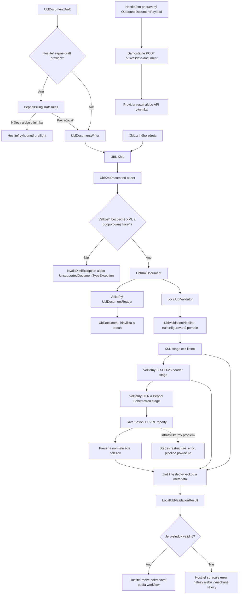

# Lokálna validácia

Konektor poskytuje samostatné validačné služby aj agregovaný kontrakt `LocalUblValidationInterface`. Validácia je lokálna a nevykonáva sieťové volania.

<details>
<summary>Obsah stránky</summary>

- [Tok validácie](#tok-validácie)
- [Kontroly](#kontroly)
  - [Schémy a pravidlá v balíku](#schémy-a-pravidlá-v-balíku)
- [Spoločný výsledok](#spoločný-výsledok)
- [Interpretácia výsledkov](#interpretácia-výsledkov)
- [Runtime a bezpečnosť](#runtime-a-bezpečnosť)
  - [Kapacita a samostatná validačná fronta](#kapacita-a-samostatná-validačná-fronta)
- [Aktualizácia pravidiel](#aktualizácia-pravidiel)

</details>

## Tok validácie

Hostiteľ môže validovať draft ešte pred zápisom a výsledné XML následne skontrolovať samostatnou lokálnou pipeline. Bezpečné načítanie vytvára spoločný `UblXmlDocument`; reader a validátory z neho čítajú nezávisle. Nálezy jedného kroku nezastavia ďalšie kroky. Chyba nástrojov alebo chýbajúci validačný zdroj je infraštruktúrna výnimka, nie chyba dokladu.



Predvolený Laravel skladá XSD, BR-CO-25 header a CEN/Peppol Schematron v tomto poradí; vlastná integrácia si môže nakonfigurovať iné kroky. Schematron stage spúšťa CEN aj Peppol pravidlá nad tým istým XML a pri vykonaní Java procesov používa samostatný concurrency limiter. `LocalUblValidator` nevolá Gateway a `UblDocumentWriter` ani odosielací adaptér validáciu automaticky nespúšťajú. Vzdialená kontrola je samostatné API volanie a môže používať iné pravidlá než lokálne pribalené zdroje.

## Kontroly

Ak vlastná pipeline spúšťa iba CEN/EN 16931, použite `CenSchematronValidationStage`. Spustí CEN stylesheet a doplní kontrolu endpointov podľa aktuálneho Peppol EAS zoznamu. Samotný upstream `CEN-EN16931-UBL.xsl` zostáva nezmenený; jeho priame spustenie cez `SaxonSchematronRunner` túto doplnkovú kontrolu nevykoná. Tento stage nemožno kombinovať s `PeppolSchematronValidationStage` v jednej pipeline, pretože druhý stage už spúšťa CEN aj Peppol pravidlá; `UblValidationPipeline` takéto zloženie odmietne s `InvalidInputException`.

```php
use DreaM1\EfakturaConnector\Infrastructure\EFaktura\Validation\Schematron\CenSchematronValidationStage;
use DreaM1\EfakturaConnector\Infrastructure\EFaktura\Validation\LocalUblValidator;
use DreaM1\EfakturaConnector\Infrastructure\EFaktura\Validation\Schematron\UblSchematronReportParser;
use DreaM1\EfakturaConnector\Infrastructure\EFaktura\Validation\Schematron\SaxonSchematronRunner;
use DreaM1\EfakturaConnector\Infrastructure\EFaktura\Validation\ValidationResources;

$cenStage = new CenSchematronValidationStage(
    new SaxonSchematronRunner(ValidationResources::directory(), sys_get_temp_dir()),
    new UblSchematronReportParser()
);
$result = (new LocalUblValidator([$cenStage]))->validateDocument($document);
```

| Služba / kontrakt | Kontrola | Závislosti |
| --- | --- | --- |
| `CenSchematronValidationStage` | Samostatný CEN Schematron s dodatočnou kontrolou aktuálnych Peppol EAS schém endpointov. | Pribalený Saxon, Java 11+, `proc_open` a `flock`. |
| `UblXmlDocumentLoaderInterface` | Bezpečné načítanie XML a podpora Invoice/CreditNote. | PHP DOM a libxml. |
| `UblSchemaValidationInterface` | UBL 2.1 XSD. | Pribalené schémy, libxml. |
| `PeppolSchematronValidationInterface` | CEN/EN 16931 a Peppol BIS Billing pravidlá; vracia `PeppolSchematronValidationResult` s nálezmi a ich závažnosťou. | Pribalený Saxon HE, Java 11+, `proc_open` a `flock`. |
| `LocalUblValidationInterface` | Spustí nastavené kroky a vráti ich nálezy v jednom výsledku; Laravel predvolene nastavuje XSD, doplnkovú kontrolu BR-CO-25 a Peppol Schematron. | Závislosti nastavených krokov. |
| `PeppolBillingDraftRulesInterface` | Predbežná kontrola polí dostupných priamo v `UblDocumentDraft`, pred serializáciou. | Bez Java a bez XSD. |
| `PeppolBillingRulesInterface` / `PeppolBillingHeaderValidationStage` | Doplnková kontrola BR-CO-25: kladná faktúra musí mať dátum splatnosti alebo platobné podmienky. | Bez Java a bez XSD. |

`UblSchemaValidationInterface`, `PeppolSchematronValidationInterface` a `PeppolBillingRulesInterface` povinne poskytujú verzie svojich pravidiel cez `ruleVersions()`.

Lokálne Schematron artefakty v tomto balíku sú UBL 2.1, CEN/EN 16931 1.3.17 a oficiálny Peppol BIS Billing 3.0.22 z vydania `2026-Q4-MR`. CEN verzia 1.3.17 sa spúšťa samostatne; OpenPeppol uvádza vo svojom Q4-MR balíku EN 16931 artefakty 1.3.16. Oficiálny Peppol `.sch` obsahuje zmeny vydania: pravidlá `PEPPOL-COMMON-R054`, `R055`, `R056-1`, `R056-2` a `R057` majú fatal závažnosť, pridané sú `R058`, `R059` a `R062`, povinné kardinality `PEPPOL-EN16931-R140` až `R276` a slovenské `SK-R-001` až `SK-R-007`. Verzie a cesty spravuje `ValidationResources`; presný zdroj a jeho kontrolný súčet sú v `resources/validation/README.md`.

Normatívny kontext poskytujú [OASIS UBL 2.1](https://docs.oasis-open.org/ubl/os-UBL-2.1/UBL-2.1.html), priebežne aktualizovaná [dokumentácia OpenPeppol BIS Billing](https://docs.peppol.eu/poacc/billing/3.0/) a [vydania CEN EN 16931](https://github.com/ConnectingEurope/eInvoicing-EN16931/releases). Konkrétne lokálne `.sch` a `.xsl` súbory a ich licencie sú pripnuté v `resources/validation/`; ich upstream tagy a postup aktualizácie sú v [README validačných podkladov](../../resources/validation/README.md). Verejná dokumentácia môže byť novšia než lokálne pravidlá.

### Schémy a pravidlá v balíku

| Kontrola | Zdroj a cesta | Implementácia |
| --- | --- | --- |
| Podporovaný koreň a bezpečné XML | UBL 2.1 `Invoice`/`CreditNote`; XML limit a bezpečnostné obmedzenia konektora | `UblXmlDocumentLoader`, `Support\Xml\SecureXmlDocumentParser` |
| Štrukturálna validácia | `resources/validation/ubl-2.1/xsd/maindoc/UBL-Invoice-2.1.xsd` alebo `UBL-CreditNote-2.1.xsd` s importovanými schémami v `common/` | `UblSchemaValidator`, libxml |
| CEN pravidlá EN 16931 | `resources/validation/cen-1.3.17/CEN-EN16931-UBL.xsl`, zdrojové `.sch` | `PeppolSchematronValidator`, pribalený Saxon |
| Peppol BIS Billing | `resources/validation/peppol-3.0.22-2026-Q4-MR/PEPPOL-EN16931-UBL.xsl`, zdrojové `.sch` vrátane slovenských pravidiel | `PeppolSchematronValidator`, pribalený Saxon |
| Slovenské pravidlá Peppol | `SK-R-001` až `SK-R-007` z vydania `2026-Q4-MR` | Predvolene ich kontroluje Peppol Schematron; `PeppolSlovakBillingValidationStage` použite vo vlastnej pipeline bez týchto pravidiel |
| BR-CO-25 | Pozitívna faktúra musí mať BT-9 alebo BT-20; pravidlo nie je v pripnutom Schematrone | `PeppolBillingHeaderRules`, `PeppolBillingHeaderValidationStage` |
| Kontrola poskytovateľom | Gateway `POST /v1/validate-document`; pravidlá nasadené u poskytovateľa | `PeppolGatewayDocumentValidationCheck` |

UBL XSD overuje XML štruktúru. Predvolený Laravel pipeline spúšťa `UblSchemaValidationStage`, `PeppolBillingHeaderValidationStage` a Peppol Schematron. Hlavičkový stage kontroluje iba BR-CO-25 pre faktúry; ostatné Peppol pravidlá vykonáva Schematron a duplicitné hlavičkové nálezy sa nevytvárajú. Q4-MR Schematron obsahuje slovenské pravidlá `SK-R-001` až `SK-R-007`. Samostatný `PeppolSlovakBillingValidationStage` pridajte do vlastnej pipeline, ktorá tieto pravidlá v Schematrone nespúšťa. Vlastná konfigurácia môže kroky vynechať alebo upraviť. Vzdialený Gateway endpoint je samostatná sieťová operácia. Verzie lokálnych pravidiel preto nezaručujú rovnakú verziu ani výsledok vzdialenej kontroly.

Pred zápisom možno zavolať `PeppolBillingDraftRulesInterface::assertSatisfied($draft)`. Ide o voliteľný preflight pred vytvorením XML, nie o krok predvolenej lokálnej pipeline. Zachytí chyby dostupné už v drafte, napríklad nepodporovanú menu či krajinu, chýbajúcu schému endpointu, prázdne riadky alebo neznámu jednotku. Krajinu overuje pri dodávateľovi a odberateľovi aj v nepovinných adresách dodania a daňového zástupcu a pri krajine pôvodu každej položky. Nálezy pre tieto polia používajú `seller_country`, `buyer_country`, `delivery_country`, `tax_representative_country` a `origin_country`. Kontrola meny v drafte vyžaduje presný kód z pribaleného ISO 4217 zoznamu; hodnoty sa počas validácie neorezávajú ani nemenia na veľké písmená. Writer ani odosielanie preflight nespúšťajú automaticky. Po zápise stále samostatne validujte výsledné XML cez XSD a Schematron:

```php
$draftRules->assertSatisfied($draft);
$xml = $writer->write($draft);
$document = $loader->parse($xml);
$result = $localValidator->validateDocument($document);

if (! $result->isValid()) {
    // Spracovať error findings a odoslanie zastaviť.
}
```

Preflight nevyžaduje DIČ ani IČ DPH. Plná CEN/EN 16931 Schematron validácia však uplatňuje všeobecné identifikačné pravidlá: `BR-CO-26` vyžaduje identifikátor dodávateľa, ktorý nemusí byť daňový. Pri štandardnej sadzbe DPH pravidlá `BR-S-02` až `BR-S-04` vyžadujú VAT identifikátor, inú daňovú registráciu alebo VAT identifikátor daňového zástupcu; obdobné podmienené pravidlá platia pre ďalšie kategórie DPH. `BR-CO-09` kontroluje ISO prefix VAT identifikátora, ak je uvedený, ale nevyžaduje slovenský prefix. Pri konkrétnych dokladoch teda môže plná validácia vyžadovať daňový identifikátor podľa použitej kategórie DPH; nevyžaduje však všeobecne slovenské DIČ alebo IČ DPH.

Kompilované XSLT používa SchXslt 1.10.1; runtime Saxon-HE 12.10 potrebuje Javu 11+. Súbory, licencie, pôvod a aktualizačný postup sú uvedené v [`resources/validation/README.md`](../../resources/validation/README.md).

### Predbežná kontrola draftu

Voliteľný `PeppolBillingDraftRules` kontroluje vybrané údaje dostupné pred serializáciou, napríklad `CustomizationID`, schválený `ProfileID`, menu, krajiny, endpointy, referenciu odberateľa a riadky. Je to skorý preflight; po zápise XML stále spustite XSD a Schematron. Hlavičkový stage tieto kontroly neopakuje, iba dopĺňa samostatné BR-CO-25. `CustomizationID` draftu musí začínať štandardným identifikátorom a nesmie obsahovať `::`, ako stanovuje pravidlo [PEPPOL-EN16931-R004](https://test-docs.peppol.eu/poacc/billing/3.0/2026-Q4-MR/rules/ubl-peppol/PEPPOL-EN16931-R004/).

Slovenské pravidlá `SK-R-002` až `SK-R-007` v sade `2026-Q4-MR` kontrolujú prítomnosť príslušného adresného elementu podľa oficiálneho Schematronu. Prázdny, ale prítomný element preto tieto slovenské varovania nevyvolá; pravidlo Peppol `PEPPOL-EN16931-R008` samostatne hlási prázdne XML elementy.

### Referencie pravidiel v kóde

Hodnoty z `PeppolBillingRule` a `PeppolBillingDraftRule` sú stabilné interné kódy konektora, nie ID Schematron pravidiel. `PeppolBillingRule` obsahuje iba `payment_due_date_or_terms`, jediný nález hlavičkového stage (BR-CO-25); ostatné hlavičkové požiadavky kontroluje plný Schematron. Ostatné kódy v tabuľke patria `PeppolBillingDraftRule` a používa ich voliteľný draft preflight pred serializáciou.

| Interný kód | Referencia | Kontrola v konektore |
| --- | --- | --- |
| `specification_identifier` | `PEPPOL-EN16931-R004` | Formát `CustomizationID` overuje voliteľný draft preflight; XML kontroluje Schematron. |
| `business_process` | `PEPPOL-EN16931-R001`, `PEPPOL-EN16931-R007` | Prítomnosť a schválenú hodnotu `ProfileID` overuje voliteľný draft preflight; XML kontroluje Schematron. |
| `document_number` | BT-1, BR-02 | Prítomnosť čísla dokladu predbežne overuje draft preflight; XML kontroluje Schematron. |
| `currency` | BT-5, BR-05, BR-CL-04; pre tax currency BT-6, `PEPPOL-EN16931-R005`, BR-CL-05 | Menu a účtovnú menu predbežne kontroluje draft preflight; XML kontroluje Schematron. |
| `seller_endpoint` | BT-34, `PEPPOL-EN16931-R020`, BR-CL-25 | Prítomnosť a schému endpointu predbežne kontroluje draft preflight; XML kontroluje Schematron. |
| `buyer_endpoint` | BT-49, `PEPPOL-EN16931-R010`, BR-CL-25 | Prítomnosť a schému endpointu predbežne kontroluje draft preflight; XML kontroluje Schematron. |
| `buyer_reference` | BT-10 alebo BT-13, `PEPPOL-EN16931-R003` | Prítomnosť referencie odberateľa alebo objednávky predbežne kontroluje draft preflight; XML kontroluje Schematron. |
| `payment_due_date_or_terms` | BT-9 alebo BT-20, BR-CO-25 | Pri kladnej sume na faktúre musí byť dátum splatnosti alebo text platobných podmienok; kontroluje draft preflight aj hlavičkový stage, nie dobropisy. |
| `document_note_count` | `PEPPOL-EN16931-R002` | Počet poznámok predbežne kontroluje draft preflight; XML kontroluje Schematron. |
| `invoice_lines` | BR-16 | Prítomnosť riadku predbežne kontroluje draft preflight; XML kontroluje Schematron. |
| `unit_code` | BR-CL-23 | Jednotku predbežne kontroluje draft preflight; XML kontroluje Schematron. |
| `*_country` | BR-CL-14/15 | Krajiny predbežne kontroluje draft preflight; XML kontroluje Schematron. |

Kódy v PHP triedach majú pri deklarácii alebo v tabuľke vyššie uvedené príslušné referencie. Podmienka pre BT-9/BT-20 je opísaná v [syntaxi Peppol BIS Billing pre faktúru](https://test-docs.peppol.eu/poacc/billing/3.0/2026-Q4-MR/syntax/ubl-invoice/tree/). Ostatné oficiálne pravidlá pre pripnuté vydanie sú v [Peppol BIS Billing 3.0.22, vydanie 2026-Q4-MR – UBL Peppol pravidlá](https://test-docs.peppol.eu/poacc/billing/3.0/2026-Q4-MR/rules/ubl-peppol/) a [EN 16931 pravidlá](https://test-docs.peppol.eu/poacc/billing/3.0/2026-Q4-MR/rules/ubl-tc434/). Pribalené zdrojové `.sch` súbory a ich kontrolné súčty sú popísané v `resources/validation/README.md`.

Vydanie `2026-Q4-MR` uvádza `BR-CO-25` iba pre faktúry a odstraňuje odkaz naň pri dobropisoch ([poznámky k vydaniu](https://test-docs.peppol.eu/poacc/billing/3.0/2026-Q4-MR/release-notes/)). Pribalené CEN aj Peppol Schematron artefakty nemajú pre toto ID samostatný assert, preto podmienku pre faktúry kontroluje PHP hlavičkový stage.

## Spoločný výsledok

Hostiteľ načíta XML raz a ten istý `UblXmlDocument` odovzdá validátorom:

```php
$document = $loader->parse($xml);
$result = $localValidator->validateDocument($document);

$result->issues();
$result->issuesForStep('schema');
$result->stepResults();
```

`LocalUblValidationResult::issues()` vracia zachované nálezy zo všetkých krokov ako normalizované `UblValidationFinding` objekty s ID kroku, kódom pravidla, správou, závažnosťou, jednotným umiestnením a doplnkovým kontextom. `severity()` vráti hodnotový objekt `UblValidationSeverity`; jeho `value()` sprístupní `error`, `warning` alebo `info`. Rovnaký reťazec je v poli `severity` metódy `toArray()`. XSD nálezy majú závažnosť `error`. Schematron preberá `warning` a `info` z príznaku SVRL; chýbajúci alebo neznámy príznak sa považuje za `error`.

`LocalUblValidationResult::isValid()` vráti `false`, ak je medzi nálezmi aspoň jedna chyba, niektorý krok vynechal nálezy alebo sa krok nepodarilo vykonať pre infraštruktúrny problém. Samotné upozornenia a informačné nálezy validitu neblokujú. Vynechané nálezy naďalej blokujú výsledok, pretože ich závažnosť nie je v reporte známa. `issuesForStep($stepId)` vráti pôvodné typované nálezy konkrétneho kroku a `omittedCountForStep($stepId)` jeho počet vynechaných nálezov. `stepResults()` sprístupňuje všetky reporty. Každý krok môže mať limit nálezov. Nepodporovaný koreňový element vyvolá `UnsupportedDocumentTypeException`. Pri priamom volaní XSD alebo Schematron validátora môže infraštruktúrny problém vyvolať `LocalValidationInfrastructureException`; `LocalUblValidator` ho zachytí do výsledku daného kroku a pokračuje ďalšími krokmi.

Každý výsledok kroku z pipeline má `metadata()` typu `UblValidationStepMetadata`. Metadáta obsahujú trvanie `validate()` v milisekundách, stav a verzie pravidiel, ak ich komponent poskytuje cez `UblValidationRuleVersionProviderInterface`:

`metadata()->status()` vracia `UblValidationStepStatus`; `value()` poskytne reťazec `passed`, `failed`, `incomplete` alebo `infrastructure_error`. `toArray()` zachováva reťazcový tvar pre serializáciu.

```php
$result->stepResults()['peppol_schematron']->metadata()->toArray();
// ['duration_ms' => 12.4, 'status' => 'passed', 'rule_versions' => [...]]
```

Stav `passed` znamená, že krok nemá chyby; môže obsahovať neblokujúce warning/info nálezy. `failed` znamená aspoň jednu chybu, `incomplete` znamená, že krok niektoré nálezy vynechal bez zachovania ich závažnosti, a `infrastructure_error` znamená, že sa krok nepodarilo spustiť. Vlastné kroky bez verziovacieho rozhrania vracajú prázdne `rule_versions`.

`LocalUblValidationResult::summary()` vráti `UblValidationSummary` s počtami zachovaných nálezov podľa závažnosti a kroku. Vynechané nálezy sú uvedené zvlášť za každý krok aj v celkovom `omitted_count`; nezapočítavajú sa do počtov severity, pretože ich závažnosť nie je známa.

```php
$summary = $result->summary()->toArray();
// [
//     'total_findings' => 3,
//     'by_severity' => ['error' => 1, 'warning' => 1, 'info' => 1],
//     'by_step' => [
//         'schema' => ['error' => 1, 'warning' => 0, 'info' => 0, 'omitted_count' => 0],
//     ],
//     'omitted_count' => 0,
// ]
```

Normalizovaný nález má jednotný tvar:

```php
$finding = [
    'stage' => 'peppol_schematron',
    'code' => 'PEPPOL-EN16931-R120',
    'message' => '...',
    'severity' => 'error',
    'location' => ['path' => '/Invoice/cac:InvoiceLine/...', 'line' => null, 'column' => null],
    'context' => ['invoice_line' => ['id' => '1']],
];
```

Pri XSD náleze je `code` a `path` hodnota `null`, `severity` je `error` a `location.line` a `location.column` obsahujú pozíciu v XML.

`LocalUblValidator` spúšťa usporiadaný zoznam validačných krokov. Predvolený zoznam v `efaktura-connector.laravel.validation.stages` obsahuje `UblSchemaValidationStage`, `PeppolBillingHeaderValidationStage` a `PeppolSchematronValidationStage`. Hlavičkový stage kontroluje iba BR-CO-25 pre faktúry, takže neopakuje nálezy Schematronu. Aplikácia môže zoznam upraviť; pri náhrade uveďte celý zoznam krokov, ktoré majú bežať. Laravel kontajner vytvorí nakonfigurované triedy a odovzdá ich pipeline. Vlastný krok má implementovať `UblValidationStageInterface` a jeho trieda sa uvedie v konfigurácii. Bez Laravelu môžete odovzdať objekty krokov priamo: `new LocalUblValidator([$schemaStage, $headerStage, $schematronStage])`. Ak vlastná pipeline nepoužíva Schematron vydania Q4-MR, slovenské pravidlá možno pridať cez `PeppolSlovakBillingValidationStage`.

`LocalUblValidationResult::fromStepResults()` vytvorí všeobecný výsledok z reportov krokov. Musí dostať aspoň jeden report, aby prázdny zoznam kontrol nebol označený za platný dokument. Výsledok nepozná konkrétne validačné technológie; prístup ku konkrétnym nálezom a počtom vynechaných položiek sa riadi ID kroku.

### Použitie bez Laravelu

Pri samostatnom použití vytvorte validačné kroky a odovzdajte ich v poradí do `LocalUblValidator`. Nasledujúci príklad spúšťa UBL XSD, doplnkovú kontrolu BR-CO-25 a CEN/Peppol Schematron:

```php
use DreaM1\EfakturaConnector\Infrastructure\EFaktura\Validation\LocalUblValidator;
use DreaM1\EfakturaConnector\Infrastructure\EFaktura\Validation\PeppolBillingHeaderValidationStage;
use DreaM1\EfakturaConnector\Infrastructure\EFaktura\Validation\Schematron\PeppolSchematronValidationStage;
use DreaM1\EfakturaConnector\Infrastructure\EFaktura\Validation\Schematron\PeppolSchematronValidator;
use DreaM1\EfakturaConnector\Infrastructure\EFaktura\Validation\Schematron\SaxonSchematronRunner;
use DreaM1\EfakturaConnector\Infrastructure\EFaktura\Validation\Schematron\UblSchematronReportParser;
use DreaM1\EfakturaConnector\Infrastructure\EFaktura\Validation\ValidationResources;
use DreaM1\EfakturaConnector\Infrastructure\EFaktura\Validation\Schema\UblSchemaValidationStage;
use DreaM1\EfakturaConnector\Infrastructure\EFaktura\Validation\Schema\UblSchemaValidator;
use DreaM1\EfakturaConnector\Infrastructure\Ubl\Reader\UblXmlDocumentLoader;
use DreaM1\EfakturaConnector\Infrastructure\Ubl\Validation\PeppolBillingHeaderRules;

$resourceDirectory = ValidationResources::directory();
$schematronRunner = new SaxonSchematronRunner($resourceDirectory, sys_get_temp_dir());

$validator = new LocalUblValidator([
    new UblSchemaValidationStage(new UblSchemaValidator($resourceDirectory)),
    new PeppolBillingHeaderValidationStage(new PeppolBillingHeaderRules()),
    new PeppolSchematronValidationStage(
        new PeppolSchematronValidator(
            new UblSchematronReportParser(),
            $schematronRunner,
            $resourceDirectory
        )
    ),
]);

$document = (new UblXmlDocumentLoader())->parse($xml);
$result = $validator->validateDocument($document);

if (! $result->isValid()) {
    foreach ($result->issues() as $finding) {
        $details = $finding->toArray();
        // Spracujte napríklad stage, code, message, severity a location.
    }
}

$summary = $result->summary()->toArray();
```

`$xml` obsahuje XML faktúry alebo dobropisu. `isValid()` vráti `false`, ak sa našla chyba alebo ak niektorý krok vynechal nálezy pre nastavený limit. Výsledok je dostupný aj po krokoch cez `stepResults()` a `issuesForStep($stepId)`.

### Vlastný validačný krok

Vlastný krok môže pridať pravidlo špecifické pre hostiteľskú aplikáciu. Nasledujúci príklad vyžaduje neprázdny `cbc:BuyerReference` a pri jeho chýbaní vráti nález so závažnosťou `error`. Triedy v aplikácii uložte do samostatných PSR-4 súborov.

```php
<?php

namespace App\Ubl\Validation;

use DOMXPath;
use DreaM1\EfakturaConnector\Core\Ubl\Contracts\UblValidationStageInterface;
use DreaM1\EfakturaConnector\Core\Ubl\UblNamespaces;
use DreaM1\EfakturaConnector\Core\Ubl\UblXmlDocument;
use DreaM1\EfakturaConnector\Core\Ubl\Validation\LimitedValidationIssues;
use DreaM1\EfakturaConnector\Core\Ubl\Validation\UblValidationStepResult;

final class RequireBuyerReferenceStage implements UblValidationStageInterface
{
    public const ID = 'app_buyer_reference';

    public function id(): string
    {
        return self::ID;
    }

    public function ruleVersions(): array
    {
        return [];
    }

    public function validate(UblXmlDocument $document): UblValidationStepResult
    {
        $xpath = new DOMXPath($document->domDocument());
        $xpath->registerNamespace('cbc', UblNamespaces::COMMON_BASIC_COMPONENTS);
        $buyerReference = trim((string) $xpath->evaluate('string(/*/cbc:BuyerReference)'));

        if ($buyerReference !== '') {
            return new UblValidationStepResult();
        }

        return new UblValidationStepResult(new LimitedValidationIssues([
            new ApplicationValidationIssue(
                'APP-BUYER-REFERENCE',
                'Buyer reference is required by the host application.',
                '/' . $document->kind() . '/cbc:BuyerReference'
            ),
        ], 0));
    }
}
```

Vlastný typ nálezu implementuje `UblValidationIssueInterface`; pipeline ho potom prevedie na spoločný `UblValidationFinding`:

```php
<?php

namespace App\Ubl\Validation;

use DreaM1\EfakturaConnector\Core\Ubl\Validation\UblValidationFinding;
use DreaM1\EfakturaConnector\Core\Ubl\Validation\UblValidationIssueInterface;
use DreaM1\EfakturaConnector\Core\Ubl\Validation\UblValidationLocation;
use DreaM1\EfakturaConnector\Core\Ubl\Validation\UblValidationSeverity;

final class ApplicationValidationIssue implements UblValidationIssueInterface
{
    private string $code;
    private string $message;
    private string $path;

    public function __construct(string $code, string $message, string $path)
    {
        $this->code = $code;
        $this->message = $message;
        $this->path = $path;
    }

    public function severity(): UblValidationSeverity
    {
        return UblValidationSeverity::error();
    }

    public function toArray(): array
    {
        return [
            'code' => $this->code,
            'message' => $this->message,
            'path' => $this->path,
            'severity' => $this->severity()->value(),
        ];
    }

    public function toFinding(string $stageId): UblValidationFinding
    {
        return new UblValidationFinding(
            $stageId,
            $this,
            $this->code,
            $this->message,
            new UblValidationLocation($this->path),
            [],
            $this->severity()
        );
    }
}
```

Pridajte `new RequireBuyerReferenceStage()` do zoznamu krokov v ručne zostavenej pipeline. Pri Laravel konfigurácii ju pridajte za predvolené kroky:

### Použitie v Laraveli

Laravel bridge predvolene zostaví kroky XSD, hlavičkové Peppol pravidlá a Peppol Schematron. Ak zoznam v konfigurácii upravíte, uveďte všetky kroky, ktoré majú bežať:

```php
'laravel' => [
    'validation' => [
        'stages' => [
            \DreaM1\EfakturaConnector\Infrastructure\EFaktura\Validation\Schema\UblSchemaValidationStage::class,
            \DreaM1\EfakturaConnector\Infrastructure\EFaktura\Validation\PeppolBillingHeaderValidationStage::class,
            \DreaM1\EfakturaConnector\Infrastructure\EFaktura\Validation\Schematron\PeppolSchematronValidationStage::class,
            App\Ubl\Validation\RequireBuyerReferenceStage::class,
        ],
    ],
],
```

Potom možno dokument načítať a validátor získať z Laravel kontajnera:

```php
use DreaM1\EfakturaConnector\Core\Contracts\LocalUblValidationInterface;
use DreaM1\EfakturaConnector\Core\Ubl\Contracts\UblXmlDocumentLoaderInterface;

$document = app(UblXmlDocumentLoaderInterface::class)->parse($xml);
$result = app(LocalUblValidationInterface::class)->validateDocument($document);
```

Každý vlastný krok musí implementovať `UblValidationStageInterface`, vrátiť verzie pravidiel cez `ruleVersions()` (alebo prázdne pole, ak ich nemá) a mať stabilné, unikátne ID, ktoré nie je prázdne ani čisto číselné. Laravel kontajner vytvorí triedy uvedené v konfigurácii. Predvolený hlavičkový stage vytvára iba doplnkový nález BR-CO-25; ostatné hlavičkové pravidlá ponecháva Schematronu.

## Interpretácia výsledkov

- `UblValidationIssueInterface` definuje spoločnú metódu `severity()` pre všetky typy nálezov. Stav validačného kroku sa určuje priamo podľa závažnosti, bez vytvárania normalizovaného nálezu.
- `SchemaValidationException` obsahuje XSD chyby, verziu a počet vynechaných nálezov.
- `PeppolSchematronValidationInterface::validateDocument()` vracia `PeppolSchematronValidationResult`; bežné Schematron nálezy nie sú výnimkou.
- `PeppolSchematronValidationResult::isValid()` povoľuje nálezy so závažnosťou `warning` a `info`; `hasErrors()` je `true`, ak report obsahuje zachovanú chybu. Vynechané nálezy znamenajú neúplný výsledok, preto `isValid()` v takom prípade vráti `false`.
- `PeppolSchematronValidationStage` prevádza špecifický výsledok na všeobecný `UblValidationStepResult`, ktorý používa lokálna validačná pipeline.
- Schematron parser zachováva `failed-assert` s príznakom `error`, `warning` aj `info`; bez príznaku a s neznámym príznakom priradí závažnosť `error`.
- `failed-assert` bez neprázdnej správy sa považuje za chybný Schematron report a vyvolá `LocalValidationInfrastructureException`, aby sa neúspešné pravidlo nestratilo z výsledku.
- Pri priamom volaní `PeppolSchematronValidationInterface::validateDocument()` sa `LocalValidationInfrastructureException` vyhodí, keď Schematron validáciu nebolo možné vykonať; lokálna pipeline ju zachytí ako stav príslušného kroku.
- `PeppolBillingDraftRulesInterface::assertSatisfied()` môže pred serializáciou draftu vyhodiť `PeppolBillingDraftRulesException`; `violatedRules()` obsahuje identifikátory vybraných pravidiel draftu. Táto kontrola nie je validačným krokom XML pipeline.
- `PeppolBillingRulesException` obsahuje zoznam `PeppolBillingRule` pre doplnkovú kontrolu hlavičky BR-CO-25 a je oddelená od plného Schematron behu.

Pri samostatnom volaní pracujete priamo s reportom Schematronu:

```php
$report = $peppolSchematron->validateDocument($document);
$report->issues();       // PeppolValidationIssue[]
$report->omittedCount();
$report->hasErrors();
$report->isValid();
```

Lokálny validátor neznamená, že poskytovateľ prijme dokument: Gateway môže používať novšiu alebo inú konfiguráciu pravidiel. Pri odosielaní použite podľa workflow aj vzdialenú kontrolu `POST /v1/validate-document`.

## Runtime a bezpečnosť

`SaxonProcessExecutor` obmedzuje počet súbežných validačných behov na 2 pre jednu aplikačnú pracovnú cestu. Sloty zdieľajú PHP workery na tom istom hoste pomocou súborových zámkov v systémovom temp adresári. Pravidlá jedného dokumentu sa naďalej vykonávajú paralelne; limit sa týka celých validácií, nie jednotlivých Java procesov. Čakanie na voľný slot má vlastný limit 60 sekúnd; po získaní slotu má samotný validačný beh samostatný 60-sekundový timeout.

V Laravel bridge možno limit nastaviť kľúčom `runtime.schematron.max_concurrent_validations`, prípadne premennou prostredia `EFAKTURA_SCHEMATRON_MAX_CONCURRENT_VALIDATIONS`. Hodnota musí byť kladné celé číslo. Samostatné hodnoty `runtime.schematron.process_timeout_seconds`, `runtime.schematron.max_report_bytes`, `runtime.schematron.max_error_output_bytes` a `runtime.schematron.max_error_detail_characters` určujú časový a výstupný limit. `runtime.validation.max_issues` nastavuje maximálny počet zachovaných nálezov pre každú jednotlivú XSD alebo Schematron kontrolu; nejde o spoločný limit celého pipeline.

Laravel config môže tiež nastaviť `laravel.validation.resource_directory`, `working_directory`, `concurrency_lock_directory` a `java_binary`; ich predvolené hodnoty sú bundled validačné zdroje, Laravel `basePath()`, podadresár `efaktura-schematron-locks` v systémovom temp adresári a Java z `JAVA_HOME`/`PATH`. Viac-hostová aplikácia môže cez `laravel.services` nahradiť `SchematronConcurrencyLimiterInterface` implementáciou napojenou na zdieľanú koordináciu.

Bez Laravelu možno timeout a súbežnosť odovzdať ako prvé dva argumenty `new SaxonProcessExecutor($timeoutSeconds, $maxConcurrentValidations)`; ďalšie limity sa dajú odovzdať v nasledujúcich argumentoch konštruktora.

Limit `max_error_detail_characters` počíta Unicode znaky vrátane koncového znaku `…`, ktorým sa označuje skrátený diagnostický detail.

Predvolene Java beží s limitom haldy, ktorý určuje JVM (štvrtina pamäte stroja na proces). Pri veľkých dokladoch a viacerých súbežných validáciách ho možno obmedziť kľúčom `runtime.schematron.java_max_heap_mb` (env `EFAKTURA_SCHEMATRON_JAVA_MAX_HEAP_MB`, 64 až 65536 MB); hodnota sa odovzdá ako `-Xmx<n>m`. Príliš nízky limit spôsobí `OutOfMemoryError` a validácia skončí chybou infraštruktúry, preto ho zvyšujte, ak sa objaví pri legitímnych dokladoch. Bez Laravelu ho odovzdajte ako piaty argument konštruktora `SaxonSchematronRunner` (za adresárom zdrojov, pracovným adresárom, executorom a cestou k Jave).

Rozsah súborového limitu určuje `concurrency_lock_directory`, nie `working_directory`: procesy na tom istom hoste, ktoré používajú rovnaký lock adresár, zdieľajú jednu sadu slotov aj vtedy, keď majú odlišné pracovné adresáre. Všetky tieto workery musia mať rovnaký limit; inak by rôzne počty očíslovaných slotov mohli obísť zamýšľanú hranicu. Odlišné lock adresáre vytvárajú nezávislé pooly.

### Kapacita a samostatná validačná fronta

Predvolené CEN a Peppol pravidlá sa spúšťajú paralelne, teda jedna validácia môže vytvoriť dva Java procesy. Pri `schematron_max_concurrent_validations = V` počítajte s kapacitou až `2 × V` súbežných Saxon procesov. Pre pamäť použite `V ≤ floor(M / R)`, kde `M` je pamäť vyhradená validácii po odpočítaní OS a ostatných workerov a `R` je nameraná špičková RSS jedného kompletného validačného batchu. Výslednú hodnotu overte podľa CPU a času behov na reprezentatívnych dokumentoch. Príliš vysoký počet Java procesov môže spomaliť validáciu aj API workery na tom istom hoste; samostatná fronta sama osebe zdroje neizoluje.

Validácie plánujte cez samostatnú hostiteľskú frontu a jej worker pool nastavte najviac na nakonfigurovaný počet validačných slotov, prípadne nižšie, ak na hoste validujú aj iné procesy. Nadbytočné joby by inak obsadili PHP workery počas čakania na slot. Pri viacerých hostoch použite zdieľaný `SchematronConcurrencyLimiterInterface`, alebo validačnú frontu spúšťajte iba na jednom hoste. Súbežnosť API fronty nastavujte nezávisle podľa kvót poskytovateľa. Podrobnosti o rozdelení front a ich monitorovaní sú v [kapacitných odporúčaniach architektúry](Architecture-and-Testing.md).

Ak hostiteľ zaregistruje `ConnectorMetricsInterface`, každý Schematron batch zaznamená jeho celkové trvanie, výsledok (`success`/`failure`) a počet spustených pravidlových sád. Metrika neobsahuje XML ani report. Laravel bridge odovzdá zaregistrovanú implementáciu automaticky; pri samostatnom použití ju možno odovzdať ako štvrtý argument `new SaxonProcessExecutor($timeoutSeconds, $maxConcurrentValidations, $limiter, $connectorMetrics)`. Chyba monitorovacieho backendu výsledok validácie nemení. Podrobnosti o registrácii a API/token udalostiach sú v [metrikách transportu](Transport-and-Authentication.md#metriky).

Predvolený `FileSchematronConcurrencyLimiter` ukladá očíslované sloty do `concurrency_lock_directory` (predvolene do `sys_get_temp_dir()/efaktura-schematron-locks`). `working_directory` sa používa na validačné pracovné súbory a overenie dostupnosti, ale neurčuje rozsah zámkov. Súborové sloty koordinujú procesy, ktoré zdieľajú ten istý lock adresár na tom istom hoste a podporovanom súborovom systéme. Pri workeroch na viacerých hostoch nahraďte `SchematronRunnerInterface` runnerom napojeným na zdieľanú službu, alebo odovzdajte do `SaxonProcessExecutor` vlastný `SchematronConcurrencyLimiterInterface`.

Saxon beží ako samostatný proces. PHP proces musí mať povolené `proc_open` a `flock`, dostupnú Java 11+ a prístup k pribaleným validačným súborom a temp adresáru. Runner zapisuje dočasné XML, reporty a chybový výstup do systémového temp adresára. Súborové zámky slotov ukladá do `concurrency_lock_directory` (predvolene `sys_get_temp_dir()/efaktura-schematron-locks`). Oba adresáre majú mať obmedzený prístup; lock súborový systém musí podporovať zámky.

Hostiteľ rozhoduje, kedy validáciu spustí a ako výsledky zobrazí. Texty chýb sú technické; zobrazenie používateľovi a preklady patria hostiteľovi.

## Proveniencia a čiastočné výsledky

Výsledky jednotlivých krokov rozlišujú `passed`, `failed`, `incomplete` a `infrastructure_error`. `failed` znamená, že krok našiel chybu v doklade; `infrastructure_error` znamená, že sa ho pre technický problém nepodarilo vykonať. Pri infraštruktúrnom zlyhaní pipeline uloží technickú správu ku kroku a pokračuje ďalšími nakonfigurovanými krokmi. Nepodporovaný typ dokladu sa naďalej odmietne výnimkou.

`LocalUblValidationResult::isValid()` vráti `false` aj vtedy, keď niektorý krok zlyhal infraštruktúrne. `hasInfrastructureFailures()` a `infrastructureFailures()` umožnia zistiť, ktoré kontroly sa nevykonali. `isComplete()` vráti `false`, keď sa kontrola nedokončila alebo keď boli nálezy vynechané limitom; samotné nálezy chýb neznamenajú neúplné vykonanie.

Metadáta kroku môžu popri verziách pravidiel obsahovať `provenance`: SHA-256 použitých XSD/XSL, manifestu a Saxon JAR, verziu Saxon-HE a minimálnu požadovanú verziu Javy. Odtlačky sa počítajú z aktívneho `resource_directory`, takže odlíšia aj vlastné validačné zdroje. Ak sa vybraná Java binárka dá spojiť s lokálnym JDK `release` súborom, metadáta uvedú aj jej verziu; inak uvedú iba minimálnu požiadavku. Konektor do proveniencie nevkladá XML dokladu ani absolútne cesty.

```php
$result->isValid();
$result->isComplete();
$result->infrastructureFailures();
$result->stepResults()['peppol_schematron']->metadata()->provenance();

$guidance = $result->issues()[0]->guidance();
if ($guidance !== null) {
    $guidance->referenceUrl();
    $guidance->recommendedAction();
}
```

Normalizovaný nález môže obsahovať `guidance` s odkazom na pripnuté Peppol pravidlo a, pre vybrané časté pravidlá, stručným odporúčaním. Nápoveda je doplnková; konektor doklad automaticky neupravuje a hostiteľ si ponecháva zodpovednosť za zobrazenie aj lokalizáciu.

## Aktualizácia pravidiel

Validačné artefakty sa verzujú v `resources/validation`. Postup aktualizácie, zdroje a licencie sú v `resources/validation/README.md`. Pri aktualizácii zachovajte pôvodné verzie a vytvorte nový adresár pravidiel, aby bola zmena dohľadateľná.

<details>
<summary>Súvisiace návody</summary>

- [Čítanie a zápis UBL](UBL-Documents)
- [Odosielanie dokladov](Sending-Documents)
- [Riešenie problémov](Troubleshooting)

</details>
